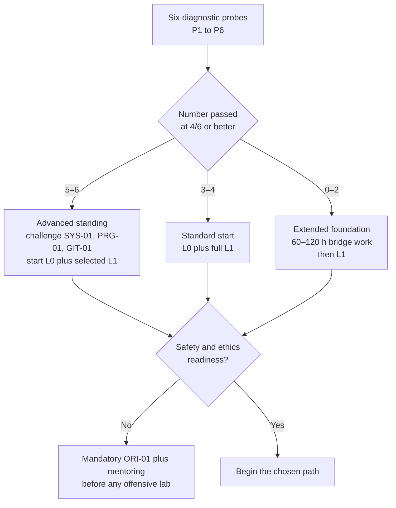

# Assumptions and Gaps

> **Status:** architecture draft. This file records what the curriculum assumes about the learner, what is likely missing, and how to diagnose it before starting.

## Table of contents

- [1. How to use this file](#1-how-to-use-this-file)
- [2. Learner assumptions](#2-learner-assumptions)
- [3. Diagnostic plan](#3-diagnostic-plan)
- [4. Likely gaps and remediation](#4-likely-gaps-and-remediation)
- [5. Environment and access constraints](#5-environment-and-access-constraints)
- [6. Risks and mitigations](#6-risks-and-mitigations)
- [7. Questions to confirm before M1](#7-questions-to-confirm-before-m1)
- [8. What changes if an assumption is wrong](#8-what-changes-if-an-assumption-is-wrong)
- [9. Review triggers](#9-review-triggers)

## 1. How to use this file

The curriculum is designed for an **experienced software developer**, not for a blank-slate beginner and not for a seasoned security specialist. That profile is an assumption, not a fact. Use this file in the first week to test the assumption and adjust the starting point.

Do not skip the diagnostic because the material "looks familiar." The goal is to find the specific gaps that will cause a lab to fail six months later, especially in memory, operating systems, networking, and statistics.

## 2. Learner assumptions

| ID | Assumption | Why it matters | Confidence |
|---|---|---|---|
| A01 | 3+ years of professional software development | The curriculum moves quickly through programming fundamentals and assumes design experience | Medium |
| A02 | Fluency in at least one of Python, JavaScript/TypeScript, Java, C#, Go, or Rust | Labs use Python and read code in several languages | High |
| A03 | C and assembly are familiar or can be refreshed quickly | `SYS-01`, `EXP-01`, `REV-01`, `MAL-01` depend on memory-level reasoning | Low |
| A04 | Git and command-line comfort | Every lab and portfolio artifact is versioned | High |
| A05 | No prior security experience assumed | Foundations start from first principles | High |
| A06 | No formal computer-science degree assumed | Architecture, OS, and networking may be gaps | Medium |
| A07 | Algebra comfort; probability, statistics, and discrete math may be rusty | `CRY-01`, `RES-02`, `RES-05` require quantitative reasoning | Low |
| A08 | 10–12 hours/week for 45+ weeks/year | Determines the 3.5–4 year full-breadth estimate | Medium |
| A09 | Apple Silicon macOS host with 16 GB RAM minimum, 32 GB recommended, 150 GB free disk | Some x86 labs need emulation or a remote x86 environment | Medium |
| A10 | Permission to run local VMs/containers and install tools | Core labs depend on isolation and snapshots | High |
| A11 | English reading proficiency for standards and papers | Primary sources are mostly English | High |
| A12 | Able to obtain written authorization for any non-synthetic testing | Offensive modules require a lawful scope | High |
| A13 | Budget of roughly €0–500/year for optional cloud, books, or hardware | The core path can be done with free/open-source tools | Medium |
| A14 | Goal is advanced practice, research, and teaching; a credential is optional | Shapes assessment and capstone design | Medium |
| A15 | AI assistant available, with disclosure and oral defense | Affects assessment integrity and learning habits | High |
| A16 | Teaching experience may be limited | `TCH-01` assumes no formal pedagogy background | Medium |

If A01, A03, A07, or A09 is false, the plan changes materially. See [section 8](#8-what-changes-if-an-assumption-is-wrong).

## 3. Diagnostic plan

### Format

Six probes, 60–90 minutes each, completed in the first week. Each is scored 0–6 against a published rubric. The probes are **diagnostic**, not gatekeeping: a low score changes the route, not the learner's worth.

| Probe | Task | Pass standard |
|---|---|---|
| P1 Memory and assembly | Given a small C program and its disassembly, identify the stack frame, calling convention, and one memory-safety bug | 4/6: correct frame and bug, plausible mitigation |
| P2 Operating systems | Use `strace` or Process Monitor to explain a file read and map the user/kernel boundary | 4/6: correct syscall chain and privilege explanation |
| P3 Networking | Capture an HTTPS request and identify DNS, TCP, TLS, and HTTP layers plus one trust decision | 4/6: correct layers and at least one failure mode |
| P4 Code security | Review a ~200-line service and find three plausible issues plus one false positive | 4/6: at least two real issues, no fabricated evidence |
| P5 Data and statistics | Given a CSV, summarize the data, choose a test, and state uncertainty | 4/6: appropriate summary, test, and caveat |
| P6 Writing | Write a one-page evidence note on a supplied log | 4/6: observation, inference, uncertainty, and source separated |

### Placement

### What the diagnostic does not measure

- Persistence, curiosity, and ability to debug for hours.
- Ethical judgment under pressure.
- Teaching ability.
- Research taste.
- Time management.

Those are assessed through the first three months of work, not a single test.

## 4. Likely gaps and remediation

| ID | Gap | Symptoms | Remediation | Added effort |
|---|---|---|---|---|
| G01 | C and assembly fluency | Cannot read a stack frame or explain pointers | C bridge, then `SYS-01`; practice with Compiler Explorer and small binaries | 40–60 h |
| G02 | OS internals | Treats syscalls, virtual memory, and scheduling as magic | `SYS-02` plus selected OSTEP/xv6 readings | 30–50 h |
| G03 | Networking depth | Cannot explain DNS, TCP states, or TLS trust | `NET-01`, `NET-02`; packet-capture drills | 20–40 h |
| G04 | Probability and statistics | Avoids uncertainty; misreads p-values | Probability/statistics bridge before `RES-02` | 40–60 h |
| G05 | Cloud and Kubernetes operations | Cannot reason about IAM, VPCs, or admission control | `CLD-01`, `CNT-01`, `K8S-01`; IaC labs | 20–40 h |
| G06 | Windows and Active Directory | Only Linux experience; AD is a black box | `SYS-04`, `AD-01`; Windows evaluation VM | 30–50 h |
| G07 | Research writing | Summarizes instead of arguing; weak citations | `ORI-03`, `RES-01`; annotated bibliography and rewrite | 20–40 h |
| G08 | Teaching and assessment design | Explains well but cannot assess understanding | `TCH-01`; observed teach-backs | 20–30 h |
| G09 | Hardware and firmware access | No device, debugger, or firmware target | `HW-01` elective; simulator or remote lab | 20–40 h |
| G10 | Authorization and legal context | Unsure what is permitted | `ORI-01`, `LAB_SAFETY.md`; organizational review | 5–10 h |
| G11 | Fragmented time | Long gaps between labs; context loss | 90-minute protected blocks; weekly minimum; lab journal | Ongoing |
| G12 | Evidence habits | Screenshots without commands; no versions | `ORI-03`; evidence template; review every lab | 5–10 h |

### Remediation rules

1. **Remediate before the dependent module, not during it.** A learner who cannot read a stack frame should not start `EXP-01` and hope to catch up.
2. **Bridge work does not count as mastery.** It prepares the learner for the module assessment; it does not waive it.
3. **Do not lower the safety bar for a motivated learner.** Motivation is not authorization or isolation.
4. **Record the bridge in the portfolio.** It is evidence of deliberate practice, not a hidden weakness.

## 5. Environment and access constraints

### Host platform

The reference host is an Apple Silicon macOS machine. This creates four constraints:

1. **Architecture.** Some x86-64 binaries and Windows labs need emulation (UTM/QEMU) or a remote x86 host. ARM64-native tools are preferred where available.
2. **Virtualization.** Decide between UTM, VMware Fusion, or a remote lab during M1. Snapshots and host-only networking are mandatory.
3. **Memory.** Running a Windows domain controller, a Linux host, and containers simultaneously needs 32 GB for comfort. At 16 GB, run labs sequentially.
4. **Disk.** Keep at least 150 GB free for VM images, snapshots, and evidence. Archive old images.

### Network

- Use **host-only** or internal networking for offensive and malware labs.
- Do not bridge a lab interface to a home or corporate network.
- Disable shared folders and clipboard sharing for malware labs unless explicitly required and documented.
- Verify isolation before every high-risk lab.

### Cloud

- Free tiers expire and change. Record the account, region, budget cap, and teardown steps.
- Prefer local emulators (`kind`, `k3d`, LocalStack, or provider emulators) for deterministic labs.
- Use one primary provider for concrete IAM/logging examples; keep concepts provider-neutral.
- Never place real credentials or customer data in a lab.

### Legal and organizational

The course cannot grant authorization. The learner must confirm:

- applicable computer-misuse and privacy law;
- organizational policy and acceptable-use rules;
- whether a lab can run on employer hardware or networks;
- data-handling and retention obligations;
- disclosure requirements for any discovered vulnerability.

## 6. Risks and mitigations

| Risk | Likelihood | Impact | Mitigation |
|---|---|---|---|
| Time slippage | High | Medium | Weekly minimum; 10–12 h target; buffer weeks; re-plan at level gates |
| Lab breakage after tool updates | High | Medium | Pin versions; snapshots; infrastructure as code; record exact environment |
| Isolation failure | Low | High | Host-only network check; no bridged adapters; pre-lab checklist; stop if uncertain |
| Legal or policy violation | Low | High | Written authorization; synthetic targets; legal review; stop conditions |
| Source drift | High | Medium | 6-month review; date-stamped claims; version-specific notes |
| AI overreliance | Medium | High | Evidence requirements; oral defense; disclose assistance; verify every citation |
| Burnout | Medium | High | One week off per eight; cohort support; reduce electives before reducing sleep |
| Hardware limits | Medium | Medium | Sequential labs; remote x86; cloud budget cap; prioritize ARM-native tools |
| Tool churn | High | Medium | Teach concepts first; isolate tool specifics in versioned notes |
| Data leakage | Low | High | Synthetic data only; no real credentials; encrypted evidence storage; deletion plan |
| Vendor lock-in in learning | Medium | Medium | Provider-neutral model plus one concrete implementation; compare two providers |
| Overfitting to one rubric | Medium | Medium | External-style review; diversify assessors; calibrate with samples |

## 7. Questions to confirm before M1

These are the questions that change the plan. They are listed here for the learner and the curriculum owner; they are not blockers for reviewing the architecture.

1. **Mathematics:** How comfortable are you with probability, statistics, discrete math, and linear algebra?
2. **Low-level code:** How much C, C++, and assembly have you written in the last two years?
3. **Cloud:** Which provider do you have access to, and what budget cap is acceptable?
4. **Windows/AD:** Do you have access to a Windows evaluation environment or an isolated AD lab?
5. **Research interest:** Which area is most likely to sustain a thesis — application security, binary exploitation, cloud, cryptography, detection, or usable security?
6. **Teaching context:** Will you teach in a classroom, a team, a conference, or one-to-one mentoring?
7. **Time:** What is a realistic weekly average, including lab blocks, over the next 12 months?
8. **Hardware:** What are your RAM, disk, and virtualization constraints?
9. **Budget:** What annual budget is available for cloud, books, hardware, or travel?
10. **Authorization:** What is your jurisdiction, and can you obtain written authorization for any non-synthetic testing?
11. **Accessibility:** Do you need captions, screen-reader-compatible materials, larger text, or alternative assessment formats?
12. **Assessment preference:** Do you prefer written reports, oral defenses, code artifacts, or a mix?

## 8. What changes if an assumption is wrong

| If this is false | Consequence | Change |
|---|---|---|
| A01: 3+ years development | Programming and design load is too high | Add a 60–100 h programming/design bridge; delay L2 |
| A03: C/assembly fluency | Binary and malware modules will fail | Add G01 remediation; move `EXP-01` later; consider the AppSec path first |
| A07: math comfort | Cryptography and research methods become bottlenecks | Add a 40–60 h probability/discrete-math bridge; pair with `RES-02` |
| A08: 10–12 h/week | The 3.5–4 year estimate is unrealistic | Extend timeline or reduce electives; do not compress labs |
| A09: 16 GB RAM | Parallel Windows/Linux/container labs thrash | Run sequentially; use remote x86; reduce simultaneous VMs |
| A12: authorization unavailable | Offensive labs cannot run lawfully | Restrict to synthetic/owned labs; defer offensive modules; emphasize defensive and research paths |
| A14: credential is the goal | The curriculum may not match the credential's objectives | Add a certification crosswalk; do not claim equivalence |
| A15: no AI assistant | Some drafting and review workflows change | Use templates and peer review; oral defense remains |

## 9. Review triggers

Re-run the diagnostic and revisit this file when:

- a level gate is failed twice;
- a lab cannot be reproduced on a clean environment;
- the learner changes path or adds a second specialization;
- a new hardware, cloud, or legal constraint appears;
- the learner reports persistent fatigue or loss of motivation;
- a major standard or tool release changes the prerequisite assumptions.

The assumptions are not a contract. They are a hypothesis about the learner, and hypotheses are meant to be tested.
