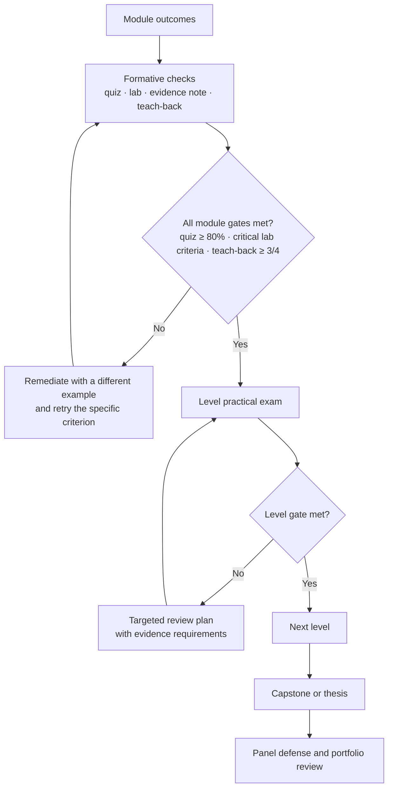

# Course Map

> **Status:** architecture draft `0.1.0`. 61 modules are `planned` and `unvalidated`; SYS-01, SYS-02, RES-01, RES-02, RES-06, and RES-07 are `drafted` and `structural`. This is a syllabus and dependency design, not a finished course.

## Table of contents

- [1. Purpose and scope](#1-purpose-and-scope)
- [2. Design axioms](#2-design-axioms)
- [3. Level architecture](#3-level-architecture)
- [4. Cross-cutting strands](#4-cross-cutting-strands)
- [5. Dependency logic](#5-dependency-logic)
- [6. Module catalog](#6-module-catalog)
- [7. Assessment and mastery strategy](#7-assessment-and-mastery-strategy)
- [8. Milestones and sequencing](#8-milestones-and-sequencing)
- [9. Definition of done for a module](#9-definition-of-done-for-a-module)
- [10. Safety gate](#10-safety-gate)
- [11. Open decisions](#11-open-decisions)
- [Appendix A: effort summary](#appendix-a-effort-summary)

## 1. Purpose and scope

This curriculum takes an experienced software developer from **systems fundamentals** to **advanced professional practice** and **research-level contribution**. It is designed around three products of mastery:

1. **Technical judgment** — the ability to explain why a system fails, build a defensible control, and prove that it works.
2. **Evidence** — reproducible labs, telemetry, timelines, threat models, and written analyses that another expert can audit.
3. **Contribution** — the ability to teach, review, disclose responsibly, and produce original research.

The scope is broad by design: architecture, operating systems, networking, programming, cryptography, identity, application security, web/API security, databases, cloud, containers, Kubernetes, Active Directory, vulnerability management, penetration testing, red/blue/purple teaming, SIEM, incident response, forensics, malware analysis, threat intelligence, reverse engineering, memory safety, exploit mitigations, security architecture, risk, governance, compliance, privacy, leadership, and academic research.

**Out of scope for this milestone:** authored lessons, tested labs, recorded command output, benchmark results, and claims of mastery. Those require the module-level work defined in [section 9](#9-definition-of-done-for-a-module).

## 2. Design axioms

1. **Systems before techniques.** Exploitation, detection, and forensics are downstream of a correct mental model of memory, operating systems, and networks.
2. **Evidence over assertion.** A lab is not complete because a command was typed; it is complete when the result is captured, explained, and reproducible.
3. **Offense and defense are paired.** Every offensive technique is studied with its telemetry, detection, mitigation, and legal boundary.
4. **Authorization and isolation precede tools.** No offensive lab runs without a scoped authorization and an isolated environment.
5. **Depth plus breadth.** Every learner goes deep in one specialization while retaining enough breadth to reason across domains.
6. **Research starts on day one.** Evidence notes, source discipline, and reproduction logs begin in orientation, not in the thesis.
7. **Teaching is a mastery test.** If you cannot explain a concept, design a practice exercise, and assess a learner, you do not yet own it.
8. **Reproducibility is a security property.** Version pins, environment records, and cleanup are part of the result.
9. **Uncertainty is explicit.** Established facts, assumptions, disputed claims, and version-dependent details are labeled differently.
10. **No fabricated evidence.** CVEs, command output, benchmarks, citations, and tool capabilities are verified or marked unknown.

## 3. Level architecture

| Level | Name | Purpose | Modules | Hours | Exit gate |
|---|---|---|---:|---:|---|
| L0 | Orientation and labcraft | Operate safely and legally; write evidence-grade reports; reason about threats | 3 | 30 | Lab-readiness inspection; authorization memo; threat model |
| L1 | Systems foundations | Explain and measure the systems security depends on | 12 | 272 | 4-hour practical: trace, capture, and explain a system |
| L2 | Core security practice | Build, assess, and defend a small system end to end | 12 | 286 | 8-hour integrated practical plus portfolio review |
| L3 | Advanced specialization | Perform deep technical work in at least one domain | 17 | 496 | 12-hour specialization practical plus written analysis |
| L4 | Expert practice and leadership | Design programs and architectures; lead incidents; validate controls; teach | 11 | 306 | Capstone proposal defense and leadership simulation |
| L5 | Research and contribution | Formulate and execute original, ethical, reproducible research | 7 | 180 | Thesis proposal, thesis, and oral defense |
| — | Capstones | Integrative exit artifacts | 5 | 380 | Panel defense against a published rubric |
| **Total** | | | **67** | **1,950** | |

The L3 count includes two electives (`MOB-01`, `ICS-01`); L4 includes one elective (`HW-01`). The full breadth is a reference design, not a requirement to complete every elective. A single learning path is 784–1,164 hours; see [`LEARNING_PATHS.md`](./LEARNING_PATHS.md).

### What each level is *not*

- **L0 is not a formality.** A learner who cannot isolate a lab, preserve evidence, and state the legal boundary does not proceed to offensive material.
- **L1 is not a vocabulary tour.** Each foundation module requires measurement: a syscall trace, packet capture, disassembly, crypto misuse demonstration, or query test.
- **L2 is not tool training.** Tools change; the level tests reasoning about trust boundaries, inputs, state, and evidence.
- **L3 is not a certificate track.** It is a depth test with a reproducible artifact.
- **L4 is not management-only.** It requires technical review, architecture decisions, and control validation.
- **L5 is not a literature summary.** It requires an original question, a defensible method, and a reproducible result.

## 4. Cross-cutting strands

| Strand | Where it appears | Evidence of mastery |
|---|---|---|
| Evidence and reproducibility | `ORI-03`, `RES-02`, every lab | Reproduction log; artifact hashes; clean-environment rerun |
| Safety, law, and ethics | `ORI-01`, `RES-06`, every offensive lab | Authorization memo; isolation check; disclosure plan |
| Adversary/defender pairing | `EXP` ↔ `LOG`/`IR`, `RED` ↔ `PUR`, `MAL` ↔ `FOR` | Attack path plus detection and mitigation |
| Architecture and engineering | `SEC-01`, `ARC-01`, `SRE-01`, `PDE-01` | Reference architecture; decision record; game day |
| Governance, risk, and privacy | `RSK-01`, `GOV-01`, `PRI-01` | Risk assessment; control matrix; DPIA |
| Research methods | `RES-01`–`RES-07`, `ORI-03` | Proposal; pre-registration; thesis |
| Teaching and assessment | `TCH-01`, every teach-back | Lesson plan; observed teaching; rubric calibration |
| AI-era security | `AI-01`, `RES-05` | ATLAS/LLM threat model; misuse tests |
| Supply chain | `GIT-01`, `SCS-01`, `CNT-01` | Provenance pipeline; SBOM; signature verification |
| Communication | Every report and debrief | Executive summary; technical appendix; oral defense |

## 5. Dependency logic

The prerequisite graph is a **directed acyclic graph**. An arrow means "is a prerequisite of." The complete graph is in [`diagrams/dependency-graph.md`](./diagrams/dependency-graph.md), split into nine readable views. The machine-readable edge list is in [`manifest/course-manifest.yaml`](./manifest/course-manifest.yaml).

Three rules govern the design:

1. **No higher-level dependency.** A module may not require a module at a higher level. Capstones sit at L5 and depend only on L4 or lower; they are not exempt from the rule.
2. **No orphan modules.** Every non-elective module appears in at least one learning path. Electives are reachable from a path or a specialization.
3. **No path is closed by assumption.** Each path is checked to contain every prerequisite of every module it lists.

## 6. Module catalog

The catalog below is generated from the manifest. Each entry states the level, type, effort split (reading / practice / assessment), status, validation status, tracks, prerequisites, measurable outcomes, assessment, and source IDs.

**Status legend:** `planned` → `drafted` → `reviewed` → `lab_validated` → `published`. **Validation legend:** `unvalidated` → `structural` → `technical` → `safety_reviewed` → `peer_reviewed` → `classroom_tested`.

## Level 0 — Orientation and labcraft

**Exit criterion:** Operate safely and legally; write evidence-grade reports; reason about threats.

**Modules:** 3 · **Effort:** 30 h

### ORI-01: Security Mindset, Ethics, Law, and Labcraft

`L0` · `module` · **12 h** (R4 / P6 / A2) · status `planned` · validation `unvalidated`  
**Tracks:** core  
**Prerequisites:** None  

**Measurable outcomes**

1. **ORI-01.O1** — Classify five incident scenarios by the security property violated (confidentiality, integrity, availability, authenticity, accountability) with at least 80% agreement against the answer key.
2. **ORI-01.O2** — Build an isolated lab with a host-only network, snapshots, and synthetic data, and demonstrate rollback after a deliberate misconfiguration using a timestamped lab journal.
3. **ORI-01.O3** — Write a scoped authorization memo containing rules of engagement, stop conditions, data-handling rules, and legal caveats for a simulated engagement.

**Assessment:** Quiz; lab-build inspection; authorization-memo review.  
**Sources:** N01, N11, N23

### ORI-02: Threat Modeling Foundations

`L0` · `module` · **10 h** (R3 / P5 / A2) · status `planned` · validation `unvalidated`  
**Tracks:** core  
**Prerequisites:** ORI-01  

**Measurable outcomes**

1. **ORI-02.O1** — Produce a data-flow diagram for a three-tier application that identifies assets, actors, trust boundaries, and attack surface.
2. **ORI-02.O2** — Apply STRIDE and LINDDUN to the same design and record at least ten credible threats with likelihood, impact, and a mapped mitigation or acceptance decision.
3. **ORI-02.O3** — Critique a supplied threat model for unstated assumptions and propose three validation tests that would confirm or refute its highest risks.

**Assessment:** Threat-model review; threat register; oral critique.  
**Sources:** N01, N34, O08, B03

### ORI-03: Technical Writing, Evidence, and Reproducibility

`L0` · `module` · **8 h** (R3 / P4 / A1) · status `planned` · validation `unvalidated`  
**Tracks:** core, research  
**Prerequisites:** ORI-01  

**Measurable outcomes**

1. **ORI-03.O1** — Write an evidence note that separates observation, inference, uncertainty, and source for a technical claim.
2. **ORI-03.O2** — Produce a reproducible lab report containing environment, versions, commands, expected versus actual results, artifacts, and cleanup.
3. **ORI-03.O3** — Review a peer report against a reproducibility rubric and identify at least three defects with concrete corrections.

**Assessment:** Evidence note; reproducible lab report; peer review.  
**Sources:** N11, N14, A18, A19

## Level 1 — Systems foundations

**Exit criterion:** Explain and measure the systems security depends on: hardware, OS, networks, code, cryptography, identity, data, and supply chain.

**Modules:** 12 · **Effort:** 272 h

### SYS-01: Computer Architecture and Memory

`L1` · `module` · **28 h** (R10 / P14 / A4) · status `drafted` · validation `structural`  
**Tracks:** core  
**Prerequisites:** ORI-01  

**Measurable outcomes**

1. **SYS-01.O1** — Explain fetch-decode-execute, register use, caches, virtual memory, and stack/heap layout, and trace a C function call at the instruction level.
2. **SYS-01.O2** — Given a compiled x86-64 or ARM64 binary, annotate its sections, calling convention, and memory layout using readelf/objdump or equivalent tools.
3. **SYS-01.O3** — Evaluate how NX, ASLR, canaries, and speculative execution affect both security and performance in a written analysis.

**Assessment:** Quiz; annotated disassembly; oral trace.  
**Sources:** B06, B09, A08

### SYS-02: Operating Systems Internals

`L1` · `module` · **32 h** (R12 / P16 / A4) · status `drafted` · validation `structural`  
**Tracks:** core  
**Prerequisites:** SYS-01  

**Measurable outcomes**

1. **SYS-02.O1** — Explain process and thread lifecycle, scheduling, syscalls, file descriptors, credentials, and user/kernel transitions.
2. **SYS-02.O2** — Trace a program's syscalls and map observed behavior to kernel abstractions using strace or equivalent syscall-tracing tooling.
3. **SYS-02.O3** — Analyze a privilege-boundary violation scenario and identify the kernel control that failed and the evidence that would confirm it.

**Assessment:** Quiz; syscall-trace lab; failure analysis.  
**Sources:** B09, B06, T09

### SYS-03: Linux Administration and Hardening

`L1` · `module` · **22 h** (R8 / P12 / A2) · status `planned` · validation `unvalidated`  
**Tracks:** core  
**Prerequisites:** SYS-02  

**Measurable outcomes**

1. **SYS-03.O1** — Provision a Linux system with users, groups, permissions, ACLs, systemd services, and package-integrity checks.
2. **SYS-03.O2** — Apply a documented subset of CIS Linux Benchmark Level 1 controls and justify every deviation with a risk decision.
3. **SYS-03.O3** — Diagnose a misconfigured service from logs and least-privilege analysis, then verify the remediation.

**Assessment:** Provisioning lab; benchmark evidence; remediation report.  
**Sources:** N35, C05, B01

### SYS-04: Windows Architecture, Registry, NTFS, and AD Preview

`L1` · `module` · **28 h** (R10 / P14 / A4) · status `planned` · validation `unvalidated`  
**Tracks:** core  
**Prerequisites:** SYS-02  

**Measurable outcomes**

1. **SYS-04.O1** — Explain the Windows object manager, registry hives, NTFS permissions, service model, token model, and core event logs.
2. **SYS-04.O2** — Audit users, services, scheduled tasks, and ACLs with native tools and produce a baseline suitable for later comparison.
3. **SYS-04.O3** — Map a Windows persistence technique to its filesystem, registry, and event-log artifacts, and state which artifact is most reliable.

**Assessment:** Audit lab; artifact-mapping report; quiz.  
**Sources:** B09, T09, M01

### NET-01: Networking and TCP/IP

`L1` · `module` · **30 h** (R12 / P14 / A4) · status `planned` · validation `unvalidated`  
**Tracks:** core  
**Prerequisites:** SYS-01  

**Measurable outcomes**

1. **NET-01.O1** — Explain encapsulation, ARP, IPv4/IPv6 addressing, TCP/UDP behavior, routing, NAT, and ICMP, and solve subnetting problems without tools.
2. **NET-01.O2** — Capture and analyze traffic with tcpdump and Wireshark, reconstruct a TCP session, and identify at least three anomalies.
3. **NET-01.O3** — Diagnose a connectivity or segmentation failure using a layered method and document the evidence at each layer.

**Assessment:** Subnetting quiz; packet-analysis lab; troubleshooting report.  
**Sources:** P08, B14

### NET-02: DNS, HTTP, and TLS

`L1` · `module` · **22 h** (R8 / P12 / A2) · status `planned` · validation `unvalidated`  
**Tracks:** core  
**Prerequisites:** NET-01  

**Measurable outcomes**

1. **NET-02.O1** — Explain DNS resolution and caching, HTTP semantics, cookies, CORS, and the TLS 1.3 handshake.
2. **NET-02.O2** — Trace an HTTPS request from name resolution through TLS completion and identify each trust decision and failure mode.
3. **NET-02.O3** — Analyze a dangling DNS record, permissive CORS policy, or weak TLS configuration and propose detection and remediation.

**Assessment:** Protocol trace; misconfiguration analysis; quiz.  
**Sources:** P05, P06, P07, P11, P12

### PRG-01: Python for Security Engineering

`L1` · `module` · **20 h** (R6 / P12 / A2) · status `planned` · validation `unvalidated`  
**Tracks:** core  
**Prerequisites:** ORI-01  

**Measurable outcomes**

1. **PRG-01.O1** — Write tested Python tools for file parsing, HTTP requests, sockets, and process inspection with explicit error handling.
2. **PRG-01.O2** — Build a log normalizer that converts heterogeneous inputs into validated JSON and passes a supplied test suite.
3. **PRG-01.O3** — Review a security tool for command injection, unsafe deserialization, path traversal, and dependency risk, and propose fixes.

**Assessment:** Tool build with tests; code review.  
**Sources:** O09, B12, O01

### PRG-02: Bash and PowerShell for Operators

`L1` · `module` · **12 h** (R4 / P7 / A1) · status `planned` · validation `unvalidated`  
**Tracks:** core  
**Prerequisites:** SYS-03, SYS-04  

**Measurable outcomes**

1. **PRG-02.O1** — Write idempotent Bash and PowerShell scripts with strict error handling, logging, and dry-run modes.
2. **PRG-02.O2** — Automate an evidence-collection task that preserves timestamps and hashes and documents chain of custody.
3. **PRG-02.O3** — Compare Linux and Windows shell telemetry and explain which artifacts each leaves for defenders.

**Assessment:** Scripted collection lab; evidence-integrity check.  
**Sources:** N14, T09, B14

### CRY-01: Cryptography Foundations

`L1` · `module` · **32 h** (R12 / P16 / A4) · status `planned` · validation `unvalidated`  
**Tracks:** core  
**Prerequisites:** NET-01, PRG-01  

**Measurable outcomes**

1. **CRY-01.O1** — Explain confidentiality, integrity, authenticity, key exchange, and the assumptions behind common cryptographic security definitions.
2. **CRY-01.O2** — Correctly apply symmetric encryption, hashing, MACs, KDFs, and signatures with a vetted library, and demonstrate one realistic misuse failure.
3. **CRY-01.O3** — Analyze a protocol for replay, downgrade, key-reuse, and nonce-reuse risks and justify concrete fixes.

**Assessment:** Misuse lab; protocol analysis; quiz.  
**Sources:** B02, B04, B05, N36

### IAM-01: Identity and Access Management Foundations

`L1` · `module` · **18 h** (R6 / P10 / A2) · status `planned` · validation `unvalidated`  
**Tracks:** core  
**Prerequisites:** NET-02, CRY-01  

**Measurable outcomes**

1. **IAM-01.O1** — Explain authentication factors, session management, OAuth 2.0/OIDC, SAML, and RBAC/ABAC/ReBAC authorization models.
2. **IAM-01.O2** — Implement and test a login and token-validation flow against CSRF, session fixation, open redirect, and token replay.
3. **IAM-01.O3** — Threat-model an identity architecture and identify at least three trust-boundary failures with mitigations.

**Assessment:** Auth-flow implementation; security tests; threat model.  
**Sources:** N04, P09, P10, O02

### DAT-01: Data and Database Security

`L1` · `module` · **16 h** (R6 / P8 / A2) · status `planned` · validation `unvalidated`  
**Tracks:** core  
**Prerequisites:** NET-02, IAM-01  

**Measurable outcomes**

1. **DAT-01.O1** — Explain data classification, encryption at rest and in transit, key management, backup integrity, and retention.
2. **DAT-01.O2** — Exploit and remediate SQL injection and excessive database privileges in a local intentionally vulnerable application.
3. **DAT-01.O3** — Design a data-protection control set mapped to NIST CSF 2.0 functions and privacy principles.

**Assessment:** SQLi lab; data-protection design review.  
**Sources:** O09, N01, O02

### GIT-01: Git, CI/CD, and Supply Chain Foundations

`L1` · `module` · **12 h** (R4 / P7 / A1) · status `planned` · validation `unvalidated`  
**Tracks:** core  
**Prerequisites:** PRG-01  

**Measurable outcomes**

1. **GIT-01.O1** — Explain the Git object model, branching, signed commits, and CI/CD trust boundaries.
2. **GIT-01.O2** — Build a pipeline with dependency pinning, SBOM generation, artifact signing, and verification.
3. **GIT-01.O3** — Analyze a software supply-chain attack path and identify preventive and detective controls at each stage.

**Assessment:** Pipeline lab; supply-chain analysis.  
**Sources:** P01, C04, P02, P03

## Level 2 — Core security practice

**Exit criterion:** Build, assess, and defend a small system end to end; produce detection and response evidence.

**Modules:** 12 · **Effort:** 286 h

### SEC-01: Secure Design Principles and Architecture

`L2` · `module` · **24 h** (R9 / P12 / A3) · status `planned` · validation `unvalidated`  
**Tracks:** core  
**Prerequisites:** ORI-02, SYS-02, NET-02  

**Measurable outcomes**

1. **SEC-01.O1** — Apply least privilege, fail-safe defaults, complete mediation, separation of duties, and economy of mechanism to a system design.
2. **SEC-01.O2** — Produce a security architecture review containing trust boundaries, data flows, assumptions, and prioritized risks.
3. **SEC-01.O3** — Compare defense-in-depth and single-control designs using a threat model plus cost, operability, and failure-mode analysis.

**Assessment:** Architecture review; design trade-off memo.  
**Sources:** A01, N07, O02

### APP-01: Application Security Fundamentals

`L2` · `module` · **32 h** (R10 / P18 / A4) · status `planned` · validation `unvalidated`  
**Tracks:** core  
**Prerequisites:** SEC-01, PRG-01, NET-02  

**Measurable outcomes**

1. **APP-01.O1** — Explain input handling, output encoding, authentication, session management, access control, and error-handling vulnerability classes.
2. **APP-01.O2** — Find and fix at least ten vulnerability classes in an intentionally vulnerable application, with regression tests proving each fix.
3. **APP-01.O3** — Integrate SAST, DAST, and dependency scanning into CI and triage findings by exploitability and reachability.

**Assessment:** Vulnerability-fix lab with regression tests; CI triage report.  
**Sources:** O01, O02, O09, B12

### WEB-01: Web Security Deep Dive

`L2` · `module` · **36 h** (R12 / P20 / A4) · status `planned` · validation `unvalidated`  
**Tracks:** core  
**Prerequisites:** APP-01  

**Measurable outcomes**

1. **WEB-01.O1** — Explain the browser security model: same-origin policy, CORS, CSP, cookies, storage, and DOM sinks.
2. **WEB-01.O2** — Demonstrate and remediate XSS, CSRF, SSRF, IDOR, insecure deserialization, and request smuggling in a local lab.
3. **WEB-01.O3** — Perform a manual assessment against OWASP WSTG and produce a risk-ranked report with reproducible evidence.

**Assessment:** WSTG assessment report; remediation tests.  
**Sources:** O03, B11, P06, P12

### API-01: API Security

`L2` · `module` · **20 h** (R7 / P11 / A2) · status `planned` · validation `unvalidated`  
**Tracks:** core  
**Prerequisites:** WEB-01  

**Measurable outcomes**

1. **API-01.O1** — Explain REST, GraphQL, and gRPC authentication and authorization, object-level authorization, rate limiting, and schema validation.
2. **API-01.O2** — Test an API for BOLA, BFLA, mass assignment, and excessive data exposure, then implement and verify fixes.
3. **API-01.O3** — Design an API gateway policy with authentication, authorization, validation, and abuse-detection requirements.

**Assessment:** API test suite; gateway-policy review.  
**Sources:** O04, O02, P06

### VUL-01: Vulnerability Management and Risk-Based Prioritization

`L2` · `module` · **20 h** (R8 / P10 / A2) · status `planned` · validation `unvalidated`  
**Tracks:** core  
**Prerequisites:** SEC-01, NET-01  

**Measurable outcomes**

1. **VUL-01.O1** — Explain CVE, CWE, CVSS v4.0, EPSS, and CISA KEV, including what each metric does and does not measure.
2. **VUL-01.O2** — Build a prioritization model that combines exploitability, exposure, business impact, and compensating controls.
3. **VUL-01.O3** — Evaluate a vulnerability-management program's metrics and propose three evidence-based improvements.

**Assessment:** Prioritization model; program-evaluation memo.  
**Sources:** C01, C02, C03, N11

### NET-03: Network Security and Defenses

`L2` · `module` · **28 h** (R10 / P14 / A4) · status `planned` · validation `unvalidated`  
**Tracks:** core  
**Prerequisites:** NET-01, NET-02, CRY-01  

**Measurable outcomes**

1. **NET-03.O1** — Explain segmentation, firewalls, IDS/IPS, VPNs, zero trust, and the limits of encrypted-traffic inspection.
2. **NET-03.O2** — Configure a segmented lab and detect a simulated lateral-movement attempt with network telemetry.
3. **NET-03.O3** — Evaluate a network defense design against a threat model and identify at least three blind spots.

**Assessment:** Segmentation lab; detection evidence; design review.  
**Sources:** N05, N25, N26, P05

### END-01: Endpoint Security and EDR

`L2` · `module` · **20 h** (R7 / P11 / A2) · status `planned` · validation `unvalidated`  
**Tracks:** core  
**Prerequisites:** SYS-03, SYS-04  

**Measurable outcomes**

1. **END-01.O1** — Explain endpoint telemetry sources, EDR detection logic, allowlisting, and hardening baselines.
2. **END-01.O2** — Deploy a lab telemetry agent, detect a simulated ATT&CK technique, and tune one false-positive source.
3. **END-01.O3** — Assess endpoint coverage against ATT&CK and propose prioritized gap remediation.

**Assessment:** Telemetry lab; coverage assessment.  
**Sources:** M01, T09, N27

### LOG-01: Logging, Telemetry, and Detection Engineering I

`L2` · `module` · **26 h** (R9 / P14 / A3) · status `planned` · validation `unvalidated`  
**Tracks:** core  
**Prerequisites:** SYS-03, SYS-04, NET-01  

**Measurable outcomes**

1. **LOG-01.O1** — Explain log sources, schemas, normalization, time synchronization, retention, and evidence handling.
2. **LOG-01.O2** — Build a pipeline that ingests Linux, Windows, and network logs and supports structured queries.
3. **LOG-01.O3** — Write and test ten detections mapped to ATT&CK, reporting precision and recall on synthetic data.

**Assessment:** Pipeline lab; detection tests with metrics.  
**Sources:** N10, T01, M01

### IR-01: Incident Response Foundations

`L2` · `module` · **20 h** (R7 / P11 / A2) · status `planned` · validation `unvalidated`  
**Tracks:** core  
**Prerequisites:** LOG-01  

**Measurable outcomes**

1. **IR-01.O1** — Explain the incident-response lifecycle and its alignment with NIST CSF 2.0.
2. **IR-01.O2** — Run a tabletop and a lab incident from detection through containment while preserving evidence.
3. **IR-01.O3** — Write an after-action report with timeline, root cause, impact, and corrective actions.

**Assessment:** Tabletop; lab incident; after-action report.  
**Sources:** N03, N15, N01

### RSK-01: Risk Management and Security Governance

`L2` · `module` · **18 h** (R7 / P9 / A2) · status `planned` · validation `unvalidated`  
**Tracks:** core  
**Prerequisites:** ORI-02  

**Measurable outcomes**

1. **RSK-01.O1** — Explain risk appetite, qualitative and quantitative assessment, control frameworks, and three-lines-of-defense roles.
2. **RSK-01.O2** — Perform a risk assessment for a scenario and justify treatment choices with explicit assumptions.
3. **RSK-01.O3** — Map controls to NIST CSF 2.0 and ISO/IEC 27001:2022 and identify gaps and duplicate controls.

**Assessment:** Risk assessment; control mapping.  
**Sources:** N09, N08, N01, I01

### CLD-01: Cloud Security Foundations

`L2` · `module` · **24 h** (R8 / P13 / A3) · status `planned` · validation `unvalidated`  
**Tracks:** core  
**Prerequisites:** NET-03, IAM-01  

**Measurable outcomes**

1. **CLD-01.O1** — Explain shared responsibility, cloud identity, network isolation, key management, and cloud logging.
2. **CLD-01.O2** — Build a hardened baseline in one cloud or local emulator using infrastructure as code and policy as code.
3. **CLD-01.O3** — Analyze a cloud attack path and map each step to preventive and detective controls.

**Assessment:** IaC baseline; attack-path analysis.  
**Sources:** N30, N31, N05, N33

### CNT-01: Container Security Foundations

`L2` · `module` · **18 h** (R6 / P10 / A2) · status `planned` · validation `unvalidated`  
**Tracks:** core  
**Prerequisites:** SYS-03, GIT-01  

**Measurable outcomes**

1. **CNT-01.O1** — Explain namespaces, cgroups, capabilities, seccomp, image layers, and registry trust.
2. **CNT-01.O2** — Build a minimal image, scan it, sign it, and run it with least privilege and a read-only filesystem.
3. **CNT-01.O3** — Analyze container escape and supply-chain risks and propose layered mitigations.

**Assessment:** Image build/sign/run lab; escape analysis.  
**Sources:** N12, O10, B10

## Level 3 — Advanced specialization

**Exit criterion:** Perform deep technical work in at least one of binary, cloud, identity, detection, forensics, or AI security.

**Modules:** 17 · **Effort:** 496 h

### EXP-01: Memory Safety and Exploit Mitigations

`L3` · `module` · **36 h** (R12 / P20 / A4) · status `planned` · validation `unvalidated`  
**Tracks:** offsec, research  
**Prerequisites:** SYS-01, SYS-02, PRG-01  

**Measurable outcomes**

1. **EXP-01.O1** — Explain stack and heap overflows, use-after-free, integer errors, and type confusion at the memory level.
2. **EXP-01.O2** — Exploit a purpose-built vulnerable binary with NX, ASLR, and canaries enabled, and explain each mitigation's effect.
3. **EXP-01.O3** — Evaluate CFI, shadow stacks, and memory-safe languages for coverage, performance, and bypass classes.

**Assessment:** Mitigation-bypass lab; mitigation evaluation.  
**Sources:** A08, A09, A10, B06

### EXP-02: Binary Exploitation

`L3` · `module` · **40 h** (R10 / P26 / A4) · status `planned` · validation `unvalidated`  
**Tracks:** offsec  
**Prerequisites:** EXP-01  

**Measurable outcomes**

1. **EXP-02.O1** — Develop reliable exploits for heap, ROP, and format-string scenarios in an isolated CTF-style lab.
2. **EXP-02.O2** — Build an exploit that bypasses ASLR, NX, and PIE, and document reliability across runs.
3. **EXP-02.O3** — Propose and test a mitigation or detection that raises the cost of the demonstrated exploit.

**Assessment:** Exploit-development lab; reliability report.  
**Sources:** A07, B06, T08

### REV-01: Reverse Engineering Fundamentals

`L3` · `module` · **32 h** (R10 / P18 / A4) · status `planned` · validation `unvalidated`  
**Tracks:** offsec, defense, research  
**Prerequisites:** SYS-01, SYS-04, PRG-01  

**Measurable outcomes**

1. **REV-01.O1** — Explain executable formats, linking, calling conventions, and control-flow reconstruction.
2. **REV-01.O2** — Reverse a small binary with static and dynamic tools and recover its core algorithm and key logic.
3. **REV-01.O3** — Produce a reproducible analysis report that separates evidence, inference, and uncertainty.

**Assessment:** Binary-analysis report; oral defense.  
**Sources:** B06, B13, T08

### MAL-01: Malware Analysis in Isolated Labs

`L3` · `module` · **36 h** (R10 / P22 / A4) · status `planned` · validation `unvalidated`  
**Tracks:** offsec, defense, research  
**Prerequisites:** REV-01, NET-01  

**Measurable outcomes**

1. **MAL-01.O1** — Explain malware taxonomy, infection vectors, persistence, command-and-control, and anti-analysis techniques.
2. **MAL-01.O2** — Perform static and dynamic analysis of synthetic malware in an isolated lab and produce IOCs plus an ATT&CK mapping.
3. **MAL-01.O3** — Evaluate containment and detection coverage for the analyzed sample and identify residual risk.

**Assessment:** Isolated analysis lab; IOC/ATT&CK report.  
**Sources:** N27, B07, M01, T02

### AD-01: Active Directory Attack and Defense

`L3` · `module` · **36 h** (R12 / P20 / A4) · status `planned` · validation `unvalidated`  
**Tracks:** offsec, defense  
**Prerequisites:** SYS-04, NET-03  

**Measurable outcomes**

1. **AD-01.O1** — Explain AD DS, Kerberos, LDAP, Group Policy, trusts, and delegation.
2. **AD-01.O2** — Demonstrate and detect credential abuse and privilege-escalation paths in a lab domain.
3. **AD-01.O3** — Design tiered administration and monitoring controls that address the demonstrated paths.

**Assessment:** AD lab; detection evidence; tiering design.  
**Sources:** B09, M01, T09

### CLD-02: Cloud Security Engineering

`L3` · `module` · **32 h** (R10 / P18 / A4) · status `planned` · validation `unvalidated`  
**Tracks:** seceng, offsec  
**Prerequisites:** CLD-01, IAM-01  

**Measurable outcomes**

1. **CLD-02.O1** — Design a multi-account cloud landing zone with identity, network, logging, and guardrail boundaries.
2. **CLD-02.O2** — Implement policy as code, workload identity, and centralized detection, then test misconfiguration response.
3. **CLD-02.O3** — Threat-model a cloud-native workload and prioritize controls by expected risk reduction.

**Assessment:** Landing-zone lab; policy tests; threat model.  
**Sources:** N33, N05, B16

### K8S-01: Kubernetes Security

`L3` · `module` · **28 h** (R9 / P15 / A4) · status `planned` · validation `unvalidated`  
**Tracks:** seceng, offsec, defense  
**Prerequisites:** CNT-01, CLD-01  

**Measurable outcomes**

1. **K8S-01.O1** — Explain control-plane security, admission control, RBAC, network policy, secrets, and runtime isolation.
2. **K8S-01.O2** — Harden a lab cluster and detect a simulated compromise using audit logs and runtime telemetry.
3. **K8S-01.O3** — Evaluate multi-tenancy and supply-chain risks for a Kubernetes platform.

**Assessment:** Cluster-hardening lab; audit-log detection.  
**Sources:** T10, T11, N12

### LOG-02: Detection Engineering II and SIEM

`L3` · `module` · **32 h** (R10 / P18 / A4) · status `planned` · validation `unvalidated`  
**Tracks:** defense, research  
**Prerequisites:** LOG-01, NET-03  

**Measurable outcomes**

1. **LOG-02.O1** — Design detection as code with version control, unit tests, staging, and rollback.
2. **LOG-02.O2** — Build a SIEM pipeline and implement correlation or behavioral analytics on synthetic data.
3. **LOG-02.O3** — Measure detection quality and reduce alert fatigue using precision, recall, and analyst-cost metrics.

**Assessment:** Detection-as-code repo; SIEM lab; quality metrics.  
**Sources:** T01, M01, M02, N10

### IR-02: Incident Response and Crisis Management

`L3` · `module` · **28 h** (R9 / P15 / A4) · status `planned` · validation `unvalidated`  
**Tracks:** defense  
**Prerequisites:** IR-01, LOG-02  

**Measurable outcomes**

1. **IR-02.O1** — Lead a multi-team incident with escalation, communication, and legal/privacy coordination.
2. **IR-02.O2** — Run a ransomware tabletop and produce a decision log with authorities, trade-offs, and timing.
3. **IR-02.O3** — Evaluate incident-response readiness using maturity metrics and a remediation roadmap.

**Assessment:** Crisis simulation; decision log; readiness assessment.  
**Sources:** N03, N15, N01

### FOR-01: Digital Forensics

`L3` · `module` · **32 h** (R10 / P18 / A4) · status `planned` · validation `unvalidated`  
**Tracks:** defense, research  
**Prerequisites:** SYS-03, SYS-04, IR-01  

**Measurable outcomes**

1. **FOR-01.O1** — Explain forensic process, evidence integrity, chain of custody, and order of volatility.
2. **FOR-01.O2** — Acquire and analyze disk, memory, and log artifacts from a lab image and produce a correlated timeline.
3. **FOR-01.O3** — Defend findings under peer review and state the limitations of the analysis.

**Assessment:** Acquisition lab; timeline; peer review.  
**Sources:** N14, N28, B08

### TI-01: Threat Intelligence

`L3` · `module` · **22 h** (R8 / P12 / A2) · status `planned` · validation `unvalidated`  
**Tracks:** offsec, defense  
**Prerequisites:** LOG-01, NET-01  

**Measurable outcomes**

1. **TI-01.O1** — Explain the intelligence cycle, sourcing, confidence language, and structured analytic techniques.
2. **TI-01.O2** — Produce a threat-intelligence report with ATT&CK mapping and validated indicators.
3. **TI-01.O3** — Evaluate intelligence quality, bias, and source reliability using a documented rubric.

**Assessment:** Intelligence report; source evaluation.  
**Sources:** N29, M01, C03

### CRY-02: Applied Cryptography Engineering

`L3` · `module` · **28 h** (R10 / P14 / A4) · status `planned` · validation `unvalidated`  
**Tracks:** seceng, appsec, research  
**Prerequisites:** CRY-01, PRG-01  

**Measurable outcomes**

1. **CRY-02.O1** — Explain key management, protocol composition, side channels, and post-quantum migration.
2. **CRY-02.O2** — Implement a secure storage or messaging design with vetted primitives and test misuse cases.
3. **CRY-02.O3** — Assess a system's cryptographic agility and produce a prioritized PQC migration plan.

**Assessment:** Secure-design lab; misuse tests; PQC plan.  
**Sources:** N16, N17, N18, N19, N20, N36

### SCS-01: Software Supply Chain Security

`L3` · `module` · **24 h** (R8 / P13 / A3) · status `planned` · validation `unvalidated`  
**Tracks:** seceng, appsec, offsec  
**Prerequisites:** GIT-01, APP-01, CNT-01  

**Measurable outcomes**

1. **SCS-01.O1** — Explain provenance, SBOMs, artifact signing, reproducible builds, and dependency-confusion attacks.
2. **SCS-01.O2** — Implement SLSA-aligned provenance and verification in a CI pipeline.
3. **SCS-01.O3** — Analyze a supply-chain incident and map controls to each stage of the attack.

**Assessment:** Provenance pipeline; incident analysis.  
**Sources:** P01, C04, P02, P03, P04

### AI-01: AI and LLM Security

`L3` · `module` · **22 h** (R7 / P13 / A2) · status `planned` · validation `unvalidated`  
**Tracks:** appsec, seceng, defense, research  
**Prerequisites:** APP-01, CLD-01  

**Measurable outcomes**

1. **AI-01.O1** — Explain prompt injection, data poisoning, model extraction, excessive agency, and retrieval-augmented-generation risks.
2. **AI-01.O2** — Test an LLM application for prompt injection and insecure output handling, then implement and verify mitigations.
3. **AI-01.O3** — Threat-model an AI system using MITRE ATLAS and the OWASP LLM Top 10.

**Assessment:** LLM red-team lab; ATLAS threat model.  
**Sources:** O05, M03, N21

### OFF-01: Penetration Testing Methodology

`L3` · `module` · **32 h** (R10 / P18 / A4) · status `planned` · validation `unvalidated`  
**Tracks:** offsec, defense  
**Prerequisites:** WEB-01, NET-03, VUL-01  

**Measurable outcomes**

1. **OFF-01.O1** — Plan an authorized engagement with scope, rules of engagement, communication, and reporting requirements.
2. **OFF-01.O2** — Execute a full-scope assessment against a lab environment and produce a professional report.
3. **OFF-01.O3** — Rank findings by exploitability and business impact and recommend verifiable fixes.

**Assessment:** Engagement plan; full lab assessment report.  
**Sources:** N11, O03, U01

### MOB-01: Mobile Security

`L3` · `elective` · **18 h** (R6 / P10 / A2) · status `planned` · validation `unvalidated`  
**Tracks:** appsec, offsec, elective  
**Prerequisites:** APP-01, NET-03  

**Measurable outcomes**

1. **MOB-01.O1** — Explain mobile sandboxing, inter-process communication, secure storage, and platform hardening.
2. **MOB-01.O2** — Test a lab mobile application for insecure storage, transport, and authentication, then remediate the findings.
3. **MOB-01.O3** — Map findings to OWASP MASVS and the OWASP Mobile Top 10.

**Assessment:** Mobile lab; MASVS mapping.  
**Sources:** O07, O02

### ICS-01: OT/ICS Security

`L3` · `elective` · **18 h** (R6 / P10 / A2) · status `planned` · validation `unvalidated`  
**Tracks:** seceng, defense, elective  
**Prerequisites:** NET-03, SYS-02  

**Measurable outcomes**

1. **ICS-01.O1** — Explain the Purdue model, OT protocols, safety constraints, and IT/OT convergence risks.
2. **ICS-01.O2** — Analyze a simulated OT network and propose segmentation and monitoring controls that respect safety limits.
3. **ICS-01.O3** — Evaluate security/safety trade-offs for a proposed OT change.

**Assessment:** OT network analysis; safety trade-off memo.  
**Sources:** N13, N26

## Level 4 — Expert practice and leadership

**Exit criterion:** Design programs and architectures; lead incidents and reviews; validate controls; teach others.

**Modules:** 11 · **Effort:** 306 h

### RED-01: Red Team Operations and Adversary Emulation

`L4` · `module` · **40 h** (R12 / P24 / A4) · status `planned` · validation `unvalidated`  
**Tracks:** offsec  
**Prerequisites:** OFF-01, AD-01, TI-01, EXP-01  

**Measurable outcomes**

1. **RED-01.O1** — Design an adversary-emulation plan mapped to ATT&CK and explicit business objectives.
2. **RED-01.O2** — Execute a multi-stage authorized campaign in a lab and document TTPs, evidence, and operational security.
3. **RED-01.O3** — Evaluate detection coverage and deliver an executive debrief with prioritized recommendations.

**Assessment:** Emulation plan; lab campaign; executive debrief.  
**Sources:** M01, N11, M02

### PUR-01: Purple Team and Control Validation

`L4` · `module` · **28 h** (R8 / P16 / A4) · status `planned` · validation `unvalidated`  
**Tracks:** defense, offsec  
**Prerequisites:** OFF-01, LOG-02  

**Measurable outcomes**

1. **PUR-01.O1** — Design control-validation tests with expected telemetry and pass/fail criteria.
2. **PUR-01.O2** — Run an iterative purple-team cycle and measure detection improvement across iterations.
3. **PUR-01.O3** — Communicate residual risk to technical and executive audiences with evidence.

**Assessment:** Control-validation suite; iteration metrics; risk brief.  
**Sources:** M01, M02, T01

### ARC-01: Security Architecture and Enterprise Engineering

`L4` · `module` · **32 h** (R10 / P18 / A4) · status `planned` · validation `unvalidated`  
**Tracks:** seceng, appsec  
**Prerequisites:** RSK-01, SEC-01, CLD-02  

**Measurable outcomes**

1. **ARC-01.O1** — Produce a reference architecture with trust zones, control planes, data flows, and failure modes.
2. **ARC-01.O2** — Evaluate build-versus-buy and centralization trade-offs in a written decision record.
3. **ARC-01.O3** — Lead an architecture review and resolve conflicting security, reliability, and delivery requirements.

**Assessment:** Reference architecture; decision record; review leadership.  
**Sources:** N07, N05, N01

### PDE-01: Product Security Engineering and SSDLC

`L4` · `module` · **28 h** (R9 / P15 / A4) · status `planned` · validation `unvalidated`  
**Tracks:** appsec, seceng  
**Prerequisites:** APP-01, SCS-01, SEC-01  

**Measurable outcomes**

1. **PDE-01.O1** — Design an SSDLC with threat modeling, security requirements, gates, and metrics.
2. **PDE-01.O2** — Implement a security-champion program and measure developer adoption and enablement.
3. **PDE-01.O3** — Assess a product-security program against NIST SSDF and OWASP SAMM.

**Assessment:** SSDLC design; program assessment.  
**Sources:** N06, O06, O02

### SRE-01: Security Reliability Engineering

`L4` · `module` · **24 h** (R8 / P13 / A3) · status `planned` · validation `unvalidated`  
**Tracks:** seceng, defense  
**Prerequisites:** LOG-02, CLD-02, K8S-01  

**Measurable outcomes**

1. **SRE-01.O1** — Explain SLOs, error budgets, incident command, and the reliability of security controls.
2. **SRE-01.O2** — Build monitoring and alerting for a security-critical service and run a game day.
3. **SRE-01.O3** — Balance security, reliability, and delivery velocity using evidence and explicit risk acceptance.

**Assessment:** Monitoring lab; game day; trade-off analysis.  
**Sources:** B15, N24, B16

### FOR-02: Advanced Forensics and Memory Analysis

`L4` · `module` · **28 h** (R9 / P15 / A4) · status `planned` · validation `unvalidated`  
**Tracks:** defense, research  
**Prerequisites:** FOR-01, REV-01  

**Measurable outcomes**

1. **FOR-02.O1** — Explain memory forensics, artifact correlation, and anti-forensic techniques.
2. **FOR-02.O2** — Analyze a memory image and reconstruct a multi-stage intrusion.
3. **FOR-02.O3** — Critique a forensic methodology and present findings in a testimony-style review.

**Assessment:** Memory-analysis lab; testimony-style review.  
**Sources:** B08, T07, N14

### MAL-02: Malware Research and Triage Automation

`L4` · `module` · **32 h** (R9 / P19 / A4) · status `planned` · validation `unvalidated`  
**Tracks:** defense, offsec, research  
**Prerequisites:** MAL-01, REV-01  

**Measurable outcomes**

1. **MAL-02.O1** — Build an automated triage pipeline for synthetic malware samples.
2. **MAL-02.O2** — Reverse a packed or obfuscated sample in a safe lab and extract configuration and indicators.
3. **MAL-02.O3** — Write a research-grade malware report with methodology, limitations, and reproducible artifacts.

**Assessment:** Triage pipeline; sample report.  
**Sources:** B07, T02, T03

### GOV-01: Governance, Compliance, and Audit

`L4` · `module` · **26 h** (R10 / P12 / A4) · status `planned` · validation `unvalidated`  
**Tracks:** seceng, appsec, defense, research  
**Prerequisites:** RSK-01  

**Measurable outcomes**

1. **GOV-01.O1** — Explain control frameworks, audit evidence, regulatory mapping, and assurance boundaries.
2. **GOV-01.O2** — Build a control matrix mapped to CSF 2.0, SP 800-53, and ISO/IEC 27001:2022.
3. **GOV-01.O3** — Conduct a mock audit, defend findings, and write a management response.

**Assessment:** Control matrix; mock audit.  
**Sources:** N01, N02, I01, C05

### PRI-01: Privacy Engineering and Data Protection

`L4` · `module` · **22 h** (R8 / P11 / A3) · status `planned` · validation `unvalidated`  
**Tracks:** appsec, seceng, research  
**Prerequisites:** GOV-01, DAT-01, CRY-02  

**Measurable outcomes**

1. **PRI-01.O1** — Explain data minimization, purpose limitation, consent, DPIAs, and de-identification.
2. **PRI-01.O2** — Conduct a DPIA and design privacy-preserving controls for a data-processing system.
3. **PRI-01.O3** — Evaluate re-identification risk and the trade-off between privacy and utility.

**Assessment:** DPIA; privacy design review.  
**Sources:** N22, N01, A16

### HW-01: Hardware and Firmware Security

`L4` · `elective` · **22 h** (R8 / P12 / A2) · status `planned` · validation `unvalidated`  
**Tracks:** offsec, seceng, elective  
**Prerequisites:** SYS-01, REV-01  

**Measurable outcomes**

1. **HW-01.O1** — Explain the boot chain, secure boot, TPM, debug interfaces, and firmware-update trust.
2. **HW-01.O2** — Analyze a firmware image and identify insecure update or verification mechanisms.
3. **HW-01.O3** — Evaluate a hardware threat model and supply-chain controls.

**Assessment:** Firmware-analysis lab; threat model.  
**Sources:** N32, B06, N07

### TCH-01: Technical Teaching and Curriculum Design

`L4` · `module` · **24 h** (R6 / P12 / A6) · status `planned` · validation `unvalidated`  
**Tracks:** teaching, research  
**Prerequisites:** ORI-03, SEC-01  
**Prerequisite note:** Plus two completed L3 modules in different domains; teaching readiness is assessed before enrollment.  

**Measurable outcomes**

1. **TCH-01.O1** — Design a 90-minute lesson with measurable objectives, worked examples, and retrieval practice.
2. **TCH-01.O2** — Deliver a lesson and a lab briefing, incorporate peer feedback, and revise the materials.
3. **TCH-01.O3** — Design an assessment with a rubric and demonstrate inter-rater consistency on two sample answers.

**Assessment:** Lesson plan; observed teaching; assessment design.  
**Sources:** A19, A18, N23

## Level 5 — Research and contribution

**Exit criterion:** Formulate and execute original, ethical, reproducible research; defend it publicly.

**Modules:** 7 · **Effort:** 180 h

### RES-01: Research Methods in Security

`L5` · `module` · **22 h** (R8 / P12 / A2) · status `drafted` · validation `structural`  
**Tracks:** research  
**Prerequisites:** ORI-03, RSK-01  

**Measurable outcomes**

1. **RES-01.O1** — Formulate a research question with scope, threat model, and falsifiable hypotheses.
2. **RES-01.O2** — Design a study with controls, data-collection procedures, and a threats-to-validity analysis.
3. **RES-01.O3** — Write a literature-review protocol with inclusion criteria and a reproducible search log.

**Assessment:** Research proposal; literature protocol.  
**Sources:** A19, A18, N11

### RES-02: Empirical Security Measurement and Statistics

`L5` · `module` · **28 h** (R10 / P14 / A4) · status `drafted` · validation `structural`  
**Tracks:** research  
**Prerequisites:** RES-01, DAT-01, PRG-01  

**Measurable outcomes**

1. **RES-02.O1** — Select and justify sampling, power, and statistical tests for a security dataset.
2. **RES-02.O2** — Analyze a public security dataset and report effect sizes with uncertainty.
3. **RES-02.O3** — Identify confounding, selection bias, and p-hacking risks in a published study.

**Assessment:** Dataset analysis; published-study critique.  
**Sources:** A17, C02, C03

### RES-03: Vulnerability Discovery Research

`L5` · `module` · **32 h** (R10 / P18 / A4) · status `planned` · validation `unvalidated`  
**Tracks:** research, offsec  
**Prerequisites:** RES-01, VUL-01, PRG-01  

**Measurable outcomes**

1. **RES-03.O1** — Compare fuzzing, static analysis, symbolic execution, and manual review for a target class.
2. **RES-03.O2** — Build a coverage-guided fuzzing campaign with corpus management, triage, and reproduction.
3. **RES-03.O3** — Evaluate reproducibility and disclosure implications of a discovered vulnerability.

**Assessment:** Fuzzing campaign; research memo.  
**Sources:** A07, A08, A17, T03

### RES-04: Usable Security and Human Factors

`L5` · `module` · **20 h** (R7 / P11 / A2) · status `planned` · validation `unvalidated`  
**Tracks:** research  
**Prerequisites:** RES-01  

**Measurable outcomes**

1. **RES-04.O1** — Explain mental models, friction, security fatigue, and accessibility in security interfaces.
2. **RES-04.O2** — Design and pilot a user study with informed consent and a pre-registered analysis plan.
3. **RES-04.O3** — Evaluate a usability-security trade-off using quantitative and qualitative evidence.

**Assessment:** Pilot study; ethics documentation.  
**Sources:** A13, A15, N04

### RES-05: Formal Methods and Program Analysis

`L5` · `module` · **32 h** (R10 / P18 / A4) · status `planned` · validation `unvalidated`  
**Tracks:** research  
**Prerequisites:** RES-01, PRG-01, CRY-02  

**Measurable outcomes**

1. **RES-05.O1** — Explain invariants, model checking, abstract interpretation, and type systems.
2. **RES-05.O2** — Model a security protocol and verify a property with a model checker.
3. **RES-05.O3** — Evaluate the scalability, assumptions, and false-confidence risks of a formal analysis.

**Assessment:** Model-checking lab; analysis critique.  
**Sources:** T05, T06, A09

### RES-06: Ethics, Disclosure, and Open Science

`L5` · `module` · **16 h** (R6 / P8 / A2) · status `drafted` · validation `structural`  
**Tracks:** research, teaching  
**Prerequisites:** RES-01  
**Prerequisite note:** GOV-01 is recommended but not required.  

**Measurable outcomes**

1. **RES-06.O1** — Apply ethical frameworks and legal constraints to a security research scenario.
2. **RES-06.O2** — Write a disclosure plan, ethics application, and data-management plan.
3. **RES-06.O3** — Evaluate reproducibility, data sharing, and dual-use risks of a proposed study.

**Assessment:** Ethics/disclosure dossier.  
**Sources:** A18, C06, N11

### RES-07: Thesis Proposal and Defense

`L5` · `module` · **30 h** (R8 / P16 / A6) · status `drafted` · validation `structural`  
**Tracks:** research  
**Prerequisites:** RES-01, RES-02, RES-03, RES-04, RES-05, RES-06  

**Measurable outcomes**

1. **RES-07.O1** — Produce a thesis proposal with question, related work, method, ethics, and timeline.
2. **RES-07.O2** — Defend the proposal before a review panel and incorporate feedback into a revised plan.
3. **RES-07.O3** — Pre-register the analysis and define success, failure, and stopping criteria.

**Assessment:** Proposal defense; pre-registration.  
**Sources:** A19, A18, N11

## Capstones

Capstones are integrative and are taken after the path's specialization modules. They are assessed by rubric and panel defense, not by attendance.

### CAP-01: Security Engineering Platform

`L5` · `capstone` · **60 h** (R4 / P48 / A8) · status `planned` · validation `unvalidated`  
**Tracks:** seceng, capstone  
**Prerequisites:** ARC-01, SRE-01, GOV-01  

**Measurable outcomes**

1. **CAP-01.O1** — Harden a multi-service platform across identity, network, data, logging, and CI/CD.
2. **CAP-01.O2** — Validate controls with automated tests and at least one adversarial scenario.
3. **CAP-01.O3** — Produce architecture decision records and an executive risk summary.

**Assessment:** Capstone rubric plus panel defense.  
**Sources:** N07, N05, N01

### CAP-02: Application Security Program

`L5` · `capstone` · **60 h** (R4 / P48 / A8) · status `planned` · validation `unvalidated`  
**Tracks:** appsec, capstone  
**Prerequisites:** PDE-01, API-01, SCS-01  

**Measurable outcomes**

1. **CAP-02.O1** — Build an SSDLC with threat models, security requirements, and CI gates for a real codebase.
2. **CAP-02.O2** — Reduce measured vulnerability density and prove the change with before/after data.
3. **CAP-02.O3** — Produce a program roadmap with metrics, developer enablement, and governance.

**Assessment:** Capstone rubric plus panel defense.  
**Sources:** N06, O06, O02

### CAP-03: Adversary Emulation and Detection Research

`L5` · `capstone` · **80 h** (R4 / P64 / A12) · status `planned` · validation `unvalidated`  
**Tracks:** offsec, defense, capstone  
**Prerequisites:** RED-01, PUR-01, TI-01  

**Measurable outcomes**

1. **CAP-03.O1** — Design an adversary-emulation campaign with explicit hypotheses about detection coverage.
2. **CAP-03.O2** — Execute the campaign in an isolated lab and collect reproducible evidence.
3. **CAP-03.O3** — Publish a research-style report with limitations and defensive recommendations.

**Assessment:** Capstone rubric plus research report and panel defense.  
**Sources:** M01, N11, A18

### CAP-04: Incident Response and Forensics Case

`L5` · `capstone` · **60 h** (R4 / P48 / A8) · status `planned` · validation `unvalidated`  
**Tracks:** defense, capstone  
**Prerequisites:** IR-02, FOR-01, MAL-01, LOG-02  

**Measurable outcomes**

1. **CAP-04.O1** — Detect, contain, eradicate, and recover from a synthetic intrusion.
2. **CAP-04.O2** — Produce a forensic timeline and an evidence package with chain of custody.
3. **CAP-04.O3** — Deliver an after-action review and a prioritized control-improvement plan.

**Assessment:** Capstone rubric plus evidence package and panel defense.  
**Sources:** N03, N14, M01

### CAP-05: Research Thesis

`L5` · `capstone` · **120 h** (R6 / P100 / A14) · status `planned` · validation `unvalidated`  
**Tracks:** research, capstone  
**Prerequisites:** RES-07  

**Measurable outcomes**

1. **CAP-05.O1** — Execute an approved research plan with reproducible code, data, and documentation.
2. **CAP-05.O2** — Analyze results with appropriate statistics and a candid limitations section.
3. **CAP-05.O3** — Defend the thesis and produce a publishable paper or equivalent artifact.

**Assessment:** Thesis rubric, external-style review, and oral defense.  
**Sources:** A19, A18, N11

## 7. Assessment and mastery strategy

### 7.1 Principles

- **Retrieval beats rereading.** Every module starts with a short recall check and ends with a mixed review.
- **Performance beats recognition.** Outcomes require a produced artifact, not a multiple-choice score alone.
- **Feedback is specific.** Rubrics name observable criteria and describe the difference between passing and expert work.
- **Mastery is a gate, not an average.** A learner may not compensate for a failed critical criterion with a high quiz score.
- **Assessment is sampled over time.** Level gates include previously mastered material to test retention.

### 7.2 Module gates

A module is complete only when all of the following are true:

1. Knowledge check ≥ 80%, with at least one application question answered correctly.
2. Lab rubric: every **critical** criterion met; no unresolved safety violation.
3. Evidence artifact: commands, outputs, environment, and uncertainty recorded.
4. Teach-back: explain the core model for 5 minutes and answer two "why" questions; rubric ≥ 3/4.
5. Research artifact: evidence note or reproduction log accepted into the portfolio.

### 7.3 Level gates

| Gate | Format | Passing standard |
|---|---|---|
| L0 | Lab inspection + authorization memo + threat model | All critical safety criteria; memo contains scope, stop conditions, data rules, legal caveats |
| L1 | 4-hour practical | Trace a syscall, capture and explain a protocol exchange, demonstrate a crypto misuse, and explain the result |
| L2 | 8-hour integrated practical | Find and fix application flaws, detect a simulated event, and produce an incident timeline |
| L3 | 12-hour specialization practical | Reproduce a technical result, explain limitations, and propose a detection or mitigation |
| L4 | Capstone proposal defense + leadership simulation | Defensible scope, architecture, metrics, and risk decisions; panel rubric ≥ 80/100 |
| L5 | Thesis proposal + thesis + oral defense | Original question, reproducible method, ethical approval, defensible analysis, publishable artifact |

### 7.4 Assessment types

| Type | What it tests | Example |
|---|---|---|
| Retrieval quiz | Recall and discrimination | Distinguish CVSS, EPSS, and KEV |
| Lab practical | Procedural skill and evidence | Acquire a memory image and build a timeline |
| Code review | Reasoning about implementation | Find authorization flaws in a service |
| Architecture review | Trade-offs and failure modes | Review a multi-account cloud design |
| Threat model | Abstraction and prioritization | STRIDE/LINDDUN on a data-flow diagram |
| Incident simulation | Decision-making under uncertainty | Ransomware tabletop with legal/privacy constraints |
| Oral defense | Depth and ownership | Explain why an exploit works and what would stop it |
| Research critique | Method and evidence | Identify threats to validity in a published study |
| Teaching observation | Explanation and assessment design | Deliver a 90-minute lesson with retrieval practice |

### 7.5 Capstone rubric

| Dimension | Weight | Mastery descriptor |
|---|---:|---|
| Technical correctness | 25 | Claims are correct, tested, and traceable to evidence |
| Evidence and reproducibility | 20 | Another expert can rerun the work from the submitted artifacts |
| Security reasoning and threat model | 15 | Assets, boundaries, adversaries, and assumptions are explicit |
| Defense, detection, or mitigation | 15 | Controls are validated, not merely proposed |
| Communication | 10 | Technical and executive audiences can act on the result |
| Ethics and safety | 10 | Authorization, isolation, data handling, and disclosure are documented |
| Originality or insight | 5 | The work contributes a non-obvious finding, method, or synthesis |

**Pass:** ≥ 80/100, no dimension below 50%, no critical safety violation. **Distinction:** ≥ 92/100 with a peer-reviewable artifact.

### 7.6 Anti-fabrication and evidence rules

- Every technical claim must point to an artifact: command, log, capture, test, or source.
- Screenshots alone are insufficient; include the command and text output where possible.
- Record environment, versions, timestamps, and hashes for collected evidence.
- If a result cannot be reproduced, report the discrepancy rather than editing the narrative.
- Never present a synthetic sample, emulated environment, or expected output as a real-world observation.
- Citations must resolve to the source ledger; unverified sources are labeled as such.

### 7.7 AI-assistant policy

AI assistants may be used for tutoring, brainstorming, code drafting, and review. They may not be used to fabricate evidence, impersonate a learner's understanding, or bypass a safety gate. Any substantive AI assistance must be disclosed in the lab report. Oral defenses and live practicals are the control that verifies understanding.

### 7.8 Assessment flow

The diagram shows the intended loop: remediation targets a specific criterion rather than repeating the whole module, and level gates sample both current and prior material.

## 8. Milestones and sequencing

These are **learner-effort milestones**, not authoring-completion guarantees. Authoring and review must stay ahead of the learner; where they do not, the module remains `planned`.

| Milestone | Scope | Learner effort | Target pace at 10–12 h/week |
|---|---|---:|---|
| M0 | Architecture, manifest, paths, research strand, source ledger, review | 0 h | Week 0 |
| M1 | Navigation, glossary, lab safety, progress tracker, templates, validation scripts, CI | 0 h | Weeks 1–3 |
| M2 | Level 0: orientation, threat modeling, evidence | 30 h | Weeks 4–7 |
| M3 | Level 1: systems foundations | 272 h | Months 2–8 |
| M4 | Level 2: core security practice | 286 h | Months 9–15 |
| M5 | Level 3: advanced specialization | 496 h | Months 16–27 |
| M6 | Level 4: expert practice and leadership | 306 h | Months 28–35 |
| M7 | Level 5 research plus capstone | 560 h | Months 36–47 |

**Full breadth:** ~1,950 hours, roughly 3.1–3.8 years at 10–12 hours/week. **One path:** 784–1,164 hours, roughly 1.3–2.2 years. **Acceleration:** challenge exams can waive up to 15% of foundation hours; they cannot waive `ORI-01`, `ORI-03`, or any safety gate.

### Review cadence

- **Every 6 months:** check standards editions, tool versions, and source links; update the manifest and regenerate diagrams.
- **Event-driven:** major NIST/OWASP/MITRE release, breaking tool change, or a significant incident that changes the threat model.
- **After each cohort:** review assessment statistics, lab failure points, and learner feedback; revise rubrics and examples.

## 9. Definition of done for a module

An authored module is not "done" because a Markdown file exists. It must contain all of the following:

1. Title and unique identifier.
2. Level, prerequisites, estimated duration, and measurable learning objectives.
3. Why the topic matters, with a concrete failure or decision it changes.
4. First-principles explanation that defines terms before using them.
5. Terminology and glossary entries.
6. Architecture and internal mechanics.
7. At least one meaningful Mermaid diagram, if a diagram can represent the subject.
8. Examples, commands, code, configuration, or pseudocode.
9. Research-informed lab with a question, hypotheses where appropriate, scope, setup, procedure, expected observations, measurement plan, evidence, verification, cleanup, troubleshooting, limitations, reproducibility notes, and manual-testing status.
10. Defensive implications and common failure modes.
11. Threat model and security considerations where applicable.
12. Common misconceptions and mistakes.
13. Exercises with progressive difficulty.
14. Knowledge-check questions and a separate answer key.
15. Summary and key takeaways.
16. Further reading with verified links and source dates.
17. Cross-links to prerequisites and follow-up modules.
18. Completion checklist and mastery criteria.

Plus two curriculum-specific requirements:

1. **Research artifact:** an evidence note or reproduction log accepted into the portfolio.
2. **Teach-back:** a 5-minute explanation and two "why" questions, assessed with a rubric.

A module also has a `validation_status`. It may be marked `technical` only after the lab has been executed on a clean environment; `safety_reviewed` only after the isolation and authorization checks; `peer_reviewed` only after an independent subject-matter review; `classroom_tested` only after a learner pilot.

## 10. Safety gate

No offensive, forensic, or malware lab proceeds until all of the following are documented:

- **Authorization:** written scope, owner, dates, rules of engagement, and revocation path.
- **Isolation:** host-only or internal network; no bridged interface to an untrusted network; snapshots enabled.
- **Data:** synthetic or intentionally vulnerable targets; no real credentials, personal data, or production data.
- **Stop conditions:** what ends the exercise, who decides, and how to recover.
- **Evidence handling:** what is collected, where it is stored, who can access it, and when it is destroyed.
- **Cleanup:** revert snapshots, remove artifacts, rotate any test credentials, and record the final state.
- **Legal check:** the learner confirms the applicable jurisdiction and organizational policy.

`LAB_SAFETY.md` will turn this into a checklist and an authorization template in M1. Until then, this section is normative.

## 11. Open decisions

| ID | Decision | Why it matters | Default for review |
|---|---|---|---|
| Q01 | Virtualization baseline on Apple Silicon | Some x86 labs need emulation or a remote lab | UTM/VMware Fusion plus a remote x86 option; decide in M1 |
| Q02 | Primary cloud provider | Labs and capstones need concrete IAM/logging examples | One primary provider plus provider-neutral concepts |
| Q03 | C/C++ and assembly depth | Determines pace of `EXP-01`, `REV-01` | Require C and one assembly dialect; Rust optional |
| Q04 | Statistics prerequisite | `RES-02` assumes probability and inference | Diagnostic plus a bridge module if needed |
| Q05 | Certification crosswalk | Learners may want NICE/DCWF or vendor mapping | Optional mapping, not a credential claim |
| Q06 | Offensive content for all paths | Breadth vs. safety and time | Required only in offensive/defensive paths; elective elsewhere |
| Q07 | Capstone hosting and data | Reproducibility vs. privacy | Synthetic/local by default; cloud only with a budget cap |
| Q08 | Learner submission license | Affects portfolio and public artifacts | Decide before accepting learner work |
| Q09 | AI-assistant policy details | Affects assessment integrity | Disclosure plus oral defense; refine in M1 |
| Q10 | Cohort vs. self-paced | Affects review capacity and teach-back | Self-paced with optional cohort reviews |

## Appendix A: effort summary

| Level | Modules | Reading | Practice | Assessment | Total |
|---|---:|---:|---:|---:|---:|
| L0 | 3 | 10 | 15 | 5 | 30 |
| L1 | 12 | 98 | 142 | 32 | 272 |
| L2 | 12 | 100 | 153 | 33 | 286 |
| L3 | 17 | 157 | 280 | 59 | 496 |
| L4 | 11 | 97 | 167 | 42 | 306 |
| L5 | 7 | 59 | 97 | 24 | 180 |
| Capstones | 5 | 22 | 308 | 50 | 380 |
| **Total** | **67** | **543** | **1,162** | **245** | **1,950** |

Reading hours are estimates for close reading plus notes, not skimming. Practice includes lab setup, execution, troubleshooting, and write-up. Assessment includes quizzes, practical exams, teach-backs, and defense preparation.
