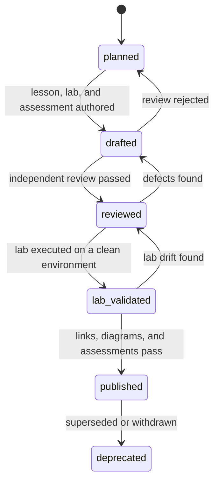
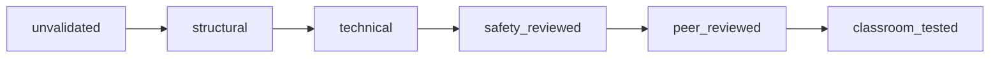

# Curriculum Manifest

> **Schema version:** `1.0.0` · **Curriculum version:** `0.1.0` · **Updated:** 2026-10-19

## Table of contents

- [1. Purpose and authority](#1-purpose-and-authority)
- [2. Files](#2-files)
- [3. Schema](#3-schema)
- [4. Field reference](#4-field-reference)
- [5. Enumerations](#5-enumerations)
- [6. Identifier conventions](#6-identifier-conventions)
- [7. Lifecycle and validation](#7-lifecycle-and-validation)
- [8. Effort model](#8-effort-model)
- [9. Integrity rules](#9-integrity-rules)
- [10. Validation procedure](#10-validation-procedure)
- [11. Current snapshot](#11-current-snapshot)
- [12. Change process](#12-change-process)
- [13. Known limitations](#13-known-limitations)

## 1. Purpose and authority

The manifest is the **single source of truth** for curriculum structure. It records each module's identifier, level, prerequisites, status, validation state, effort, outcomes, assessment, sources, and safety constraints.

Authority order:

1. [`manifest/course-manifest.yaml`](./manifest/course-manifest.yaml) — structural truth.
2. [`REFERENCES.md`](./REFERENCES.md) — source identity and verification status.
3. [`COURSE_MAP.md`](./COURSE_MAP.md) and [`diagrams/dependency-graph.md`](./diagrams/dependency-graph.md) — generated or derived views.
4. Authored module files — teaching content, which must conform to the manifest.

If a derived view disagrees with the manifest, the manifest wins and the view is regenerated.

## 2. Files

| File | Role | Editing rule |
|---|---|---|
| `manifest/course-manifest.yaml` | Canonical curriculum data | Edit this first |
| `manifest/schema.json` | Machine-readable JSON Schema 2020-12 | Update with any structural schema change |
| `CURRICULUM_MANIFEST.md` | Schema and governance | Update when the schema changes |
| `COURSE_MAP.md` | Human-readable catalog and assessment strategy | Regenerate catalog from manifest; edit prose separately |
| `diagrams/dependency-graph.md` | Rendered prerequisite views | Regenerate from manifest; never hand-edit edges |
| `REFERENCES.md` | Source ledger | Add a record before citing a new source |

## 3. Schema

The machine-readable schema is [`manifest/schema.json`](./manifest/schema.json). The manifest is a YAML document with three top-level collections: `level_definitions`, `paths`, and `modules`.

```yaml
schema_version: "1.0.0"
curriculum_version: "0.1.0"
updated: "2026-10-19"
status: "draft"
description: "Architecture manifest for the Cybersecurity Master Academy."
source_ledger: "REFERENCES.md"

level_definitions:
  - id: "L0"
    name: "Orientation and labcraft"
    exit_criterion: "Operate safely and legally; write evidence-grade reports; reason about threats."

paths:
  - id: "PATH-SECENG"
    name: "Security Engineering"
    capstone: "CAP-01"
    focus: "Platform, cloud, identity, and infrastructure security engineering."
    module_count: 35
    modules: ["ORI-01", "ORI-02", "ORI-03"]   # full list in the manifest

modules:
  - id: "ORI-01"
    title: "Security Mindset, Ethics, Law, and Labcraft"
    level: "L0"
    type: "module"                 # module | elective | capstone
    tracks: ["core"]
    status: "planned"              # publication state
    validation_status: "unvalidated"
    prerequisites: []
    prerequisite_note: null
    effort_hours:
      reading: 4
      practice: 6
      assessment: 2
      total: 12
    outcomes:
      - id: "ORI-01.O1"
        statement: "Classify five incident scenarios by the security property violated..."
      - id: "ORI-01.O2"
        statement: "Build an isolated lab..."
      - id: "ORI-01.O3"
        statement: "Write a scoped authorization memo..."
    assessment: "Quiz; lab-build inspection; authorization-memo review."
    sources: ["N01", "N11", "N23"]
    safety:
      isolation: "none"            # none | recommended | required
      risk: "low"                  # low | moderate | high
    artifacts:
      docs: []
      labs: []
      assessments: []
    last_reviewed: null
    reviewer: null
```

The example is abbreviated for readability. The actual file contains 67 module entries and complete path lists.

## 4. Field reference

### Top-level fields

| Field | Required | Type | Rules |
|---|---|---|---|
| `schema_version` | Yes | string | Semantic version of this schema; quote it in YAML |
| `curriculum_version` | Yes | string | Semantic version of the curriculum content |
| `updated` | Yes | date | ISO 8601 date of the last structural change |
| `status` | Yes | enum | `draft`, `review`, `stable`, `deprecated` |
| `description` | Yes | string | One-paragraph scope statement |
| `source_ledger` | Yes | path | Relative path to the source ledger |
| `level_definitions` | Yes | list | One entry per level, ordered L0–L5 |
| `paths` | Yes | list | One entry per learning path |
| `modules` | Yes | list | One entry per module, elective, or capstone |

### Level definition fields

| Field | Required | Type | Rules |
|---|---|---|---|
| `id` | Yes | enum | `L0`–`L5`, unique |
| `name` | Yes | string | Human-readable level name |
| `exit_criterion` | Yes | string | Observable capability required to leave the level |

### Path fields

| Field | Required | Type | Rules |
|---|---|---|---|
| `id` | Yes | string | `PATH-<UPPERCASE>`; unique |
| `name` | Yes | string | Human-readable path name |
| `capstone` | Yes | module ID | Must exist and have `type: capstone` |
| `focus` | Yes | string | One-sentence specialization statement |
| `module_count` | Yes | integer | Must equal `len(modules)` |
| `modules` | Yes | list | Unique module IDs; closed under prerequisites |

### Module fields

| Field | Required | Type | Rules |
|---|---|---|---|
| `id` | Yes | string | `<PREFIX>-<NN>`; unique; stable |
| `title` | Yes | string | Descriptive; no version numbers |
| `level` | Yes | enum | `L0`–`L5` |
| `type` | Yes | enum | `module`, `elective`, `capstone` |
| `tracks` | Yes | list | Filter hints such as `core`, `seceng`, `appsec`, `offsec`, `defense`, `research`, `teaching`, `elective`, `capstone` |
| `status` | Yes | enum | Publication state; see section 7 |
| `validation_status` | Yes | enum | Evidence level; see section 7 |
| `prerequisites` | Yes | list | Module IDs; must exist; no self-reference; no cycles |
| `prerequisite_note` | No | string or null | Human nuance that cannot be expressed as IDs |
| `effort_hours` | Yes | object | `reading`, `practice`, `assessment`, `total`; total must equal the sum |
| `outcomes` | Yes | list | At least two; IDs unique within the module |
| `assessment` | Yes | string | At least one observable assessment method |
| `sources` | Yes | list | Source IDs present in `REFERENCES.md` |
| `safety` | Yes | object | `isolation` and `risk` enums |
| `artifacts` | Yes | object | Lists of `docs`, `labs`, `assessments` paths; empty until authored |
| `last_reviewed` | No | date or null | Date of the most recent substantive review |
| `reviewer` | No | string or null | Reviewer identifier or role |

### Outcome fields

| Field | Required | Type | Rules |
|---|---|---|---|
| `id` | Yes | string | `<MODULE-ID>.O<number>`; stable |
| `statement` | Yes | string | Measurable; includes an artifact, threshold, or observable behavior |

## 5. Enumerations

### Level

| Value | Meaning |
|---|---|
| `L0` | Orientation and labcraft |
| `L1` | Systems foundations |
| `L2` | Core security practice |
| `L3` | Advanced specialization |
| `L4` | Expert practice and leadership |
| `L5` | Research and contribution |

### Module type

| Value | Meaning |
|---|---|
| `module` | Required or path-selected teaching module |
| `elective` | Optional specialization module |
| `capstone` | Integrative exit artifact with a panel defense |

### Publication status

| Value | Meaning | Allowed next states |
|---|---|---|
| `planned` | Designed but not authored | `drafted`, `deprecated` |
| `drafted` | Lesson, lab, and assessment exist | `reviewed`, `planned`, `deprecated` |
| `reviewed` | Independent review passed | `lab_validated`, `drafted`, `deprecated` |
| `lab_validated` | Lab executed on a clean environment | `published`, `reviewed`, `deprecated` |
| `published` | Released; checks pass | `deprecated` |
| `deprecated` | Superseded or withdrawn | None |

### Validation status

Validation is orthogonal to publication status. A `drafted` module may already be `technical`; a `published` module must be at least `safety_reviewed` and `peer_reviewed`.

| Value | Meaning | Evidence required |
|---|---|---|
| `unvalidated` | No validation beyond the architecture review | None |
| `structural` | Schema, IDs, prerequisites, paths, links, and diagrams pass checks | Validator and render logs |
| `technical` | Commands and labs executed on a clean environment | Captured environment, commands, outputs |
| `safety_reviewed` | Authorization, isolation, data handling, and legal boundaries reviewed | Signed checklist |
| `peer_reviewed` | Subject-matter and pedagogical review completed | Reviewer notes and disposition |
| `classroom_tested` | Piloted with a learner or cohort | Assessment data and revision notes |

### Safety

| Field | Values | Meaning |
|---|---|---|
| `isolation` | `none`, `recommended`, `required` | Whether the lab must run in an isolated environment |
| `risk` | `low`, `moderate`, `high` | Potential for harm if instructions are followed outside scope |

## 6. Identifier conventions

- **Module:** `PREFIX-NN`, for example `SYS-02`, `EXP-01`, `CAP-03`.
- **Outcome:** `MODULE.O#`, for example `SYS-02.O3`.
- **Path:** `PATH-NAME`, for example `PATH-DEFENSE`.
- **Source:** a letter and number, for example `N03`, `O02`, `A18`, `B06`, `T09`, `U01`.
- **Diagram:** descriptive title; no stable ID required.

Domain prefixes:

| Prefix | Domain | Prefix | Domain |
|---|---|---|---|
| `ORI` | Orientation and labcraft | `EXP` | Exploitation and memory safety |
| `SYS` | Systems and operating systems | `REV` | Reverse engineering |
| `NET` | Networking and protocols | `MAL` | Malware analysis |
| `PRG` | Programming and automation | `AD` | Active Directory |
| `CRY` | Cryptography | `CLD` | Cloud |
| `IAM` | Identity and access management | `CNT` | Containers |
| `DAT` | Data and databases | `K8S` | Kubernetes |
| `GIT` | Git, CI/CD, supply chain | `LOG` | Logging and detection |
| `SEC` | Secure design | `IR` | Incident response |
| `APP` | Application security | `FOR` | Forensics |
| `WEB` | Web security | `TI` | Threat intelligence |
| `API` | API security | `SCS` | Supply-chain security |
| `VUL` | Vulnerability management | `AI` | AI/LLM security |
| `END` | Endpoint security | `OFF` | Penetration testing |
| `RSK` | Risk and governance | `MOB` | Mobile security |
| `RED` | Red team | `ICS` | OT/ICS security |
| `PUR` | Purple team | `ARC` | Security architecture |
| `PDE` | Product security | `SRE` | Security reliability engineering |
| `GOV` | Governance and audit | `PRI` | Privacy engineering |
| `HW` | Hardware and firmware | `TCH` | Teaching |
| `RES` | Research | `CAP` | Capstone |

Identifiers are **immutable** once published. If a module is replaced, deprecate the old ID and create a new one; do not recycle it.

## 7. Lifecycle and validation

### Publication lifecycle



A module may move backward when a defect is found. The reason and reviewer must be recorded in the change log (planned `CHANGELOG.md`).

### Validation ladder

The ladder is cumulative: `technical` implies `structural`, `safety_reviewed` implies `technical`, and so on. A later stage may be granted only when all earlier evidence exists.



## 8. Effort model

Effort is an estimate for a learner with the stated prerequisites, not for an expert refreshing the material.

| Component | Includes | Excludes |
|---|---|---|
| `reading` | Close reading, notes, source checks | Skimming or background video |
| `practice` | Lab setup, execution, debugging, write-up | Repeating the lab after mastery |
| `assessment` | Quizzes, practicals, teach-backs, defense prep | Waiting time or administrative delay |

Effort estimates are **uncalibrated** in M0. They will be revised after the first cohort completes each level. A change of more than 20% must be recorded in the change log.

## 9. Integrity rules

These rules are normative. `scripts/validate_manifest.py` enforces the structural portion of R01–R12; R13–R16 require the link, Markdown, Mermaid, and review checks.

| ID | Rule | Failure action |
|---|---|---|
| R01 | Module IDs are unique and match `PREFIX-NN`. | Reject |
| R02 | Every prerequisite exists. | Reject |
| R03 | No self-dependency and no cycles. | Reject |
| R04 | A module may not depend on a higher-level module. | Reject |
| R05 | Every module has at least two measurable outcomes. | Reject |
| R06 | Every module has at least one assessment that can evidence its outcomes. | Reject |
| R07 | Every module has at least one source ID. | Reject |
| R08 | Every source ID exists in `REFERENCES.md`. | Reject |
| R09 | Every path is closed under prerequisites. | Reject |
| R10 | Every capstone has at least one path and explicit prerequisites. | Reject |
| R11 | Every non-elective module appears in at least one path. | Reject |
| R12 | Status and validation transitions follow section 7. | Reject |
| R13 | The catalog and diagrams are regenerated after a manifest change. | Reject release |
| R14 | Relative links resolve and anchors exist. | Reject release |
| R15 | Every Mermaid block renders with the pinned CLI version. | Reject release |
| R16 | Claims are sourced or marked uncertain; no fabricated evidence. | Reject release |

## 10. Validation procedure

### Planned commands (M1)

These scripts do **not** exist yet. They are specified here so the M1 implementation has a contract.

```bash
python3 scripts/validate_manifest.py manifest/course-manifest.yaml
python3 scripts/check_links.py .
python3 scripts/check_markdown.py .
npx markdownlint-cli2 "**/*.md"
./scripts/render_mermaid.sh diagrams/*.md
```

Expected results:

- `validate_manifest.py`: exit 0, zero errors, report counts by level/status.
- `check_links.py`: exit 0, zero broken relative links or missing anchors.
- `check_markdown.py`: one H1 per file, no skipped heading levels, balanced fences.
- `markdownlint-cli2`: exit 0 under the repository configuration.
- `render_mermaid.sh`: every block renders; output stored outside the repository or in a build artifact.

### Checks performed in M0

The M0 checks were run ad hoc because the scripts are not yet committed. See [`ARCHITECTURE_REVIEW.md`](./ARCHITECTURE_REVIEW.md#6-verification-performed) for commands and results.

## 11. Current snapshot

| Metric | Value |
|---|---:|
| Modules (non-capstone, includes 3 electives) | 62 |
| Electives | 3 |
| Capstones | 5 |
| Total entries | 67 |
| Measurable outcomes | 201 |
| Total effort | 1,950 h |
| Source IDs used | 149 |
| Learning paths | 5 |
| Modules `planned` | 61 |
| Modules `unvalidated` | 61 |
| Modules `drafted` | 6 |
| Modules `structural` | 6 |
| Modules `published` | 0 |

This snapshot is generated from the manifest and must be updated whenever the manifest changes.

## 12. Change process

1. **Propose.** Open an issue or pull request describing the change and its rationale.
2. **Edit the manifest.** Do not hand-edit generated catalog or diagram edges.
3. **Regenerate.** Rebuild the catalog and diagrams from the manifest.
4. **Validate.** Run the structural, link, Markdown, and Mermaid checks.
5. **Review impact.** Inspect affected paths, capstones, effort totals, and source usage.
6. **Version.** Use semantic versioning:
   - **Patch:** typo, source link, clarification with no structural effect.
   - **Minor:** new module, outcome, elective, or path; backward-compatible schema addition.
   - **Major:** level change, prerequisite restructuring, path removal, or breaking schema change.
7. **Record.** Add a change-log entry with date, author, reviewer, and affected IDs.

## 13. Known limitations

- **Mostly unauthored.** 61 entries remain `planned`. SYS-01, SYS-02, RES-01, RES-02, RES-06, and RES-07 are `drafted` and `structural`; no lab or research project has been executed on a clean Linux environment, so no module is `technical` or `published`.
- **Uncalibrated effort.** Hours are estimates based on comparable curricula and expert judgment, not measured cohorts.
- **Draft standards.** `N34` (SP 800-154) and `N17` (SP 800-227) are drafts; `N16` (IR 8547) is an initial public draft. Version-dependent guidance will be re-checked at authoring time.
- **Restricted sources.** The ISO catalogue page blocks automated access; the edition is recorded from the standard designation but was not machine-verified.
- **No CI yet.** The validation commands are specified but not implemented; M0 checks were manual.
- **No classroom data.** Rubrics and mastery thresholds are expert-designed and await calibration.
- **Tool churn.** Mermaid, detection formats, cloud APIs, and offensive tooling change; pin versions and record drift.
