# Lab Safety and Authorization Policy

> **Status:** policy added during the 2026-10-19 quality audit. **Scope:** every lab, exercise, project, assessment, and research experiment in this repository.
> This policy is not legal advice. It does not replace written authorization, institutional review, or local law.

## 1. Non-negotiable rule

**Do not test, scan, exploit, trace, disrupt, or collect data from a system you do not own or have explicit written authorization to use.**

Owning a device, having an account on a service, or finding a target on the public internet is not authorization. A lab instruction is not authorization to use a different target.

## 2. What authorization means

A valid authorization record identifies:

- the accountable owner and the person authorized to act;
- the systems, accounts, networks, and data in scope;
- the permitted techniques and prohibited techniques;
- the start and end times;
- the permitted evidence collection and retention;
- emergency contacts and stop conditions;
- how the authorization is verified before the lab starts.

Use a written scope document or the authorization section of the lab template. If the scope is ambiguous, do not proceed.

Authorization for a system is separate from:

- **consent** from human participants;
- **ethical review** by an institution;
- **legal permission** under applicable law;
- **permission to publish** exploit details or personal data.

## 3. Isolation levels

Choose the lowest level that safely supports the learning objective.

| Level | Environment | Minimum use |
|---|---|---|
| **S0 — Local analysis** | Files, synthetic logs, public documentation, or a local program you own | No network or target interaction |
| **S1 — Disposable container** | A container with a non-root user, no host mounts, and no production credentials | Local syscall, permission, and packaging exercises |
| **S2 — Disposable VM** | A VM snapshotted before use, with a host-only or isolated network | Namespace, kernel, malware-triage, and forensic exercises that need a real kernel |
| **S3 — Isolated lab network** | Dedicated hardware or a segmented virtual network with written scope and monitoring | Offensive or multi-host exercises with explicit authorization |
| **S4 — Prohibited in this repository** | Production systems, third-party services, shared networks, or systems without written scope | Never permitted by course material |

A container is not automatically a security boundary. Do not use a privileged container, host PID/network namespace, runtime socket, or host filesystem mount for an untrusted lab unless the lab explicitly justifies it and the reviewer approves it.

## 4. Data and evidence rules

- Prefer synthetic data, generated logs, public test corpora, and intentionally vulnerable applications.
- Never place real credentials, private keys, customer data, personal data, or production captures in a lab, screenshot, trace, or repository.
- Collect the minimum evidence needed to answer the lab question.
- Redact usernames, hostnames, home directories, IP addresses, tokens, and account identifiers before sharing a report.
- Keep raw evidence local when it cannot be safely published; publish the procedure and a justified restriction statement instead.
- Delete temporary containers, VMs, files, credentials, and network rules during cleanup.
- Do not upload a lab artifact to a third-party service without checking its data-handling terms and the learner's authorization.

## 5. Technique boundaries

The following are not permitted in learner labs unless a specific, reviewed lab grants a narrower exception and the environment is isolated:

- attacking a system without written authorization;
- bypassing authentication, CAPTCHA, anti-bot controls, or rate limits on a third-party service;
- denial-of-service, resource exhaustion, or destructive testing against shared infrastructure;
- persistence, backdoors, credential theft, or data exfiltration outside a synthetic lab;
- disabling host protections on a machine used for other work;
- attaching a tracer to another user's process;
- publishing a working exploit before a coordinated disclosure or without an explicit educational justification and safety review.

Offensive material must include detection, mitigation, legal, ethical, and stop conditions. A technique demonstration without those elements is incomplete.

## 6. Stop conditions

Stop immediately and notify the instructor or lab owner if any of the following occurs:

- the target is not the one in the authorization;
- production data or personal data appears;
- a lab action affects another user, host, or network;
- a container or VM escapes its intended boundary;
- a credential or secret is exposed;
- the learner cannot explain what the next command will affect;
- a safety control fails or behaves differently from the documented expectation.

Preserve relevant logs, but do not continue testing to "see what happens." Report the stop condition without including sensitive evidence in a public channel.

## 7. Roles and review

| Role | Responsibility |
|---|---|
| Author | States scope, isolation, data handling, expected evidence, stop conditions, and cleanup |
| Technical reviewer | Checks that commands work and the claimed evidence is reproducible |
| Safety reviewer | Checks authorization, blast radius, data handling, and whether a safer design is available |
| Instructor | Confirms the environment and authorization before releasing the lab |
| Learner | Follows scope, records evidence honestly, stops on ambiguity, and cleans up |

The author cannot be the only safety reviewer for an offensive, forensic, malware, or human-subjects lab. If no independent reviewer is available, mark the lab `unreviewed` and do not publish it as ready for use.

## 8. Lab lifecycle

```mermaid
stateDiagram-v2
  [*] --> Proposed
  Proposed --> Scoped: objective, environment, authorization
  Scoped --> SafetyReview: threat model and data plan
  SafetyReview --> Rejected: unacceptable risk or no authorization
  SafetyReview --> Approved: conditions and stop rules recorded
  Approved --> Executed: evidence captured
  Executed --> Cleaned: artifacts removed and verified
  Cleaned --> Reviewed: technical and safety review
  Reviewed --> Published: rubric and limitations complete
  Reviewed --> Approved: defects found; revise and rerun
  Rejected --> [*]
  Published --> Deprecated: superseded or withdrawn
```

## 9. Required safety record

Every lab must contain, or link to, the following:

- [ ] Objective and learning question.
- [ ] Authorization or an explicit statement that no target interaction occurs.
- [ ] In-scope and out-of-scope systems and data.
- [ ] Isolation level and why it is sufficient.
- [ ] Software and environment versions.
- [ ] Stop conditions and emergency contact or escalation path.
- [ ] Evidence retention and redaction rules.
- [ ] Cleanup commands and verification.
- [ ] Known limitations and residual risk.
- [ ] Reviewer names and review date.

Use [lab template](./authoring-templates/lab.md) as the authoring contract. The presence of a checked box is not evidence; the linked artifact or command output is.

## 10. Incident reporting

If a lab causes an unintended security impact:

1. stop the activity;
2. preserve relevant logs and snapshots;
3. notify the lab owner, instructor, and system owner through the agreed channel;
4. do not publish the details or evidence until the affected parties and disclosure process permit it;
5. document the timeline, scope, corrective action, and follow-up review.

If the impact involves personal data, follow the applicable privacy and breach-notification policy in addition to this document.

## 11. Relationship to other policies

- Research ethics and disclosure: [`research/06-ethics-disclosure-and-open-science.md`](./research/06-ethics-disclosure-and-open-science.md).
- Authoring and review workflow: [`CONTRIBUTING.md`](./CONTRIBUTING.md).
- Orientation and legal foundations: `ORI-01` in [`COURSE_MAP.md`](./COURSE_MAP.md).
- Current authored labs: [SYS-01](labs/sys-01-memory-and-binaries/lab.md) and [SYS-02](labs/sys-02-syscalls-and-isolation/lab.md).

## 12. Change log

| Date | Change |
|---|---|
| 2026-10-19 | Initial policy added during the quality audit; existing labs require re-review against this checklist before being marked lab-validated. |
