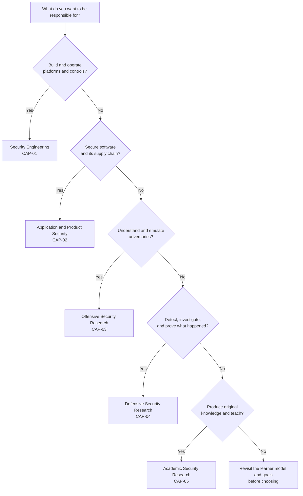

# Learning Paths

> **Status:** architecture draft. Paths are sequences through the 67-module design; SYS-01, SYS-02, RES-01, RES-02, RES-06, and RES-07 are drafted, while the remaining modules are planned. No path is yet fully authored or validated.

## Table of contents

- [1. How to choose a path](#1-how-to-choose-a-path)
- [2. Path comparison](#2-path-comparison)
- [3. Shared core and cross-path rules](#3-shared-core-and-cross-path-rules)
- [4. Security Engineering](#4-security-engineering)
- [5. Application and Product Security](#5-application-and-product-security)
- [6. Offensive Security Research](#6-offensive-security-research)
- [7. Defensive Security Research: Detection, IR, and DFIR](#7-defensive-security-research-detection-ir-and-dfir)
- [8. Academic Security Research](#8-academic-security-research)
- [9. Time model and acceleration](#9-time-model-and-acceleration)
- [10. What no path can replace](#10-what-no-path-can-replace)

## 1. How to choose a path

A path is a **coherent specialization**, not a locked sequence. Choose the responsibility you want to own, then follow its prerequisites. The shared core is non-negotiable; the specialization is where you go deep.

The decision tree is a starting point, not a diagnosis. Many learners combine two paths; the shared core makes that possible. A combined path should reduce elective breadth, not skip prerequisites.

## 2. Path comparison

| Path | Central question | Capstone | Modules | Hours | Best fit |
|---|---|---|---:|---:|---|
| Security Engineering | Can I build and operate a platform that resists and detects attacks? | `CAP-01` | 35 | 840 | Developers moving into platform, cloud, identity, or infrastructure security |
| Application and Product Security | Can I make software and its supply chain secure at scale? | `CAP-02` | 33 | 784 | Developers who want to own secure development and product-security programs |
| Offensive Security Research | Can I discover, demonstrate, and explain exploitable weaknesses? | `CAP-03` | 44 | 1,164 | Experienced developers targeting exploit development, RE, or adversary emulation |
| Defensive Security Research | Can I detect, investigate, and prove what happened, and validate controls? | `CAP-04` | 44 | 1,098 | Developers moving into detection engineering, IR, forensics, or malware triage |
| Academic Security Research | Can I produce original, reproducible, ethical knowledge and teach it? | `CAP-05` | 36 | 938 | Learners targeting research, publication, or academic teaching |

Hours are learner effort for the listed modules, including the capstone. They exclude optional reading beyond the module sources.

## 3. Shared core and cross-path rules

### Shared core

All paths begin with:

- `ORI-01`, `ORI-02`, `ORI-03` — safety, threat modeling, evidence.
- `SYS-01`, `SYS-02` — architecture and OS internals.
- `NET-01`, `NET-02` — networking, DNS, HTTP, TLS.
- `PRG-01` — Python for security engineering.
- `CRY-01` — cryptography foundations.

The engineering, application, offensive, and defensive paths add `SYS-03`, `SYS-04`, `IAM-01`, `GIT-01`, and typically `DAT-01`. The research path adds `SYS-03`, `SYS-04`, `IAM-01`, `DAT-01`, `GIT-01`, and a technical depth anchor.

### Rules

1. **No skipping the safety gate.** `ORI-01` and the [lab-safety checklist](./LAB_SAFETY.md#9-required-safety-record) are required before any offensive, forensic, or malware lab.
2. **Challenge exams, not assumptions.** A learner may challenge `SYS-01`, `PRG-01`, `GIT-01`, or `DAT-01` with a practical exam (≥ 85%) plus an oral explanation. `ORI-01`, `ORI-03`, and all capstones cannot be challenged.
3. **Substitutions are evidence-based.** A maximum of two modules may be replaced by prior learning, each with a portfolio artifact and reviewer approval.
4. **Prerequisites are closed.** If a path adds a module, it must add that module's prerequisites. The manifest validator enforces this.
5. **Research artifacts are required in every path.** Even paths without `RES-01`–`RES-07` still require evidence notes and a reproduction log for each lab.
6. **Teaching is optional except in the research path.** `TCH-01` is required for the academic path and recommended for anyone who expects to mentor or instruct.

## 4. Security Engineering

**Focus:** platform, cloud, identity, network, and infrastructure security engineering.

**Who it is for:** a developer who wants to design and operate systems that are secure by construction, not just assessed after the fact.

**Entry assumptions:** programming fluency, Git, command-line comfort; no prior cloud or security certification.

### Sequence

| Phase | Modules | Hours |
|---|---|---:|
| L0 | ORI-01, ORI-02, ORI-03 | 30 |
| L1 | SYS-01, SYS-02, SYS-03, SYS-04, NET-01, NET-02, PRG-01, PRG-02, CRY-01, IAM-01, DAT-01, GIT-01 | 272 |
| L2 | SEC-01, APP-01, VUL-01, NET-03, END-01, LOG-01, IR-01, RSK-01, CLD-01, CNT-01 | 230 |
| L3 | CLD-02, K8S-01, LOG-02, SCS-01, CRY-02 | 144 |
| L4 | SRE-01, ARC-01, GOV-01, PRI-01 | 104 |
| Capstone | CAP-01 | 60 |

**Critical path:** `SYS-02` → `NET-02` → `CRY-01` → `IAM-01` → `NET-03` → `CLD-01` → `CLD-02` → `SRE-01`/`ARC-01` → `CAP-01`. `SEC-01` should run early because it changes how you read every later design.

**Why this sequence:** the path starts with the machine and the network, then builds identity and cloud boundaries, then moves to platform engineering and architecture. `LOG-02` and `SRE-01` make detection and reliability part of the design rather than an afterthought.

### Exit competencies

1. Design a multi-account cloud landing zone with identity, network, logging, and guardrail boundaries, and defend the trade-offs.
2. Implement infrastructure as code and policy as code, with automated tests for control drift.
3. Build detection for a platform compromise and validate it with an adversarial scenario.
4. Lead a security architecture review and produce decision records that survive audit.
5. Operate a security-critical service with SLOs, error budgets, and a game-day report.

### Portfolio evidence

- A versioned infrastructure-as-code repository with policy tests.
- A threat model and architecture decision records.
- A detection suite with test evidence and precision/recall notes.
- A game-day or incident-response exercise report.
- The `CAP-01` platform package and panel defense.

**What this path does not cover:** deep exploit development, malware reversing, mobile application security, and formal research methods. Add `EXP-01`/`REV-01` or `RES-01` if those are goals.

## 5. Application and Product Security

**Focus:** secure design, web/API security, supply-chain assurance, and product-security programs.

**Who it is for:** a developer who wants to own secure development practices, review code and architecture, and run a product-security program.

**Entry assumptions:** strong programming and code-review skills; familiarity with web fundamentals is helpful but not required.

### Sequence

| Phase | Modules | Hours |
|---|---|---:|
| L0 | ORI-01, ORI-02, ORI-03 | 30 |
| L1 | SYS-01, SYS-02, SYS-03, SYS-04, NET-01, NET-02, PRG-01, CRY-01, IAM-01, DAT-01, GIT-01 | 260 |
| L2 | SEC-01, APP-01, WEB-01, API-01, VUL-01, NET-03, LOG-01, IR-01, RSK-01, CLD-01, CNT-01 | 266 |
| L3 | CRY-02, SCS-01, AI-01, MOB-01 | 92 |
| L4 | PDE-01, GOV-01, PRI-01 | 76 |
| Capstone | CAP-02 | 60 |

**Critical path:** `APP-01` → `WEB-01` → `API-01` → `SCS-01` → `PDE-01` → `CAP-02`. `IAM-01` and `DAT-01` are essential because most application flaws are authorization or data-handling failures in disguise.

**Why this sequence:** the path builds from implementation-level flaws to browser and API boundaries, then to supply chain and program design. `AI-01` and `MOB-01` extend the same reasoning to newer surfaces without changing the core method.

### Exit competencies

1. Run a threat-modeling and secure-design review for a product feature and defend the prioritization.
2. Find, exploit, and fix web and API vulnerabilities, with regression tests proving each fix.
3. Implement SSDLC gates, SBOM generation, provenance, and artifact signing in CI.
4. Assess a product-security program against NIST SSDF and OWASP SAMM and produce a roadmap.
5. Reduce measured vulnerability density in a codebase and prove the change with before/after data.

### Portfolio evidence

- Threat models and data-flow diagrams for real or realistic designs.
- A vulnerability-fix pull request with tests and a root-cause analysis.
- A CI pipeline with security gates and triage records.
- An SSDLC or program assessment with metrics.
- The `CAP-02` program package and panel defense.

**What this path does not cover:** red-team infrastructure, deep DFIR, exploit development, and large-scale incident command. Add `OFF-01`, `FOR-01`, or `RED-01` as electives if needed.

## 6. Offensive Security Research

**Focus:** exploit development, reverse engineering, malware analysis, adversary emulation, and vulnerability research.

**Who it is for:** a developer with strong systems curiosity who wants to understand how attacks actually work and produce evidence-grade offensive research.

**Entry assumptions:** comfort with C and at least one assembly dialect; willingness to work in isolated labs; strong tolerance for ambiguity and debugging.

### Sequence

| Phase | Modules | Hours |
|---|---|---:|
| L0 | ORI-01, ORI-02, ORI-03 | 30 |
| L1 | SYS-01, SYS-02, SYS-03, SYS-04, NET-01, NET-02, PRG-01, PRG-02, CRY-01, IAM-01, GIT-01 | 256 |
| L2 | SEC-01, APP-01, WEB-01, API-01, VUL-01, NET-03, END-01, LOG-01, IR-01, RSK-01, CLD-01, CNT-01 | 286 |
| L3 | EXP-01, EXP-02, REV-01, MAL-01, AD-01, CLD-02, K8S-01, LOG-02, TI-01, OFF-01 | 326 |
| L4 | RED-01, PUR-01, HW-01, GOV-01 | 116 |
| L5 | RES-01, RES-03, RES-06 | 70 |
| Capstone | CAP-03 | 80 |

**Critical path:** `SYS-02` → `EXP-01` → `EXP-02`; `REV-01` → `MAL-01`; `NET-03` → `AD-01` → `RED-01`; `OFF-01` → `RED-01`. `LOG-02` and `PUR-01` are mandatory because an exploit you cannot detect is an incomplete result.

**Why this sequence:** binary exploitation and reverse engineering are separated so that each gets a full feedback cycle. Adversary emulation comes after network, identity, and detection foundations; otherwise it degenerates into tool running. Research methods and ethics are included before the capstone because offensive research has the highest dual-use risk.

### Exit competencies

1. Develop reliable exploits against purpose-built targets and explain the effect of each mitigation.
2. Reverse a binary and analyze synthetic malware in an isolated lab, producing reproducible indicators.
3. Design and execute an ATT&CK-mapped adversary-emulation campaign with evidence.
4. Evaluate detection coverage and communicate residual risk to technical and executive audiences.
5. Produce a research-style offensive report with methodology, limitations, and defensive recommendations.

### Portfolio evidence

- Exploit write-ups with reliability data and mitigation analysis.
- Reverse-engineering and malware-analysis reports with IOCs.
- An adversary-emulation plan, execution log, and detection-coverage map.
- A disclosure or ethics dossier.
- The `CAP-03` research package and panel defense.

**What this path does not cover:** product-security program management, privacy engineering, and large-scale cloud governance. Add `PDE-01`, `PRI-01`, or `GOV-01` if those are goals.

## 7. Defensive Security Research: Detection, IR, and DFIR

**Focus:** telemetry, detection engineering, incident response, digital forensics, malware triage, and control validation.

**Who it is for:** a developer who wants to detect, investigate, and prove what happened, and to test whether controls actually work.

**Entry assumptions:** systems and networking fundamentals; comfort with logs and scripting; willingness to write precise timelines and evidence reports.

### Sequence

| Phase | Modules | Hours |
|---|---|---:|
| L0 | ORI-01, ORI-02, ORI-03 | 30 |
| L1 | SYS-01, SYS-02, SYS-03, SYS-04, NET-01, NET-02, PRG-01, PRG-02, CRY-01, IAM-01, DAT-01, GIT-01 | 272 |
| L2 | SEC-01, APP-01, WEB-01, VUL-01, NET-03, END-01, LOG-01, IR-01, RSK-01, CLD-01, CNT-01 | 266 |
| L3 | AD-01, K8S-01, LOG-02, IR-02, FOR-01, TI-01, REV-01, MAL-01, ICS-01, OFF-01 | 296 |
| L4 | FOR-02, MAL-02, PUR-01 | 88 |
| L5 | RES-01, RES-02, RES-04, RES-06 | 86 |
| Capstone | CAP-04 | 60 |

**Critical path:** `LOG-01` → `LOG-02` → `IR-02`; `IR-01` → `FOR-01` → `FOR-02`; `REV-01` → `MAL-01` → `MAL-02`; `OFF-01` → `PUR-01`. `AD-01` is essential because enterprise intrusions rarely avoid identity.

**Why this sequence:** detection starts with telemetry and normalization, then moves to detection-as-code and incident leadership. Forensics and malware analysis are paired because memory, disk, and sample evidence usually converge in the same case. Purple-team validation closes the loop.

### Exit competencies

1. Build a telemetry pipeline and a detection-as-code repository with tests and quality metrics.
2. Lead an incident from detection through recovery, including escalation, communication, and legal/privacy coordination.
3. Acquire and analyze disk, memory, and log evidence; produce a defensible timeline.
4. Analyze synthetic malware and map behavior to ATT&CK with validated indicators.
5. Validate controls with an iterative purple-team cycle and communicate residual risk.

### Portfolio evidence

- A detection repository with tests, deployment history, and precision/recall metrics.
- An incident decision log and after-action report.
- A forensic timeline and evidence package with chain of custody.
- A malware triage report with IOCs and limitations.
- The `CAP-04` case package and panel defense.

**What this path does not cover:** exploit development depth, product-security program ownership, and formal methods. Add `EXP-01`, `PDE-01`, or `RES-05` if those are goals.

## 8. Academic Security Research

**Focus:** research methods, measurement, formal analysis, ethics, teaching, and a thesis.

**Who it is for:** a learner targeting research, publication, academic teaching, or a research-oriented security role.

**Entry assumptions:** strong writing, comfort with abstraction, and willingness to learn statistics and formal reasoning. A technical depth anchor is required; this path defaults to application security.

### Sequence

| Phase | Modules | Hours |
|---|---|---:|
| L0 | ORI-01, ORI-02, ORI-03 | 30 |
| L1 | SYS-01, SYS-02, SYS-03, SYS-04, NET-01, NET-02, PRG-01, CRY-01, IAM-01, DAT-01, GIT-01 | 260 |
| L2 | SEC-01, APP-01, WEB-01, API-01, VUL-01, LOG-01, RSK-01, NET-03, CLD-01, CNT-01 | 246 |
| L3 | CRY-02, SCS-01 | 52 |
| L4 | GOV-01, TCH-01 | 50 |
| L5 | RES-01, RES-02, RES-03, RES-04, RES-05, RES-06, RES-07 | 180 |
| Capstone | CAP-05 | 120 |

**Technical depth anchor:** the default anchor is application security (`APP-01` → `WEB-01` → `API-01`). Alternatives:

- **Binary anchor:** `EXP-01` + `REV-01` (adds ~68 h; enables systems and vulnerability-discovery research).
- **Cloud anchor:** `CLD-02` + `K8S-01` (adds ~60 h; enables cloud measurement and control research).
- **Cryptography anchor:** `CRY-02` + `RES-05` (adds ~60 h; enables protocol and formal-methods research).

A research path without a depth anchor is a literature survey, not a research apprenticeship.

**Critical path:** `RES-01` → `RES-02`/`RES-03`/`RES-04`/`RES-05`/`RES-06` → `RES-07` → `CAP-05`. `TCH-01` should be taken before the thesis defense so the teaching portfolio is complete.

**Why this sequence:** methods and ethics come before data collection; measurement, discovery, human factors, and formal methods provide four different research lenses; the proposal defense gates the thesis. The technical anchor keeps the research grounded in systems that actually exist.

### Exit competencies

1. Formulate a research question with a threat model, falsifiable hypotheses, and a reproducible search protocol.
2. Design and pre-register an ethical study with appropriate controls and a threats-to-validity analysis.
3. Analyze results with effect sizes, uncertainty, and explicit limitations.
4. Teach a 90-minute lesson and design an assessment with a calibrated rubric.
5. Produce and defend a thesis with reproducible code, data, and documentation.

### Portfolio evidence

- A literature-review protocol and annotated bibliography.
- A measurement proposal and pilot.
- An ethics/disclosure dossier.
- A taught lesson, assessment, and learner feedback.
- The `CAP-05` thesis and oral defense.

**What this path does not cover:** full engineering leadership, incident command, and production operations. Add `ARC-01`, `IR-02`, or `SRE-01` if the research context requires them.

## 9. Time model and acceleration

| Pace | One path (784–1,164 h) | Full breadth (1,950 h) | Notes |
|---|---:|---:|---|
| 8 h/week | 1.9–2.8 years | 4.7 years | Sustainable with a full-time job; slower retention decay |
| 10 h/week | 1.5–2.2 years | 3.8 years | Recommended default |
| 12 h/week | 1.3–1.9 years | 3.1 years | Good balance for most learners |
| 15 h/week | 1.0–1.5 years | 2.5 years | Requires protected lab blocks |
| 20 h/week | 0.8–1.1 years | 1.9 years | Risk of shallow labs and burnout; not recommended as a default |

**Acceleration options:**

- Challenge exams for `SYS-01`, `PRG-01`, `GIT-01`, `DAT-01` (up to ~15% of foundation hours).
- Substitute a work portfolio for up to two modules, with reviewer approval.
- Run research-strand reading in parallel with technical modules.
- Combine two paths by dropping electives, not prerequisites.

**Deceleration is normal.** A failed lab or a busy month is not a reason to lower the mastery threshold; it is a reason to extend the timeline.

## 10. What no path can replace

- **Supervised practice.** Feedback from a more experienced practitioner changes the quality of judgment.
- **Real organizational context.** Budget, politics, legacy systems, and risk appetite are not simulated fully in a lab.
- **Legal and ethical judgment.** A course can teach frameworks; it cannot make the decision for you.
- **A credential.** Completing a path is evidence of work, not a license, degree, or certification.
- **Sustained curiosity.** The field changes; the curriculum is a scaffold, not a finish line.
