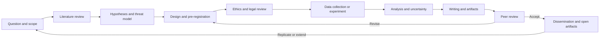
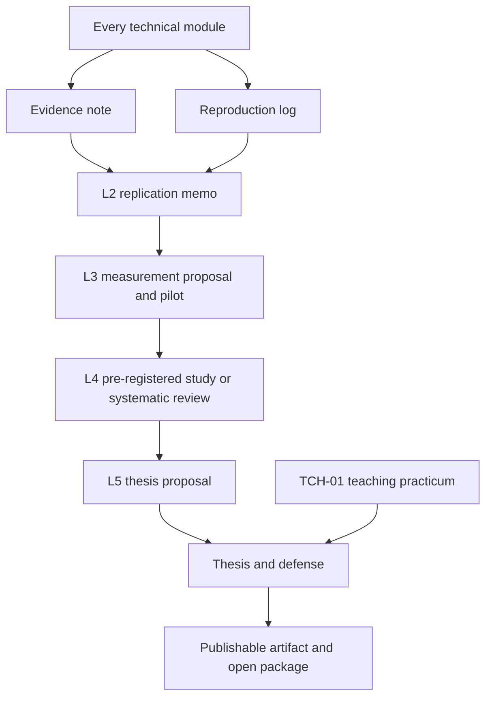

# Research and Teaching Strand

> **Status:** core methods track implemented. RES-01, RES-02, RES-06, and RES-07 are drafted and structurally validated; RES-03, RES-04, and RES-05 remain planned. The research projects are specifications, not completed studies.

## Table of contents

- [1. Why research runs alongside the technical track](#1-why-research-runs-alongside-the-technical-track)
- [1.1 Implemented research track](#11-implemented-research-track)
- [2. Competency model](#2-competency-model)
- [3. Progression by level](#3-progression-by-level)
- [4. Research lifecycle](#4-research-lifecycle)
- [5. Artifact pipeline](#5-artifact-pipeline)
- [6. Deliverables and assessment](#6-deliverables-and-assessment)
- [7. Teaching strand](#7-teaching-strand)
- [8. Rigor standards](#8-rigor-standards)
- [9. Research rubric](#9-research-rubric)
- [10. Ethics, law, and disclosure](#10-ethics-law-and-disclosure)
- [11. Integration contract for every tutorial](#11-integration-contract-for-every-tutorial)
- [12. Common failure modes](#12-common-failure-modes)
- [13. Reading list](#13-reading-list)
- [14. What this strand does not grant](#14-what-this-strand-does-not-grant)

## 1. Why research runs alongside the technical track

Security is an empirical field. Practitioners routinely make claims such as "this control works," "this detection catches the technique," "this library is safe," or "this vulnerability is exploitable." Each claim is a hypothesis about a system, an adversary, or a population. Without research discipline, those claims become folklore.

The strand therefore starts in orientation and never stops. It teaches the learner to:

- turn a vague concern into a **falsifiable question**;
- find and evaluate **primary evidence**;
- design a study or experiment that could **disconfirm** the claim;
- collect and analyze data with **explicit uncertainty**;
- respect **ethical and legal boundaries**;
- write, present, and **defend** the result;
- **teach** it to someone else and assess their understanding.

This is not a PhD program. It is the research component of professional mastery. It prepares a learner to read papers critically, run defensible internal studies, contribute to open-source research, and decide whether a formal academic path is worth pursuing.

### 1.1 Implemented research track

The research methods are authored as a modular track under [`research/`](./research/README.md). Read the tutorials in order; the projects apply them.

| Component | Files |
|---|---|
| Track overview | [`research/README.md`](./research/README.md) |
| Methods tutorials | [1 Literature search](./research/01-literature-search-and-source-evaluation.md) · [2 Questions and threat models](./research/02-research-questions-hypotheses-and-threat-models.md) · [3 Experimental design](./research/03-experimental-design-baselines-and-sampling.md) · [4 Measurement and statistics](./research/04-measurement-statistics-and-uncertainty.md) · [5 Reproducibility](./research/05-reproducibility-and-replication.md) · [6 Ethics and disclosure](./research/06-ethics-disclosure-and-open-science.md) · [7 Scientific writing](./research/07-scientific-writing-and-publication.md) · [8 Domain designs](./research/08-domain-research-designs.md) |
| Templates | [Paper review](./authoring-templates/research-paper-review.md) · [Literature matrix](./authoring-templates/literature-matrix.md) · [Experiment plan](./authoring-templates/experiment-plan.md) · [Replication report](./authoring-templates/replication-report.md) · [Publication outline](./authoring-templates/publication-outline.md) |
| Project ladder | [P1 literature review](./research/projects/01-structured-literature-review.md) · [P2 replication](./research/projects/02-replication-study.md) · [P3 controlled experiment](./research/projects/03-controlled-experiment.md) · [P4 thesis and paper](./research/projects/04-thesis-proposal-and-paper.md) |
| Rubrics | [`research/projects/rubrics.md`](./research/projects/rubrics.md) |
| Portfolio assessment | [`assessments/research/assessment.md`](./assessments/research/assessment.md) |

The track distinguishes **original results**, **cited claims**, **assumptions**, and **generated examples**. Every project requires a recorded evidence trail and an honest limitations section.

## 2. Competency model

| ID | Competency | What it looks like in practice | Primary modules |
|---|---|---|---|
| R0 | Source discipline | Uses primary sources, records editions and access dates, separates fact from assumption and dispute | `ORI-03`, every module |
| R1 | Literature and synthesis | Builds a reproducible search protocol, maps claims to sources, identifies the gap | `RES-01` |
| R2 | Problem formulation | States a question, scope, threat model, hypotheses, and success criteria | `ORI-02`, `RES-01` |
| R3 | Study and measurement design | Chooses controls, sampling, instruments, power, and validity safeguards | `RES-02`, `RES-03` |
| R4 | Analysis and uncertainty | Reports effect sizes, confidence intervals, limitations, and alternative explanations | `RES-02`, `RES-05` |
| R5 | Ethics, law, and disclosure | Obtains authorization or consent, minimizes data, plans disclosure, assesses dual use | `RES-06`, `ORI-01` |
| R6 | Communication and teaching | Writes for technical and executive audiences; designs and delivers instruction; reviews peers | `TCH-01`, `RES-07` |

A learner is not "research-ready" until all six competencies have an artifact in the portfolio. The thesis adds a seventh: **synthesis** — producing a coherent contribution that survives external review.

## 3. Progression by level

| Level | Research focus | Required artifact | Gate |
|---|---|---|---|
| L0 | Evidence and uncertainty | Evidence note; source ledger entry; threat model | Rubric ≥ 3/4; claims classified correctly |
| L1 | Observation and reproduction | Reproduction log for a protocol, syscall, or crypto misuse | Another learner can rerun it |
| L2 | Replication and critique | Replication memo for a small published result or a controlled measurement | Discrepancies reported, not hidden |
| L3 | Design and pilot | Measurement proposal plus a pilot with synthetic or public data | Threats-to-validity analysis; ethics review |
| L4 | Pre-registration and teaching | Pre-registered study or systematic-review protocol; taught lesson | Panel review; teaching observation |
| L5 | Synthesis and defense | Thesis proposal, thesis, oral defense, publishable artifact | External-style review; reproducible package |

### L0–L1: observation discipline

At the start, research looks like **good notes**. The learner records what was done, what was observed, what was inferred, and what remains uncertain. The key lesson is that a command output is not an explanation, and an explanation is not evidence.

### L2–L3: from demonstration to study

A demonstration shows that something *can* happen. A study estimates *how often*, *under what conditions*, and *with what uncertainty*. The learner must add a baseline or control, define the population or sample, and state what result would refute the hypothesis.

### L4–L5: contribution

At the expert level, the learner moves from consuming research to producing it: a pre-registered study, a systematic review, a formal model, or a reproducible measurement. The thesis is the capstone, but the habit begins much earlier.

## 4. Research lifecycle

The loop is deliberate. Peer review often exposes a design flaw, not just a writing flaw; the revision returns to design. Dissemination is not the end: replication and extension are how a result becomes knowledge.

## 5. Artifact pipeline

The pipeline prevents the common failure in which a learner arrives at the thesis without ever having written a rigorous evidence note or replicated anyone else's result.

## 6. Deliverables and assessment

### Evidence note (L0–L1)

A one-to-two-page note with four labeled sections:

1. **Observation** — what was directly observed, with command, artifact, or source.
2. **Inference** — what the observation is taken to mean.
3. **Uncertainty** — alternative explanations, missing data, and confidence.
4. **Source** — primary source IDs and access dates.

Assessment: rubric ≥ 3/4 on each section; no inference presented as observation.

### Reproduction log (L1–L2)

A structured record containing environment, versions, inputs, commands, expected result, actual result, deviations, and cleanup. Another learner must be able to rerun it without asking questions.

Assessment: independent rerun succeeds within the stated tolerance; deviations are documented.

### Replication memo (L2)

A short memo that attempts to reproduce a published or documented result in a lab. It must state what was reproduced, what differed, and why. Negative or partial replication is acceptable and often more instructive.

Assessment: method fidelity, discrepancy analysis, and limitations.

### Measurement proposal and pilot (L3)

A proposal with question, population or sample, variables, controls, instrument, analysis plan, ethics, and threats to validity; plus a small pilot using synthetic or public data.

Assessment: feasibility, validity, ethics, and whether the analysis plan could answer the question.

### Pre-registered study or systematic review (L4)

A pre-registration or review protocol deposited before data collection, with inclusion criteria, search strategy, analysis plan, and stopping rules. The learner executes at least a pilot and reports deviations.

Assessment: protocol quality, adherence, and transparency about deviations.

### Thesis (L5)

An original, bounded contribution with:

- a clear question and stated significance;
- a literature review that identifies a real gap;
- a defensible method and threat model;
- ethical approval or documented exemption;
- reproducible code, data, and environment;
- analysis with uncertainty and limitations;
- a discussion of dual use and disclosure;
- an oral defense.

Assessment: thesis rubric plus external-style review and oral defense.

## 7. Teaching strand

Teaching is not a soft add-on. It exposes whether the learner can decompose a concept, choose an example, anticipate misconceptions, and assess understanding.

### Requirements

1. **Teach-back in every module.** Five minutes, no slides, two "why" questions. Rubric ≥ 3/4.
2. **`TCH-01` for the academic path.** Lesson design, observed teaching, and assessment design.
3. **Two full lessons.** One technical, one research-methods lesson. Each includes objectives, prior knowledge check, worked example, guided practice, independent practice, retrieval quiz, and accessibility notes.
4. **One assessment design.** Blueprint, items, rubric, answer key, and inter-rater calibration on two sample answers.
5. **One peer review.** Review another learner's lesson or assessment against the rubric and provide actionable feedback.

### Teaching rubric

| Dimension | Weight | Mastery descriptor |
|---|---:|---|
| Accuracy | 25 | Claims are correct, sourced, and appropriately qualified |
| Clarity and structure | 20 | Objectives, examples, and transitions make the reasoning easy to follow |
| Retrieval and practice | 15 | Learners recall and apply, not just listen |
| Assessment alignment | 15 | Items measure the stated objectives at the right cognitive level |
| Misconception handling | 10 | Common errors are predicted and addressed |
| Accessibility and inclusion | 10 | Multiple representations, captions, readable materials, inclusive examples |
| Reflection and revision | 5 | Feedback is incorporated with evidence |

**Pass:** ≥ 80/100, no dimension below 50%, observed teaching not merely a written plan.

## 8. Rigor standards

### 8.1 Claims and sources

Every substantive claim is classified:

| Type | Meaning | Required treatment |
|---|---|---|
| Established | Supported by a primary standard, peer-reviewed result, or direct measurement | Cite source ID and date |
| Assumption | Necessary but not verified in this context | Label and state impact if wrong |
| Disputed | Credible sources disagree | Present both positions and the evidence |
| Version-dependent | True for a specific version or configuration | Record version, date, and scope |
| Unknown | Insufficient evidence | Say "unknown"; do not infer |

No claim may be supported only by an AI-generated answer, a vendor marketing page, or an unattributed blog post. Secondary sources may be used to find primary sources, not to replace them.

### 8.2 Reproducibility

A reproducible artifact includes:

- environment and versions (OS, kernel, runtime, libraries, tools);
- inputs, seeds, and data provenance;
- exact commands or scripts;
- expected output and tolerance;
- actual output and deviations;
- resource limits and known confounders;
- cleanup and reset instructions.

Where reproducibility is impossible (for example, a live incident), the report states why and preserves the strongest available evidence.

### 8.3 Quantitative analysis

- Pre-register the primary outcome and analysis when possible.
- Report effect sizes and confidence intervals, not only p-values.
- Correct for multiple comparisons or justify why not.
- Report power or precision; do not treat a non-significant result as proof of no effect.
- Preserve raw data and analysis code; report exclusions.
- Distinguish statistical significance from practical significance.

### 8.4 Qualitative analysis

- State the sampling strategy and inclusion criteria.
- Use a coding scheme with definitions and examples.
- Report inter-rater reliability or a documented reconciliation process.
- Reflect on researcher position and potential bias.
- Preserve anonymized excerpts and consent records.

### 8.5 Formal methods

- State the model boundary and assumptions.
- Record tool and version.
- Provide the model and the property checked.
- Report counterexamples, not just "verified."
- Distinguish "no counterexample found" from "proved."

## 9. Research rubric

| Dimension | Weight | Mastery descriptor |
|---|---:|---|
| Question and significance | 15 | The question is clear, bounded, and worth answering |
| Literature and gap | 15 | Primary sources are synthesized; the gap is real, not a gap in the learner's reading |
| Method and validity | 20 | Design, controls, sampling, and threats to validity are defensible |
| Ethics and safety | 10 | Authorization, consent, data handling, and dual-use review are documented |
| Evidence and reproducibility | 20 | Another expert can audit and rerun the work |
| Analysis and uncertainty | 10 | Effect sizes, uncertainty, and alternative explanations are handled |
| Communication | 10 | Technical and non-specialist audiences can understand the contribution |

**Pass:** ≥ 80/100, no dimension below 50%, ethics review complete, and a reproducible package submitted. **Distinction:** ≥ 92/100 and a peer-reviewable artifact.

## 10. Ethics, law, and disclosure

### Before the work

- Confirm **authorization** or **informed consent**.
- Obtain ethics review for human-subject research, even in a course.
- Minimize data; prefer synthetic or public data.
- Define storage, access, retention, and destruction.
- Assess dual-use risk and decide what will not be published.
- Declare conflicts of interest and funding.

### During the work

- Stay within scope; stop when the scope or safety condition is violated.
- Do not collect more data than needed.
- Keep evidence integrity: hashes, timestamps, chain of custody.
- Document deviations from the protocol.

### After the work

- Report negative and inconclusive results.
- Follow coordinated disclosure for vulnerabilities; do not publish exploit details before a fix or agreed deadline.
- Share code, data, and materials when it is safe and lawful.
- Give credit accurately; do not ghostwrite or fabricate authorship.
- Archive the artifact with a persistent identifier when possible.

### Primary guidance

- The Menlo Report for ethical decision-making in security research (`A18`).
- CISA's coordinated vulnerability disclosure guidance (`C06`).
- NIST SP 800-115 for assessment planning and reporting (`N11`).
- NIST SP 800-61r3 for incident handling and evidence (`N03`).
- Institutional review board or ethics committee requirements, which take precedence for human-subject work.

**No course can authorize research on a system you do not own or have permission to test.** Legal rules vary by jurisdiction; the learner is responsible for confirming them.

## 11. Integration contract for every tutorial

Every authored tutorial must include, in addition to the 18 elements in [`COURSE_MAP.md`](./COURSE_MAP.md#9-definition-of-done-for-a-module):

1. **Evidence and uncertainty** — a short table classifying the module's central claims as established, assumed, disputed, version-dependent, or unknown.
2. **Reproduction** — the minimum artifact another learner needs to rerun the core result.
3. **Source ledger** — source IDs used in the lesson, with a note on what each supports.
4. **Research extension** — one exercise that turns the lab into a small study (add a baseline, measure a rate, compare two configurations, or replicate a published result).
5. **Teach-back prompt** — a specific question the learner must explain without notes.

This contract is what makes the research strand real rather than aspirational. A tutorial that cannot support these five items is not ready to publish.

## 12. Common failure modes

| Failure | Symptom | Correction |
|---|---|---|
| Demo ≠ experiment | "It worked once" is presented as a finding | Add a baseline, repetitions, and a stated claim |
| Cherry-picked evidence | Only confirming logs are shown | Preserve all runs; report exclusions |
| Citation laundering | A blog cites a paper the learner never read | Read the primary source; cite the ledger ID |
| Overgeneralization | One sample becomes "attackers always..." | State the population and scope |
| Unfalsifiable claim | No observation could refute it | Rewrite as a testable hypothesis |
| Ethics afterthought | "It's just a lab" | Complete the ethics section before collection |
| Hidden negative results | Failed replications disappear | Report them; they are evidence |
| Tool-centric research | The tool is the contribution, not the question | Start from the question; justify the tool |
| p-hacking | Many tests, one significant result | Pre-register, correct, or label exploratory |
| Irreproducible environment | "Works on my machine" | Pin versions; publish setup scripts |
| Teaching as performance | A polished talk with no learning check | Add retrieval, practice, and assessment |
| AI-generated evidence | Fabricated logs or citations | Require artifacts and oral defense |

## 13. Reading list

These are starting points, not a complete bibliography. Source IDs refer to [`REFERENCES.md`](./REFERENCES.md).

### Research practice and ethics

- Menlo Report (`A18`) — ethical decision-making for security research.
- ACM/IEEE-CS/AAAI CS2023 (`A19`) — curriculum and research context for computing.
- NIST SP 800-115 (`N11`) — assessment planning, execution, and reporting.
- CISA coordinated vulnerability disclosure (`C06`).
- NIST SP 800-61r3 (`N03`) — incident handling and evidence.

### Research methods core

- PRISMA 2020 (`R01`) — systematic review reporting and flow.
- Wohlin et al., *Experimentation in Software Engineering* (`R02`) — design, randomization, validity.
- Empirical Standards for Software Engineering Research (`R03`) — study-type expectations; preprint, verify status.
- National Academies, *Reproducibility and Replicability in Science* (`R04`) — definitions and systemic issues.
- Sandve et al., *Ten Simple Rules for Reproducible Computational Research* (`R05`).
- Munafò et al., *A manifesto for reproducible science* (`R06`).
- Greenland et al. (`R07`), Ioannidis (`R08`), and the ASA statement (`R09`) — statistical interpretation, power, and publication bias.
- CERT Guide to Coordinated Vulnerability Disclosure (`R10`) and ISO/IEC 29147 (`R11`).
- NIST/SEMATECH e-Handbook (`R12`) — statistical methods.
- ACM artifact and publication policies (`R13`, `R14`), and the Belmont Report (`R15`).

### Measurement, fuzzing, and formal methods

- Manes et al., *The Art, Science, and Engineering of Fuzzing: A Survey* (`A17`).
- Dwork and Roth, *The Algorithmic Foundations of Differential Privacy* (`A16`).
- TLA+ (`T06`) and KLEE (`T05`) documentation for model checking and symbolic execution.
- Shacham (`A07`) and Szekeres et al. (`A08`) for the research framing of memory safety.

### Usable security and human factors

- Adams and Sasse, *Users are not the enemy* (`A13`).
- Herley, *So long, and no thanks for the externalities* (`A15`).
- NIST SP 800-63-4 (`N04`) for identity usability requirements.

### Security engineering and systems

- Anderson, *Security Engineering*, 3rd edition (`B01`).
- Saltzer and Schroeder (`A01`) for foundational design principles.
- Google SRE (`B15`) and *Building Secure and Reliable Systems* (`B16`) for reliability and incident practice.

## 14. What this strand does not grant

- **Not a degree or academic qualification.** It develops research skills; it does not confer a PhD, MSc, or institutional affiliation.
- **Not ethics approval.** Only a recognized review board can approve human-subject research in its jurisdiction.
- **Not legal advice.** Authorization and disclosure decisions require organizational and legal review.
- **Not a publication guarantee.** The thesis is assessed against a rubric; external publication depends on peer review.
- **Not a license to test real systems.** Authorization remains mandatory, regardless of research value.
