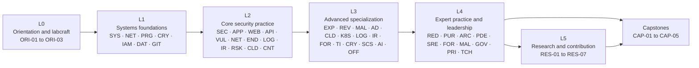
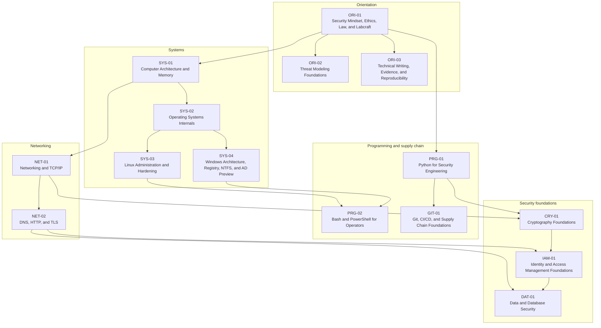
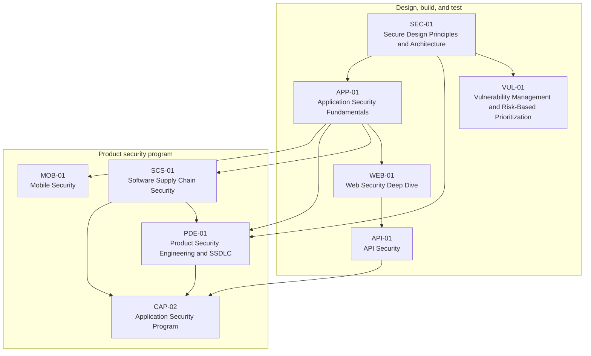
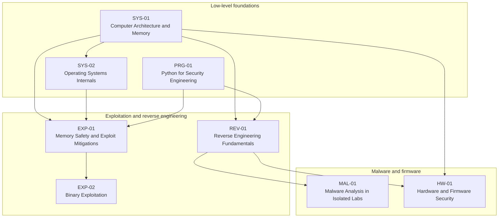
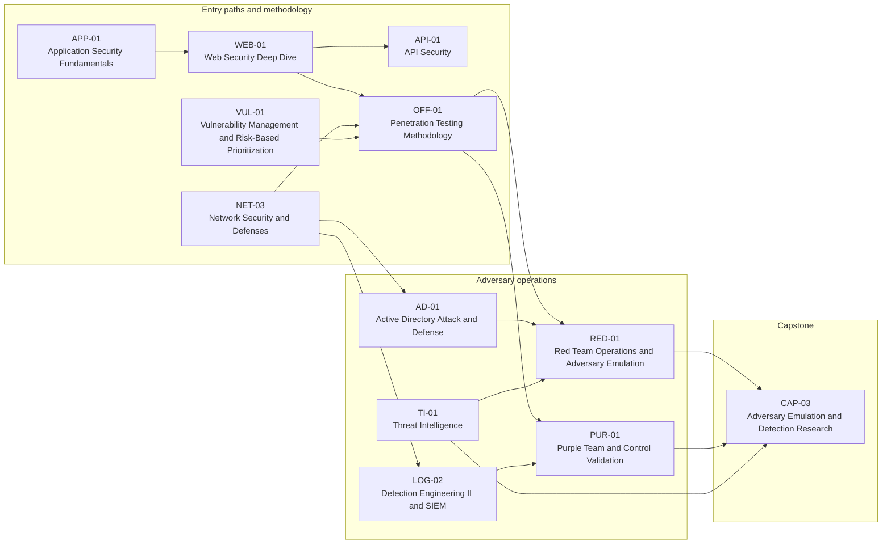
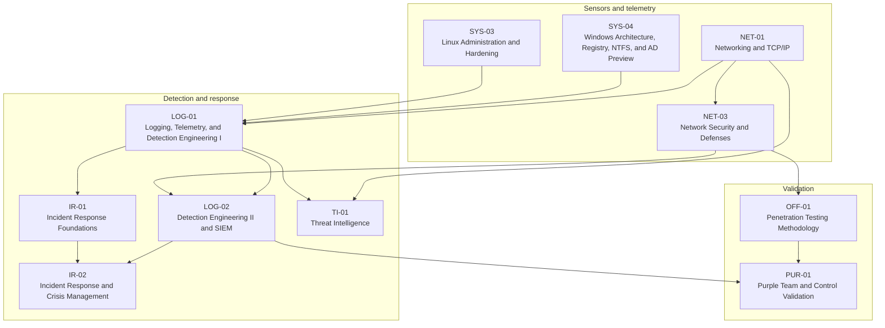
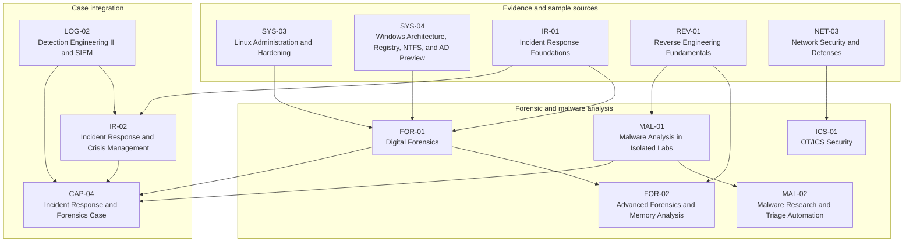
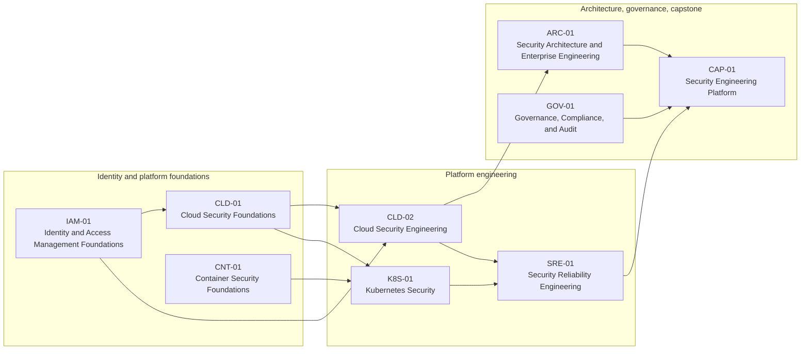
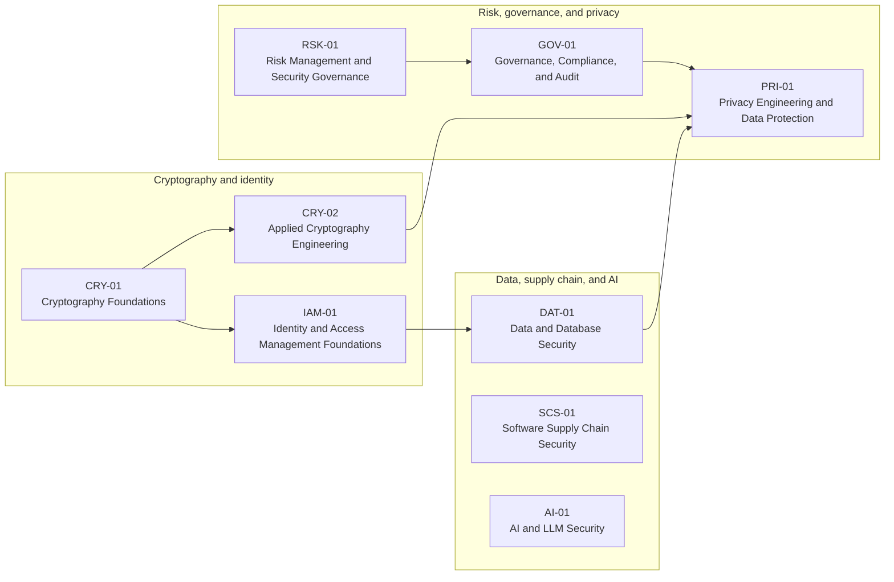
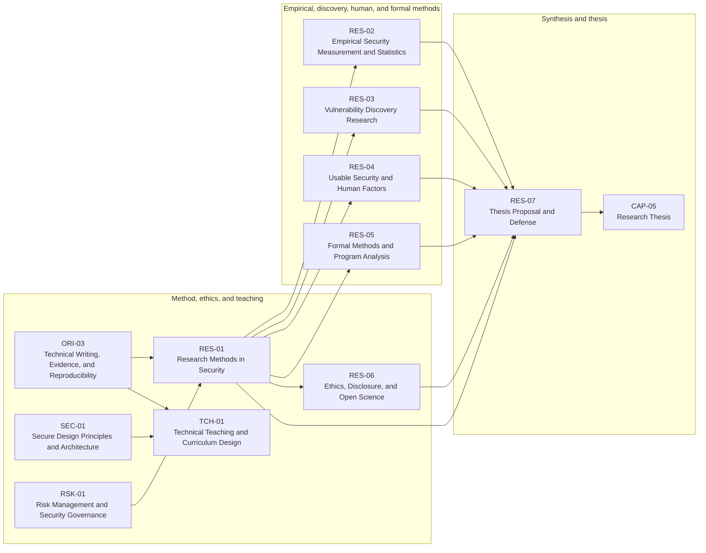

# Dependency Graph

> **Status:** generated architecture view. All edges come from [`manifest/course-manifest.yaml`](../manifest/course-manifest.yaml). Do not hand-edit edges.

## Table of contents

- [Graph metadata](#graph-metadata)
- [How to read these diagrams](#how-to-read-these-diagrams)
- [Diagram 1 — Level spine](#diagram-1-level-spine)
- [Diagram 2 — Foundations detail](#diagram-2-foundations-detail)
- [Diagram 3 — Application and product security chain](#diagram-3-application-and-product-security-chain)
- [Diagram 4 — Binary exploitation and reverse-engineering chain](#diagram-4-binary-exploitation-and-reverse-engineering-chain)
- [Diagram 5 — Adversary emulation and control-validation chain](#diagram-5-adversary-emulation-and-control-validation-chain)
- [Diagram 6 — Detection and response chain](#diagram-6-detection-and-response-chain)
- [Diagram 7 — Forensics, malware, and case chain](#diagram-7-forensics-malware-and-case-chain)
- [Diagram 8 — Cloud, container, and platform engineering chain](#diagram-8-cloud-container-and-platform-engineering-chain)
- [Diagram 9 — Data, cryptography, supply-chain, and privacy chain](#diagram-9-data-cryptography-supply-chain-and-privacy-chain)
- [Diagram 10 — Research and teaching strand](#diagram-10-research-and-teaching-strand)
- [What the graph guarantees](#what-the-graph-guarantees)
- [What the graph does not guarantee](#what-the-graph-does-not-guarantee)
- [Maintenance](#maintenance)

## Graph metadata

| Property | Value |
|---|---|
| Source of truth | [`manifest/course-manifest.yaml`](../manifest/course-manifest.yaml) |
| Modules | 67 |
| Edges | All prerequisite relationships in the manifest |
| Layout | One overview plus nine dependency-chain slices |
| Renderer | Mermaid CLI 12.0.0 |
| Rendered | 2026-10-19 |
| Result | 10 of 10 diagrams rendered successfully |

## How to read these diagrams

The dependency graph is split into one overview and nine readable slices. An arrow means **“is a prerequisite of”**: `A --> B` means A must be completed before B.

The diagrams show only prerequisites internal to each slice. Every slice lists its external prerequisites below it. The authoritative, machine-readable edge list is in [`manifest/course-manifest.yaml`](../manifest/course-manifest.yaml); if a diagram and the manifest disagree, the manifest wins.

### Diagram 1: Level spine

The spine is a **minimum depth order**, not a lock-step sequence. A learner may start a research-strand module in parallel with technical modules once its prerequisites are met.

### Diagram 2: Foundations detail

ORI-01 is the only true entry point; every other foundation module traces back to it.  
*External prerequisites for this slice:* None.

### Diagram 3: Application and product security chain

This chain shows how design review, application testing, supply-chain assurance, and program management converge on the application-security capstone.  
*External prerequisites for this slice:* CNT-01, GIT-01, NET-01, NET-02, NET-03, ORI-02, PRG-01, SYS-02.

### Diagram 4: Binary exploitation and reverse-engineering chain

SYS-04 (Windows internals) and NET-01 are also required for MAL-01 but are omitted here to keep the chain readable; see Diagram 2.  
*External prerequisites for this slice:* NET-01, ORI-01, SYS-04.

### Diagram 5: Adversary emulation and control-validation chain

RED-01 also requires EXP-01; PUR-01 deliberately depends on offensive methodology plus detection engineering rather than on full red-team operations.  
*External prerequisites for this slice:* CRY-01, EXP-01, LOG-01, NET-01, NET-02, PRG-01, SEC-01, SYS-04.

### Diagram 6: Detection and response chain

This chain is the defensive counterpart to Diagram 5: telemetry is only useful if it is collected, normalized, detected, and validated. `END-01` is covered in the core and in the defensive path but is omitted here because it is not a prerequisite of `LOG-01`.  
*External prerequisites for this slice:* CRY-01, NET-02, SYS-01, SYS-02, VUL-01, WEB-01.

### Diagram 7: Forensics, malware, and case chain

This chain shows how evidence acquisition, reverse engineering, malware triage, and incident leadership converge on the defensive capstone.  
*External prerequisites for this slice:* CRY-01, NET-01, NET-02, SYS-01, SYS-02, VUL-01, WEB-01.

### Diagram 8: Cloud, container, and platform engineering chain

NET-03 is an external prerequisite for the cloud foundations and is shown in Diagram 2 and Diagram 6.  
*External prerequisites for this slice:* CRY-01, GIT-01, LOG-02, NET-02, NET-03, RSK-01, SEC-01, SYS-03.

### Diagram 9: Data, cryptography, supply-chain, and privacy chain

DAT-01 requires IAM-01; PRI-01 requires GOV-01, DAT-01, and CRY-02, which is why the governance subgraph closes the chain.  
*External prerequisites for this slice:* APP-01, CLD-01, CNT-01, GIT-01, NET-01, NET-02, ORI-02, PRG-01.

### Diagram 10: Research and teaching strand

Every technical module also contributes an evidence note or reproduction log to this strand, even when the module is not shown here.  
*External prerequisites for this slice:* CRY-02, DAT-01, NET-02, ORI-01, ORI-02, PRG-01, SYS-02, VUL-01.

## What the graph guarantees

- Every module except ORI-01 has at least one prerequisite.
- Every prerequisite exists in the manifest.
- The graph is acyclic.
- Each learning path in `LEARNING_PATHS.md` is closed under prerequisites.
- Capstones have explicit specialization prerequisites.

## What the graph does not guarantee

- **Readiness.** Passing a prerequisite is necessary, not sufficient; mastery gates still apply.
- **Scheduling.** The graph says what may follow what, not what must be taught concurrently.
- **Content quality.** A planned module is not an authored or validated module.
- **Tool stability.** Version-specific labs may need revision when tools change.

## Maintenance

1. Edit the manifest, not this file.
2. Regenerate the diagram blocks from the manifest.
3. Render the Markdown with the pinned Mermaid CLI.
4. Compare the rendered output and the manifest edge count.
5. Update the [graph metadata](#graph-metadata) table.

A diagram is a communication aid, not the specification. If a diagram is unreadable, split it; do not delete an edge to make it fit.
