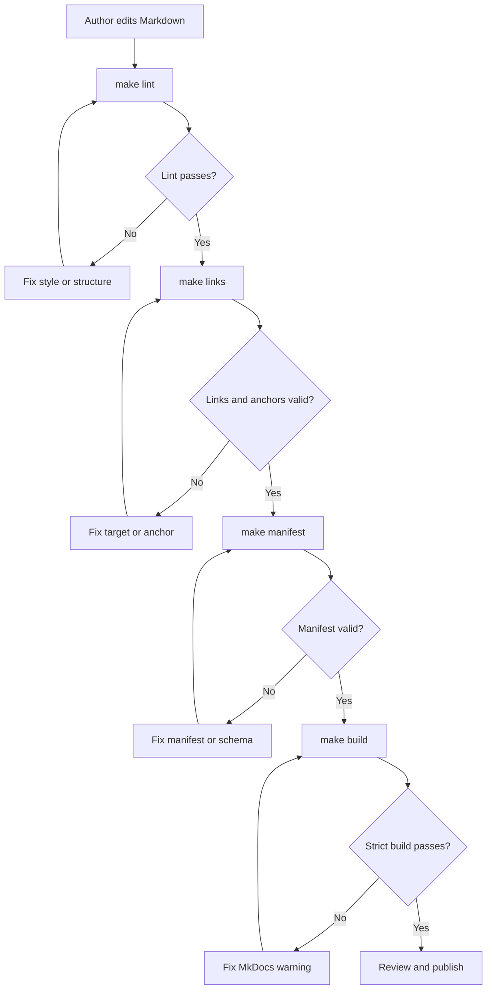
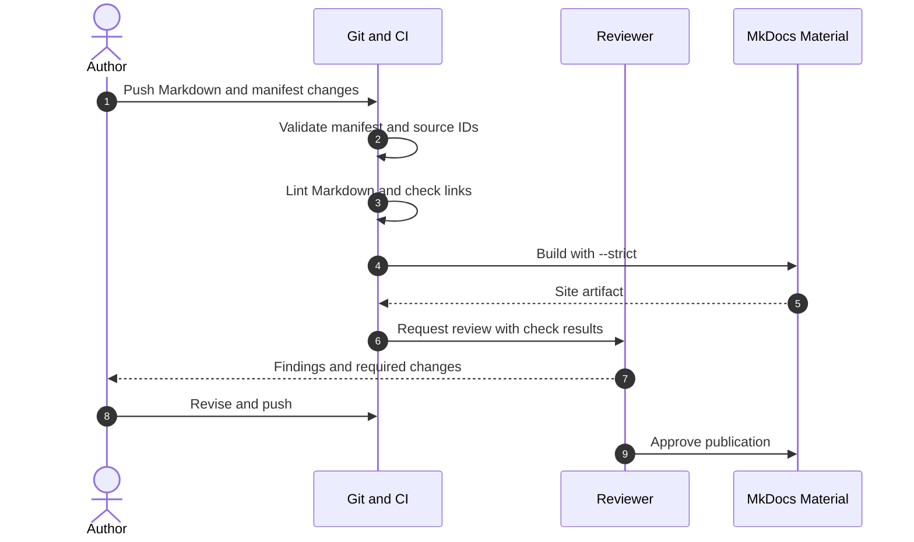
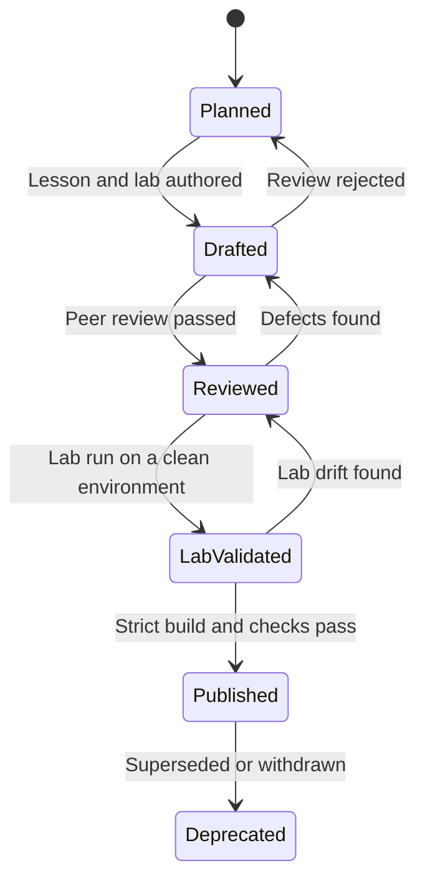

# Documentation Example

This page demonstrates the three diagram types the academy uses most often in its authoring and review documentation. It is a working example, not a lesson. If the diagrams render in the local MkDocs site, the Mermaid integration is configured correctly.

## 1. Authoring and validation flow

The flowchart shows the path from a Markdown edit to a published page. The loop is intentional: failed checks return the author to the specific step that failed, not to the beginning.



**What to notice:** the manifest check comes before the site build because a broken prerequisite or path should fail fast. The build is strict, so a warning is a failure.

## 2. Review sequence

The sequence diagram shows the same work as an interaction between the author, CI, a reviewer, and MkDocs. It makes the hand-offs explicit.



**What to notice:** the reviewer sees the check results before reading the content. The author is responsible for fixing the failed check, not the reviewer.

## 3. Page lifecycle

The state diagram mirrors the manifest's publication status. Validation is tracked separately from publication; a page can be published only after the required checks pass.



**What to notice:** moving backward is allowed when evidence is found. The reason and reviewer must be recorded.

## Local commands

From the repository root:

```bash
make install   # create .venv and install pinned documentation dependencies
make serve     # serve at http://127.0.0.1:8000
make check     # manifest, links, Markdown lint, and strict build
make build     # strict build into site/
```

The optional Mermaid render check requires `mmdc` on `PATH`:

```bash
make mermaid
```

If `mmdc` is unavailable, the build still works; the script reports that rendering was skipped.
