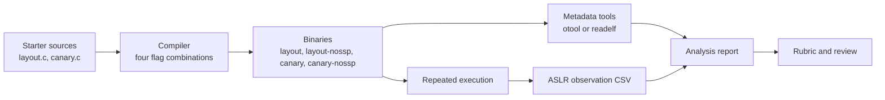
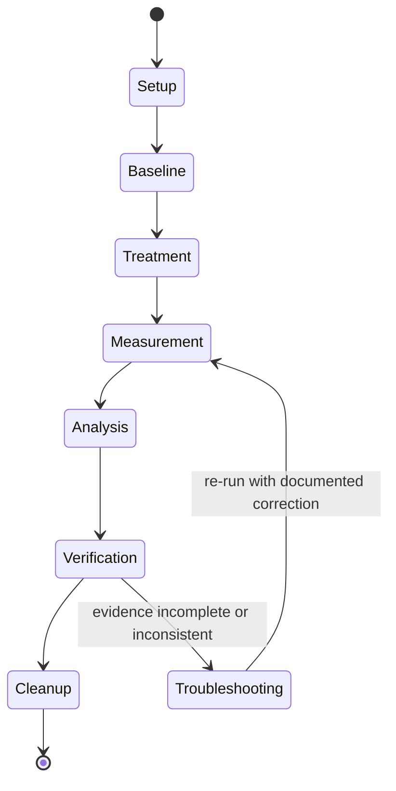

# Lab SYS-01: Reproducible Binary and Memory Analysis

> **Student instructions.** **Module:** SYS-01 · **Level:** L1 · **Type:** research-informed analysis lab
> **Risk:** low · **Isolation:** none required · **Time:** 4–6 h
> **Status:** drafted · **Validation:** structural; macOS path executed, Linux path manual

## At a glance

| Item | Value |
|---|---|
| Research question | How do compiler flags change observable binary and memory properties, and how much do addresses vary across repeated executions? |
| Artefacts | Four builds, metadata captures, annotated disassembly, ASLR observation CSV, analysis report |
| Primary environment | Local macOS or Linux host with a C compiler |
| Network | Not required |
| Offensive activity | None |
| Rubric | [`rubric.md`](rubric.md) |
| Reproducibility notes | [`reproducibility.md`](reproducibility.md) |
| Instructor solution | `solution.md` (instructor-only; excluded from the published site) |

## 1. Research and learning question

**Question:** Which binary properties are stable across compiler configurations, and which properties change when a mitigation or address randomization is enabled?

This is a measurement lab, not a demonstration. You will define what you observe, record the evidence, and state what the evidence does and does not support.

### Hypotheses

| ID | Hypothesis | Prediction |
|---|---|---|
| H1 | Enabling an explicit stack protector adds guard symbols and guard instructions without changing the executable format or PIE status. | `canary` has stack-guard symbols and guard code; `canary-nossp` does not; both have the same format and PIE state. |
| H2 | On an ASLR-enabled host, repeated runs of the same PIE binary produce more than one page-aligned base for at least one region. | The observation CSV contains more than one distinct page for stack, heap, or image base. |
| H3 | A clean rebuild with identical flags preserves observable metadata even if the bytes are not identical. | Format, PIE state, section names, and guard-symbol presence match across two clean builds. |

### What would refute or weaken the hypotheses

- H1 is weakened if the guard symbols appear with `-fno-stack-protector`, or if enabling the guard changes the executable format or PIE state.
- H2 is weakened if all observed pages are identical on a host documented as ASLR-enabled.
- H3 is weakened if metadata differs across identical rebuilds.

A failed or partial hypothesis is a result. Report it; do not edit the observation.

## 2. Prerequisites

- [SYS-01.1 Machine model](../../tutorials/sys-01-computer-architecture/01-machine-model-and-execution.md)
- [SYS-01.2 Memory layout and stack frames](../../tutorials/sys-01-computer-architecture/02-memory-layout-and-stack-frames.md)
- [SYS-01.3 Binary anatomy and calling conventions](../../tutorials/sys-01-computer-architecture/03-binary-anatomy-and-calling-conventions.md)
- [SYS-01.4 Memory safety and mitigations](../../tutorials/sys-01-computer-architecture/04-memory-safety-and-mitigations.md)
- A C compiler and either binutils (`readelf`, `objdump`, `nm`, `size`) on Linux or Xcode Command Line Tools (`otool`, `nm`, `size`) on macOS.
- Python 3.10+ for the measurement and verification scripts.

## 3. Scope, safety, and authorization

**In scope:** compiling the supplied starter sources, inspecting the resulting binaries, running them repeatedly, and analyzing the output.

**Out of scope:** exploiting a vulnerable program, running untrusted binaries, disabling host protections, or testing any system you do not own.

- [ ] I will work in a local directory I control.
- [ ] I will not run binaries from untrusted sources.
- [ ] I will not disable ASLR, SIP, or other host protections.
- [ ] I will record commands and outputs rather than relying on memory.
- [ ] I will remove compiled artifacts during cleanup.

This lab involves no offensive technique against a third party. The `canary.c` source contains a deliberate overflow so the compiler's guard code can be observed; do not turn it into an exploit.

## 4. Environment and software versions

Record your own values; the validated column is the environment in which this lab's macOS path was executed.

| Component | Validated capture host | Your environment |
|---|---|---|
| OS | macOS 27.0.1 (build 26A434) | |
| Architecture | arm64 | |
| Compiler | Apple clang 21.0.0 (clang-2100.3.34.2) | |
| Binary tools | `otool`, `nm`, `size`, `objdump` | |
| Python | 3.9.6 system Python | |
| Page size | 16384 bytes | |

```bash
uname -a
cc --version
getconf PAGE_SIZE
python3 --version
```

> **Version note (2026-10-19).** Compiler defaults, page size, and binary metadata differ by platform. On the validated macOS host, the default compiler settings already emitted stack-protection code; only `-fno-stack-protector` removed it. Do not assume "no explicit flag" means "no protection."

## 5. Experimental topology



The topology is local and single-host. No network service, container, or remote target is involved.

### Experiment state transitions



## 6. Measurement plan

| ID | Metric | Operational definition | Evidence required | Analysis |
|---|---|---|---|---|
| M1 | Executable format and PIE state | Categorical value from the header (`Type` on ELF; `PIE` flag on Mach-O) | Header command and quoted field | Compare builds; test H1 and H3 |
| M2 | Stack-guard symbols | Presence and count of `stack_chk_guard` / `stack_chk_fail` symbols or imports | Symbol/import command and output | Compare `canary` with `canary-nossp`; test H1 |
| M3 | Guard instructions | Presence of a guard load, store, compare, and failure call in `copy_name` | Disassembly with annotations | Explain the control flow; test H1 |
| M4 | Address variation | Number of distinct page-aligned bases per region across N runs | `aslr-observations.csv` and summary JSON | Test H2; do **not** estimate entropy from N=30 |
| M5 | Rebuild metadata stability | Equality of format, PIE, section names, and guard-symbol presence across two clean builds | Two metadata captures and SHA-256 hashes | Test H3; byte identity is a separate observation |
| M6 | Evidence completeness | All required files present and CSV validates | `verify_evidence.py` exit status | Gate before analysis |

**Measurement rule:** a claim such as "ASLR randomized the stack" requires the CSV and the summary. A claim such as "ASLR has X bits of entropy" is out of scope and cannot be supported by this design.

## 7. Setup

The lab directory contains:

```text
labs/sys-01-memory-and-binaries/
├── lab.md
├── rubric.md
├── reproducibility.md
├── solution.md              # instructor-only, excluded from the site
├── starter/
│   ├── Makefile
│   ├── layout.c
│   └── canary.c
├── scripts/
│   ├── measure_aslr.py
│   └── verify_evidence.py
└── SHA256SUMS
```

From the lab directory:

```bash
mkdir -p evidence
shasum -a 256 -c SHA256SUMS        # macOS
sha256sum -c SHA256SUMS            # Linux
cd starter
make all
```

Expected: four binaries are produced. Record the compiler output.

If `make` is unavailable, compile directly:

```bash
cc -O0 -g -Wall -Wextra -o layout layout.c
cc -O0 -g -Wall -Wextra -fno-stack-protector -o layout-nossp layout.c
cc -O0 -g -Wall -Wextra -fstack-protector-all -o canary canary.c
cc -O0 -g -Wall -Wextra -fno-stack-protector -o canary-nossp canary.c
```

## 8. Procedure

### Task 1: Environment baseline

Record the commands from section 4 and the exact `make` or compiler commands. Save them as `evidence/environment.txt`.

**Verification:** the file contains the OS, architecture, compiler version, and page size.

### Task 2: Build matrix and hashes

```bash
cd starter
make clean
make all
shasum -a 256 layout layout-nossp canary canary-nossp | tee ../evidence/binary-hashes.txt
```

**Question:** which observable properties should be identical across builds, and which should differ?

### Task 3: Metadata comparison

**Linux:**

```bash
for f in layout layout-nossp canary canary-nossp; do
  echo "=== $f"
  readelf -h "$f" | grep -E 'Class|Data|Type|Machine'
  readelf -S "$f" | grep -E '\.text|\.data|\.bss|\.rodata|\.got|\.plt'
done | tee ../evidence/metadata.txt
```

**macOS:**

```bash
for f in layout layout-nossp canary canary-nossp; do
  echo "=== $f"
  otool -hv "$f"
  size -m "$f" | grep -E 'Segment|Section' | head -20
done | tee ../evidence/metadata.txt
```

**Questions:**

1. Is each binary position-independent? Quote the field.
2. Which segments or sections contain code, writable data, and zero-filled data?
3. Does the executable format change when the stack protector is enabled?
4. Which differences support or weaken H1 and H3?

### Task 4: Guard-symbol and disassembly comparison

**Linux:**

```bash
for f in canary canary-nossp; do
  echo "=== $f"
  readelf -s "$f" | grep -E 'stack_chk|strcpy' || echo "no guard symbols"
  objdump -d --no-show-raw-insn "$f" | sed -n '/<copy_name>:/,/^$/p'
done | tee ../evidence/guard-analysis.txt
```

**macOS:**

```bash
for f in canary canary-nossp; do
  echo "=== $f"
  otool -Iv "$f" | grep -E 'stack_chk|strcpy' || echo "no guard imports"
  otool -tvV "$f" | sed -n '/_copy_name:/,/^_main:/p'
done | tee ../evidence/guard-analysis.txt
```

Annotate the guard load, store, comparison, and failure call. If a build has no guard, say so and explain why.

### Task 5: Address-variation measurement

From the lab directory:

```bash
python3 scripts/measure_aslr.py \
  --binary starter/layout \
  --runs 30 \
  --csv evidence/aslr-observations.csv \
  | tee evidence/aslr-summary.json
python3 scripts/verify_evidence.py \
  --csv evidence/aslr-observations.csv \
  --min-runs 30
```

The script runs the binary repeatedly, parses the six addresses, and records the page number for each region. It does **not** estimate entropy.

**Questions:**

1. How many distinct pages were observed for the stack, heap, code, and data regions?
2. Did any region remain at a single page across all runs? What would that suggest?
3. Why is 30 runs insufficient to estimate the distribution of ASLR bases?
4. Does the evidence support H2?

### Task 6: Rebuild stability

```bash
cd starter
make clean
make all
shasum -a 256 layout layout-nossp canary canary-nossp | tee ../evidence/binary-hashes-rebuild.txt
```

Compare the two hash files and the two metadata captures.

**Questions:**

1. Are the binaries byte-identical? If not, why might that happen?
2. Are the format, PIE state, section names, and guard-symbol presence identical?
3. Does the evidence support H3 as stated, or only part of it?

### Task 7: Analysis report

Write a 700–1000 word report with:

1. **Question and hypotheses:** restate them.
2. **Method:** environment, build matrix, sample size, tools.
3. **Results:** a table for M1–M5 with the observed value and evidence file.
4. **Hypothesis decisions:** supported, weakened, or inconclusive, with reasons.
5. **Limitations:** at least four, including sample size and platform scope.
6. **Threats to validity:** one confounder and how you controlled or acknowledged it.
7. **Reproducibility:** commands and versions another learner needs.
8. **Evidence index:** file names and commands for every claim.

## 9. Expected observations

These are qualitative expectations, not recorded results:

- The explicit stack-protector build contains guard symbols and guard instructions; the `-fno-stack-protector` build should not.
- Enabling the stack protector should not change the executable format or PIE state.
- Repeated runs on an ASLR-enabled host should produce more than one page-aligned base for at least one region.
- A rebuild may produce different bytes even when observable metadata is stable; the reason depends on the linker and platform.

Your addresses, symbol names, section layout, and instruction encodings will differ. Report your observations.

## 10. Verification

The lab is complete only when:

- [ ] `evidence/environment.txt` records OS, architecture, compiler, and page size.
- [ ] `evidence/binary-hashes.txt` and `binary-hashes-rebuild.txt` exist.
- [ ] `evidence/metadata.txt` contains header and section/segment evidence for all four builds.
- [ ] `evidence/guard-analysis.txt` contains the guard comparison and your annotations.
- [ ] `evidence/aslr-observations.csv` has at least 30 runs and passes `verify_evidence.py`.
- [ ] `evidence/aslr-summary.json` is present.
- [ ] The report states a decision for H1, H2, and H3.
- [ ] The report lists at least four limitations and one confounder.
- [ ] No claim depends on an output you did not capture.

Verification command:

```bash
python3 scripts/verify_evidence.py --csv evidence/aslr-observations.csv --min-runs 30
```

## 11. Evidence package

Submit:

```text
evidence/
├── environment.txt
├── binary-hashes.txt
├── binary-hashes-rebuild.txt
├── metadata.txt
├── guard-analysis.txt
├── aslr-observations.csv
├── aslr-summary.json
└── report.md
```

Do not include compiled binaries in the submission. Hashes are sufficient.

## 12. Cleanup

```bash
cd starter && make clean
```

Keep `evidence/`. Remove temporary binaries, scratch copies, and any addresses or paths you do not need.

## 13. Troubleshooting

| Symptom | Likely cause | Check | Resolution |
|---|---|---|---|
| `cc: command not found` | No compiler | `cc --version` | Install Xcode Command Line Tools or build-essential |
| `readelf: command not found` | macOS or minimal Linux | `uname -s` | Use `otool` on macOS; install binutils on Linux |
| `otool: invalid option` | Wrong flag | `otool -h` | Use `-hv`, `-l`, `-tvV`, or `-Iv` |
| Addresses identical across runs | ASLR disabled or constrained | Documented platform setting | Do not change host settings; report the observation |
| `measure_aslr.py` cannot find the binary | Relative path resolved incorrectly | `ls starter/layout` | Pass an absolute path or run from the lab directory |
| CSV has fewer than 30 rows | Program failed mid-run | `stderr` from the script | Fix the failure and rerun; do not pad the CSV |
| `verify_evidence.py` fails | Missing column or malformed hex | Inspect the CSV header | Re-run the measurement; do not hand-edit evidence |

## 14. Limitations

1. **Small sample.** Thirty runs describe only those runs; they do not estimate ASLR entropy or the distribution of bases.
2. **Platform scope.** macOS Mach-O and Linux ELF differ in headers, segments, and tool output. Results do not transfer automatically.
3. **Compiler defaults.** The default build may already enable protections; the flag matrix controls only what is explicit.
4. **No exploitation.** The lab observes defensive metadata and code; it does not test exploitability.
5. **Linker nondeterminism.** Byte-identical rebuilds are not guaranteed; H3 deliberately tests metadata, not bytes.
6. **Page size.** A 16 KiB page host will report different page counts than a 4 KiB host.

## 15. Manual testing status

| Path | Status | Notes |
|---|---|---|
| macOS arm64 build and measurement | Executed during repository validation | Real outputs are recorded in `solution.md` |
| Linux ELF build and measurement | Not executed in repository validation | Commands and expected fields are documented; a Linux VM or container is required |
| Windows/PE path | Not covered | Out of scope for this lab |

## 16. Extension tasks

1. Add a PIE versus non-PIE build (`-no-pie` where supported) and compare headers and address variation.
2. Repeat the measurement at `-O2` and compare frame layout and guard placement.
3. Increase the sample to 300 runs and report whether the number of distinct pages changes; still do not claim entropy without a justified estimator.
4. Repeat on a 4 KiB-page Linux host and compare the page counts.
5. Design a reproducibility check that compares metadata, not bytes, across two machines.

## 17. Evaluation

Use [`rubric.md`](rubric.md). The rubric weights the research question, measurement design, evidence, analysis, limitations, safety, and communication. A fabricated output or a run against an unauthorized target is an automatic fail.

## 18. Instructor materials

`solution.md` contains the validated macOS observations, expected Linux fields, grading notes, and common learner errors. It is excluded from the published site but remains readable in the repository; restrict repository access separately if the assessment must remain confidential.
