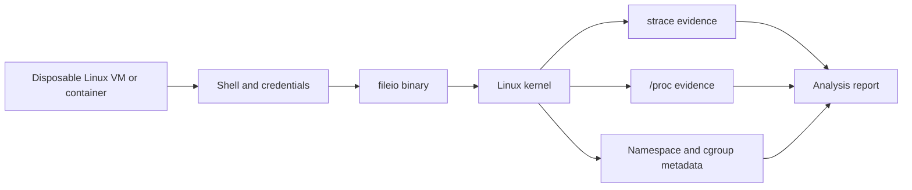
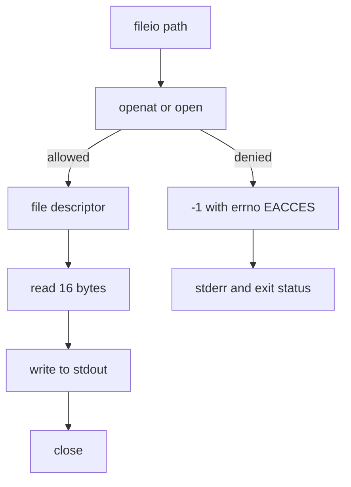
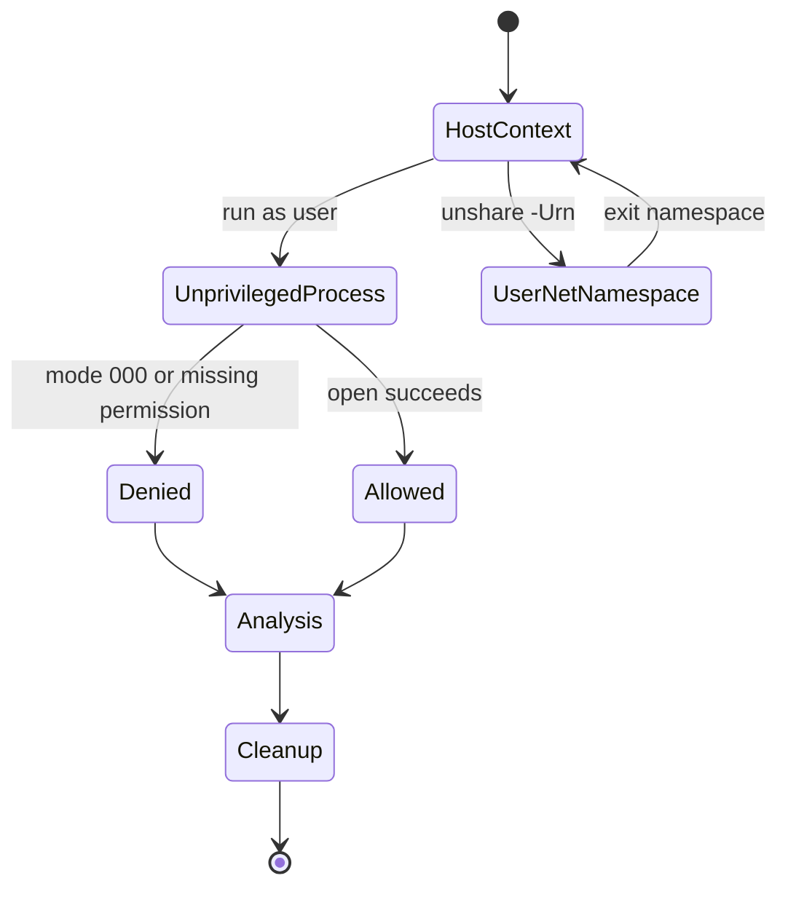

# Lab SYS-02: Syscalls, Credentials, and Isolation

> **Student instructions.** **Module:** SYS-02 · **Level:** L1 · **Type:** research-informed systems lab
> **Risk:** low to moderate · **Isolation:** disposable Linux VM recommended; container for tracing subset
> **Time:** 4–6 h · **Status:** drafted · **Validation:** structural; macOS partial path executed, Linux path manual

## At a glance

| Item | Value |
|---|---|
| Research question | How do credentials, syscall filters, and namespace membership change what a process can access and what evidence remains? |
| Artefacts | Syscall traces, credential and sandbox snapshot, namespace comparison, boundary analysis |
| Primary environment | Disposable Linux VM with `gcc`, `strace`, util-linux, iproute2 |
| Secondary environment | Container for syscall tracing only, if its seccomp/ptrace policy permits; macOS fallback for the descriptor/error subset |
| Network | Not required; do not use a production host |
| Offensive activity | None |
| Rubric | [`rubric.md`](rubric.md) |
| Reproducibility notes | [`reproducibility.md`](reproducibility.md) |
| Instructor solution | `solution.md` (instructor-only; excluded from the published site) |

## 1. Research and learning question

**Question:** Which observations distinguish a denied operation from an allowed one, and how do we know which kernel control produced the result?

The lab asks you to connect four layers:

1. the process's credentials;
2. the kernel object and its permissions;
3. the syscall interface and return value;
4. the evidence left in traces, `/proc`, and namespace metadata.

### Hypotheses

| ID | Hypothesis | Prediction |
|---|---|---|
| H1 | A mode-`000` file opened by an unprivileged process fails with `EACCES`, while a process with `CAP_DAC_OVERRIDE` may succeed. | The unprivileged trace contains a failed open with `EACCES`; a root trace may contain a successful open. |
| H2 | A process in a new user and network namespace appears as UID 0 inside while its host UID is unchanged, and sees only a loopback interface. | `id` inside shows UID 0; the host `id` still shows the original UID; `ip link` shows loopback only. |
| H3 | A container with a default seccomp profile reports a different `Seccomp` value and a smaller effective capability set than the host shell. | `/proc/self/status` inside the container differs in `Seccomp` and `CapEff` from the host snapshot. |

H3 is optional and only testable if a container runtime is available and correctly configured. Record "not tested" rather than inventing a comparison.

### What would refute or weaken the hypotheses

- H1 is weakened if the unprivileged open succeeds without an alternative explanation (for example, the file is owned by the user with a permissive ACL, or the process has a capability).
- H2 is weakened if the UID inside is not mapped as predicted or the network namespace shares host interfaces.
- H3 is weakened if the container is unconfined, `Seccomp` is disabled, or the capability set is not reduced.

## 2. Prerequisites

- [SYS-02.1 Privilege levels](../../tutorials/sys-02-operating-systems/01-privilege-levels-and-kernel-boundary.md)
- [SYS-02.2 Processes and threads](../../tutorials/sys-02-operating-systems/02-processes-threads-and-scheduling.md)
- [SYS-02.3 Files and permissions](../../tutorials/sys-02-operating-systems/03-files-permissions-and-access-control.md)
- [SYS-02.4 System calls and tracing](../../tutorials/sys-02-operating-systems/04-system-calls-and-tracing.md)
- [SYS-02.5 Isolation and sandboxing](../../tutorials/sys-02-operating-systems/05-isolation-and-sandboxing.md)
- A disposable Linux VM or container. A VM is preferred because namespace and container-inspection tasks may be restricted inside a container.
- Packages: `gcc`, `strace`, `util-linux`, `iproute2`; optional `libcap2-bin` for `capsh`.
- Python 3.10+ for the verifier.

## 3. Scope, safety, and authorization

**In scope:** local processes, files you create, namespace creation where permitted, and inspection of your own container configuration.

**Out of scope:** attaching a tracer to another user's process, testing a remote host, running privileged containers, changing host kernel policy, or attempting an escape.

- [ ] I will use a disposable VM or container I own.
- [ ] I will not attach a tracer to processes I do not own.
- [ ] I will not use `--privileged` or add `CAP_SYS_ADMIN` for this lab.
- [ ] I will not disable SIP, ASLR, seccomp, or kernel hardening.
- [ ] I will remove containers and temporary files at the end.

If `unshare` fails, record the exact error. A restricted environment is a valid finding, not a reason to change host policy.

## 4. Environment and software versions

| Component | Validated capture host | Your environment |
|---|---|---|
| OS | macOS 27.0.1 (partial fallback only) | |
| Linux kernel | Not available in validation | |
| Distribution | Not available in validation | |
| Architecture | arm64 | |
| Compiler | Apple clang 21.0.0 | |
| `strace` | Not available on the capture host | |
| Python | 3.9.6 | |
| Container runtime | Docker CLI present; daemon not running | |

```bash
uname -a
cat /etc/os-release
cc --version
strace -V
python3 --version
```

> **Version note (2026-10-19).** Syscall names, trace formatting, namespace support, and default seccomp profiles differ by kernel, distribution, libc, and container runtime. Record the exact versions. Do not generalize a result from one distribution to another.

## 5. Experimental topology



### Data flow for the file experiment



### State transitions



## 6. Measurement plan

| ID | Metric | Operational definition | Evidence required | Analysis |
|---|---|---|---|---|
| M1 | Open outcome | Exit status of `fileio` and syscall return value | `denied-status.txt`, `stderr-denied.txt`, `trace-denied.txt` | Test H1 |
| M2 | Syscall sequence | Ordered syscall names and return values for a successful read | `trace-success.txt` | Map to descriptors and kernel objects |
| M3 | Credentials | Real/effective/saved/fs UID and GID; group list | `id`, `status-fields.txt` | Explain the permission class |
| M4 | Sandbox state | `Seccomp`, `NoNewPrivs`, `CapEff`, `CapPrm` | `status-fields.txt` | Explain what each value permits |
| M5 | Namespace membership | Namespace inode numbers on host versus inside the new namespace | `namespaces.txt`, `namespace-experiment.txt` | Test H2 |
| M6 | Network visibility | Interface names and count inside the network namespace | `namespace-experiment.txt` | Test H2 |
| M7 | Cgroup membership | Cgroup v2 path from `/proc/<pid>/cgroup` | `cgroup.txt` | Explain resource containment |
| M8 | Container comparison | `Seccomp` and `CapEff` inside a default container versus host | Optional container capture | Test H3 |
| M9 | Evidence completeness | Required files present and verifier passes | `verify_evidence.py` exit status | Gate before analysis |

**Measurement rule:** "the process was denied" requires the exit status and the failed syscall line with `EACCES`. A single line without the command, environment, and credential context is insufficient.

## 7. Setup

```text
labs/sys-02-syscalls-and-isolation/
├── lab.md
├── rubric.md
├── reproducibility.md
├── solution.md                    # instructor-only, excluded from the site
├── starter/
│   └── fileio.c
├── scripts/
│   ├── collect_evidence.sh
│   └── verify_evidence.py
├── environment/
│   └── Containerfile
└── SHA256SUMS
```

From the lab directory:

```bash
shasum -a 256 -c SHA256SUMS        # macOS
sha256sum -c SHA256SUMS            # Linux
```

The automated collector is the preferred path on Linux:

```bash
scripts/collect_evidence.sh evidence
scripts/verify_evidence.py --dir evidence
```

The script refuses to run on non-Linux hosts. Review it before running; it only creates files under `evidence/`.

## 8. Procedure

### Task 1: Environment baseline

Record the section 4 commands in `evidence/environment.txt`. Confirm you are on a disposable host and not a production system.

### Task 2: Build the harness

```bash
mkdir -p evidence
cc -O0 -g -Wall -Wextra -o evidence/fileio starter/fileio.c
printf 'synthetic lab data\n' > evidence/sample.txt
printf 'synthetic restricted data\n' > evidence/restricted.txt
chmod 000 evidence/restricted.txt
```

**Question:** why does the lab use synthetic files instead of real system files?

### Task 3: Trace a successful read

```bash
strace -f -e trace=openat,read,write,close,exit_group \
  -o evidence/trace-success.txt \
  evidence/fileio evidence/sample.txt \
  > evidence/stdout-success.txt 2> evidence/stderr-success.txt
```

**Questions:**

1. Which syscall opened the file, and what descriptor did it return?
2. Which descriptor did `read` and `write` use?
3. How many bytes did `read` return, and how does that compare with the request?
4. Which syscall ended the process?

### Task 4: Produce and trace a permission failure

As an unprivileged user:

```bash
set +e
strace -f -e trace=openat,exit_group \
  -o evidence/trace-denied.txt \
  evidence/fileio evidence/restricted.txt \
  > evidence/stdout-denied.txt 2> evidence/stderr-denied.txt
status=$?
set -e
printf 'exit_status=%s\n' "$status" | tee evidence/denied-status.txt
```

**Questions:**

1. What is the exact return value and symbolic error?
2. Which credential and permission bits caused the result?
3. What happens if you run the same command as root? Record it as a separate observation; do not overwrite the unprivileged run.

### Task 5: Snapshot credentials and sandbox state

```bash
id | tee evidence/id.txt
grep -E '^(Uid|Gid|CapEff|CapPrm|NoNewPrivs|Seccomp):' /proc/self/status \
  | tee evidence/status-fields.txt
command -v capsh >/dev/null && capsh --decode="$(awk '/^CapEff:/ {print $2}' /proc/self/status)" \
  | tee evidence/capabilities-decoded.txt || true
```

**Questions:**

1. What are the four UID values?
2. Which effective capabilities are present?
3. What do `Seccomp` values 0, 1, 2, and 3 mean?
4. What does `NoNewPrivs` prevent?

### Task 6: Namespace experiment

```bash
set +e
unshare -Urn --fork --pid --mount-proc sh -c '
  echo "--- id"; id
  echo "--- links"; ip link 2>&1 || true
  echo "--- namespaces"; ls -l /proc/self/ns
  echo "--- cgroup"; cat /proc/self/cgroup
' > evidence/namespace-experiment.txt 2>&1
echo "exit_status=$?" | tee evidence/namespace-status.txt
set -e
```

Also capture the host comparison:

```bash
ls -l /proc/self/ns | tee evidence/namespaces.txt
cat /proc/self/cgroup | tee evidence/cgroup.txt
```

**Questions:**

1. Which namespace inode numbers differ from the host?
2. What UID do you appear to have inside the user namespace?
3. Which network interfaces are visible?
4. If `unshare` failed, what was the exact error, and which policy or kernel feature blocked it?

### Task 7: Optional container comparison

Only if a container runtime is available:

```bash
docker run --rm -d --name sys02lab debian:bookworm-slim sleep 300
PID=$(docker inspect -f '{{.State.Pid}}' sys02lab)
docker inspect --format 'privileged={{.HostConfig.Privileged}} cap_add={{.HostConfig.CapAdd}} net={{.HostConfig.NetworkMode}}' sys02lab \
  | tee evidence/container-config.txt
ls -l /proc/$PID/ns | tee evidence/container-namespaces.txt
grep -E '^(CapEff|NoNewPrivs|Seccomp):' /proc/$PID/status | tee evidence/container-status.txt
docker rm -f sys02lab
```

If Docker is unavailable, write "not tested" in the report. Do not install a runtime solely for this lab.

**Questions:**

1. Does the container share any namespace with the host?
2. Is it privileged? Which capabilities are added?
3. How do `Seccomp` and `CapEff` compare with the host?
4. Which additional control would you add before running untrusted code?

### Task 8: Boundary-failure analysis

For each scenario, name the failed control, the evidence you would collect, and one preventive control:

| # | Scenario |
|---|---|
| A | A root service follows a user-controlled path and writes into a world-writable directory. |
| B | A container runs with `--privileged` and mounts the host runtime socket. |
| C | A user namespace is assumed to be a security boundary, but a kernel bug allows a mount operation to affect the host. |

Write 150–250 words per scenario and cite the relevant tutorial section.

### Task 9: Analysis report

Write a 700–1000 word report with:

1. Question and hypotheses.
2. Environment and exact commands.
3. Evidence table for M1–M9.
4. Hypothesis decisions with reasons.
5. At least four limitations and one confounder.
6. A boundary-failure analysis for A–C.
7. Reproducibility notes and evidence index.

## 9. Expected observations

These are qualitative expectations, not recorded results:

- A successful trace contains an open, a read, a write, and a close or exit.
- The descriptor returned by the open should be the one used by read and close.
- An unprivileged open of a mode-`000` file should fail with `EACCES` and a nonzero exit status.
- A root or `CAP_DAC_OVERRIDE` process may succeed; that is a different observation and must be recorded separately.
- Inside a user and network namespace, the process may appear as UID 0 and see only loopback.
- `unshare` may fail with `Operation not permitted`; record the failure rather than changing host policy.

## 10. Verification

- [ ] Environment file records OS, kernel, architecture, compiler, and `strace`.
- [ ] Success trace contains the open/read/write/close or exit sequence.
- [ ] Denied trace contains the failed open and the exact errno.
- [ ] Credential snapshot includes UID/GID, capabilities, `Seccomp`, and `NoNewPrivs`.
- [ ] Host and namespace inode evidence are both present.
- [ ] Namespace failure is recorded with the exact error, if it failed.
- [ ] Container task is completed or explicitly marked not tested.
- [ ] The report states a decision for H1, H2, and H3 where testable.
- [ ] The report cites commands and files for every claim.

Verification command:

```bash
scripts/verify_evidence.py --dir evidence
```

## 11. Evidence package

```text
evidence/
├── environment.txt
├── trace-success.txt
├── trace-denied.txt
├── denied-status.txt
├── stderr-denied.txt
├── status-fields.txt
├── namespaces.txt
├── cgroup.txt
├── namespace-experiment.txt
├── namespace-status.txt
├── id.txt
└── report.md
```

Optional: `capabilities-decoded.txt`, `container-*.txt`.

## 12. Cleanup

```bash
rm -f evidence/fileio evidence/sample.txt evidence/restricted.txt
docker rm -f sys02lab 2>/dev/null || true
```

Keep the evidence files you cite. Remove any container and temporary files.

## 13. Troubleshooting

| Symptom | Likely cause | Check | Resolution |
|---|---|---|---|
| `strace: command not found` | Not installed | `command -v strace` | Install the distribution package or use a VM that has it |
| `strace: ptrace(PTRACE_TRACEME) ... Operation not permitted` | Container seccomp/Yama policy blocks tracing | `cat /proc/sys/kernel/yama/ptrace_scope`; container profile | Use the VM path; do not add `--privileged` or `CAP_SYS_ADMIN` |
| `unshare: Operation not permitted` | User namespaces restricted | `sysctl kernel.unprivileged_userns_clone` (distribution-dependent) | Record the error; do not change host policy |
| `ip: command not found` | iproute2 missing | `command -v ip` | Install iproute2 or record the substitution |
| Docker socket permission denied | User lacks access | `docker info` | Use rootless Docker or skip Task 7 |
| Trace file is empty | Wrong filter or early failure | `cat trace-*.txt`; run without `-o` | Include `-f`; check stderr |
| `EACCES` not reproduced | Running as root or ACL grants access | `id`; `ls -l`; `getfacl` | Run as an unprivileged user and verify the mode |
| Verifier fails on `Seccomp` | Field name or format differs | `cat status-fields.txt` | Record the actual field and explain the difference |

## 14. Limitations

1. **Trace scope.** A trace shows syscalls, not library logic, kernel-internal work, or buffer contents.
2. **Snapshot in time.** Namespace and cgroup metadata describe one moment; processes can move or exit.
3. **Credential dependence.** Root or capabilities change the result; the report must state which credential was used.
4. **Distribution differences.** Syscall names, `/proc` fields, and seccomp defaults vary by kernel and distribution.
5. **Container variance.** Runtimes apply different default profiles; a container result is not a universal claim about containers.
6. **macOS fallback.** The fallback demonstrates descriptors and `EACCES`, not a syscall trace.
7. **No offensive testing.** The lab does not attempt an escape, injection, or privilege escalation.

## 15. Manual testing status

| Path | Status | Notes |
|---|---|---|
| Linux VM with `strace` and `unshare` | Not executed in repository validation | Primary path; requires a Linux runtime |
| Container tracing subset | Not executed | Docker daemon was not running during validation |
| macOS descriptor/error fallback | Executed during repository validation | Real output recorded in `solution.md` |
| `collect_evidence.sh` syntax | Validated with `bash -n` | Execution requires Linux |
| `verify_evidence.py` logic | Validated against a temporary fixture | Not evidence for a real experiment |

## 16. Extension tasks

1. Write a seccomp filter that allows only `openat`, `read`, `write`, `close`, and `exit_group`. Test which syscalls fail and with which action.
2. Compare `strace` output for the same program on x86-64 and AArch64; explain the differences.
3. Run the container comparison with a read-only root filesystem and no network; explain which measurements change.
4. Add a measurement of `pids.max` or `memory.max` and verify the limit with a controlled workload.
5. Design a detection rule for repeated `EACCES` opens of sensitive paths, and state the false positives.

## 17. Evaluation

Use [`rubric.md`](rubric.md). The rubric weights the research question, measurement design, trace evidence, credential and sandbox analysis, namespace evidence, boundary analysis, safety, and communication. Attaching a tracer to a process you do not own is an automatic fail.

## 18. Instructor materials

`solution.md` contains expected syscall categories, the validated macOS fallback output, grading notes, and scenario answers. It is excluded from the published site but remains readable in the repository; restrict repository access separately if the assessment must remain confidential.
