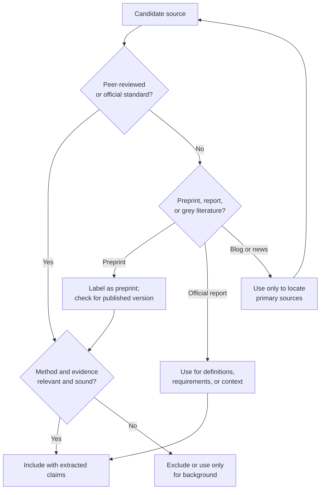
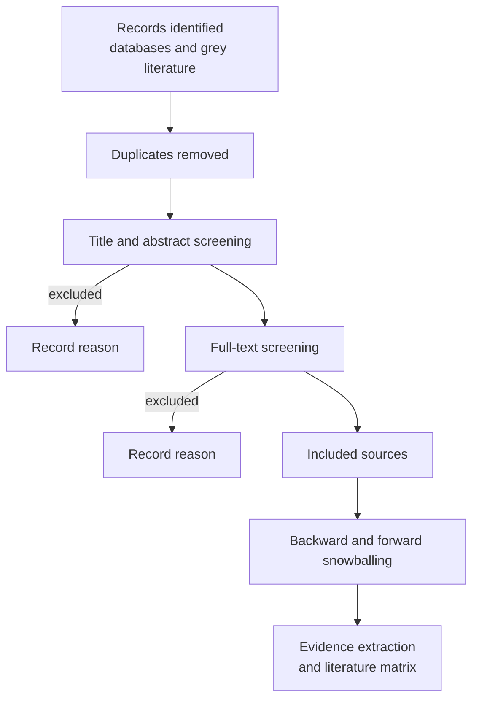

# Research 1: Literature Search and Source Evaluation

> **Track:** Academic Cybersecurity Research · **Level:** L5 · **Prerequisites:** ORI-03, RES-01 enrollment · **Estimated time:** 10 h
> **Primary module:** RES-01 · **Status:** drafted · **Validation:** structural

## Learning outcomes

By the end of this tutorial you can:

1. Turn a research question into a reproducible search protocol with databases, query strings, dates, and screening rules.
2. Screen sources using explicit inclusion and exclusion criteria and record why each source was included or excluded.
3. Evaluate a source's venue, method, evidence, recency, and conflicts of interest rather than relying on its title or abstract.
4. Distinguish primary evidence, secondary summaries, preprints, and generated examples.
5. Produce a literature matrix that supports a defensible gap statement.

## Why this matters

A literature review is not a list of papers. It is a **sampling procedure** over a population of evidence. If the procedure is undocumented, the review cannot be reproduced, and the "gap" may be an artifact of which databases or query terms the author happened to use.

Security research has an additional problem: much relevant evidence lives in venues that are not indexed the same way as academic papers, including standards bodies, vendor advisories, incident reports, and open-source artifacts. A credible review must state which evidence types it searched and which it excluded.

## First principles

### The review as a measurement

A review measures the state of evidence. It has:

| Element | Review equivalent |
|---|---|
| Population | All sources that could answer the question |
| Sampling frame | Databases, venues, and grey literature searched |
| Sampling method | Query strings, date range, language, citation chasing |
| Inclusion criteria | What makes a source eligible |
| Exclusion criteria | What disqualifies a source |
| Instrument | Screening and extraction form |
| Measurement | Extracted claims, methods, and evidence |
| Analysis | Synthesis, comparison, gap identification |
| Uncertainty | Missing databases, publication bias, language bias |

Documenting these elements is what separates a **systematic** or **structured** review from a narrative one.

### Source hierarchy

| Tier | Examples | Strength | Limitation |
|---|---|---|---|
| Primary research | Peer-reviewed papers, dissertations, technical reports with methods | Direct evidence and methods | Quality varies; publication bias |
| Standards and official guidance | NIST, ISO/IEC, IETF, CISA, OWASP, FIRST | Authoritative requirements and definitions | Not empirical evidence of effectiveness |
| Official project documentation | Kernel docs, man pages, vendor security guides | Precise behavior and versions | May be incomplete or outdated |
| Incident and advisory data | CVE/NVD, CISA KEV, vendor advisories | Real-world exploitation evidence | Reporting bias, incomplete context |
| Secondary summaries | Textbooks, surveys, blog posts, news | Orientation and vocabulary | May distort or omit primary claims |
| Generated examples | Tutorials, hypotheticals, AI output | Teaching and illustration | Not evidence |

A survey can help you find primary sources. It cannot replace them for a specific factual claim.

### Preprints, peer review, and versioning

A **preprint** has not completed peer review. It may be valuable and later validated, but it must be labeled. A **peer-reviewed** paper has passed editorial and reviewer scrutiny; that is a quality signal, not a guarantee. A **retracted** paper must not be cited as support without explaining the retraction.

Record the version you read: conference version, extended journal version, arXiv version, or draft. Claims can change between versions.



## Building a search protocol

### 1. Decompose the question

For a question such as "Do stack canaries reduce exploitable stack overflows in real software?", identify concepts:

| Concept | Synonyms and related terms |
|---|---|
| Stack canary | stack protector, stack guard, SSP, canary value |
| Exploitation | buffer overflow, stack smashing, control-flow hijack |
| Effectiveness | reduction, bypass, mitigation, measurement |
| Real software | deployed, production, real-world, benchmark |

### 2. Select sources

At minimum, record:

- **Academic databases:** ACM Digital Library, IEEE Xplore, USENIX, NDSS, arXiv, Scopus or Web of Science if available.
- **Grey literature:** NIST, CISA, MITRE, OWASP, FIRST, vendor security advisories.
- **Artifact sources:** GitHub repositories, datasets, replication packages.
- **Citation chasing:** backward and forward snowballing from included papers.

Google Scholar may be used for discovery, but it should not be the only source; its ranking and coverage are not a reproducible sampling frame.

### 3. Write the query and record it

A query is part of the method. Record:

```text
Database:
Query string:
Filters (date, language, document type):
Date executed:
Number of results:
Screening method:
```

Example query template (a **generated example**, not a search result):

```text
("stack canary" OR "stack protector" OR "stack guard")
AND ("buffer overflow" OR "stack smashing" OR "control-flow hijack")
AND (effectiveness OR bypass OR evaluation OR measurement)
```

### 4. Screen in two stages

1. **Title and abstract screening:** apply inclusion/exclusion criteria.
2. **Full-text screening:** verify method, population, and evidence.

Record the reason for exclusion. A PRISMA-style flow makes the sampling auditable [R01].



### 5. Extract evidence, not abstracts

For each included source, record the **specific claim** and the **specific evidence**. "The paper says canaries work" is not extraction. A usable row says which canaries, which attack model, which measurement, and which result with uncertainty.

## Worked example: evaluating a source

This is a **generated example** for practice, not a real citation.

| Field | Example entry |
|---|---|
| Source | *A Measurement of Stack Protector Effectiveness* (fictional) |
| Venue | Peer-reviewed security conference |
| Version | Conference version; no artifact found |
| Question | Does `-fstack-protector-strong` reduce control-flow hijack in the benchmark? |
| Method | 40 C programs, 5 exploit classes, 30 trials |
| Baseline | Same programs without the flag |
| Claim | "Protection reduced successful hijacks by 60%" |
| Evidence | Table 3; no confidence interval; no source code |
| Threats | Benchmark selection, compiler version, no real-world sample |
| Use in review | Include as evidence for benchmark behavior, not as proof of deployed effectiveness |

The extraction separates the authors' claim from the reviewer's judgment. That distinction must survive into the synthesis.

## Common misconceptions

| Misconception | Correction |
|---|---|
| "A highly cited paper is necessarily correct." | Citation counts measure attention, not validity. |
| "Peer review guarantees correctness." | It is a filter, not a proof. Retractions and replication failures exist. |
| "Google Scholar is a complete database." | It is a discovery tool with opaque ranking and incomplete coverage. |
| "The abstract states the result accurately." | Abstracts simplify and sometimes overstate; read the method and results. |
| "A preprint can be cited as established fact." | Label it as a preprint and check for peer-reviewed publication. |
| "No results means no evidence." | Absence of evidence is a finding only if the search was adequate. |
| "A standards document proves a control works." | Standards define requirements and consensus; empirical effectiveness needs measurement. |

## Exercises

### Foundation

1. Decompose a question of your choice into concepts and synonyms.
2. Write a search protocol with at least two databases, one grey-literature source, and explicit date limits.
3. Explain the difference between a primary study and a secondary survey.

### Application

4. Run your protocol and record the number of results per database and the date. Do not fabricate counts.
5. Screen at least 20 records at title/abstract level and record exclusion reasons.
6. Extract five included sources into the [literature matrix](../authoring-templates/literature-matrix.md).

### Analysis

7. Identify one claim that appears in multiple secondary sources but traces to a single primary study. Explain the risk.
8. Find a preprint and its later peer-reviewed version. Compare the claims and note any changes.
9. Assess one source for conflicts of interest and explain how they affect your confidence.

### Extension

10. Design a search that would detect publication bias in a subfield (for example, by comparing venue acceptance to replication attempts). State the sampling frame and its limitations.

## Knowledge check

1. Why is a search protocol part of the method rather than an administrative detail?
2. What is the difference between an inclusion criterion and an exclusion reason?
3. Why should a preprint be labeled in a review?
4. What does a PRISMA-style flow communicate that a reference list does not?
5. Why is "the paper says X" insufficient evidence extraction?

Answers: instructor key in `assessments/research/answer-key.md` (planned; not yet authored).

## Key takeaways

- A literature review is a sampling procedure; document the frame, query, dates, and screening rules.
- Source tier and version matter; label preprints and distinguish standards from empirical evidence.
- Extract claims and evidence, not abstracts.
- A gap statement is only credible if the search that produced it is reproducible.

## Further reading

| Source | Supports | Verification |
|---|---|---|
| [R01] PRISMA 2020 | Systematic review reporting and flow | V2 |
| [R03] Empirical Standards | Study-type expectations and reporting | V1 |
| [A19] CS2023 | Computing research context and curriculum | V1 |
| [N11] NIST SP 800-115 | Assessment planning and evidence | V1 |

Links and verification status for every source ID are recorded in [`REFERENCES.md`](../REFERENCES.md).

## Cross-links

- Next: [Research 2: Questions, hypotheses, and threat models](02-research-questions-hypotheses-and-threat-models.md)
- Template: [Literature matrix](../authoring-templates/literature-matrix.md)
- Project: [P1 structured literature review](projects/01-structured-literature-review.md)
- Track overview: [Research track](README.md)

## Completion checklist

- [ ] I wrote a search protocol with databases, queries, dates, and filters.
- [ ] I recorded inclusion and exclusion criteria before screening.
- [ ] I screened at least 20 records and recorded reasons.
- [ ] I extracted five sources into a matrix with claims and evidence.
- [ ] I labeled at least one preprint or grey-literature source correctly.
- [ ] I can explain why the review is reproducible.
