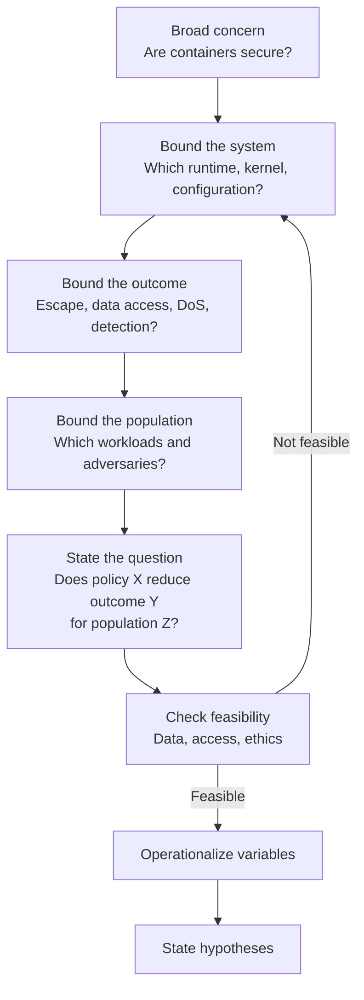
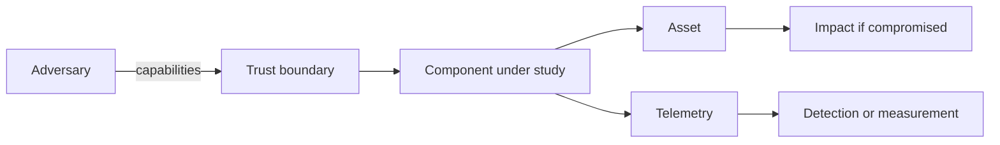
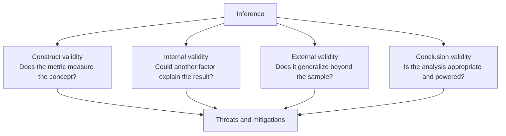

# Research 2: Questions, Hypotheses, and Threat Models

> **Track:** Academic Cybersecurity Research · **Level:** L5 · **Prerequisites:** Research 1; RES-01 module gate · **Estimated time:** 9 h
> **Primary module:** RES-01 · **Status:** drafted · **Validation:** structural
> **Outcomes addressed:** RES-01.O1, RES-01.O2

## Learning outcomes

By the end of this tutorial you can:

1. Refine a broad concern into a bounded, answerable research question.
2. Operationalize constructs into variables, metrics, and evidence.
3. State falsifiable hypotheses with a null and an alternative where appropriate.
4. Build two different threat models: a **security threat model** for the system under study and a **validity threat model** for the research design.
5. Write a pre-registration-style plan that fixes the primary question and analysis before data collection.

## Why this matters

Most weak research fails before data collection. The question is too broad, the outcome is undefined, or the study cannot distinguish the proposed explanation from a simpler one. A precise question and a threat model force those decisions into the open while they can still be changed.

A security threat model and a research validity threat model are not the same:

- The **security threat model** describes the adversary, assets, trust boundaries, and attack surface of the system you study.
- The **validity threat model** describes what could make your inference wrong: selection, measurement, confounding, leakage, and scope.

A paper needs both. A study of a detection rule needs to know what adversary it detects and what could make the measured detection rate misleading.

## First principles

### From concern to question

A research question should be:

| Property | Test |
|---|---|
| Answerable | An observation or argument could answer it |
| Bounded | The population, system, and time frame are stated |
| Significant | The answer changes a decision, claim, or design |
| Feasible | The data and access are obtainable within constraints |
| Ethical and lawful | Authorization, consent, and disclosure are possible |

A useful refinement sequence:

A common failure is to keep the broad concern and call it a question. "Are containers secure?" cannot be answered because "secure" has no operational definition and "containers" spans many isolation models.

### Operationalization

Operationalization maps an abstract construct to something observable:

| Construct | Variable | Metric | Evidence |
|---|---|---|---|
| Isolation strength | Whether a process can read a host file | Binary success/failure under a defined policy | Trace, file access, test result |
| Detection quality | Ability to identify an attack | Precision, recall, false positive rate on a labeled corpus | Confusion matrix |
| Exploit mitigation | Difficulty of control-flow hijack | Successful hijacks per N attempts under a threat model | Experiment log |
| Usability | Ability to complete a security task | Completion rate, time, error rate | Study protocol and observations |

The metric is not the construct. A high recall score does not prove "good detection" if the corpus is unrepresentative or the false positive cost is ignored.

### Hypotheses

A hypothesis is a testable statement about a relationship or difference. Prefer statements that specify the comparison and the expected direction where justified.

| Form | Example |
|---|---|
| Null | There is no difference in detection recall between rule A and rule B on the corpus. |
| Alternative, non-directional | There is a difference in recall between A and B. |
| Alternative, directional | Rule A has higher recall than B under the stated conditions. |
| Mechanistic | A succeeds because it inspects field X, which B does not. |

A hypothesis is not a prediction about a single run, and it is not a result. "We expect to find many vulnerabilities" is a hope, not a hypothesis.

### Research threat models

#### Security threat model

Borrow the structure from system threat modeling:

Document the adversary's capabilities, access, and goals. A study of a container escape must state whether the adversary has code execution in the container, access to the runtime socket, or host privileges.

#### Validity threat model

| Threat | Question | Example mitigation |
|---|---|---|
| Selection bias | Is the sample representative? | Define sampling frame; report exclusions |
| Confounding | Is another variable responsible? | Randomize, block, or measure confounders |
| Measurement error | Does the instrument measure the construct? | Validate instrument; report reliability |
| Leakage | Did test data influence training or tuning? | Separate tuning and test sets |
| Overfitting | Is the result specific to the sample? | Holdout, cross-validation, replication |
| Researcher bias | Did expectations influence labeling or analysis? | Blinding, pre-registration, second coder |
| Scope inflation | Are claims broader than the population? | State boundaries in every claim |

## Worked example: refining a question

This is a **generated example**, not a study result.

**Broad concern:** "Containers are not isolated enough."

**Refined question:** "For a Linux container with one writable upload directory and no host mounts, does running the file parser as a non-root user, compared with root inside the container, reduce the number of files outside the upload directory that a path-traversal flaw can modify?"

**Operationalization:**

| Element | Definition |
|---|---|
| Population | One pinned container image and runtime version |
| Treatment | Parser runs as a non-root UID (for example, 1000) |
| Baseline | Parser runs as root inside the container; same image, mounts, and policy |
| Outcome | Number of files outside the upload directory modified through the vulnerable path in a synthetic filesystem tree |
| Adversary | Code execution in the application, no host privileges, no additional capability |
| Evidence | Reproducible harness, path and ownership trace, file hashes before and after, container configuration |

**Hypotheses:**

- H0: The number of modified files outside the upload directory is the same for the root and non-root runs.
- H1: The number is lower when the parser runs as non-root.

**Alternative explanation:** Any difference may come from file ownership or a mount option rather than the UID. The design must hold mounts and synthetic-tree ownership constant and record both.

The refined question is narrow enough to answer and broad enough to matter for container hardening. It also exposes an ethical boundary: the test must run in a disposable lab, not a shared host.

## Common misconceptions

| Misconception | Correction |
|---|---|
| "A broad question is more ambitious." | A broad question is usually unanswerable; ambition belongs in the contribution, not the wording. |
| "A hypothesis is a guess." | It is a testable statement with defined variables and a comparison. |
| "The security threat model is the research design." | One describes the adversary; the other describes what could invalidate the inference. |
| "Operationalization is bureaucratic." | It is the difference between a measurable claim and an opinion. |
| "Pre-registration prevents exploration." | It separates confirmatory tests from exploratory analysis, which can still be reported. |
| "Statistical significance proves the hypothesis." | It indicates compatibility with a model; effect size, design, and bias also matter [R07] [R09]. |

## Exercises

### Foundation

1. Refine "phishing training works" into a bounded research question.
2. Define one construct, variable, metric, and evidence source for a study of password-manager usability.
3. Write a null and a directional alternative hypothesis for a detection comparison.

### Application

4. Build a security threat model for a web application you can run locally. State adversary capabilities and assets.
5. Build a validity threat model for the same study. Name one threat to each validity type.
6. Write a one-page pre-registration with the primary outcome, analysis, and stopping rule.

### Analysis

7. A study finds that a new fuzzer finds more crashes than a baseline. List three alternative explanations that are not "the fuzzer is better."
8. Critique a published abstract: identify the construct, metric, population, and any claim that exceeds them.
9. Explain why a security threat model that assumes a weaker adversary can inflate the apparent effectiveness of a control.

### Extension

10. Design a study that could distinguish a real improvement from a measurement artifact. Specify the baseline, control, and falsification condition.

## Knowledge check

1. What makes a research question answerable?
2. Why must a construct be operationalized?
3. What is the difference between a null and an alternative hypothesis?
4. What does a validity threat model cover that a security threat model does not?
5. Why is pre-registration useful even when the study is exploratory?

Answers: `assessments/research/answer-key.md` (instructor-only).

## Key takeaways

- Refine broad concerns into bounded questions with a population, intervention, outcome, and scope.
- Operationalization links constructs to metrics and evidence.
- Hypotheses must be testable and must state the comparison.
- A study needs both a security threat model and a validity threat model.

## Further reading

| Source | Supports | Verification |
|---|---|---|
| [R02] Experimentation in Software Engineering | Experimental design and hypothesis framing | V2 |
| [R03] Empirical Standards | Study-type expectations | V1 |
| [N07] NIST SP 800-160 Vol. 1 | Systems security engineering and threat modeling | V1 |
| [N09] NIST SP 800-30 | Risk assessment concepts | V1 |
| [A19] CS2023 | Computing research context | V1 |

Links and verification status for every source ID are recorded in [`REFERENCES.md`](../REFERENCES.md).

## Cross-links

- Previous: [Research 1: Literature search](01-literature-search-and-source-evaluation.md)
- Next: [Research 3: Experimental design](03-experimental-design-baselines-and-sampling.md)
- Templates: [Experiment plan](../authoring-templates/experiment-plan.md), [Research paper review](../authoring-templates/research-paper-review.md)
- Project: [P1 literature review](projects/01-structured-literature-review.md)

## Completion checklist

- [ ] I refined one broad concern into a bounded question.
- [ ] I defined the population, intervention, outcome, and scope.
- [ ] I operationalized at least one construct with a metric and evidence source.
- [ ] I wrote a null and an alternative hypothesis.
- [ ] I built both a security threat model and a validity threat model.
- [ ] I wrote a pre-registration with a primary outcome and analysis.
