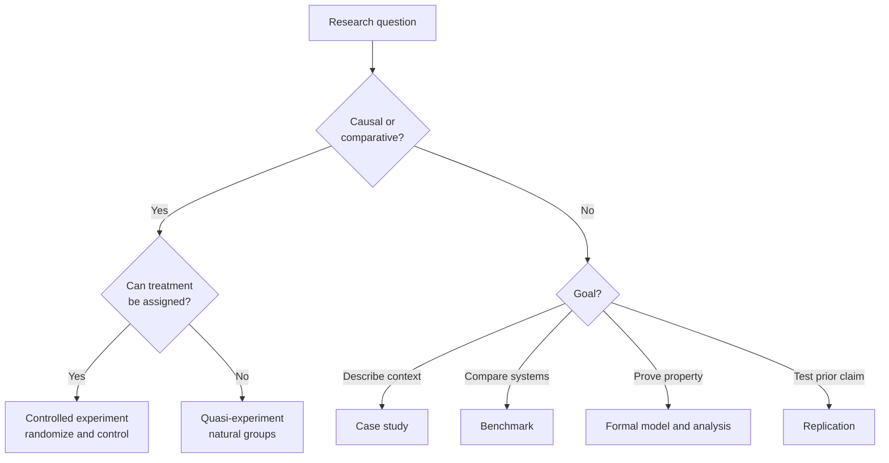
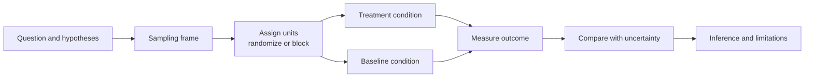

# Research 3: Experimental Design, Baselines, and Sampling

> **Track:** Academic Cybersecurity Research · **Level:** L5 · **Prerequisites:** Research 2 · **Estimated time:** 11 h
> **Primary module:** RES-02 · **Status:** drafted · **Validation:** structural

## Learning outcomes

By the end of this tutorial you can:

1. Select a study design that matches the question: controlled experiment, quasi-experiment, observational study, case study, benchmark, or formal analysis.
2. Define the unit of analysis, treatment, baseline, and control variables.
3. Choose a sampling strategy and justify its coverage and limitations.
4. Identify confounding, leakage, and selection threats before data collection.
5. Write a measurement plan that another researcher could execute.

## Why this matters

Security claims are often comparative: "this control reduces risk," "this detector is better," "this language is safer." A comparison is only meaningful if the baseline, conditions, and sample are defined. Without them, a result may measure the benchmark, the hardware, or the researcher's tuning rather than the claimed effect.

A strong design does not guarantee a true conclusion, but it makes the conclusion **auditable**.

## First principles

### Design families

| Design | Question it fits | Strength | Main limitation |
|---|---|---|---|
| Controlled experiment | Does treatment X cause outcome Y? | Randomization and control | Artificial setting |
| Quasi-experiment | Same, when randomization is impossible | Uses natural variation | Confounding |
| Observational study | What is associated with what? | Real-world data | Causality is hard |
| Case study | How does a phenomenon work in context? | Depth | Limited generalization |
| Benchmark | How do systems compare on a task? | Standardized comparison | Benchmark overfitting |
| Formal analysis | Does a model satisfy a property? | Strong guarantees within assumptions | Model–reality gap |
| Replication | Does a prior result hold? | Tests robustness | Original may be underspecified |

### Unit of analysis

The **unit** is what receives the treatment and contributes one independent observation. It might be:

- a process, container, or virtual machine;
- a software project or repository;
- a network flow or packet;
- a human participant;
- a model-checking run.

The unit determines the sample size and the independence assumption. Fifty vulnerabilities from one project are not fifty independent projects; observations within a project may share code, conventions, and developers.

### Treatment, baseline, and control

| Element | Definition | Example |
|---|---|---|
| Treatment | The condition whose effect is studied | New detection rule |
| Baseline | The comparison condition | Existing rule or no rule |
| Control variable | A factor held constant | Log source, volume, attack mix |
| Confounder | A factor that varies with treatment and outcome | Analyst experience |
| Randomization | Assignment of units to conditions by chance | Randomly split log windows |
| Blocking | Grouping similar units before assignment | Block by attack family |

A **baseline** is not "the old system" unless it is configured and measured under the same conditions. A **control** is not a second treatment; it is a condition that isolates the factor of interest.

### Sampling

| Strategy | Use | Risk |
|---|---|---|
| Simple random | Homogeneous population | May miss rare classes |
| Stratified | Ensure coverage of subgroups | Requires known strata |
| Systematic | Ordered list, every k-th unit | Periodicity |
| Cluster | Groups of units | Intra-cluster correlation |
| Convenience | Available data | Selection bias |
| Purposive | Information-rich cases | Not representative |
| Snowball | Hard-to-reach populations | Network bias |

Record how the sample was drawn, what was excluded, and why. A sample of 1,000 vulnerabilities from one bug-bounty platform is not a sample of all vulnerabilities.

### Power and sample size

**Statistical power** is the probability of detecting an effect of a given size if it exists. Power depends on effect size, variance, sample size, and the significance criterion. A study with low power can miss a real effect and can also exaggerate the effects it does detect [R07] [R08].

You cannot compute power until you define:

1. the primary outcome;
2. the smallest effect that matters;
3. the variability or baseline rate;
4. the test and alpha;
5. the unit of analysis.

If a power analysis is impossible, state the precision you can achieve and treat the study as exploratory.

### The experimental pipeline

## Worked example: comparing two detection rules

This is a **generated design example**, not a result.

**Question:** On a fixed synthetic log corpus, does rule A detect more true malicious events than rule B without increasing the false positive rate beyond a stated threshold?

| Element | Design |
|---|---|
| Unit | One labeled log window |
| Population | Windows from the same synthetic corpus generator |
| Treatment | Rule A |
| Baseline | Rule B |
| Control variables | Log schema, window size, attack mix, parser version |
| Sampling | Stratified by attack family and benign activity level |
| Primary metric | Recall at a fixed false positive rate |
| Secondary metrics | Precision, time to detect, analyst alerts per day |
| Analysis | Paired comparison per window; confidence interval for the difference |
| Threats | Corpus realism, label errors, rule tuning on the test set |

**Alternative explanation:** Rule A may perform better because it was tuned on the same corpus. The design should separate a tuning split from a held-out test split.

## Common misconceptions

| Misconception | Correction |
|---|---|
| "A benchmark is a controlled experiment." | It is a standardized comparison; it may lack randomization and control. |
| "More data always means better inference." | More biased data increases false confidence. |
| "The baseline is whatever was there before." | The baseline must be defined and measured under comparable conditions. |
| "Randomization removes all bias." | It addresses assignment bias, not measurement or selection bias. |
| "Power is only relevant for statistics." | Any quantitative comparison needs enough precision to detect a meaningful difference. |
| "Holding everything constant is always possible." | Some factors cannot be controlled; measure and report them. |

## Exercises

### Foundation

1. Classify three security questions by design family.
2. Define the unit of analysis for a study of container escapes.
3. Distinguish a control variable from a confounder.

### Application

4. Design a controlled comparison of two password-strength meters. Define the population, unit, treatment, baseline, and controls.
5. Draw the sampling frame for a study of vulnerabilities in open-source projects. Identify two selection risks.
6. Write a power-analysis plan for a detection study. If parameters are unknown, state how you will estimate them.

### Analysis

7. A fuzzing paper compares a new fuzzer to AFL on 20 programs. Identify three possible confounders and how to measure them.
8. A study uses 500 vulnerabilities from one project and claims a general trend. Explain the unit-of-analysis problem.
9. Explain why tuning a detector on the test set inflates its measured performance.

### Extension

10. Design a quasi-experiment that uses a natural policy change (for example, a new disclosure rule) to estimate an effect. State the identifying assumption.

## Knowledge check

1. What is the difference between a baseline and a control variable?
2. Why does the unit of analysis matter for independence?
3. What is statistical power, and what inputs does it need?
4. Name two threats that randomization does not remove.
5. Why can a benchmark overstate real-world performance?

Answers: `assessments/research/answer-key.md` (instructor-only).

## Key takeaways

- Choose the design that fits the question, not the design that is easiest.
- Define unit, treatment, baseline, controls, and sampling before running anything.
- Power and precision are design decisions, not post-hoc calculations.
- Benchmarks and convenience samples need explicit generalization limits.

## Further reading

| Source | Supports | Verification |
|---|---|---|
| [R02] Experimentation in Software Engineering | Design, randomization, validity | V2 |
| [R03] Empirical Standards | Study-type reporting expectations | V1 |
| [R07] Statistical misinterpretations | Power, intervals, and inference | V2 |
| [R08] Why Most Published Research Findings Are False | Low power and bias | V2 |
| [R12] NIST/SEMATECH e-Handbook | Sampling and experimental statistics | V1 |

Links and verification status for every source ID are recorded in [`REFERENCES.md`](../REFERENCES.md).

## Cross-links

- Previous: [Research 2: Questions and threat models](02-research-questions-hypotheses-and-threat-models.md)
- Next: [Research 4: Measurement and statistics](04-measurement-statistics-and-uncertainty.md)
- Template: [Experiment plan](../authoring-templates/experiment-plan.md)
- Project: [P3 controlled experiment](projects/03-controlled-experiment.md)

## Completion checklist

- [ ] I selected a design and justified it against alternatives.
- [ ] I defined the unit, treatment, baseline, and controls.
- [ ] I described the sampling frame and exclusions.
- [ ] I stated the primary outcome and a meaningful effect size.
- [ ] I identified at least three validity threats.
- [ ] I wrote a measurement plan another researcher could execute.
