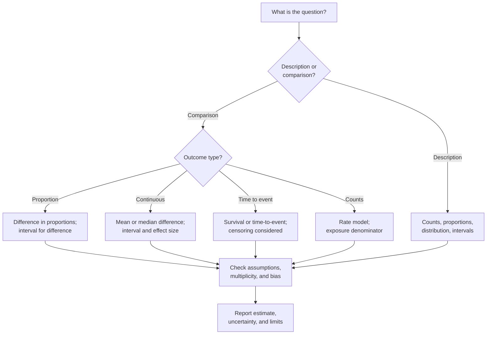

# Research 4: Measurement, Statistics, and Uncertainty

> **Track:** Academic Cybersecurity Research · **Level:** L5 · **Prerequisites:** Research 3; RES-02 module gate · **Estimated time:** 11 h
> **Primary module:** RES-02 · **Status:** drafted · **Validation:** structural
> **Outcomes addressed:** RES-02.O2, RES-02.O3

## Learning outcomes

By the end of this tutorial you can:

1. Define metrics that match the research question and the cost of errors.
2. Distinguish descriptive statistics, estimates, uncertainty intervals, and hypothesis tests.
3. Interpret p-values, confidence intervals, effect sizes, and power correctly.
4. Recognize multiple-comparison, selection, and reporting problems.
5. Report results with enough detail for replication and critical review.

## Why this matters

Security decisions often hinge on a number: detection rate, false positive rate, exploit success rate, time to patch, or vulnerability density. A number without a definition, denominator, and uncertainty is easy to misread and easy to misuse.

Statistical tools do not rescue a bad design. They can, however, make a good design's uncertainty visible and its claims proportionate.

## First principles

### Metrics

A metric needs:

| Component | Question |
|---|---|
| Definition | What exactly is counted? |
| Unit | Per event, host, project, participant, or run? |
| Denominator | Out of what? |
| Direction | Is higher better or worse? |
| Cost asymmetry | What does a false positive or false negative cost? |
| Stability | Does it depend on prevalence, workload, or time? |

For classification, define the confusion matrix explicitly:

|  | Actual positive | Actual negative |
|---|---|---|
| Predicted positive | True positive (TP) | False positive (FP) |
| Predicted negative | False negative (FN) | True negative (TN) |

- **Precision** = TP / (TP + FP): among alerts, how many are real?
- **Recall / sensitivity** = TP / (TP + FN): among real events, how many were found?
- **False positive rate** = FP / (FP + TN): among benign events, how many were flagged?
- **Accuracy** = (TP + TN) / total: misleading when classes are imbalanced.

A detector with 99% accuracy on a corpus with 1% positives can have poor precision. Report the full matrix or the metrics that expose the trade-off.

### Descriptive statistics and estimates

Descriptive statistics summarize the sample: counts, proportions, medians, means, ranges, and distributions. They are not estimates of a population parameter unless the sampling supports that inference.

An **estimate** comes with uncertainty. Report a confidence interval or a credible interval, not just a point estimate. The interval reflects the model and the sampling; it is not a guarantee that the true value lies inside for every study.

### p-values

A p-value is the probability of observing data at least as extreme as the observed data, assuming the null hypothesis and the statistical model are true. It is **not**:

- the probability that the null hypothesis is true;
- the probability that the result will replicate;
- a measure of effect size;
- a substitute for design, bias assessment, or judgment.

The ASA statement emphasizes that p-values are a part of a broader inferential process and should not be used as a binary gate [R09]. Greenland et al. catalog common misinterpretations and recommend intervals and explicit models [R07].

### Effect size and practical significance

A statistically detectable effect can be operationally trivial. Report:

- the absolute difference (for example, 2 percentage points);
- the relative difference, with the baseline stated;
- the uncertainty interval;
- the cost or benefit in the application context.

"25% improvement" could mean 0.25% to 0.31%, or 40% to 50%. State the base.

### Multiple comparisons

Testing many hypotheses increases the chance of a false positive. Options:

- pre-register one primary outcome;
- correct for multiple comparisons (for example, Bonferroni or false discovery rate) and state the method;
- label all other tests as exploratory;
- report all tests, not only significant ones.

### Power and sample size

Power depends on effect size, variance, alpha, and sample size. A study powered for a large effect may be unable to detect a small one. Underpowered studies are also more likely to exaggerate effects among the results that reach significance [R08].

### Statistical versus practical reasoning



## Worked arithmetic example (generated, not measured)

The following numbers are **constructed for arithmetic practice**. They are not experimental results.

Suppose a detector is evaluated on 1,180 events:

- TP = 80
- FP = 20
- FN = 100
- TN = 980

Then:

- Precision = 80 / (80 + 20) = 0.80
- Recall = 80 / (80 + 100) ≈ 0.444
- False positive rate = 20 / (20 + 980) = 0.02
- Accuracy = (80 + 980) / 1,180 ≈ 0.898

A 95% normal-approximation interval for precision, treated as a proportion 80/100, is approximately:

```text
0.80 ± 1.96 * sqrt(0.80 * 0.20 / 100)
= 0.80 ± 0.0784
≈ [0.722, 0.878]
```

This is an illustration of the arithmetic, not a claim about any detector. The normal approximation is itself an assumption; for small counts or extreme proportions, use an exact or Wilson interval and state the method.

## Common misconceptions

| Misconception | Correction |
|---|---|
| "p < 0.05 proves the hypothesis." | It indicates incompatibility with a model under assumptions; it does not prove a hypothesis. |
| "A 95% confidence interval contains the true value with 95% probability." | The interval is a procedure with long-run coverage; the interpretation depends on the framework. |
| "Accuracy is enough." | Class imbalance can make accuracy misleading; report precision, recall, and the matrix. |
| "A larger sample guarantees significance." | It increases power but does not remove bias. |
| "Non-significant means no effect." | The study may be underpowered or the interval may include meaningful effects. |
| "Exploratory results are worthless." | They are valuable if labeled and confirmed in a separate study. |

## Exercises

### Foundation

1. Define precision, recall, and false positive rate for a phishing detector.
2. Explain why accuracy can be misleading on a rare-event corpus.
3. What is a 95% confidence interval, in one paragraph, without saying "95% chance the true value is inside"?

### Application

4. Compute the confusion matrix metrics for a generated example you construct. Label it as generated.
5. Choose a test for comparing two proportions from independent groups. State the assumptions.
6. Design a multiple-comparison correction plan for a study with five secondary outcomes.

### Analysis

7. A paper reports "a 30% reduction" with no baseline. List three questions to ask.
8. A result has p = 0.04 and a wide interval that includes a practically trivial effect. How would you report it?
9. Explain why an underpowered study can produce both false negatives and exaggerated positive results.

### Extension

10. Reanalyze a public dataset with a pre-registered primary outcome and report the interval, effect size, and sensitivity analysis. Do not claim causality without a design that supports it.

## Knowledge check

1. What does a p-value mean?
2. Why is a confidence interval more informative than a single point estimate?
3. What is the difference between statistical and practical significance?
4. Why is multiple-comparison correction needed?
5. Why should a confusion matrix accompany a single detection metric?

Answers: `assessments/research/answer-key.md` (instructor-only).

## Key takeaways

- Metrics need definitions, denominators, units, and cost context.
- p-values are not effect sizes or posterior probabilities; interpret them with design and intervals.
- Report uncertainty and all relevant outcomes, not only significant ones.
- Underpowered and biased studies can mislead in both directions.

## Further reading

| Source | Supports | Verification |
|---|---|---|
| [R07] Greenland et al. | p-values, intervals, power, misinterpretations | V2 |
| [R08] Ioannidis | Low power, bias, and publication | V2 |
| [R09] ASA statement on p-values | Official statistical interpretation | V2 |
| [R12] NIST/SEMATECH e-Handbook | Statistical methods and examples | V1 |

Links and verification status for every source ID are recorded in [`REFERENCES.md`](../REFERENCES.md).

## Cross-links

- Previous: [Research 3: Experimental design](03-experimental-design-baselines-and-sampling.md)
- Next: [Research 5: Reproducibility and replication](05-reproducibility-and-replication.md)
- Template: [Experiment plan](../authoring-templates/experiment-plan.md)
- Project: [P3 controlled experiment](projects/03-controlled-experiment.md)

## Completion checklist

- [ ] I defined every metric with a denominator and unit.
- [ ] I reported a confusion matrix or equivalent counts.
- [ ] I included uncertainty intervals, not only point estimates.
- [ ] I distinguished confirmatory and exploratory analyses.
- [ ] I checked multiplicity and power.
- [ ] I can explain what my p-value does and does not mean.
