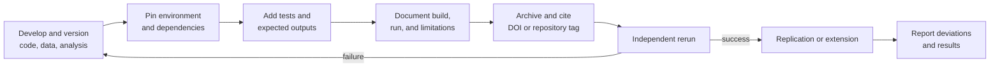
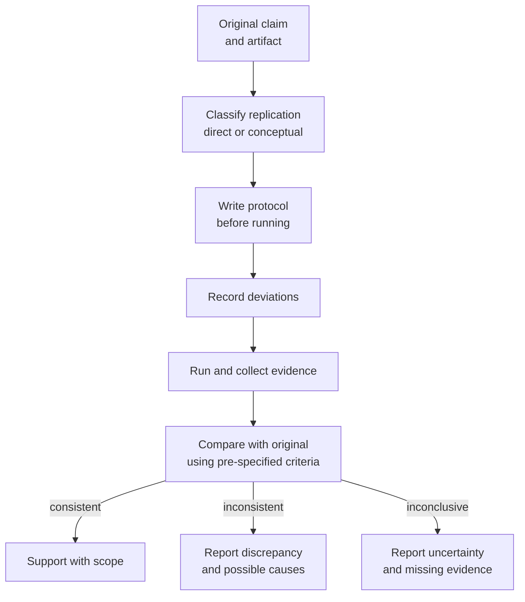

# Research 5: Reproducibility and Replication

> **Track:** Academic Cybersecurity Research · **Level:** L5 · **Prerequisites:** Research 4; RES-02 module gate · **Estimated time:** 9 h
> **Primary module:** RES-02 · **Status:** drafted · **Validation:** structural
> **Outcomes addressed:** RES-02.O2

## Learning outcomes

By the end of this tutorial you can:

1. Distinguish reproducibility, replicability, and repeatability in a security study.
2. Package an artifact so another researcher can rerun the analysis and understand every dependency.
3. Design a direct or conceptual replication and classify deviations from the original.
4. Report negative, partial, and failed replications honestly.
5. Evaluate an artifact against a reproducibility rubric.

## Why this matters

Security research often informs defensive decisions. If a detection rule, benchmark, or exploit-mitigation result cannot be reproduced, the decision rests on an unverifiable claim. Reproducibility is not a bureaucratic appendix; it is part of the evidence.

The National Academies distinguish **reproducibility** (same data and methods produce the same result) from **replicability** (a new study with new data reaches a consistent conclusion) [R04]. A study can be reproducible but not replicable, or replicable but not reproducible if the original artifact is unavailable.

## First principles

### Definitions

| Term | Meaning | Question |
|---|---|---|
| Reproducibility | Same data, code, and method produce the same result | Can I rerun it? |
| Replicability | A new study with new data reaches a consistent result | Does it hold again? |
| Repeatability | The same researcher repeats the measurement | Is the instrument stable? |
| Robustness | The result holds under reasonable changes | How sensitive is it? |

### What an artifact must contain

| Artifact component | Why it matters |
|---|---|
| Source code | Enables inspection and rerun |
| Environment specification | OS, kernel, runtime, libraries, tool versions |
| Data or generator | Allows the same or equivalent input |
| Seeds and parameters | Makes stochastic procedures repeatable |
| Build and run instructions | Removes hidden steps |
| Expected outputs or checksums | Detects drift |
| Analysis scripts | Separates data collection from analysis |
| License and citation | Defines reuse and credit |
| Limitations and known failures | Prevents overgeneralization |

A repository with code but no data, or data but no analysis script, is not a complete artifact.

### Course-defined artifact levels

These levels are a course rubric, not ACM artifact badges or a community standard. Use [`R13`](../REFERENCES.md) for the distinction and cite the actual badge policy when making a formal artifact claim.

| Level | Description | Evidence |
|---|---|---|
| R0 | No artifact | Claim only |
| R1 | Code or data, incomplete instructions | Partial rerun |
| R2 | Code and data, documented environment | Independent rerun possible |
| R3 | R2 plus automated tests and expected outputs | Rerun verified by another person |
| R4 | R3 plus independent replication | Consistent result on new data |

Do not claim R3 or R4 without evidence.

### The artifact lifecycle

### Replication design

A replication should state:

- the original claim and study;
- what was held constant and what changed;
- whether the replication is direct (same design, new data) or conceptual (different design, same claim);
- the outcome that counts as consistent;
- deviations from the protocol and their reasons;
- whether the original authors were contacted;
- the result and its uncertainty.

## Worked example: replication plan

This is a **generated plan**, not a result.

**Original claim:** "Detector D achieves recall above 0.90 on a labeled corpus of command-and-control traffic."

| Element | Plan |
|---|---|
| Replication type | Direct, using a new capture from the same generator |
| Held constant | Detector version, feature set, labeling rules |
| Changed | Capture date, traffic mix, background noise |
| Primary outcome | Recall at a fixed false positive rate |
| Consistency criterion | Recall interval overlaps the original interval and remains above 0.85 |
| Deviations | New capture has more encrypted traffic; record the shift |
| Analysis | Same confusion-matrix metrics; report interval |
| Artifact | Detector config, corpus generator, labels, analysis script |
| Ethics | Synthetic traffic only; no third-party capture |

The criterion is set before running. Changing it after seeing the result would undermine the replication.

## Common misconceptions

| Misconception | Correction |
|---|---|
| "Reproducible means the same numbers exactly." | Floating-point, timing, and environment variation may require tolerances; state them. |
| "A Dockerfile guarantees reproducibility." | It pins some dependencies but not kernel, hardware, data, or external services. |
| "Replication must use the same data." | That is reproduction; replication uses new data. |
| "A failed replication disproves the original." | It may reveal scope, implementation, or environment differences. |
| "Negative results are not publishable." | They are valuable when the method is sound and the question matters. |
| "Code availability equals artifact availability." | Data, environment, instructions, and expected outputs are also required. |

## Exercises

### Foundation

1. Define reproducibility and replicability and give one example of each.
2. List five components of a complete artifact.
3. What is the difference between a direct and a conceptual replication?

### Application

4. Take a small script you wrote and package it at R2: environment, data, instructions, and expected output.
5. Write a replication protocol for a published measurement study. State the consistency criterion before running.
6. Create a deviation log with fields for date, change, reason, and impact.

### Analysis

7. A replication finds a different effect size but the same direction. Is it consistent? Explain using a pre-specified criterion.
8. A Dockerfile pins a base image tag but not a digest. What reproducibility risk remains?
9. A paper reports only successful runs. Explain the threat and a reporting remedy.

### Extension

10. Design a replication that varies one factor (for example, corpus size) and measures sensitivity. State the sampling and analysis plan.

## Knowledge check

1. What is the difference between reproducibility and replicability?
2. Why are seeds and environment versions part of the method?
3. What should a replication report include besides the result?
4. Why can a failed replication be informative?
5. What does an artifact badge not prove?

Answers: `assessments/research/answer-key.md` (instructor-only).

## Key takeaways

- Reproducibility concerns rerunning the same analysis; replicability concerns a new study.
- Artifacts include code, data, environment, instructions, and expected outputs.
- Pre-specify replication criteria and report deviations.
- Negative and partial results are part of the evidence.

## Further reading

| Source | Supports | Verification |
|---|---|---|
| [R04] Reproducibility and Replicability in Science | Definitions and systemic issues | V2 |
| [R05] Ten Simple Rules for Reproducible Computational Research | Practical artifact rules | V2 |
| [R06] A manifesto for reproducible science | Incentives and reforms | V2 |
| [R13] ACM Artifact Review and Badging | Artifact evaluation context | V4 |
| [N11] NIST SP 800-115 | Assessment evidence and reporting | V1 |

Links and verification status for every source ID are recorded in [`REFERENCES.md`](../REFERENCES.md).

## Cross-links

- Previous: [Research 4: Measurement and statistics](04-measurement-statistics-and-uncertainty.md)
- Next: [Research 6: Ethics and disclosure](06-ethics-disclosure-and-open-science.md)
- Template: [Replication report](../authoring-templates/replication-report.md)
- Project: [P2 replication study](projects/02-replication-study.md)

## Completion checklist

- [ ] I can distinguish reproducibility, replicability, and repeatability.
- [ ] I packaged an artifact with environment, data, instructions, and expected outputs.
- [ ] I wrote a replication protocol with a pre-specified criterion.
- [ ] I recorded deviations and their impact.
- [ ] I reported a negative or partial result honestly.
- [ ] I stated what the artifact does not prove.
