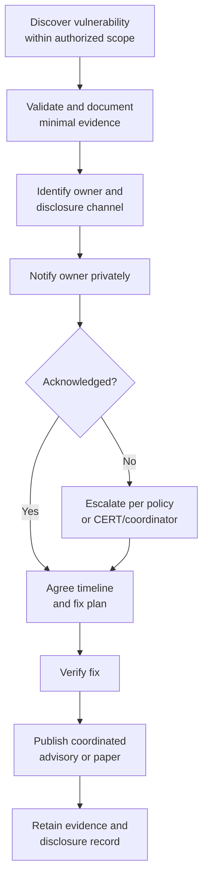

# Research 6: Ethics, Responsible Disclosure, and Open Science

> **Track:** Academic Cybersecurity Research · **Level:** L5 · **Prerequisites:** Research 2 · **Estimated time:** 8 h
> **Primary module:** RES-06 · **Status:** drafted · **Validation:** structural

## Learning outcomes

By the end of this tutorial you can:

1. Apply ethical frameworks to security research involving systems, data, and people.
2. Distinguish authorization, informed consent, legal permission, and ethical approval.
3. Plan a coordinated vulnerability disclosure process with roles, timelines, and escalation.
4. Assess dual-use, privacy, and open-science trade-offs.
5. Document ethics and disclosure decisions in a form a reviewer can audit.

## Why this matters

Security research can expose vulnerabilities, collect sensitive data, and affect people who never agreed to participate. The fact that a study is technically possible does not make it ethical or lawful.

Ethics is also a design input. If a study requires deception, surveillance, or exploit publication, that changes the protocol, the review path, and the evidence that can be shared.

## First principles

### Four different permissions

| Permission | Source | What it covers |
|---|---|---|
| Authorization | System owner or delegate | Access and testing within a defined scope |
| Informed consent | Human participant | Participation after understanding risks and benefits |
| Legal permission | Law and regulation | What is permitted in a jurisdiction |
| Ethical approval | Review board or ethics committee | Whether the study meets ethical standards |

None automatically implies another. A signed authorization does not replace consent from human subjects; consent does not authorize access to a system; legal permission does not guarantee ethical acceptability.

### Ethical frameworks

- **Menlo Report:** adapts the Belmont principles (respect for persons, beneficence, justice) to information and communication technology research, and adds respect for law and public interest [A18].
- **Belmont Report:** foundational U.S. guidance for human-subject research [R15].
- **Professional codes and organizational policy:** ACM publications policies, institutional review boards, and employer security policies [R14].

Use the framework that applies to your jurisdiction and institution. When they conflict, seek review rather than choosing the most convenient one.

### Risk categories

| Category | Example | Controls |
|---|---|---|
| Minimal risk to systems | Lab test on synthetic data | Standard lab isolation |
| Risk to third parties | Scanning a shared network | Written scope, coordination |
| Risk to human subjects | Usability study with phishing simulation | Consent, deception review, debriefing |
| Dual-use risk | Novel exploit technique | Coordinated disclosure, publication review |
| Privacy risk | Incident dataset with personal data | Minimization, de-identification, access control |

### Coordinated vulnerability disclosure

**Coordinated vulnerability disclosure (CVD)** is a process for reporting a vulnerability privately to the owner and coordinating a fix and publication timeline [R10] [R11]. It is not a guarantee that the vendor will respond, and it is not a license to test without authorization.

Timelines vary by policy, severity, and coordination. Do not invent a universal deadline. State the policy you followed and the dates.

### Open science and its limits

Open science increases reproducibility and reuse, but not everything should be published immediately:

- exploit code may increase harm before a fix;
- datasets may contain personal or confidential data;
- artifacts may enable abuse;
- participant transcripts may be re-identifiable.

A responsible artifact release states **what is withheld, why, and under what conditions it can be shared**.

## Worked example: disclosure decision

This is a **generated scenario**, not a real vulnerability.

A researcher finds that a widely used parsing library crashes on a crafted input. The crash can be triggered remotely in applications that accept untrusted files. The researcher has a local proof of concept and a proposed patch.

| Decision | Reasoning |
|---|---|
| Test scope | The researcher tested a local copy of the library, not a production service |
| Owner | Library maintainers and, if deployed, affected application vendors |
| Initial report | Private channel; minimal proof of concept; no public exploit |
| Timeline | Follow the maintainer's policy; record dates and responses |
| Publication | Coordinate after a fix or agreed date; publish defensive details |
| Artifact | Share a regression test; withhold a turnkey exploit if it adds no defensive value |
| Ethics review | Determine whether the institution requires review for dual-use release |

The scenario does not specify a deadline because the correct timeline depends on policy and coordination.

## Common misconceptions

| Misconception | Correction |
|---|---|
| "It is research, so authorization is implied." | Research status does not grant access. |
| "The data was public, so consent is unnecessary." | Public data can still contain personal information and require ethics review. |
| "Responsible disclosure means 90 days." | Timelines are policy- and context-dependent; state the policy. |
| "Publishing everything is open science." | Responsible openness can include controlled access and withholding. |
| "A fix means the vulnerability is no longer sensitive." | Exploit details, affected versions, and detection can remain sensitive. |
| "IRB approval covers system testing." | Ethics review and system authorization are separate. |

## Exercises

### Foundation

1. Distinguish authorization, consent, legal permission, and ethical approval.
2. Name the three Belmont principles and how Menlo adapts them.
3. What is CVD, and what does it not guarantee?

### Application

4. Write an authorization memo for a local lab study of a container escape.
5. Write a consent form for a phishing-usability study, including deception and debriefing.
6. Create a disclosure plan for a synthetic vulnerability with roles, channels, and decision points.

### Analysis

7. A dataset of incident reports is publicly available but includes email addresses. What ethical and legal questions arise?
8. A reviewer asks for exploit code to reproduce a result. Propose an artifact-sharing approach that balances reproducibility and harm.
9. A vendor does not respond to a report. Describe escalation options and the limits of each.

### Extension

10. Draft an ethics section for a paper that uses human participants and a vulnerability disclosure. Identify the approvals and artifacts you would need.

## Knowledge check

1. Why is authorization not the same as consent?
2. What does the Menlo Report add to the Belmont principles?
3. What are the phases of coordinated disclosure?
4. Why might an artifact be shared under controlled access?
5. What should an ethics section state?

Answers: `assessments/research/answer-key.md` (instructor-only).

## Key takeaways

- Authorization, consent, legality, and ethics are distinct requirements.
- CVD is a coordinated process, not a universal deadline or a substitute for authorization.
- Open science includes deliberate decisions about what not to publish.
- Ethics decisions must be documented before publication.

## Further reading

| Source | Supports | Verification |
|---|---|---|
| [A18] The Menlo Report | Ethics for ICT research | V2 |
| [R15] The Belmont Report | Human-subject principles | V4 |
| [R10] CERT Guide to CVD | Coordinated disclosure practice | V1 |
| [R11] ISO/IEC 29147 | Vulnerability disclosure standard | V4 |
| [C06] CISA CVD Program | Government disclosure coordination | V1 |
| [N03] NIST SP 800-61r3 | Incident handling and evidence | V1 |

Links and verification status for every source ID are recorded in [`REFERENCES.md`](../REFERENCES.md).

## Cross-links

- Previous: [Research 5: Reproducibility](05-reproducibility-and-replication.md)
- Next: [Research 7: Scientific writing](07-scientific-writing-and-publication.md)
- Template: [Research paper review](../authoring-templates/research-paper-review.md)
- Project: [P3 controlled experiment](projects/03-controlled-experiment.md)

## Completion checklist

- [ ] I can distinguish authorization, consent, legality, and ethics.
- [ ] I identified the ethical risks of my study.
- [ ] I wrote an authorization or consent plan.
- [ ] I wrote a disclosure plan with roles and decision points.
- [ ] I stated what artifact I will withhold and why.
- [ ] I cited the policy or framework I followed.
