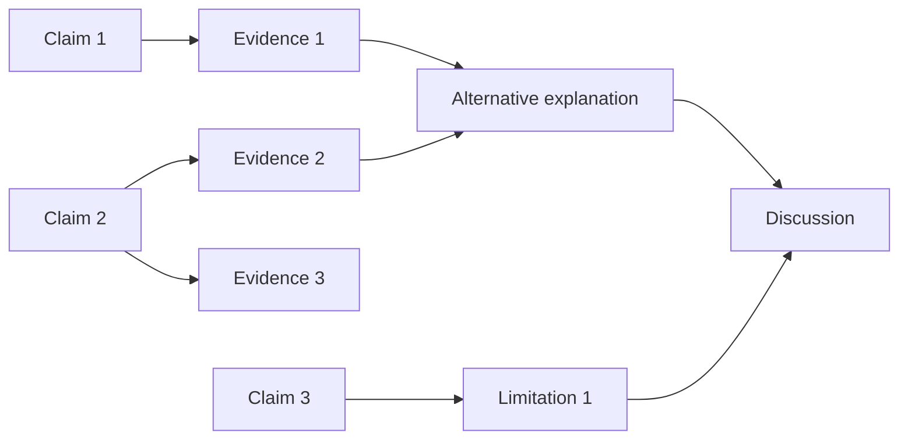
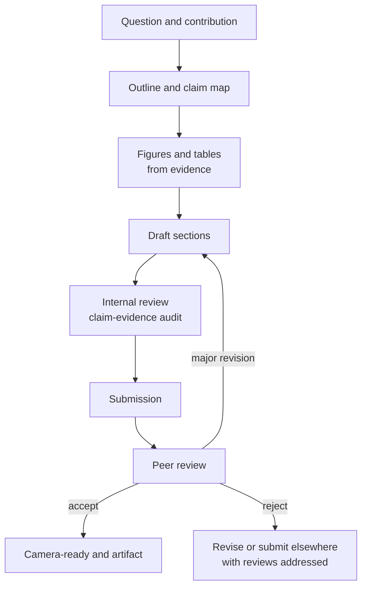

# Research 7: Scientific Writing and Publication

> **Track:** Academic Cybersecurity Research · **Level:** L5 · **Prerequisites:** Research 5 and 6 · **Estimated time:** 9 h
> **Primary module:** RES-07 · **Status:** drafted · **Validation:** structural

## Learning outcomes

By the end of this tutorial you can:

1. Map every major claim in a paper to evidence and a limitation.
2. Structure a security research paper for a technical audience.
3. Write an abstract, introduction, method, results, discussion, and limitations section that do not overclaim.
4. Prepare a reproducibility appendix and an artifact availability statement.
5. Respond to peer review with evidence and revise without hiding inconvenient results.

## Why this matters

A result that cannot be understood, checked, or used is not yet a contribution. Scientific writing is the interface between evidence and the reader's decisions. It is also where overclaiming is most likely: a narrow lab result becomes "containers are insecure," or a correlation becomes a cause.

Writing is a reasoning tool. The claim–evidence map forces you to notice which claims have no evidence before a reviewer does.

## First principles

### Contribution types

| Contribution | What it adds | Typical evidence |
|---|---|---|
| Measurement | New data or a new measurement of a known phenomenon | Dataset, sampling, statistics |
| System or design | A new mechanism or architecture | Implementation, evaluation, comparison |
| Attack | A new capability or vulnerability class | Proof of concept, responsible disclosure, evaluation |
| Defense | A mitigation or detection | Evaluation against a threat model |
| Formal result | A proof or model-checking result | Model, assumptions, property, counterexample |
| SoK / survey | Synthesis and taxonomy | Systematic search, coding, comparison |
| Replication | A test of a prior claim | Protocol, deviations, comparison |

The contribution type determines the evidence standard. An attack paper without a threat model and a defense paper without a baseline are both incomplete.

### The claim–evidence map

Every substantive claim should have:

| Field | Question |
|---|---|
| Claim | What exactly is asserted? |
| Scope | For which systems, populations, or conditions? |
| Evidence | Which table, figure, dataset, theorem, or citation supports it? |
| Uncertainty | What is the interval, variance, or confidence? |
| Alternative | What else could explain it? |
| Limitation | What would make the claim false or narrower? |

### Paper anatomy

| Section | Purpose | Common failure |
|---|---|---|
| Title | Accurate, specific, not a slogan | Overstates scope |
| Abstract | Question, method, result, implication | Reports only the best number |
| Introduction | Problem, gap, contribution | Assumes the reader cares |
| Related work | Positions the contribution | Citation list without synthesis |
| Threat model | Adversary, assets, assumptions | Missing or too weak |
| Method | Reproducible design | Underspecified baselines |
| Results | Evidence with uncertainty | Cherry-picked runs |
| Discussion | Interpretation and alternatives | Repeats results |
| Limitations | What the evidence does not show | Generic boilerplate |
| Ethics | Authorization, consent, disclosure | Afterthought |
| Availability | Code, data, artifacts, restrictions | "Available on request" without terms |
| Appendix | Protocols, proofs, extra results | Hides inconvenient results |

### Writing pipeline

## Worked example: outline and claim map

This is a **generated outline**, not a paper or a result.

**Working title:** "A Controlled Comparison of Two Log-Based Detection Rules for a Synthetic Command-and-Control Corpus"

**Contribution:** a measurement comparing two rules under a fixed corpus and cost constraint.

| Claim | Scope | Evidence | Uncertainty | Alternative | Limitation |
|---|---|---|---|---|---|
| Rule A has higher recall than B at a fixed false positive rate | Synthetic corpus, stated generator | Table 2 | Interval for difference | Corpus favors A's features | Not real traffic |
| Rule A costs more analyst time | Same corpus, alert volume | Table 3 | Range across windows | Alert triage differences | Synthetic labels |
| The result is reproducible | Artifact release | Appendix B | Not statistical | Environment differences | Restricted data |

The title does not say "better detection" because the scope is a synthetic corpus and a fixed cost constraint.

## Common misconceptions

| Misconception | Correction |
|---|---|
| "The abstract can round up the result." | The abstract must remain within the scope of the evidence. |
| "Related work is a list of citations." | It should synthesize and position the contribution. |
| "Limitations weaken the paper." | They define the claim and increase credibility. |
| "More numbers means more rigor." | Undefined metrics and missing uncertainty reduce rigor. |
| "A rejected paper is a failed project." | Reviews often improve the work; rejection is not a verdict on the question. |
| "AI-generated text is not plagiarism if edited." | Policies on authorship, disclosure, and accuracy still apply [R14]. |

## Exercises

### Foundation

1. Identify the contribution type of three papers in your area.
2. Write a one-sentence claim and one limitation for a study you designed.
3. List the sections a security measurement paper needs.

### Application

4. Create a claim–evidence table for your current project.
5. Draft an abstract with question, method, result placeholder, and scope. Do not invent a result.
6. Write a limitations section with at least five specific limitations.

### Analysis

7. Take a published abstract and mark every claim that is not supported by the reported method.
8. Review a paper's artifact availability statement. What would you need to reproduce it?
9. Explain how a threat model omission can make a defense evaluation look stronger than it is.

### Extension

10. Write a response to a reviewer who asks for an analysis your data cannot support. Propose an alternative that preserves honesty.

## Knowledge check

1. What is a claim–evidence map?
2. Why must the abstract match the scope of the evidence?
3. What belongs in a threat model section?
4. How should artifact restrictions be described?
5. What is the difference between a limitation and an excuse?

Answers: `assessments/research/answer-key.md` (instructor-only).

## Key takeaways

- Writing is an evidence audit; every claim needs scope, evidence, and uncertainty.
- The contribution type determines the expected evidence.
- Limitations and ethics are part of the argument, not decoration.
- Review is a revision process, not a verdict on the researcher.

## Further reading

| Source | Supports | Verification |
|---|---|---|
| [R01] PRISMA 2020 | Reporting systematic reviews | V2 |
| [R03] Empirical Standards | Section expectations by study type | V1 |
| [R13] ACM Artifact Review and Badging | Artifact evaluation and badges | V4 |
| [R14] ACM Publications Policies | Authorship, integrity, and disclosure | V4 |
| [A19] CS2023 | Computing research communication | V1 |
| [N11] NIST SP 800-115 | Technical reporting and evidence | V1 |

Links and verification status for every source ID are recorded in [`REFERENCES.md`](../REFERENCES.md).

## Cross-links

- Previous: [Research 6: Ethics and disclosure](06-ethics-disclosure-and-open-science.md)
- Next: [Research 8: Domain research designs](08-domain-research-designs.md)
- Template: [Publication outline](../authoring-templates/publication-outline.md)
- Project: [P4 thesis proposal and paper](projects/04-thesis-proposal-and-paper.md)

## Completion checklist

- [ ] I identified the contribution type.
- [ ] I built a claim–evidence map with scope and uncertainty.
- [ ] I wrote an abstract that does not overclaim.
- [ ] I wrote specific limitations.
- [ ] I described artifact availability and restrictions.
- [ ] I can respond to review with evidence, not defensiveness.
