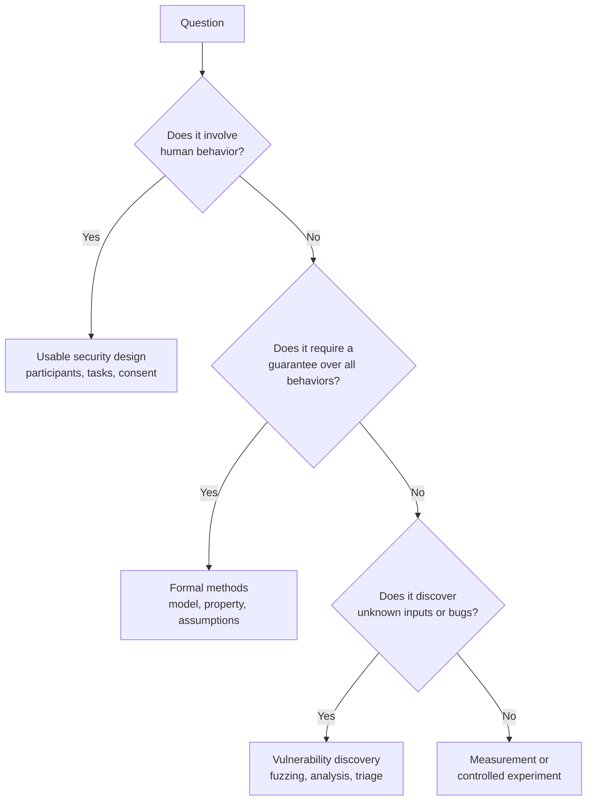
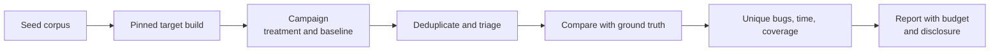
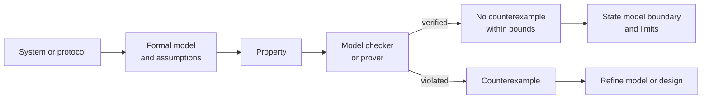

# Research 8: Domain Research Designs

> **Track:** Academic Cybersecurity Research · **Level:** L5 · **Prerequisites:** Research 3 and 4 · **Estimated time:** 10 h
> **Primary modules:** RES-03, RES-04, RES-05 · **Status:** drafted · **Validation:** structural

## Learning outcomes

By the end of this tutorial you can:

1. Adapt a general experimental design to vulnerability discovery, usable security, or formal methods.
2. Choose domain-appropriate evidence, baselines, and metrics.
3. Identify the characteristic validity threats and ethical constraints of each domain.
4. Decide which research design fits a question and which evidence it cannot produce.

## Why this matters

The same method does not fit every security question. A fuzzing campaign, a human-subjects study, and a model-checking proof produce different kinds of evidence and different threats to validity. Using the wrong design produces a result that looks rigorous but does not answer the question.

## 1. Vulnerability discovery research

### Questions

- Does a new technique find more unique vulnerabilities than a baseline under a fixed budget?
- How does discovery time scale with corpus size or program complexity?
- Are findings reproducible and triageable by maintainers?

### Design elements

| Element | Guidance |
|---|---|
| Unit | Program, target version, fuzzing campaign, or unique bug |
| Treatment | New technique, mutation strategy, or oracle |
| Baseline | Established fuzzer or analysis tool with the same budget |
| Budget | CPU time, executions, wall-clock time, or energy |
| Corpus | Seed corpus, provenance, preprocessing |
| Ground truth | Known bugs, injected bugs, or triaged unique crashes |
| Metrics | Unique bugs, time to discovery, coverage, crash triage rate, false positives |
| Threats | Benchmark selection, duplicate crashes, oracle errors, tuning on target |

A **coverage** metric is not a bug count. A campaign can increase coverage without finding a distinct vulnerability, and a crash can be a duplicate or a non-security bug.

**Ethics:** run only against programs you may test, use isolated environments, and coordinate disclosure. A crash in a third-party service is not a research dataset.

## 2. Usable security research

### Questions

- Does a security interface change completion rate, error rate, or mental model?
- Which friction points cause users to bypass a control?
- How do different populations experience the same security task?

### Design elements

| Element | Guidance |
|---|---|
| Participants | Sampling frame, inclusion criteria, compensation |
| Task | Realistic scenario with a defined success condition |
| Conditions | Between-subjects or within-subjects design |
| Measures | Completion, time, errors, comprehension, trust, workload |
| Qualitative data | Interviews, think-aloud, coding scheme |
| Controls | Order effects, task difficulty, prior expertise |
| Ethics | Consent, deception review, debriefing, data minimization |
| Threats | Demand characteristics, small samples, lab–field gap, accessibility |

Usable security studies frequently use deception (for example, a simulated phishing message). Deception requires justification, review, and debriefing. **Informed consent** and **debriefing** are not optional formalities [R15].

**Measurement caution:** self-reported intention is not observed behavior. A study that measures "willingness to use" cannot claim "adoption."

## 3. Formal methods and program analysis

### Questions

- Does a protocol or program satisfy a safety or liveness property under stated assumptions?
- Does a static analysis produce sound results for a class of programs?
- How does verification scale with model size?

### Design elements

| Element | Guidance |
|---|---|
| Model | State machine, protocol, program, or abstraction |
| Property | Safety, liveness, confidentiality, integrity |
| Assumptions | Cryptographic primitives, adversary model, environment |
| Tool | Model checker, theorem prover, abstract interpreter |
| Evidence | Proof, counterexample, or "no counterexample found" |
| Baselines | Manual analysis, another tool, or a bounded model |
| Threats | Model–reality gap, unsound abstraction, tool bugs, state explosion |

A model-checking result says the property holds **in the model**, not in the deployed system. Report the model boundary and assumptions.

## Worked examples (generated, not results)

| Domain | Generated question | Design | What it cannot show |
|---|---|---|---|
| Vulnerability discovery | Does strategy A find more unique bugs than B in 24 CPU-hours per program? | Paired campaigns on a fixed benchmark, triaged unique bugs | Real-world prevalence |
| Usable security | Does a just-in-time warning reduce risky downloads? | Randomized between-subjects lab study with a simulated task | Long-term behavior in the field |
| Formal methods | Does the protocol preserve authentication under a Dolev–Yao adversary? | Model checking with a bounded number of sessions | Implementation bugs outside the model |

The "cannot show" column is part of the contribution. A paper that omits it invites overgeneralization.

## Common misconceptions

| Misconception | Correction |
|---|---|
| "More coverage means more vulnerabilities." | Coverage is not a vulnerability count; triage is required. |
| "A user study proves real-world behavior." | Lab tasks and self-reports have external-validity limits. |
| "Model checking proves the system secure." | It proves a property in a model under assumptions. |
| "A counterexample is a bug in the system." | It may be a modeling error or an infeasible path. |
| "Human-subjects ethics is only about consent forms." | Risk, deception, power, privacy, and debriefing also matter. |
| "A benchmark is a fair comparison." | Benchmark selection and tuning can favor one approach. |

## Exercises

### Foundation

1. Match three research questions to the three domain designs.
2. Name one metric and one validity threat for each domain.
3. Explain why coverage is not a vulnerability count.

### Application

4. Design a fuzzing comparison with a fixed budget and a triage plan.
5. Design a usability study for a password manager. Include consent, task, and measures.
6. Model a simple authentication protocol and state one property to check.

### Analysis

7. A fuzzing paper compares a new tool to a baseline run with a smaller budget. What is the threat?
8. A usability study recruits 12 undergraduate students and claims broad adoption. Critique the claim.
9. A model checker finds no counterexample within 5 sessions. What can and cannot be concluded?

### Extension

10. Design a mixed-methods study that combines a controlled usability task with interviews. State how the evidence types answer different parts of the question.

## Knowledge check

1. What is the unit of analysis in a fuzzing campaign?
2. Why is self-reported intention weak evidence of behavior?
3. What does a model checker verify?
4. Name two ethical requirements for a deception study.
5. Why does each domain need a different validity threat model?

Answers: `assessments/research/answer-key.md` (instructor-only).

## Key takeaways

- Domain determines evidence: bugs, human behavior, or formal guarantees.
- Every design has a characteristic validity threat and ethical constraint.
- State what the design cannot show.
- Use the domain modules and project P3 to go deeper.

## Further reading

| Source | Supports | Verification |
|---|---|---|
| [A17] Fuzzing survey | Fuzzing design and metrics | V2 |
| [A13] Users are not the enemy | Usable security and mental models | V2 |
| [A15] So long, and no thanks | Security advice and user behavior | V2 |
| [R15] Belmont Report | Human-subjects ethics | V4 |
| [T05] KLEE | Symbolic execution and program analysis | V1 |
| [T06] TLA+ | Model checking and specification | V1 |
| [A09] Control-Flow Integrity | Formal/program-analysis security property | V2 |

Links and verification status for every source ID are recorded in [`REFERENCES.md`](../REFERENCES.md).

## Cross-links

- Previous: [Research 7: Scientific writing](07-scientific-writing-and-publication.md)
- Projects: [P3 controlled experiment](projects/03-controlled-experiment.md), [P4 thesis](projects/04-thesis-proposal-and-paper.md)
- Modules: [RES-03](../COURSE_MAP.md#res-03-vulnerability-discovery-research), [RES-04](../COURSE_MAP.md#res-04-usable-security-and-human-factors), [RES-05](../COURSE_MAP.md#res-05-formal-methods-and-program-analysis)

## Completion checklist

- [ ] I can match a question to a domain design.
- [ ] I can name the unit, baseline, and metric for each domain.
- [ ] I can state one validity threat and one ethical constraint per domain.
- [ ] I can explain what each design cannot show.
- [ ] I cited the primary sources for the domain methods.
