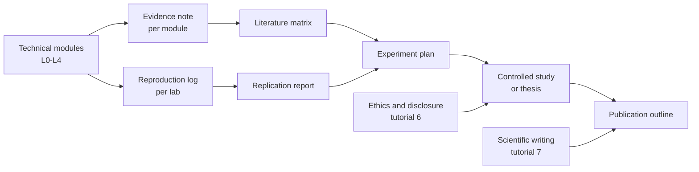
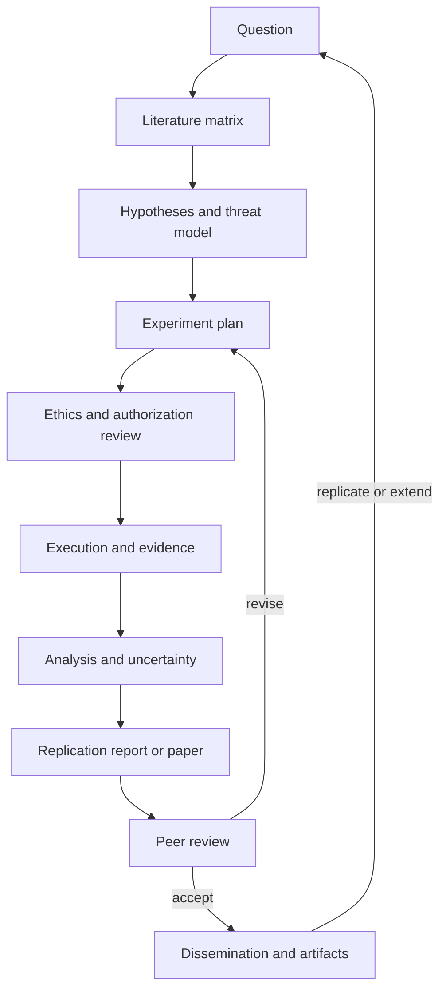

# Academic Cybersecurity Research Track

> **Level:** L5 · **Prerequisites:** research methods build on L0–L4; each project states its own technical prerequisites
> **Status:** core methods drafted · **Validation:** structural for authored tutorials; projects and rubrics are templates, not completed research

This track teaches the craft of producing, evaluating, and communicating cybersecurity research. It is not a degree, a publication guarantee, or ethics approval. It is a structured apprenticeship in asking answerable questions, collecting defensible evidence, and reporting what the evidence supports.

## Why a separate research track

Technical skill is necessary but not sufficient for research. A practitioner can configure a control, run a tool, or find a bug without being able to answer:

- What question is this work answering?
- What would count as evidence for or against the claim?
- What is the baseline, and what was controlled?
- How large is the uncertainty?
- Would another expert get the same result?
- What are the alternative explanations?
- Is the work ethical and lawfully authorized?
- What should a reader do differently because of it?

The research track makes those questions explicit and assessable.

## Track map

| # | Tutorial | Core content | Primary module |
|---|---|---|---|
| 1 | [Literature search and source evaluation](01-literature-search-and-source-evaluation.md) | Search protocol, databases, screening, source hierarchy, provenance | RES-01 |
| 2 | [Research questions, hypotheses, and threat models](02-research-questions-hypotheses-and-threat-models.md) | Question refinement, operationalization, hypotheses, research threat models | RES-01 |
| 3 | [Experimental design, baselines, and sampling](03-experimental-design-baselines-and-sampling.md) | Designs, controls, sampling, power, validity | RES-02 |
| 4 | [Measurement, statistics, and uncertainty](04-measurement-statistics-and-uncertainty.md) | Metrics, effect sizes, intervals, tests, multiple comparisons | RES-02 |
| 5 | [Reproducibility and replication](05-reproducibility-and-replication.md) | Artifact packaging, environment capture, replication types, reporting | RES-02 |
| 6 | [Ethics, responsible disclosure, and open science](06-ethics-disclosure-and-open-science.md) | Authorization, consent, dual use, CVD, data ethics, authorship | RES-06 |
| 7 | [Scientific writing and publication](07-scientific-writing-and-publication.md) | Claim–evidence mapping, paper structure, review, revision | RES-07 |
| 8 | [Domain research designs](08-domain-research-designs.md) | Vulnerability discovery, usable security, formal methods | RES-03/04/05 (planned; design overview only) |

Read tutorials 1–7 in order once the module gates in [`course-manifest.yaml`](../manifest/course-manifest.yaml) are met. Tutorial 8 applies the method to three security subfields and can be read after tutorial 3; it is a design overview, not completion of the planned modules.

## Integration with the technical curriculum

The research track is not a final add-on. Every technical module contributes to it:

A learner who has not produced evidence notes and reproduction logs should not begin a thesis. The projects enforce that prerequisite.

## The research artifact pipeline

## Claim taxonomy

Every research artifact must distinguish four categories of statement:

| Type | Definition | Required treatment |
|---|---|---|
| **Original result** | Produced by the author's own study, with recorded evidence | Cite the artifact, dataset, code, and analysis; state uncertainty |
| **Cited claim** | Asserted by another source | Cite the source and the specific claim; do not present it as your result |
| **Generated example** | Constructed for teaching, illustration, or a hypothetical | Label it explicitly; never present it as measured data |
| **Assumption** | A condition the work depends on but does not establish | State it, test it where possible, and bound the conclusion if it fails |

An unlabeled assumption is a defect.

## Evidence standard

A research artifact is acceptable only when:

1. The question and hypotheses are explicit.
2. The method is described well enough to reproduce.
3. The baseline, controls, sampling, and metrics are defined.
4. The evidence is recorded, not reconstructed from memory.
5. Alternative explanations and limitations are addressed.
6. Ethical authorization or consent is documented.
7. The artifact, code, and data availability statement are accurate.
8. Claims do not exceed the evidence.

## Templates

| Template | Use |
|---|---|
| [Research paper review](../authoring-templates/research-paper-review.md) | Structured critique of a published paper |
| [Literature matrix](../authoring-templates/literature-matrix.md) | Search protocol, screening, evidence extraction, synthesis |
| [Experiment plan](../authoring-templates/experiment-plan.md) | Pre-registration-style design before data collection |
| [Replication report](../authoring-templates/replication-report.md) | Direct or conceptual replication with deviations |
| [Publication outline](../authoring-templates/publication-outline.md) | Claim–evidence map and paper structure |

## Progressive projects

| Project | Difficulty | Output | Prerequisites |
|---|---|---|---|
| [P1: Structured literature review](projects/01-structured-literature-review.md) | Foundational | Protocol, matrix, synthesis, gap memo | Tutorials 1–2 |
| [P2: Replication study](projects/02-replication-study.md) | Intermediate | Replication report and artifact review | Tutorials 1–5 |
| [P3: Controlled experiment](projects/03-controlled-experiment.md) | Advanced | Experiment plan, execution, analysis, paper draft | Tutorials 1–6 + technical depth |
| [P4: Thesis proposal and paper](projects/04-thesis-proposal-and-paper.md) | Research-level | Proposal, thesis/paper, defense | All tutorials + P3 |

Rubrics: [research project rubrics](projects/rubrics.md).

## Research integrity rules

- Do not fabricate data, citations, command output, or results.
- Do not cite a source you have not opened.
- Do not present a generated example as a measurement.
- Do not hide negative or inconclusive results.
- Do not change the analysis plan after seeing the data without reporting it.
- Do not test a system without written authorization.
- Do not publish exploit details before coordinated disclosure.
- Disclose AI assistance and verify every generated claim.

## What this track does not provide

- A degree, certification, or academic affiliation.
- Ethics approval from an institutional review board.
- Legal authorization to test a system.
- A guarantee of publication.
- A substitute for supervision by an experienced researcher.

## Cross-links

- [Research and Teaching Strand](../RESEARCH_STRAND.md)
- [Course Map](../COURSE_MAP.md)
- [References](../REFERENCES.md)
- [Assumptions and Gaps](../ASSUMPTIONS_AND_GAPS.md)
