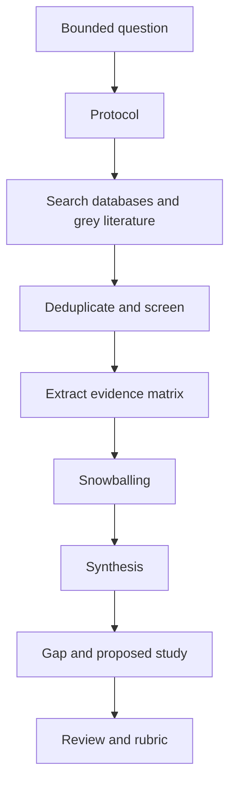

# P1: Structured Literature Review

> **Difficulty:** foundational · **Prerequisites:** Research 1–2 · **Estimated effort:** 30–50 h
> **Output:** review protocol, literature matrix, synthesis, gap memo · **Rubric:** [P1 rubric](rubrics.md#p1-structured-literature-review)

## 1. Question

Choose a security question that can be informed by existing evidence, for example:

- What is the measured effectiveness of a mitigation in deployed systems?
- Which factors are associated with vulnerability disclosure delays?
- What evidence exists for the usability of a security mechanism?

The question must be bounded by population, intervention or exposure, outcome, and time frame.

## 2. Deliverables

| Deliverable | Content |
|---|---|
| `protocol.md` | Databases, queries, dates, filters, inclusion/exclusion, screening method |
| `matrix.csv` or `matrix.md` | 12–20 included sources with extracted claims and evidence |
| `synthesis.md` | Themes, agreements, contradictions, strength of evidence |
| `gap.md` | What is missing, why it matters, and what study would address it |
| `review.md` | 2,000–3,000 word review with limitations and reproducibility appendix |
| `sources/` | Search logs, screening decisions, and source snapshots or citations |

## 3. Method

## 4. Requirements

- Record exact queries and dates. Do not report result counts you did not observe.
- Use at least two academic databases and one grey-literature source.
- Include at least 12 sources; at least eight should be primary research or standards.
- Label preprints, secondary sources, and generated examples.
- Separate each source's claim from your assessment.
- State at least four search limitations (coverage, language, publication bias, access).

## 5. Milestones

| Milestone | Evidence | Review |
|---|---|---|
| M1: Question and protocol | `protocol.md` | Advisor checks scope and feasibility |
| M2: Screening | Search log and exclusion reasons | Reviewer checks consistency |
| M3: Matrix | 12+ rows with claims and evidence | Reviewer checks extraction fidelity |
| M4: Synthesis and gap | `synthesis.md`, `gap.md` | Reviewer checks whether the gap follows from the evidence |
| M5: Final review | `review.md` | Rubric review |

## 6. What would fail

- A reference list with no search protocol.
- A gap statement based on sources the author did not screen.
- Claims copied from abstracts without checking the method or results.
- Unlabeled preprints or generated examples.
- A "systematic" label without a reproducible search.

## 7. Extension

Add a second reviewer for a 20% sample of screening decisions and report agreement. If agreement is low, revise the criteria and re-screen.
