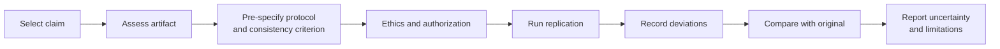

# P2: Replication Study

> **Difficulty:** intermediate · **Prerequisites:** Research 1–5; RES-02 module gates (DAT-01, PRG-01, RES-01) · **Estimated effort:** 50–80 h
> **Output:** replication protocol, artifact review, replication report · **Rubric:** [P2 rubric](rubrics.md#p2-replication-study)

## 1. Question

Select a published security result with enough methodological detail to replicate. Prefer a study with a public artifact. If no artifact exists, choose a conceptual replication with public or synthetic data and state the limitation.

The replication question is not "is the paper good?" It is "does the claim hold under a specified replication design?"

## 2. Deliverables

| Deliverable | Content |
|---|---|
| `selection.md` | Original claim, why it is replicable, artifact availability |
| `protocol.md` | Design, data, metrics, consistency criterion, deviations policy |
| `artifact-review.md` | What the original artifact contains and what is missing |
| `deviations.md` | Every change from the original protocol and its expected impact |
| `replication-report.md` | Completed [replication report](../../authoring-templates/replication-report.md) |
| `evidence/` | Commands, logs, outputs, checksums, environment |

## 3. Method

## 4. Requirements

- State the original claim and its scope precisely.
- Pre-specify what counts as consistent, inconsistent, or inconclusive.
- Run at least one direct comparison; if direct replication is impossible, justify a conceptual design.
- Record environment, versions, seeds, and data provenance.
- Report negative, partial, and failed results.
- Do not contact the original authors only to ask for the expected result; you may ask for artifact clarification.

## 5. Milestones

| Milestone | Evidence | Review |
|---|---|---|
| M1: Claim selected | `selection.md` | Advisor checks feasibility |
| M2: Protocol and criterion | `protocol.md` | Reviewer checks pre-specification |
| M3: Artifact review | `artifact-review.md` | Reviewer checks completeness |
| M4: Execution | `evidence/`, `deviations.md` | Reviewer checks traceability |
| M5: Report | `replication-report.md` | Rubric review |

## 6. What would fail

- Changing the consistency criterion after seeing the result.
- Claiming a replication without running the original method or a justified alternative.
- Hiding a failed or partial result.
- Reporting a result without environment and artifact details.
- Presenting the original authors' claim as your own result.

## 7. Extension

Add a sensitivity analysis that varies one factor (sample size, corpus mix, or parameter) and report how the conclusion changes.
