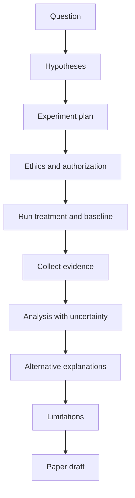

# P3: Controlled Experiment

> **Difficulty:** advanced · **Prerequisites:** Research 1–6, P2, technical depth in the domain · **Estimated effort:** 80–150 h
> **Output:** experiment plan, data, analysis, paper draft · **Rubric:** [P3 rubric](rubrics.md#p3-controlled-experiment)

## 1. Question

Ask a comparative or causal question that can be tested with a controlled design. Examples:

- Does a new detection rule improve recall at a fixed false positive rate?
- Does a memory-safety mitigation reduce a defined exploit class under a stated threat model?
- Does a user-interface change reduce a measured security error?

The question must include the population, intervention, comparison, outcome, and scope.

## 2. Deliverables

| Deliverable | Content |
|---|---|
| `experiment-plan.md` | Completed [experiment plan](../../authoring-templates/experiment-plan.md), approved before execution |
| `ethics/` | Authorization, consent, or exemption; disclosure plan |
| `data/` | Raw and processed data with provenance |
| `analysis/` | Scripts, outputs, and uncertainty calculations |
| `paper-draft.md` | 4,000–6,000 word draft using the [publication outline](../../authoring-templates/publication-outline.md) |
| `artifact/` | Code, environment, instructions, expected outputs |

## 3. Method

## 4. Requirements

- Define unit, treatment, baseline, controls, sampling, and metrics before running.
- State the primary outcome and the smallest effect that matters.
- Report uncertainty and the full result set, not only significant findings.
- Include at least one alternative explanation and the evidence that addresses it.
- Include a reproducibility artifact and a limitations section.
- Obtain authorization or ethics review before data collection.

## 5. Milestones

| Milestone | Evidence | Review |
|---|---|---|
| M1: Plan approved | `experiment-plan.md` | Advisor and ethics reviewer |
| M2: Pilot | Pilot data, feasibility note | Reviewer checks design |
| M3: Execution | Raw data, logs, deviations | Reviewer checks evidence |
| M4: Analysis | Scripts, intervals, sensitivity | Reviewer checks reasoning |
| M5: Draft | `paper-draft.md`, artifact | Rubric review |

## 6. What would fail

- No baseline or an incomparable baseline.
- Tuning on the test set or leaking test data.
- Reporting only significant results.
- A causal claim from a design that cannot support causality.
- Missing ethics approval or authorization.
- A result that cannot be traced to raw evidence.

## 7. Extension

Run a replication of your own experiment on a second population or environment and report the difference.
