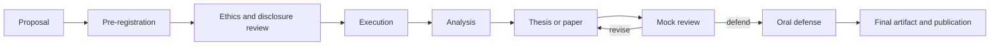

# P4: Thesis Proposal and Paper

> **Difficulty:** research-level · **Prerequisites:** all research tutorials, P3 · **Estimated effort:** 300–600 h
> **Output:** proposal, thesis or paper, artifact, defense · **Rubric:** [P4 rubric](rubrics.md#p4-thesis-proposal-and-paper)

## 1. Contribution

The thesis must make an original, bounded contribution. Acceptable forms include:

- a new measurement with a defensible sample and analysis;
- a new system or defense with a threat model and evaluation;
- a new attack or vulnerability class with responsible disclosure;
- a formal result with explicit assumptions;
- a replication or synthesis that changes the state of evidence.

A thesis is not a literature review plus a tool demo. The contribution must be clear enough that a reviewer can state it in one sentence.

## 2. Deliverables

| Deliverable | Content |
|---|---|
| `proposal.md` | Question, related work, gap, method, ethics, timeline, risks |
| `pre-registration.md` | Primary outcome, analysis, stopping rules, deviations policy |
| `thesis.pdf` or `paper.pdf` | Full manuscript |
| `artifact/` | Code, data, environment, instructions, expected outputs |
| `defense.md` | Slides, claims, evidence, limitations, anticipated questions |
| `reviews/` | Mock reviews and responses |

## 3. Method

## 4. Requirements

- The proposal must state the question, gap, method, ethics, and what would falsify the contribution.
- The thesis must distinguish original results, cited claims, assumptions, and generated examples.
- The artifact must be sufficient for an independent rerun, or the restriction must be justified.
- The defense must include limitations, alternative explanations, and residual uncertainty.
- The candidate must be able to explain every claim without notes.

## 5. Milestones

| Milestone | Evidence | Review |
|---|---|---|
| M1: Proposal defense | `proposal.md` | Panel |
| M2: Pre-registration | `pre-registration.md` | Advisor |
| M3: Ethics and disclosure | Approvals and plan | Ethics reviewer |
| M4: Execution | Data and artifact | Advisor |
| M5: Draft | Manuscript | Readers |
| M6: Mock review | Reviews and responses | Independent reviewer |
| M7: Defense | `defense.md` | Panel |

## 6. What would fail

- A contribution that cannot be stated or defended.
- A claim that exceeds the evidence.
- Missing ethics, authorization, or disclosure.
- An artifact that cannot be rerun and no justified restriction.
- A defense that cannot answer "what would prove you wrong?"

## 7. Extension

Submit the paper to a peer-reviewed venue or archive it with a persistent identifier after coordinating disclosure and obtaining permission for any restricted data.
