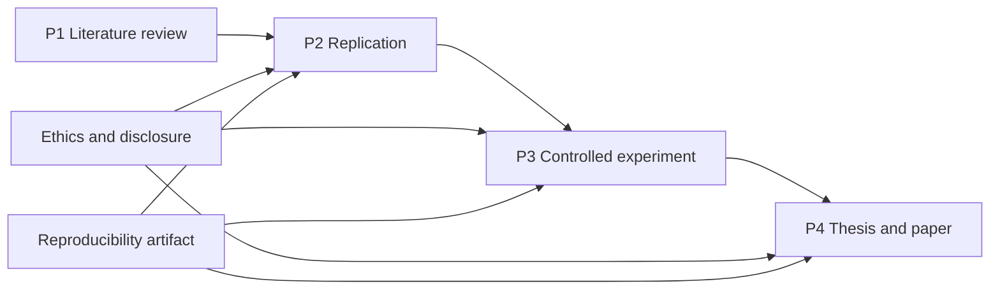

# Research Projects

> **Status:** project briefs drafted · **Validation:** structural · **Rubrics:** [research project rubrics](rubrics.md)
> These are project specifications, not completed research. No results are claimed.

The projects form a ladder. Each one adds a research skill and requires the previous level's evidence discipline. Do not skip P1 or P2 and expect a defensible P4.

| Project | Difficulty | Core skill | Prerequisites | Output |
|---|---|---|---|---|
| [P1: Structured literature review](01-structured-literature-review.md) | Foundational | Search, screening, synthesis | Research 1–2 | Protocol, matrix, synthesis, gap memo |
| [P2: Replication study](02-replication-study.md) | Intermediate | Reproduction, deviations, comparison | Research 1–5; RES-02 module gates | Replication report, artifact review |
| [P3: Controlled experiment](03-controlled-experiment.md) | Advanced | Design, measurement, analysis | Research 1–6 + technical depth | Plan, data, analysis, paper draft |
| [P4: Thesis proposal and paper](04-thesis-proposal-and-paper.md) | Research-level | Original contribution and defense | All tutorials + P3 | Proposal, thesis/paper, defense |

## Progression rules

1. **Evidence before claims.** A project with no recorded evidence fails regardless of prose quality.
2. **No fabricated results.** Placeholders are allowed in plans; invented numbers are not.
3. **Ethics before execution.** P2–P4 require an authorization or ethics statement before data collection.
4. **Reproducibility is part of the result.** A project without an artifact or a justified restriction is incomplete.
5. **Review is required.** Each project must be reviewed by someone other than the author using the rubric.

## Project workflow

## Deliverable conventions

- Use a version-controlled repository with a README.
- Keep raw evidence separate from analysis.
- Label every generated example.
- Record commands and environment versions.
- Include a limitations section in every report.
- State what is withheld and why.

## Review

Use the [research project rubrics](rubrics.md). A reviewer must be able to trace every claim to an artifact, a source, or an explicitly labeled generated example.
