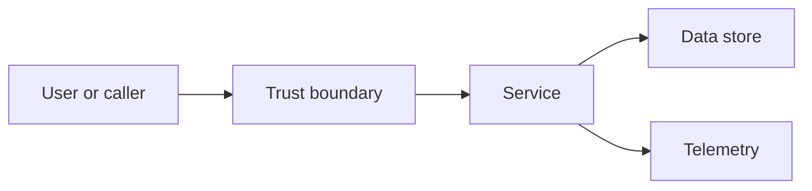

# Architecture Review Template

> Use this template for a security architecture review, a design review, or an architecture decision record. Keep the scope and assumptions explicit.

## Review metadata

| Field | Value |
|---|---|
| Review ID | `[REVIEW-ID]` |
| System or feature | `[NAME]` |
| Owner | `[NAME OR TEAM]` |
| Review date | `YYYY-MM-DD` |
| Reviewers | `[NAMES OR ROLES]` |
| Decision | `pending / approved / approved with conditions / rejected` |

## Context and scope

`[WHAT IS BEING REVIEWED, WHAT IS OUT OF SCOPE, AND WHAT DECISION THE REVIEW MUST ENABLE.]`

## Assumptions

| Assumption | Impact if wrong | Owner |
|---|---|---|
| `[ASSUMPTION]` | `[IMPACT]` | `[OWNER]` |

## Data flow and trust boundaries

`[EXPLAIN EACH BOUNDARY, WHAT CROSSES IT, AND WHAT AUTHENTICATION OR AUTHORIZATION IS ENFORCED.]`

## Assets and adversaries

| Asset | Sensitivity | Adversary | Impact if compromised |
|---|---|---|---|
| `[ASSET]` | `low / moderate / high` | `[ACTOR]` | `[IMPACT]` |

## Controls

| Control | Threat addressed | Evidence | Status |
|---|---|---|---|
| `[CONTROL]` | `[THREAT]` | `[TEST, LOG, CONFIG]` | `present / partial / missing` |

## Decisions and trade-offs

| Decision | Alternatives | Rationale | Consequences |
|---|---|---|---|
| `[DECISION]` | `[ALTERNATIVES]` | `[WHY]` | `[COST, RISK, OPERABILITY]` |

## Failure modes

| Failure | Detection | Blast radius | Recovery |
|---|---|---|---|
| `[FAILURE]` | `[SIGNAL]` | `[SCOPE]` | `[ACTION]` |

## Verification plan

- [ ] Threat model reviewed.
- [ ] Controls have automated tests or evidence.
- [ ] Logging and detection cover the critical paths.
- [ ] Failure modes were exercised.
- [ ] Residual risk is accepted by an accountable owner.

## Residual risk

| Risk | Likelihood | Impact | Acceptance owner | Review date |
|---|---|---|---|---|
| `[RISK]` | `low / moderate / high` | `low / moderate / high` | `[OWNER]` | `YYYY-MM-DD` |

## Open questions

| Question | Why it matters | Owner | Due |
|---|---|---|---|
| `[QUESTION]` | `[IMPACT]` | `[OWNER]` | `YYYY-MM-DD` |

## Review checklist

- [ ] Scope and assumptions are explicit.
- [ ] Trust boundaries and data flows are documented.
- [ ] Assets and adversaries are identified.
- [ ] Controls map to threats and have evidence.
- [ ] Trade-offs and consequences are recorded.
- [ ] Failure modes and detection are covered.
- [ ] Residual risk has an accountable owner.
- [ ] Decision and conditions are recorded.

## Decision record

`[DECISION, CONDITIONS, DATE, AND SIGN-OFF]`
