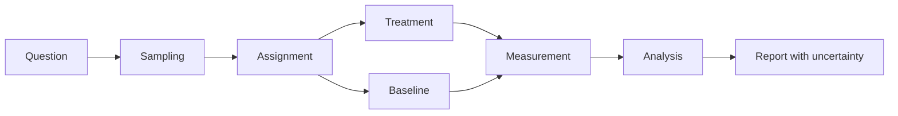

# Experiment Plan

> Write this plan before collecting data. It is a pre-registration-style document, not a results report. Replace every `[PLACEHOLDER]`.

## 1. Study metadata

| Field | Value |
|---|---|
| Study title | `[TITLE]` |
| Researcher | `[NAME OR ROLE]` |
| Version | `[VERSION]` |
| Date | `YYYY-MM-DD` |
| Status | `draft / approved / running / completed` |
| Related question | `[RQ ID]` |

## 2. Research question and hypotheses

**Question:** `[BOUNDED QUESTION]`

| ID | Hypothesis | Prediction | Falsification condition |
|---|---|---|---|
| H0 | `[NULL]` | `[PREDICTION]` | `[WHAT WOULD REFUTE]` |
| H1 | `[ALTERNATIVE]` | `[PREDICTION]` | `[WHAT WOULD REFUTE]` |

## 3. Contribution and claim

| Item | Value |
|---|---|
| Contribution type | `measurement / system / attack / defense / formal / replication` |
| Primary claim | `[CLAIM]` |
| Scope | `[POPULATION, SYSTEM, CONDITIONS]` |
| What the study will not show | `[BOUNDARY]` |

## 4. Design

| Element | Definition |
|---|---|
| Design family | `controlled / quasi-experimental / observational / case study / benchmark / formal` |
| Unit of analysis | `[UNIT]` |
| Treatment | `[TREATMENT]` |
| Baseline | `[BASELINE]` |
| Control variables | `[VARIABLES]` |
| Randomization or blocking | `[METHOD]` |
| Blinding | `[WHO IS BLINDED]` |

## 5. Sampling and power

| Item | Value |
|---|---|
| Sampling frame | `[FRAME]` |
| Sampling method | `[RANDOM / STRATIFIED / CONVENIENCE]` |
| Inclusion criteria | `[CRITERIA]` |
| Exclusion criteria | `[CRITERIA]` |
| Planned sample size | `[N]` |
| Power analysis | `[EFFECT, ALPHA, POWER, VARIANCE]` |
| If power is unknown | `[PRECISION OR EXPLORATORY STATUS]` |

## 6. Variables and metrics

| Variable | Type | Operational definition | Instrument | Evidence |
|---|---|---|---|---|
| `[OUTCOME]` | primary | `[DEFINITION]` | `[TOOL]` | `[FILE]` |
| `[SECONDARY]` | secondary | `[DEFINITION]` | `[TOOL]` | `[FILE]` |
| `[CONFOUNDER]` | control | `[DEFINITION]` | `[TOOL]` | `[FILE]` |

## 7. Procedure

1. `[SETUP AND VERIFICATION]`
2. `[ASSIGNMENT]`
3. `[TREATMENT RUN]`
4. `[BASELINE RUN]`
5. `[DATA COLLECTION]`
6. `[CLEANUP]`

## 8. Analysis plan

| Item | Plan |
|---|---|
| Primary analysis | `[TEST OR ESTIMATOR]` |
| Effect size | `[METRIC]` |
| Uncertainty | `[INTERVAL METHOD]` |
| Multiple comparisons | `[CORRECTION OR EXPLORATORY LABEL]` |
| Missing data | `[HANDLING]` |
| Outliers | `[PRE-SPECIFIED RULE]` |
| Sensitivity analysis | `[PLANNED CHECKS]` |
| Stopping rule | `[WHEN TO STOP]` |

## 9. Threats to validity

| Threat | Likelihood | Mitigation | Residual risk |
|---|---|---|---|
| Selection bias | `low / med / high` | `[CONTROL]` | `[RISK]` |
| Confounding | `[LIKELIHOOD]` | `[CONTROL]` | `[RISK]` |
| Measurement error | `[LIKELIHOOD]` | `[CONTROL]` | `[RISK]` |
| Leakage | `[LIKELIHOOD]` | `[CONTROL]` | `[RISK]` |
| External validity | `[LIKELIHOOD]` | `[CONTROL]` | `[RISK]` |

## 10. Ethics and authorization

| Item | Value |
|---|---|
| System authorization | `[DOCUMENT]` |
| Human-subject review | `[IRB / EXEMPTION]` |
| Consent and debriefing | `[PLAN]` |
| Data minimization | `[PLAN]` |
| Dual-use review | `[PLAN]` |
| Disclosure plan | `[PLAN]` |

## 11. Reproducibility

| Item | Value |
|---|---|
| Code repository | `[URL OR PATH]` |
| Data or generator | `[URL OR PATH]` |
| Environment | `[OS, KERNEL, RUNTIME, TOOLS]` |
| Seeds | `[SEEDS]` |
| Expected outputs | `[FILES OR CHECKSUMS]` |
| Artifact restrictions | `[WHAT IS WITHHELD AND WHY]` |

## 12. Deviations log

| Date | Deviation | Reason | Impact on analysis |
|---|---|---|---|
| `YYYY-MM-DD` | `[CHANGE]` | `[REASON]` | `[IMPACT]` |

## 13. Approval

| Role | Name | Date | Decision |
|---|---|---|---|
| Researcher | `[NAME]` | `YYYY-MM-DD` | `[SIGN-OFF]` |
| Reviewer or advisor | `[NAME]` | `YYYY-MM-DD` | `[APPROVE / REVISE]` |
| Ethics reviewer | `[NAME]` | `YYYY-MM-DD` | `[APPROVE / EXEMPT]` |
