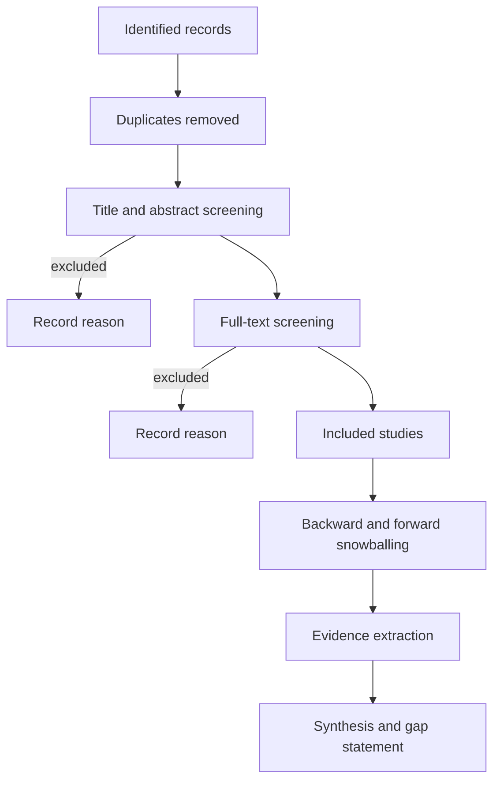

# Literature Matrix and Search Protocol

> Use this template to make a literature review auditable. Replace every `[PLACEHOLDER]`. Keep the protocol from being edited after screening begins without a recorded reason.

## 1. Review metadata

| Field | Value |
|---|---|
| Review question | `[QUESTION]` |
| Reviewer | `[NAME OR ROLE]` |
| Start date | `YYYY-MM-DD` |
| Last search date | `YYYY-MM-DD` |
| Review type | `systematic / structured / narrative` |
| Protocol version | `[VERSION]` |

## 2. Search protocol

| Database or source | Query string | Filters | Date executed | Results | Notes |
|---|---|---|---:|---:|---|
| `[ACM DL / IEEE Xplore / USENIX / arXiv / Scopus]` | `[QUERY]` | `[DATE, LANGUAGE, TYPE]` | `YYYY-MM-DD` | `[N]` | `[NOTES]` |
| `[NIST / CISA / MITRE / OWASP]` | `[QUERY]` | `[FILTERS]` | `YYYY-MM-DD` | `[N]` | `[GREY LITERATURE]` |

Record the exact query and date. Do not report a result count you did not observe.

## 3. Inclusion and exclusion criteria

| Criterion | Include | Exclude | Rationale |
|---|---|---|---|
| Topic | `[IN SCOPE]` | `[OUT OF SCOPE]` | `[WHY]` |
| Evidence type | `[PEER-REVIEWED, STANDARD, REPORT]` | `[BLOG, MARKETING]` | `[WHY]` |
| Date | `[RANGE]` | `[OUTSIDE]` | `[WHY]` |
| Language | `[LANGUAGES]` | `[OTHERS]` | `[WHY]` |
| Artifact | `[AVAILABLE]` | `[NOT REQUIRED]` | `[WHY]` |

## 4. Screening flow

## 5. Screening log

| Record ID | Source | Title | Stage | Decision | Reason |
|---|---|---|---|---|---|
| `[ID]` | `[VENUE]` | `[TITLE]` | `title / full text` | `include / exclude` | `[REASON]` |

## 6. Evidence matrix

| ID | Study and venue | Year | Question | Design | Sample or data | Main claim | Evidence | Limitations | Relevance | Replication status |
|---|---|---|---:|---|---|---|---|---|---|---|---|
| `[S1]` | `[CITATION]` | `[YEAR]` | `[RQ]` | `[DESIGN]` | `[N]` | `[CLAIM]` | `[TABLE/FIGURE]` | `[LIMITS]` | `[HIGH/MED/LOW]` | `[NONE/PARTIAL/DIRECT]` |
| `[S2]` | `[CITATION]` | `[YEAR]` | `[RQ]` | `[DESIGN]` | `[N]` | `[CLAIM]` | `[EVIDENCE]` | `[LIMITS]` | `[RELEVANCE]` | `[STATUS]` |

Keep claims and evidence separate. "The paper says X" is not an evidence extraction.

## 7. Synthesis

| Theme | Supporting sources | Contradicting sources | Strength of evidence | Gap |
|---|---|---|---|---|
| `[THEME]` | `[S1, S4]` | `[S2]` | `strong / moderate / weak` | `[GAP]` |

## 8. Gap statement

`[A GAP IS A DEFICIT IN THE EVIDENCE, NOT A TOPIC THE REVIEWER HAS NOT READ. STATE WHAT IS MISSING, WHY IT MATTERS, AND WHAT STUDY WOULD ADDRESS IT.]`

## 9. Source evaluation

| Source | Peer reviewed? | Venue quality | Method quality | Conflicts | Version checked | Confidence |
|---|---|---|---|---|---|---|
| `[S1]` | `yes / no` | `[ASSESSMENT]` | `[ASSESSMENT]` | `[NONE/DISCLOSED]` | `[VERSION/DATE]` | `high / medium / low` |

## 10. Reproducibility of the review

- [ ] Queries and dates are recorded.
- [ ] Inclusion and exclusion criteria were fixed before screening.
- [ ] Exclusion reasons are recorded.
- [ ] Snowballing is documented.
- [ ] The matrix can be reconstructed from the log.
- [ ] Limitations of the search are stated.
