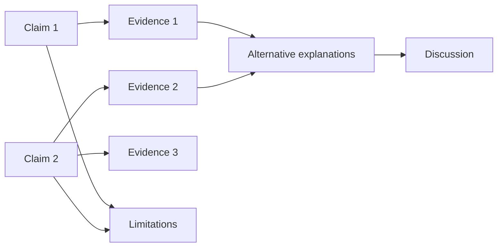

# Publication Outline and Claim–Evidence Map

> Use this template to plan a paper before drafting. Replace every `[PLACEHOLDER]`. Do not write results you have not measured.

## 1. Metadata

| Field | Value |
|---|---|
| Working title | `[TITLE]` |
| Authors | `[AUTHORS AND ROLES]` |
| Target venue | `[VENUE OR TYPE]` |
| Contribution type | `measurement / system / attack / defense / formal / SoK / replication` |
| Draft version | `[VERSION]` |
| Date | `YYYY-MM-DD` |

## 2. Contribution statement

**Problem:** `[WHAT PROBLEM]`

**Gap:** `[WHAT EVIDENCE IS MISSING]`

**Approach:** `[WHAT YOU DID]`

**Result:** `[WHAT YOU FOUND, WITH SCOPE]`

**Implication:** `[WHAT SHOULD CHANGE]`

## 3. Claim–evidence map

| # | Claim | Scope | Evidence | Uncertainty | Alternative | Limitation |
|---|---|---|---|---|---|---|
| C1 | `[CLAIM]` | `[SCOPE]` | `[TABLE/FIGURE]` | `[INTERVAL]` | `[ALTERNATIVE]` | `[LIMIT]` |
| C2 | `[CLAIM]` | `[SCOPE]` | `[EVIDENCE]` | `[UNCERTAINTY]` | `[ALTERNATIVE]` | `[LIMIT]` |

## 4. Paper anatomy

| Section | Content | Evidence or source |
|---|---|---|
| Title | `[ACCURATE, SPECIFIC TITLE]` | — |
| Abstract | Question, method, result, scope | `[CLAIMS]` |
| Introduction | Problem, gap, contribution | `[LITERATURE]` |
| Related work | Synthesis and positioning | `[MATRIX]` |
| Threat model | Adversary, assets, assumptions | `[THREAT MODEL]` |
| Method | Design, sample, metrics, analysis | `[PLAN]` |
| Results | Evidence with uncertainty | `[TABLES/FIGURES]` |
| Discussion | Interpretation and alternatives | `[ANALYSIS]` |
| Limitations | What the study cannot show | `[LIST]` |
| Ethics | Authorization, consent, disclosure | `[DOCUMENTS]` |
| Availability | Code, data, artifacts, restrictions | `[LINKS]` |
| Appendix | Protocols, proofs, extra results | `[FILES]` |

## 5. Abstract draft

`[CONTEXT: ONE SENTENCE]`

`[GAP: ONE SENTENCE]`

`[METHOD: ONE OR TWO SENTENCES]`

`[RESULT: ONE OR TWO SENTENCES WITH SCOPE AND UNCERTAINTY]`

`[IMPLICATION: ONE SENTENCE]`

Do not include a result placeholder as if it were measured. Mark it clearly until the analysis is complete.

## 6. Figures and tables

| Item | Purpose | Data source | Claim supported |
|---|---|---|---|
| Figure 1 | `[SYSTEM OR THREAT MODEL]` | `[DESIGN]` | `[CLAIM]` |
| Table 1 | `[MAIN RESULT]` | `[DATA]` | `[CLAIM]` |
| Figure 2 | `[SENSITIVITY OR ABLATION]` | `[DATA]` | `[CLAIM]` |

Every figure must have a caption that states what is measured, the sample, and the uncertainty.

## 7. Related work plan

| Theme | Sources | What this paper adds |
|---|---|---|
| `[THEME]` | `[SOURCES]` | `[CONTRIBUTION]` |

## 8. Limitations

1. `[SAMPLE OR POPULATION]`
2. `[DESIGN OR MEASUREMENT]`
3. `[EXTERNAL VALIDITY]`
4. `[ARTIFACT OR DATA]`
5. `[ETHICS OR DISCLOSURE]`

## 9. Ethics and availability statements

| Statement | Draft |
|---|---|
| Authorization or consent | `[TEXT]` |
| Disclosure | `[TEXT]` |
| Data availability | `[TEXT]` |
| Code availability | `[TEXT]` |
| Restrictions | `[WHAT AND WHY]` |

## 10. Reviewer checklist

- [ ] Every claim maps to evidence.
- [ ] The abstract does not exceed the scope.
- [ ] The threat model is explicit.
- [ ] The baseline and controls are described.
- [ ] Uncertainty is reported.
- [ ] Limitations are specific.
- [ ] Ethics and disclosure are documented.
- [ ] Artifact availability is accurate.
- [ ] Cited claims are distinguished from original results.
