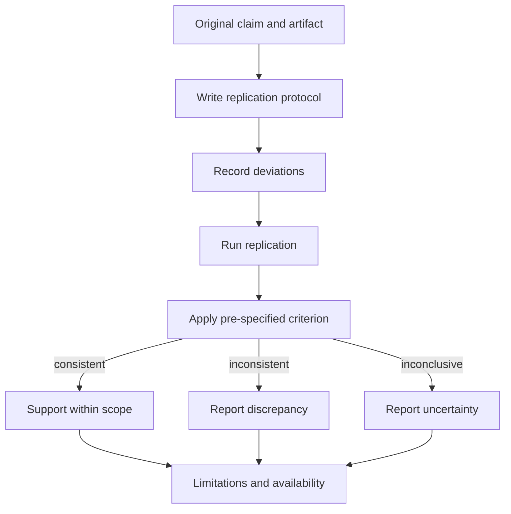

# Replication Report

> Use this template for a direct or conceptual replication. Pre-specify the consistency criterion before running the study. Replace every `[PLACEHOLDER]`.

## 1. Metadata

| Field | Value |
|---|---|
| Replication title | `[TITLE]` |
| Researcher | `[NAME OR ROLE]` |
| Date | `YYYY-MM-DD` |
| Original study | `[CITATION]` |
| Original source ID | `[SOURCE-ID]` |
| Replication type | `direct / conceptual / partial` |
| Status | `planned / running / completed` |

## 2. Original claim

| Item | Value |
|---|---|
| Claim | `[WHAT THE ORIGINAL STUDY ASSERTS]` |
| Scope | `[POPULATION, SYSTEM, CONDITIONS]` |
| Original evidence | `[TABLE, FIGURE, DATASET]` |
| Original uncertainty | `[INTERVAL OR VARIANCE]` |
| Original artifact | `[AVAILABLE / PARTIAL / NONE]` |

## 3. Replication question

**Question:** `[WHAT EXACTLY IS BEING TESTED]`

**Pre-specified consistency criterion:** `[WHAT RESULT WOULD COUNT AS CONSISTENT, INCONSISTENT, OR INCONCLUSIVE]`

## 4. Protocol

| Element | Original | Replication | Change and reason |
|---|---|---|---|
| Design | `[DESIGN]` | `[DESIGN]` | `[CHANGE]` |
| Population | `[POPULATION]` | `[POPULATION]` | `[CHANGE]` |
| Sample size | `[N]` | `[N]` | `[CHANGE]` |
| Treatment | `[TREATMENT]` | `[TREATMENT]` | `[CHANGE]` |
| Baseline | `[BASELINE]` | `[BASELINE]` | `[CHANGE]` |
| Metrics | `[METRICS]` | `[METRICS]` | `[CHANGE]` |
| Analysis | `[METHOD]` | `[METHOD]` | `[CHANGE]` |

## 5. Environment and artifacts

| Item | Value |
|---|---|
| OS and kernel | `[VERSIONS]` |
| Runtime and libraries | `[VERSIONS]` |
| Hardware | `[CPU, MEMORY, ACCELERATOR]` |
| Original artifact version | `[COMMIT/TAG]` |
| Replication artifact | `[REPOSITORY/TAG]` |
| Data or generator | `[SOURCE, VERSION]` |
| Seeds | `[SEEDS]` |
| Known environment differences | `[DIFFERENCES]` |

## 6. Deviations log

| Date | Deviation | Reason | Expected impact |
|---|---|---|---|
| `YYYY-MM-DD` | `[CHANGE]` | `[REASON]` | `[IMPACT]` |

## 7. Results

| Metric | Original result | Replication result | Interval or variance | Consistent? |
|---|---|---|---|---|
| `[METRIC]` | `[VALUE]` | `[VALUE]` | `[INTERVAL]` | `yes / no / unclear` |
| `[METRIC]` | `[VALUE]` | `[VALUE]` | `[INTERVAL]` | `[YES/NO/UNCLEAR]` |

Do not fill this table until the data are collected and analyzed. Generated examples must be labeled.

## 8. Analysis

`[APPLY THE PRE-SPECIFIED CRITERION. SEPARATE OBSERVED RESULTS FROM INTERPRETATION. REPORT EFFECT SIZES AND UNCERTAINTY.]`

## 9. Alternative explanations

| Observation | Alternative explanation | Evidence for or against | Follow-up |
|---|---|---|---|
| `[DIFFERENCE]` | `[EXPLANATION]` | `[EVIDENCE]` | `[TEST]` |

## 10. Limitations

1. `[SCOPE]`
2. `[ENVIRONMENT]`
3. `[ARTIFACT]`
4. `[SAMPLE]`
5. `[ANALYSIS]`

## 11. Conclusion

| Statement | Type | Support |
|---|---|---|
| `[CONCLUSION]` | `original result / cited claim / inference` | `[EVIDENCE]` |

## 12. Availability and ethics

| Item | Value |
|---|---|
| Code | `[URL / RESTRICTED / NONE]` |
| Data | `[URL / GENERATOR / RESTRICTED]` |
| License | `[LICENSE]` |
| Authorization or consent | `[DOCUMENT]` |
| Disclosure | `[NOT APPLICABLE / PLAN]` |

## 13. Reviewer checklist

- [ ] Consistency criterion was set before running.
- [ ] Deviations are recorded with reasons.
- [ ] The comparison does not change the metric post hoc.
- [ ] Uncertainty is reported.
- [ ] Negative or inconclusive results are not hidden.
- [ ] Artifact restrictions are explained.
