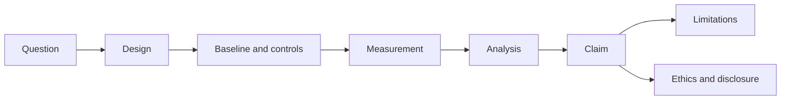

# Research Paper Review Template

> Use this template to evaluate a security research paper. The goal is to judge the evidence and method, not to summarize the abstract. Replace every `[PLACEHOLDER]`.

## Review metadata

| Field | Value |
|---|---|
| Reviewer | `[NAME OR ROLE]` |
| Review date | `YYYY-MM-DD` |
| Paper title | `[TITLE]` |
| Authors | `[AUTHORS]` |
| Venue and year | `[VENUE, YEAR]` |
| Version reviewed | `[CONFERENCE / JOURNAL / PREPRINT / DRAFT]` |
| DOI or URL | `[IDENTIFIER]` |
| Source ID | `[SOURCE-ID]` |

## 1. Contribution and claim

| Item | Assessment |
|---|---|
| Contribution type | `measurement / system / attack / defense / formal / SoK / replication` |
| One-sentence claim | `[WHAT THE PAPER ASSERTS]` |
| Scope of the claim | `[SYSTEMS, POPULATIONS, CONDITIONS]` |
| Claimed novelty | `[WHAT THE AUTHORS SAY IS NEW]` |
| Is the claim falsifiable? | `yes / no / partly` |

If you cannot state the claim in one sentence, the paper may be unclear or you may not yet understand it. Do not substitute the abstract for the claim.

## 2. Research question and hypotheses

| Item | Assessment |
|---|---|
| Question | `[WHAT THE PAPER ASKS]` |
| Hypotheses | `[WHAT IT PREDICTS]` |
| Unit of analysis | `[PROGRAM, HOST, PARTICIPANT, RUN]` |
| Population or sample | `[WHAT THE EVIDENCE COVERS]` |
| Success criterion | `[WHAT WOULD COUNT FOR OR AGAINST]` |

## 3. Method and evidence

| Item | Assessment |
|---|---|
| Design | `controlled experiment / quasi-experiment / observational / case study / benchmark / formal / replication` |
| Baseline | `[WHAT WAS COMPARED]` |
| Controls | `[WHAT WAS HELD CONSTANT]` |
| Data source | `[CORPUS, DATASET, PARTICIPANTS, MODEL]` |
| Sampling | `[HOW UNITS WERE SELECTED]` |
| Instruments and versions | `[TOOLS, VERSIONS, CONFIGURATIONS]` |
| Analysis | `[STATISTICAL OR QUALITATIVE METHOD]` |
| Artifact availability | `[CODE, DATA, MODEL, NONE]` |

## 4. Claim–evidence table

| # | Claim | Scope | Evidence in paper | Uncertainty | Alternative explanation | Reviewer judgment |
|---|---|---|---|---|---|---|
| C1 | `[CLAIM]` | `[SCOPE]` | `[TABLE, FIGURE, SECTION]` | `[INTERVAL, VARIANCE]` | `[ALTERNATIVE]` | `supported / partly / unsupported` |
| C2 | `[CLAIM]` | `[SCOPE]` | `[EVIDENCE]` | `[UNCERTAINTY]` | `[ALTERNATIVE]` | `[JUDGMENT]` |

A claim that cites another paper is a **cited claim**, not the authors' original result. Mark it separately.

## 5. Original results versus cited claims

| Statement | Type | Source | Verified? |
|---|---|---|---|
| `[STATEMENT]` | `original result / cited claim / assumption / generated example` | `[SECTION OR SOURCE ID]` | `yes / no / partial` |

Do not let a cited claim inherit the authority of the current paper's method.

## 6. Results and interpretation

`[SEPARATE WHAT WAS OBSERVED FROM WHAT THE AUTHORS CONCLUDE. NOTE EFFECT SIZES, INTERVALS, DENOMINATORS, AND ANY CLAIM THAT OUTRUNS THE DATA.]`

## 7. Threats to validity

| Threat | Evidence in the paper | Severity | Mitigation or missing control |
|---|---|---|---|
| Selection bias | `[EVIDENCE]` | `low / moderate / high` | `[CONTROL]` |
| Confounding | `[EVIDENCE]` | `[SEVERITY]` | `[CONTROL]` |
| Measurement error | `[EVIDENCE]` | `[SEVERITY]` | `[CONTROL]` |
| Leakage or overfitting | `[EVIDENCE]` | `[SEVERITY]` | `[CONTROL]` |
| External validity | `[EVIDENCE]` | `[SEVERITY]` | `[CONTROL]` |
| Reproducibility | `[EVIDENCE]` | `[SEVERITY]` | `[CONTROL]` |

## 8. Reproducibility

- [ ] Code is available.
- [ ] Data or a generator is available.
- [ ] Environment and versions are specified.
- [ ] Build and run commands are sufficient.
- [ ] Seeds and parameters are reported.
- [ ] Expected outputs are provided.
- [ ] Negative or inconclusive results are reported.
- [ ] Artifact restrictions are stated with a reason.

If a box is unchecked, state what is missing and how it affects confidence.

## 9. Ethics and disclosure

| Question | Assessment |
|---|---|
| Authorization or consent | `[EVIDENCE]` |
| Human-subject review | `[IRB OR EQUIVALENT]` |
| Data minimization and privacy | `[EVIDENCE]` |
| Dual-use risk | `[ASSESSMENT]` |
| Vulnerability disclosure | `[PROCESS, DATES, COORDINATION]` |
| Conflicts of interest | `[DISCLOSURE]` |
| AI assistance disclosure | `[IF APPLICABLE]` |

## 10. Relevance to this curriculum

`[WHICH MODULES THIS PAPER SUPPORTS OR CHALLENGES, AND WHAT THE LEARNER SHOULD DO DIFFERENTLY]`

## 11. Decision

- [ ] Accept the claim as well supported.
- [ ] Accept with qualifications.
- [ ] Reject the claim as stated.
- [ ] Insufficient evidence to decide.

**Rationale:** `[ONE PARAGRAPH]`

**Required revisions or follow-up:** `[SPECIFIC ACTIONS]`

## 12. Review quality self-check

- [ ] I distinguished the paper's claims from my interpretation.
- [ ] I cited the specific section, table, or figure for each judgment.
- [ ] I did not penalize the paper for a scope it did not claim.
- [ ] I did not reward it for a claim it did not support.
- [ ] I checked at least one cited source.
- [ ] I stated my own uncertainty.
