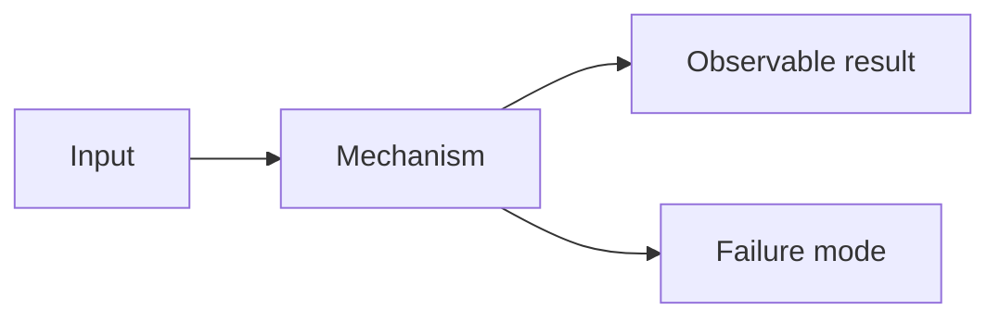

# Tutorial Template

> Copy this file to the module directory and replace every `[PLACEHOLDER]`. Do not publish a tutorial that still contains placeholders.

## Module metadata

| Field | Value |
|---|---|
| Module ID | `[MODULE-ID]` |
| Title | `[TITLE]` |
| Level | `[L0-L5]` |
| Prerequisites | `[MODULE-IDS]` |
| Estimated duration | `[READING] h reading + [PRACTICE] h practice + [ASSESSMENT] h assessment` |
| Status | `planned` |
| Validation | `unvalidated` |
| Last reviewed | `YYYY-MM-DD` |
| Source ledger | `[SOURCE-IDS]` |

## Learning objectives

By the end of this tutorial, the learner can:

1. `[OBJECTIVE-1: observable verb + artifact + threshold]`
2. `[OBJECTIVE-2]`
3. `[OBJECTIVE-3]`

## Why this matters

`[CONCRETE FAILURE, DECISION, OR ATTACK THIS TOPIC CHANGES. AVOID GENERIC MOTIVATION.]`

## Prerequisites and diagnostic

- Required modules: `[MODULE-IDS]`
- Diagnostic question: `[A SHORT QUESTION THAT REVEALS THE KEY PRIOR CONCEPT]`
- If the learner cannot answer: `[REMEDIATION LINK]`

## First principles

`[DEFINE THE SYSTEM, THE TRUST BOUNDARY, AND THE PROPERTY BEING PROTECTED BEFORE INTRODUCING TOOLS.]`

### Terminology

| Term | Definition | Why it matters |
|---|---|---|
| `[TERM]` | `[DEFINITION]` | `[CONSEQUENCE]` |

## Architecture and mechanics

`[EXPLAIN HOW THE MECHANISM WORKS INTERNALLY. NAME THE COMPONENTS, STATE TRANSITIONS, AND FAILURE MODES.]`



`[EXPLAIN THE DIAGRAM. IF THE DIAGRAM IS NOT USEFUL, DELETE IT.]`

## Worked example

`[A SMALL, COMPLETE EXAMPLE. INCLUDE THE COMMAND OR CODE, THE EXPECTED OUTPUT, AND THE INTERPRETATION.]`

```bash
# Replace with a runnable example.
[COMMAND]
```

Expected observation: `[WHAT THE LEARNER SHOULD SEE]`

Why it happens: `[MECHANISM]`

## Lab

- Lab brief: `[LINK TO labs/[MODULE-ID]/lab.md]`
- Isolation: `[none | recommended | required]`
- Risk: `[low | moderate | high]`
- Evidence required: `[ARTIFACTS]`

## Defensive implications

`[WHAT A DEFENDER SHOULD LOG, DETECT, PREVENT, OR RECOVER. INCLUDE AT LEAST ONE DETECTION IDEA AND ONE MITIGATION.]`

### Common failure modes

| Failure | Symptom | Detection | Mitigation |
|---|---|---|---|
| `[FAILURE]` | `[SYMPTOM]` | `[TELEMETRY]` | `[CONTROL]` |

## Threat model

| Element | Description |
|---|---|
| Asset | `[WHAT IS PROTECTED]` |
| Actor | `[WHO MIGHT ATTACK]` |
| Trust boundary | `[WHERE TRUST CHANGES]` |
| Attack surface | `[ENTRY POINTS]` |
| Assumption | `[WHAT MUST BE TRUE]` |

## Common misconceptions

| Misconception | Correction |
|---|---|
| `[MISCONCEPTION]` | `[CORRECTION WITH EVIDENCE]` |

## Exercises

### Foundation

`[RECALL OR EXPLAIN]`

### Application

`[APPLY TO A NEW CASE]`

### Analysis

`[COMPARE, DIAGNOSE, OR EVALUATE]`

### Extension

`[TURN THE LAB INTO A SMALL STUDY: ADD A BASELINE, MEASURE A RATE, OR REPLICATE A RESULT]`

## Knowledge check

1. `[QUESTION]`
2. `[QUESTION]`
3. `[QUESTION]`
4. `[QUESTION]`
5. `[QUESTION]`

Answers and rubric: `[LINK TO assessments/[MODULE-ID]/answer-key.md]`

## Summary and key takeaways

- `[TAKEAWAY-1]`
- `[TAKEAWAY-2]`
- `[TAKEAWAY-3]`

## Further reading

| Source ID | What it supports | Verification |
|---|---|---|
| `[SOURCE-ID]` | `[CLAIM]` | `[V1-V5]` |

## Cross-links

- Prerequisite: `[LINK]`
- Follow-up: `[LINK]`
- Related lab: `[LINK]`
- Related assessment: `[LINK]`

## Research artifact and teach-back

- Evidence note: `[WHAT OBSERVATION, INFERENCE, UNCERTAINTY, AND SOURCE WILL BE RECORDED]`
- Reproduction log: `[ENVIRONMENT, COMMANDS, EXPECTED VS ACTUAL]`
- Teach-back prompt: `[A QUESTION THE LEARNER MUST EXPLAIN WITHOUT NOTES]`

## Completion checklist

- [ ] All objectives are measurable and assessed.
- [ ] Every command was executed and its output recorded.
- [ ] The lab has setup, expected results, verification, cleanup, and troubleshooting.
- [ ] Defensive implications and failure modes are included.
- [ ] At least one Mermaid diagram is meaningful and renders.
- [ ] Misconceptions and progressive exercises are included.
- [ ] Knowledge check and answer key are separate.
- [ ] Sources are in the ledger and version-dependent claims are dated.
- [ ] Cross-links resolve.
- [ ] Research artifact and teach-back are complete.

## Author notes

`[OPEN QUESTIONS, KNOWN LIMITATIONS, OR MATERIAL DEFERRED TO A LATER REVISION]`
