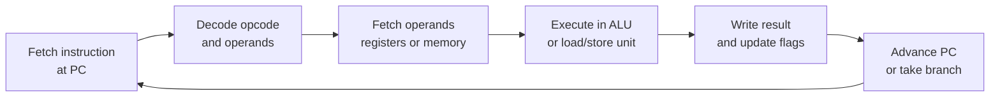
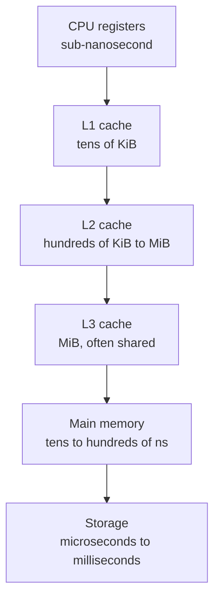

# SYS-01.1: Machine Model and Instruction Execution

> **Module:** SYS-01 · **Level:** L1 · **Prerequisites:** ORI-01 · **Estimated time:** 6 h (3 reading, 3 practice)
> **Outcome addressed:** SYS-01.O1

## Learning outcomes

By the end of this tutorial you can:

1. Describe the von Neumann execution cycle and identify the role of the program counter, registers, ALU, and memory.
2. Read a short ARM64 or x86-64 disassembly and explain what each instruction does to registers and memory.
3. Explain why caches, pipelining, and speculative execution exist, and why they create security-relevant side effects.
4. Distinguish an instruction set architecture (ISA) from an application binary interface (ABI).

## Why this matters

Source code is an abstraction. The machine executes instructions that load, transform, store, and branch. Exploitation, reverse engineering, and detection all depend on knowing which instruction touched which memory and why.

A concrete example: a C function that "just adds two numbers" becomes a sequence of stack adjustments, register stores, an addition, and a return. If an attacker can overwrite the saved return address on that stack, the function returns somewhere else. You cannot see that in the C source.

## First principles

### The machine

A simplified stored-program computer has:

| Component | Role |
|---|---|
| **Control unit** | Fetches and decodes instructions; sequences the pipeline |
| **Arithmetic logic unit (ALU)** | Performs arithmetic and bitwise operations |
| **Registers** | Small, fast storage inside the CPU |
| **Program counter (PC)** | Address of the next instruction; called `rip` on x86-64 and `pc` on AArch64 |
| **Flags/status register** | Records conditions such as zero, carry, sign, overflow |
| **Memory** | Byte-addressed storage for instructions and data |
| **I/O and devices** | Controllers, buses, and memory-mapped registers |

**Stored-program model:** instructions and data live in the same address space. That is convenient and dangerous. A write primitive that can reach executable memory can change what the program does.

### Fetch, decode, execute



The cycle repeats for every instruction. Modern CPUs overlap many instructions at once (pipelining, out-of-order execution) and guess which way branches will go (branch prediction). The architectural result looks sequential, but the microarchitectural execution is not.

### Registers you will actually see

**x86-64** has 16 general-purpose 64-bit registers (`rax`–`r15`), plus `rip`, `rsp` (stack pointer), `rbp` (frame pointer), and `rflags` [L12]. Sub-registers such as `eax`, `ax`, and `al` alias the low parts of `rax`.

**AArch64** has 31 general-purpose 64-bit registers (`x0`–`x30`), a zero register (`xzr`), a stack pointer (`sp`), and a program counter [L11]. `w0`–`w30` are the 32-bit views. `x29` is conventionally the frame pointer and `x30` the link register holding the return address.

Both architectures use 64-bit pointers in the standard 64-bit ABIs. That is why `sizeof(void *)` is 8 in the captured example below.

### ISA versus ABI

| Concept | What it defines | Example |
|---|---|---|
| **ISA** | Instructions, registers, addressing modes, privilege levels | ARMv8-A, x86-64 |
| **ABI** | Calling convention, register usage, stack alignment, data layout, symbol naming | System V AMD64 ABI [L10], AAPCS64 [L11], Apple ARM64 |

Two programs can target the same ISA but disagree on the ABI and fail to link or corrupt each other's data. Security guidance that says "the first argument is in `rdi`" is true only for a specific ABI.

### Caches and the memory hierarchy



Caches exploit **temporal locality** (recently used data is likely reused) and **spatial locality** (nearby bytes are likely used). They are why memory access patterns matter for performance.

They also matter for security. Cache state depends on which addresses were accessed, and that state can be observed by another process or another thread on the same core. This is the basis of cache-timing side channels and part of the Spectre family of attacks [A10]. The details are microarchitecture- and version-specific; the durable lesson is that **the architectural model is not the whole machine**.

### Pipeline, branch prediction, and speculation

A pipelined CPU starts executing later instructions before earlier ones finish. When it encounters a branch, it predicts the direction and speculates down that path. If the prediction is wrong, architectural state is rolled back, but microarchitectural state (caches, branch predictors, fill buffers) may not be fully restored. Spectre demonstrated that this leftover state can leak information across a security boundary [A10].

> **Version note (2026-10-19).** Mitigations and their performance costs differ by CPU generation, microcode, OS, and compiler. Do not state that a specific system is "immune" without evidence. Record the CPU, firmware, kernel, and compiler versions when testing.

### Endianness and alignment

**Endianness** is the byte order used to store a multi-byte value. Little-endian stores the least significant byte first. x86-64 is little-endian. AArch64 supports both byte orders for data, but mainstream operating systems run it little-endian. The captured program below reports little-endian on macOS arm64.

**Alignment** means an object's address is a multiple of its size or a required boundary. Misaligned access may be slower or, on some architectures, fault. Compilers insert padding in structures to satisfy alignment; that padding is part of the binary layout and can leak data if structures are copied raw.

## Worked example: a real ARM64 function

The following source was compiled on the capture host:

```c
__attribute__((noinline)) int add(int a, int b) {
    int local = a + b;
    return local;
}
```

Compiled with `cc -O0 -g -Wall -Wextra`. The disassembly below is captured output from **Apple clang 21.0.0 on macOS 27.0.1, arm64**, using `otool -tvV layout`:

```text
_add:
0000000100000548	sub	sp, sp, #0x10
000000010000054c	str	w0, [sp, #0xc]
0000000100000550	str	w1, [sp, #0x8]
0000000100000554	ldr	w8, [sp, #0xc]
0000000100000558	ldr	w9, [sp, #0x8]
000000010000055c	add	w8, w8, w9
0000000100000560	str	w8, [sp, #0x4]
0000000100000564	ldr	w0, [sp, #0x4]
0000000100000568	add	sp, sp, #0x10
000000010000056c	ret
```

Reading it line by line:

| Instruction | Effect |
|---|---|
| `sub sp, sp, #0x10` | Reserve 16 bytes of stack for this frame |
| `str w0, [sp, #0xc]` | Spill argument `a` (in `w0`) to the stack |
| `str w1, [sp, #0x8]` | Spill argument `b` (in `w1`) to the stack |
| `ldr w8, [sp, #0xc]` | Load `a` into `w8` |
| `ldr w9, [sp, #0x8]` | Load `b` into `w9` |
| `add w8, w8, w9` | `w8 = a + b` |
| `str w8, [sp, #0x4]` | Store the result in `local` on the stack |
| `ldr w0, [sp, #0x4]` | Load `local` into `w0`, the return register |
| `add sp, sp, #0x10` | Release the frame |
| `ret` | Return to the address in `x30` (the link register) |

The `-O0` build spills aggressively. An optimized build would keep values in registers and might eliminate the frame entirely. That is why disassembly examples must state the compiler and flags.

### The captured platform facts

```text
$ ./sysinfo
pointer size: 8 bytes
long size:    8 bytes
page size:    16384 bytes
endianness:   little
```

`sysconf(_SC_PAGESIZE)` returned **16384** on this Apple Silicon host. On many x86-64 Linux systems the base page size is **4096**. Code that assumes 4 KiB pages is not portable. Always query the page size at runtime.

## Security implications

1. **Control flow is data.** A return address or function pointer stored in writable memory is a target. If an attacker can write it, they can redirect execution.
2. **The compiler is part of the attack surface.** Optimization decisions, inlining, and inserted checks change which bugs are exploitable. A compiler or toolchain compromise can inject behavior that source review will not reveal; this is the lesson of Thompson's "Reflections on Trusting Trust" [A20].
3. **Microarchitecture leaks.** Cache and speculation side channels cross isolation boundaries that the ISA says are separate [A10].
4. **Data layout leaks.** Structure padding, uninitialized stack slots, and partial copies can expose data that the program never intended to disclose.
5. **Assumptions are versioned.** "64-bit" does not mean 64 usable address bits; "little-endian" is a platform default, not a universal law; "the compiler will optimize that away" is not a security control.

## Common misconceptions

| Misconception | Correction |
|---|---|
| "Registers are just fast memory." | Registers are named storage inside the CPU with fixed width and ABI-defined roles; they are not byte-addressable like memory. |
| "The CPU executes one instruction at a time." | The architectural result is sequential, but execution is pipelined and speculative. |
| "C is a portable assembler." | C defines an abstract machine. Behavior depends on the compiler, ABI, and undefined-behavior choices. |
| "64-bit means 64-bit addresses." | Implementations use fewer virtual address bits than the register width. Check the platform, not the marketing term. |
| "Endianness only matters to network programmers." | It matters to binary parsers, cryptography, file formats, and any code that reinterprets bytes as integers. |
| "A cache is an implementation detail with no security impact." | Cache state is observable and has been used to leak secrets [A10]. |

## Exercises

### Foundation

1. In the disassembly above, which register holds the return value, and why is it not `w8`?
2. Explain the difference between `sp` and `x30` on AArch64.
3. Why does `-O0` produce more stack traffic than `-O2`?

### Application

4. Compile the `add` function on your machine with `-O0` and again with `-O2`. Disassemble both. Record the differences in a table and explain at least two.
5. Write a small C program that prints `sizeof(void *)`, `sizeof(long)`, and `sysconf(_SC_PAGESIZE)`. Run it and compare with the captured output above.
6. Find one instruction in your disassembly that writes memory and one that only writes a register. Explain the difference in terms of the memory hierarchy.

### Analysis

7. A colleague says: "ASLR makes stack overflows unexploitable." Using the machine model in this tutorial, list two reasons that claim is too strong.
8. Explain why a compiler optimization that removes a bounds check can change a bug from "crash" to "exploitable."
9. A cache-timing attack observes that a victim's lookup is faster for one candidate key byte. Explain, at the level of cache lines, why timing can depend on secret data.

### Extension

10. Design a small experiment that measures whether a repeated array traversal is faster than a random traversal of the same size. State your hypothesis, controls, and how you would avoid confusing cache effects with other costs.

## Knowledge check

1. What are the five conceptual stages of the fetch-decode-execute cycle?
2. Which register holds the return value in the ARM64 code above?
3. What is the difference between an ISA and an ABI?
4. Why can speculative execution leak data even when architectural state is rolled back?
5. Why must a lab report record the compiler, flags, and platform?

Answers: `assessments/sys-01/answer-key.md`.

## Key takeaways

- The machine executes instructions over registers and memory; source code is an abstraction over that model.
- ABIs define how functions exchange arguments and return values, and they differ across platforms.
- Caches and speculation are performance features with observable security side effects.
- Platform facts such as page size and endianness must be measured, not assumed.

## Further reading

| Source | Supports | Verification |
|---|---|---|
| [L10] System V AMD64 ABI | Register roles and calling convention | V1 |
| [L11] Arm Architecture Reference Manual | AArch64 registers, exception levels, memory model | V4 (automated access blocked) |
| [L12] Intel Software Developer's Manual | x86-64 architecture and instruction semantics | V4 (automated access blocked) |
| [A10] Spectre Attacks | Speculative execution side channels | V2 |
| [A20] Reflections on Trusting Trust | Compiler trust and supply chain | V2 |
| [B06] Practical Binary Analysis | Binary analysis workflow and tooling | V4 |

Links and verification status for every source ID are recorded in [`REFERENCES.md`](../../REFERENCES.md).

## Cross-links

- Next: [SYS-01.2 Memory layout and stack frames](02-memory-layout-and-stack-frames.md)
- Lab: [SYS-01 lab](../../labs/sys-01-memory-and-binaries/lab.md)
- Assessment: [SYS-01 assessment](../../assessments/sys-01/assessment.md)

## Completion checklist

- [ ] I can explain fetch-decode-execute without notes.
- [ ] I can identify the return register and stack pointer in a short disassembly.
- [ ] I measured pointer size, page size, and endianness on my own machine.
- [ ] I recorded the compiler and flags for every disassembly I produced.
- [ ] I can explain one security consequence of caches or speculation.
- [ ] I answered the knowledge-check questions and checked the answer key.
