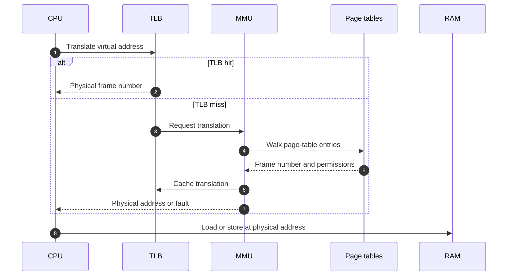
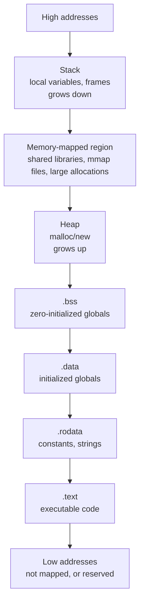
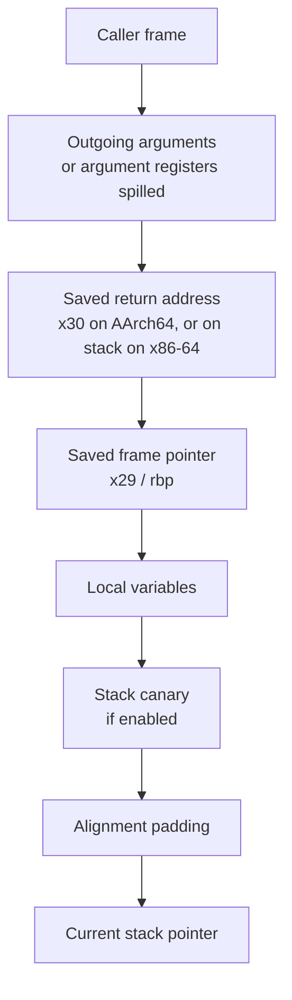

# SYS-01.2: Memory Layout and Stack Frames

> **Module:** SYS-01 · **Level:** L1 · **Prerequisites:** SYS-01.1 · **Estimated time:** 7 h (3 reading, 4 practice)
> **Outcome addressed:** SYS-01.O1

## Learning outcomes

By the end of this tutorial you can:

1. Explain virtual memory, page tables, the TLB, and page faults well enough to explain why two processes can use the same address.
2. Identify text, read-only data, initialized data, BSS, heap, memory-mapped regions, and stack in a running process.
3. Draw and explain the stack frame of a non-leaf function, including the saved frame pointer, saved return address, locals, and canary.
4. Explain how a linear overflow can reach a saved return address.

## Why this matters

Every memory-corruption exploit is a story about layout: what is adjacent to what, what is writable, what is executable, and what the program does with the overwritten bytes. Without a layout model, a crash is just a crash. With it, a crash is evidence about which boundary was crossed.

## First principles

### Virtual memory

A **virtual address** is what the program uses. A **physical address** is where the byte actually lives in RAM. The **memory management unit (MMU)** translates one to the other using **page tables** maintained by the kernel [L12] [L11].



Key terms:

| Term | Meaning |
|---|---|
| **Page** | Fixed-size block of virtual memory, commonly 4 KiB on x86-64 Linux; 16 KiB on the captured Apple Silicon host |
| **Frame** | Fixed-size block of physical memory |
| **Page-table entry (PTE)** | Maps a virtual page to a frame and stores permission bits |
| **TLB** | Translation lookaside buffer; a cache of recent translations |
| **Page fault** | The MMU cannot complete a translation; the kernel handles it (map a page, grow the stack, deliver a signal, or kill the process) |
| **Demand paging** | Pages are mapped when first touched, not all at startup |
| **Copy-on-write (COW)** | After `fork`, parent and child share pages read-only until one writes, then the kernel copies |

Because each process has its own page tables, the same virtual address in two processes can map to different physical memory. That is the basis of process isolation, and it is why a pointer value is meaningless in another process without a shared mapping.

### The user address space

A typical 64-bit user process has these regions:



The exact order, gaps, and randomization differ by OS and executable format. The important properties are:

- **`.text`** is executable and normally read-only.
- **`.rodata`** is read-only but not executable under W^X.
- **`.data` and `.bss`** are writable.
- **Heap** is writable and non-executable on modern systems.
- **Stack** is writable and non-executable on modern systems.
- **Shared libraries** are mapped into the process; their code is executable and shared.

The captured `size -m` output shows the Mach-O segments on macOS:

```text
Segment __PAGEZERO: 4294967296 (zero fill)
Segment __TEXT: 16384
	Section __text: 336
	Section __stubs: 36
	Section __cstring: 119
	Section __unwind_info: 96
Segment __DATA_CONST: 16384
	Section __got: 24
Segment __DATA: 16384
	Section __data: 8
	Section __common: 4 (zerofill)
Segment __LINKEDIT: 16384
```

`__PAGEZERO` is a 4 GiB unmapped region at low addresses; it turns null-pointer dereferences into faults instead of allowing access to low memory. `__TEXT` contains code and constants, `__DATA` contains writable data, and `__LINKEDIT` contains linker metadata.

### Stack frames

When a function is called, the caller and callee agree on a **calling convention**. For a non-leaf function on AArch64, the prologue typically saves the frame pointer and link register:



On x86-64, `call` pushes the return address onto the stack [L10]. On AArch64, `bl` writes the return address to `x30`; a non-leaf function must save `x30` before making another call [L11]. This is why the real disassembly in the next section stores `x29` and `x30` together.

The stack usually grows **downward** toward lower addresses on both x86-64 and AArch64. A buffer overflow that writes past the end of a local array therefore moves toward the saved frame pointer, saved return address, and caller's frame.

### The heap

`malloc` and `new` obtain memory from an allocator. The allocator may:

- extend the program break (`brk`/`sbrk` on Linux),
- map anonymous pages with `mmap`,
- reuse a freed block from a free list or size-class bin,
- keep per-thread arenas to reduce contention.

Allocator metadata usually lives adjacent to user data. A heap overflow or a write-after-free can corrupt that metadata, which is why heap exploitation is a separate discipline from stack overflow.

`malloc` does not zero memory. `calloc` does. Reading uninitialized heap memory can disclose data from earlier allocations in the same process.

## Worked example: the same address space, measured

The following program prints the addresses of a function, a static variable, initialized and uninitialized globals, a heap allocation, and a stack local.

```c
#include <stdio.h>
#include <stdlib.h>

int global_initialized = 42;
int global_uninitialized;
static int static_value = 7;

__attribute__((noinline)) int add(int a, int b) {
    int local = a + b;
    return local;
}

int main(void) {
    int stack_value = add(2, 3);
    int *heap_value = malloc(sizeof(int));
    if (heap_value == NULL) return 1;
    *heap_value = 99;

    printf("add()        %p\n", (void *)&add);
    printf("static       %p\n", (void *)&static_value);
    printf("global init  %p\n", (void *)&global_initialized);
    printf("global bss   %p\n", (void *)&global_uninitialized);
    printf("heap         %p\n", (void *)heap_value);
    printf("stack        %p\n", (void *)&stack_value);
    printf("stack_value  %d\n", stack_value);
    free(heap_value);
    return 0;
}
```

Captured output from one run on **macOS 27.0.1, arm64, Apple clang 21.0.0**:

```text
add()        0x104390548
static       0x104398004
global init  0x104398000
global bss   0x104398008
heap         0x1043c52a0
stack        0x16ba6ecf8
stack_value  5
```

What this shows:

- Code and read-only data are near the low end of the mapped image (`0x104390548`).
- Writable data is in a nearby segment (`0x104398xxx`).
- The heap allocation is above the data segment (`0x1043c52a0`).
- The stack is at a much higher address (`0x16ba6ecf8`).
- The order is consistent with the layout diagram, but the exact values change between runs and operating systems.

Run the program several times. You will usually see the high bits of the stack and heap move because of **ASLR**. Do not conclude that the layout is random; the *relative* structure stays stable while the *base* is randomized.

> **Version note (2026-10-19).** The captured host reports a 16 KiB page size (`sysconf(_SC_PAGESIZE) = 16384`). Many x86-64 Linux systems use 4 KiB. If your lab checks page alignment, query the page size instead of hard-coding 4096.

## Worked example: a leaf frame, instruction by instruction

The `add` function compiled at `-O0` produced this frame:

```text
_add:
0000000100000548	sub	sp, sp, #0x10
000000010000054c	str	w0, [sp, #0xc]
0000000100000550	str	w1, [sp, #0x8]
0000000100000554	ldr	w8, [sp, #0xc]
0000000100000558	ldr	w9, [sp, #0x8]
000000010000055c	add	w8, w8, w9
0000000100000560	str	w8, [sp, #0x4]
0000000100000564	ldr	w0, [sp, #0x4]
0000000100000568	add	sp, sp, #0x10
000000010000056c	ret
```

This is a **leaf** function: it calls nothing, so it does not need to save `x30`. It reserves 16 bytes, stores two 4-byte arguments, computes the sum, stores it as a local, loads it into the return register `w0`, releases the frame, and returns.

A non-leaf function is different. The captured `copy_name` function in [SYS-01.4](04-memory-safety-and-mitigations.md) saves `x29` and `x30` with `stp` because it calls `strcpy` and `printf`. If it did not, those calls would overwrite the link register and the function would return to the wrong place.

### Reading a frame diagram against real code

For the non-leaf case, the frame usually looks like this (addresses grow upward):

| Offset from frame pointer | Contents |
|---|---|
| `[x29, #0]` | Saved `x29` from the caller |
| `[x29, #8]` | Saved `x30` (return address) |
| `[x29, #-8]` | Stack canary, if enabled |
| `[x29, #-N]` | Local buffers and variables |
| `sp` | Bottom of the frame; 16-byte aligned at calls |

The exact offsets depend on the compiler. The captured canary build stores the canary at `[x29, #-0x8]` and checks it before restoring `x29`/`x30`. That is the pattern to look for.

## Security implications

1. **Linear overflows target adjacent state.** A stack buffer overflow can overwrite the canary, saved frame pointer, and saved return address in that order.
2. **Writable does not mean executable, and executable does not mean writable.** W^X and NX separate code from data; bypasses use code reuse (return-oriented programming) rather than injecting new code.
3. **Uninitialized memory leaks.** A structure copied to disk or sent over a socket may include padding or stale heap bytes.
4. **Use-after-free turns a pointer into a capability.** After `free`, the memory can be reallocated for a different type; a stale pointer now writes into the new object.
5. **ASLR is entropy, not immunity.** A single address leak can reveal a randomized base; 32-bit processes have much less entropy than 64-bit processes.
6. **Stack size is a resource limit.** Deep recursion or a large variable-length array can exhaust the stack; `ulimit -s` bounds it on Unix-like systems.

## Common misconceptions

| Misconception | Correction |
|---|---|
| "The stack grows upward." | On x86-64 and AArch64 it typically grows downward toward lower addresses. |
| "Virtual address equals physical address." | The MMU translates through page tables; the numbers are unrelated. |
| "`malloc` returns zeroed memory." | It does not. Use `calloc` if you need zeroing. |
| "The heap is one contiguous block." | It is a set of mappings and allocator-managed regions, often per-thread. |
| "ASLR changes the layout on every allocation." | It randomizes base addresses at load time; relative layout is stable. |
| "The stack is unlimited." | It has a finite limit and guard pages; overflow of the stack itself faults. |

## Exercises

### Foundation

1. In the captured address output, which address belongs to the stack and which to the heap? How do you know?
2. Why is `__PAGEZERO` useful on macOS?
3. What is the difference between a page and a frame?

### Application

4. Run the layout program ten times. Record the stack and heap addresses. Describe the variation without computing a precise entropy estimate.
5. Compile the same program with `-O2`. Does the `add` function still have a frame? Explain what changed.
6. Write a program with a 32-byte local array and print the addresses of the array, the frame pointer, and the return address using a debugger or a helper. Draw the frame.

### Analysis

7. A program crashes only when an input is longer than 24 bytes. Using the frame model, propose two explanations and the evidence that would distinguish them.
8. Explain why a use-after-free can be more dangerous than an immediate crash.
9. A 32-bit process and a 64-bit process both use ASLR. Explain why the 32-bit process is generally easier to exploit.

### Extension

10. Design an experiment to measure how often the stack base changes across executions on your system. State the sample size, the metric, and the limitation that ASLR entropy cannot be estimated reliably from a small sample.

## Knowledge check

1. What does the MMU do, and what does the TLB cache?
2. Why can two processes use the same virtual address without conflict?
3. In which direction does the stack grow on x86-64 and AArch64?
4. Why does `malloc` not zero memory, and why does that matter for security?
5. What is the difference between a page fault that grows the stack and one that delivers a segmentation fault?

Answers: `assessments/sys-01/answer-key.md`.

## Key takeaways

- Virtual memory gives each process its own translation table, enabling isolation and demand paging.
- The user address space is a set of regions with different permissions; exploits depend on what is adjacent.
- Stack frames are a contract between caller and callee; saved control data sits near local buffers.
- Heap behavior is allocator-specific; uninitialized and freed memory are security-relevant.

## Further reading

| Source | Supports | Verification |
|---|---|---|
| [L09] ELF format | Sections, segments, and loadable images | V1 |
| [L12] Intel SDM | Paging, page tables, and x86-64 memory model | V4 |
| [L11] Arm Architecture Reference Manual | AArch64 memory model and translation | V4 |
| [A08] SoK: Eternal War in Memory | Memory corruption and mitigation landscape | V2 |
| [B06] Practical Binary Analysis | Inspecting binaries and memory | V4 |

Links and verification status for every source ID are recorded in [`REFERENCES.md`](../../REFERENCES.md).

## Cross-links

- Previous: [SYS-01.1 Machine model](01-machine-model-and-execution.md)
- Next: [SYS-01.3 Binary anatomy and calling conventions](03-binary-anatomy-and-calling-conventions.md)
- Lab: [SYS-01 lab](../../labs/sys-01-memory-and-binaries/lab.md)

## Completion checklist

- [ ] I can explain virtual-to-physical translation and the role of the TLB.
- [ ] I can name the main regions of a process address space and their permissions.
- [ ] I can draw a stack frame and point to the saved return address.
- [ ] I measured address variation across runs and recorded the platform.
- [ ] I can explain one security consequence of heap reuse or uninitialized memory.
- [ ] I answered the knowledge-check questions and checked the answer key.
