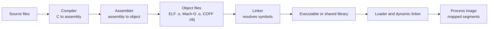

# SYS-01.3: Binary Anatomy and Calling Conventions

> **Module:** SYS-01 · **Level:** L1 · **Prerequisites:** SYS-01.1, SYS-01.2 · **Estimated time:** 7 h (3 reading, 4 practice)
> **Outcome addressed:** SYS-01.O2

## Learning outcomes

By the end of this tutorial you can:

1. Describe the structure of ELF, Mach-O, and PE files and explain the difference between sections and segments.
2. Inspect headers, sections, segments, symbols, and relocation-related structures with platform tools.
3. Explain the System V AMD64, Microsoft x64, and AAPCS64 calling conventions well enough to read a function prologue.
4. Explain how PIE, RELRO, lazy binding, and dynamic loading affect security.

## Why this matters

A compiled binary is the artifact that actually runs. Reviewing source code is not enough: the binary contains the compiler's decisions about layout, inlining, stack usage, and defenses. Incident responders and malware analysts usually have only the binary.

Binary anatomy also explains a class of attacks that never touch memory corruption: hijacking the dynamic loader, replacing a shared library, exploiting an unsigned DLL search path, or abusing a writable GOT entry. Those attacks are about the loader's trust decisions.

## First principles

### From source to process



The **compiler** translates source to machine instructions. The **assembler** emits an object file with code, data, symbols, and relocations. The **linker** combines objects and libraries and resolves symbols. At run time, the **loader** maps segments into memory and the **dynamic linker** resolves shared-library symbols.

### Sections versus segments

| Concept | Purpose | Typical examples |
|---|---|---|
| **Section** | Linker-level unit used to organize code, data, and metadata | `.text`, `.data`, `.bss`, `.rodata`, `.symtab`, `.rela.text` |
| **Segment** | Loader-level unit mapped with permissions | `LOAD` (ELF), `__TEXT`/`__DATA` (Mach-O), `.text`/`.data` (PE) |

Sections are for the linker. Segments are for the loader. A single read-only `LOAD` segment may contain several sections (`.text`, `.rodata`, `.eh_frame`). This is why `readelf -S` and `readelf -l` show different views of the same file.

### ELF

ELF is used by Linux and many Unix-like systems. The file begins with an ELF header containing the class (32/64-bit), byte order, type (`ET_EXEC`, `ET_DYN`, `ET_REL`, `ET_CORE`), machine, entry point, and offsets to the program header table and section header table.

Important structures:

| Structure | What it tells you |
|---|---|
| Program header table | Segments to map, their permissions, and the interpreter path |
| Section header table | Sections, their types, flags, and offsets |
| `.text` | Executable instructions |
| `.rodata` | Read-only constants and strings |
| `.data` | Initialized writable data |
| `.bss` | Zero-initialized writable data; occupies no file bytes |
| `.plt` / `.got` | Lazy-binding stubs and global offset table for dynamic symbols |
| `.dynsym` / `.dynstr` | Dynamic symbol and string tables |
| `.rela.*` | Relocations used by the linker or dynamic loader |

A **position-independent executable (PIE)** is an `ET_DYN` file that can be loaded at a randomized base. A non-PIE executable is typically `ET_EXEC` with fixed addresses.

### Mach-O

Mach-O is used by macOS and iOS. It starts with a header (`MH_MAGIC_64`, CPU type, file type, flags, load-command count), followed by **load commands** that describe segments and how to load the file.

Common segments:

| Segment | Contents | Typical permissions |
|---|---|---|
| `__PAGEZERO` | Unmapped guard at low addresses | none |
| `__TEXT` | Code, strings, stubs | read + execute |
| `__DATA_CONST` | Data that becomes read-only after relocation, such as the GOT | read + write during load, then read-only |
| `__DATA` | Writable data | read + write |
| `__LINKEDIT` | Symbol tables, relocations, code signatures | read |

The captured header below shows a 64-bit ARM64 executable with the `PIE` flag:

```text
$ otool -hv layout
layout:
Mach header
      magic  cputype cpusubtype  caps    filetype ncmds sizeofcmds      flags
MH_MAGIC_64    ARM64        ALL  0x00     EXECUTE    18       1288   NOUNDEFS DYLDLINK TWOLEVEL PIE
```

`EXECUTE` is the Mach-O file type (`MH_EXECUTE`). `PIE` means the main executable can be loaded at a randomized base. `DYLDLINK` means it uses the dynamic linker. `TWOLEVEL` means namespaces for symbol resolution. `NOUNDEFS` means the static link found definitions for its symbols.

### PE/COFF

Windows uses the Portable Executable (PE) format, derived from COFF. A PE file has a DOS header and stub, an `IMAGE_NT_HEADERS` structure, a section table, and directories for imports, exports, exceptions, relocations, resources, and debug data.

Important sections and directories:

| Item | Purpose |
|---|---|
| `.text` | Executable code |
| `.rdata` | Read-only data and import tables |
| `.data` | Initialized writable data |
| `.pdata` | Exception unwind information on x86-64 |
| Import directory | DLLs and functions the image needs |
| Export directory | Functions the image exposes |
| Relocation directory | Fixups for ASLR |
| Load configuration | Security flags such as CFG and safe exception handlers |

The PE format is documented by Microsoft [L17]. Windows internals and object management are covered in [B09].

### Symbols and stripping

A **symbol** maps a name to an address and a binding (local, global, weak). `nm` lists symbols; `objdump -t` and `readelf -s` do the same for ELF. Debug builds also contain DWARF or CodeView type and line information.

**Stripping** removes the symbol table, but it does not remove:

- dynamic symbols needed for linking;
- string literals;
- import and export names;
- exception metadata;
- code structure visible in disassembly.

Stripping raises the cost of analysis. It is not a confidentiality control.

### Calling conventions

A calling convention defines where arguments go, who saves registers, how the return value is delivered, and how the stack is aligned.

| Convention | Integer/pointer arguments | Return | Callee-saved | Stack rule |
|---|---|---|---|---|
| System V AMD64 (Linux, BSD, macOS x86-64) | `rdi`, `rsi`, `rdx`, `rcx`, `r8`, `r9` | `rax`, `rdx` | `rbx`, `rbp`, `r12`–`r15` | 16-byte aligned before `call`; 128-byte red zone below `rsp` |
| Microsoft x64 (Windows) | `rcx`, `rdx`, `r8`, `r9` | `rax` | `rbx`, `rbp`, `rdi`, `rsi`, `r12`–`r15` | 32-byte shadow space; 16-byte alignment |
| AAPCS64 (AArch64) | `x0`–`x7` | `x0`, `x1` | `x19`–`x28`, frame pointer `x29` | 16-byte aligned at public interfaces |
| Apple ARM64 | `x0`–`x7` | `x0`, `x1` | `x19`–`x28`, `x29` | 16-byte alignment; platform-specific frame rules |

Differences matter. A function compiled for System V AMD64 will misread its arguments if called with the Microsoft x64 convention. Malware and exploits often target a specific convention; a shellcode payload that assumes `rdi` will fail on Windows x64.

### The prologue and epilogue

A typical x86-64 non-leaf prologue:

```asm
push rbp
mov rbp, rsp
sub rsp, 0x20
```

A typical AArch64 non-leaf prologue:

```asm
sub sp, sp, #0x40
stp x29, x30, [sp, #0x30]
add x29, sp, #0x30
```

A typical epilogue reverses it:

```asm
ldp x29, x30, [sp, #0x30]
add sp, sp, #0x40
ret
```

Recognizing these patterns lets you find frame boundaries in a stripped binary. It does not tell you the variable names or types; that requires deeper analysis.

## Worked example: inspecting a real Mach-O binary

The binary was compiled with `cc -O0 -g -Wall -Wextra` on **macOS 27.0.1, arm64, Apple clang 21.0.0**.

### Header and PIE

```text
$ otool -hv layout
layout:
Mach header
      magic  cputype cpusubtype  caps    filetype ncmds sizeofcmds      flags
MH_MAGIC_64    ARM64        ALL  0x00     EXECUTE    18       1288   NOUNDEFS DYLDLINK TWOLEVEL PIE
```

### Segments

```text
$ otool -l layout
      cmd LC_SEGMENT_64
  cmdsize 72
  segname __PAGEZERO
   vmaddr 0x0000000000000000
   vmsize 0x0000000100000000
  fileoff 0
 filesize 0
...
      cmd LC_SEGMENT_64
  cmdsize 392
  segname __TEXT
   vmaddr 0x0000000100000000
   vmsize 0x0000000000004000
  fileoff 0
 filesize 16384
```

This excerpt is trimmed from real output. The `...` marks omitted load commands, not missing data in the original.

### Symbols

```text
$ nm -m layout | grep -E ' _add$| _main$'
0000000100000548 (__TEXT,__text) external _add
0000000100000570 (__TEXT,__text) external _main
```

Both functions are external symbols in the executable text section. A stripped release build may not show `_add` at all, but `_main` and dynamic symbols usually remain.

### What to check in an ELF build

On Linux, run the same analysis with `readelf` and `objdump`:

```bash
readelf -h ./layout          # Class, Data, Type, Entry point
readelf -S ./layout          # Sections and flags
readelf -l ./layout          # Segments, permissions, interpreter
readelf -s ./layout          # Symbol table
objdump -d ./layout          # Disassembly
```

Record these fields rather than assuming them:

- `Type: DYN` with an interpreter usually indicates PIE; `Type: EXEC` indicates a fixed-address executable.
- `GNU_STACK` with `RW` and no `E` indicates a non-executable stack.
- `GNU_RELRO` indicates that part of the GOT will be made read-only after relocation.
- A `.plt`/`.got` pair indicates dynamic symbol resolution.

> **Version note (2026-10-19).** Tool output and defaults differ across binutils, LLVM, macOS, and Linux distributions. The field names above are stable; the exact formatting is not. Record `readelf --version` or `otool` output in your lab report.

## Security implications

1. **PIE plus ASLR raises the cost of code reuse.** Without PIE, code addresses are fixed, which makes return-oriented programming easier.
2. **Lazy binding creates a writable function-pointer table.** Full RELRO resolves symbols at load time and makes the GOT read-only; partial RELRO leaves part writable.
3. **Dynamic loader environment variables are dangerous.** `LD_PRELOAD` on Linux and `DYLD_INSERT_LIBRARIES` on macOS can inject libraries into a process. Setuid binaries ignore many of these variables for exactly this reason.
4. **DLL search order is a trust boundary on Windows.** An attacker who can place a DLL in a searched directory can execute code in the loading process. Modern Windows has safe search modes, but misconfigured applications still exist.
5. **Symbols and strings leak intent.** Function names, error messages, URLs, and library imports reveal capabilities even in stripped binaries.
6. **Unsigned or unverified code is a supply-chain risk.** Code signing and notarization raise the cost of tampering; they do not prove the absence of vulnerabilities.

## Common misconceptions

| Misconception | Correction |
|---|---|
| "Stripping removes all useful information." | Imports, strings, exception data, and code remain; dynamic symbols often remain too. |
| "PIE makes exploitation impossible." | It raises the cost. An address leak or a partial overwrite can defeat it. |
| "`.bss` takes up space in the file." | It is zero-filled at load time and normally occupies no file bytes. |
| "ELF is Linux-only." | ELF is used by many Unix-like systems; Mach-O and PE are different formats. |
| "The first argument is always in `rdi`." | Only under the System V AMD64 convention; Windows x64 uses `rcx`, and AArch64 uses `x0`. |
| "A signed binary is safe." | Signing proves origin and integrity, not the absence of vulnerabilities. |

## Exercises

### Foundation

1. What is the difference between a section and a segment?
2. Which Mach-O flag indicates that the executable is position-independent?
3. Which register holds the first integer argument under System V AMD64, Microsoft x64, and AAPCS64?

### Application

4. Run `otool -hv` or `readelf -h` on a binary you compiled. Record the file type and flags, then explain each field.
5. Use `nm` or `readelf -s` to list symbols. Identify one function and one imported library function.
6. Disassemble a non-leaf function on your platform. Mark the prologue, the call instruction, and the epilogue.

### Analysis

7. A binary is `ET_EXEC` and has no `GNU_RELRO`. Explain two ways those facts make exploitation easier.
8. A setuid program calls a helper through `system()`. Explain why the dynamic loader environment and the shell's `PATH` are both security-relevant.
9. Compare the information available in a stripped binary with a debug build. What remains, and what is lost?

### Extension

10. Build the same C source as a PIE and as a non-PIE (`-no-pie` on GCC/Clang). Compare headers, symbol addresses, and relocation sections. Report the differences with evidence.

## Knowledge check

1. What does the linker do that the assembler does not?
2. Why does `.bss` not occupy file space?
3. What is the security purpose of RELRO?
4. Why can a calling-convention mismatch cause memory corruption?
5. Why is code signing not a substitute for memory safety?

Answers: `assessments/sys-01/answer-key.md`.

## Key takeaways

- Executable formats organize code, data, and metadata for the linker and loader.
- Sections are linker units; segments are loader units with permissions.
- Calling conventions are platform contracts; reading them is essential for binary analysis.
- PIE, RELRO, signing, and safe search paths are trust-boundary controls, not guarantees.

## Further reading

| Source | Supports | Verification |
|---|---|---|
| [L09] ELF format | ELF header, sections, segments, symbols | V1 |
| [L17] Microsoft PE format | PE headers, sections, directories | V1 |
| [L10] System V AMD64 ABI | Calling convention and data layout | V1 |
| [L11] Arm Architecture Reference Manual | AArch64 procedure-call standard context | V4 |
| [B09] Windows Internals | Windows image loading and object management | V1 |
| [B06] Practical Binary Analysis | Binary inspection workflow | V4 |

Links and verification status for every source ID are recorded in [`REFERENCES.md`](../../REFERENCES.md).

## Cross-links

- Previous: [SYS-01.2 Memory layout and stack frames](02-memory-layout-and-stack-frames.md)
- Next: [SYS-01.4 Memory safety and mitigations](04-memory-safety-and-mitigations.md)
- Lab: [SYS-01 lab](../../labs/sys-01-memory-and-binaries/lab.md)

## Completion checklist

- [ ] I can distinguish sections from segments and name examples of each.
- [ ] I inspected a real binary header and explained its file type and flags.
- [ ] I can name the argument and return registers for three calling conventions.
- [ ] I can identify a prologue and epilogue in disassembly.
- [ ] I can explain PIE, RELRO, and dynamic-loader trust in security terms.
- [ ] I answered the knowledge-check questions and checked the answer key.
