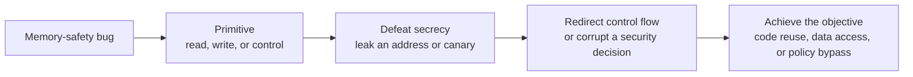
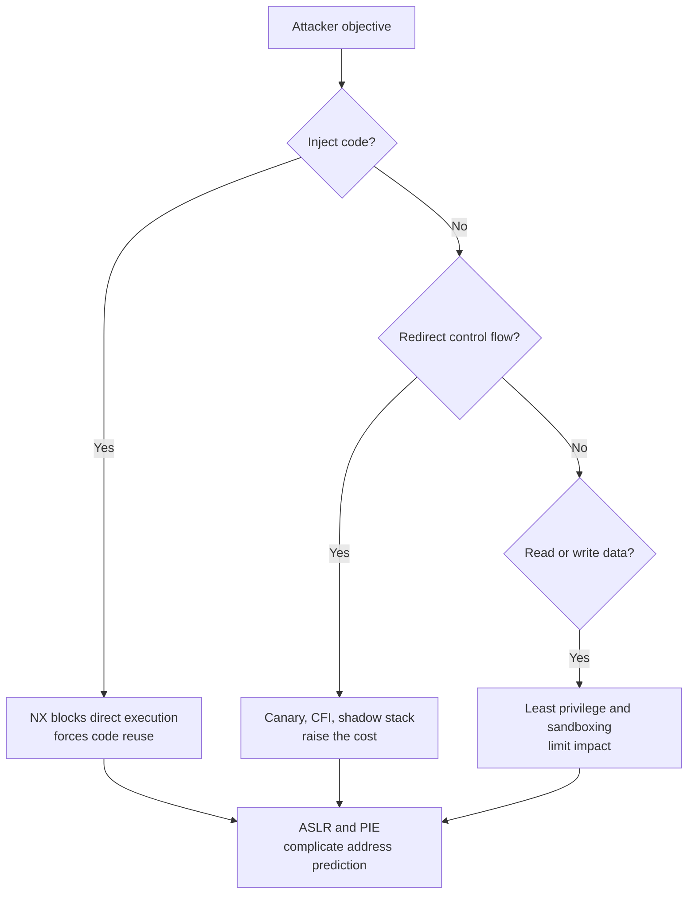

# SYS-01.4: Memory Safety and Mitigations

> **Module:** SYS-01 · **Level:** L1 · **Prerequisites:** SYS-01.1–SYS-01.3 · **Estimated time:** 8 h (3 reading, 4 practice, 1 assessment)
> **Outcome addressed:** SYS-01.O3

## Learning outcomes

By the end of this tutorial you can:

1. Classify memory-safety bugs and explain the primitive each one gives an attacker.
2. Explain what NX, ASLR, PIE, stack canaries, RELRO, CFI, shadow stacks, and memory tagging do, and what they do not do.
3. Read compiler-inserted canary code in a real disassembly and explain each step.
4. Evaluate a mitigation set against a threat model instead of treating any single control as sufficient.

## Why this matters

Memory-safety bugs remain a major source of critical vulnerabilities. The response is not one control but a layered set of controls, each raising the cost of a different step in the exploit chain. A defender who cannot explain which layer stops which step will over-invest in one control and miss another.

This tutorial is defensive. It explains bypass classes conceptually so you can reason about residual risk. It does not provide exploit code, and the lab does not attack a real target.

## First principles

### What memory safety means

A program is **memory safe** if it cannot read or write memory it does not own, cannot use memory after its lifetime ends, and cannot interpret memory as the wrong type. Most C and C++ code is not memory safe by construction; it relies on programmer discipline and runtime defenses.

Memory-safety failures usually provide one or more **primitives**:

| Primitive | Meaning | Typical impact |
|---|---|---|
| Out-of-bounds read | Read before or after an object | Information disclosure, ASLR bypass |
| Out-of-bounds write | Write before or after an object | Control-flow hijack, data corruption |
| Use-after-free | Use a pointer after the object is freed | Type confusion, write into a new object |
| Double free | Free the same allocation twice | Allocator corruption, arbitrary write |
| Uninitialized use | Read memory never written | Information disclosure |
| Type confusion | Treat an object as a different type | Field reinterpretation, control-flow hijack |
| Integer overflow | Arithmetic wraps or truncates | Undersized allocation, bounds-check bypass |
| Format-string bug | Attacker controls a format string | Read or write arbitrary memory |

### The exploit chain

Most memory-corruption exploits follow a chain:



Mitigations target different links. A canary targets the transition from a linear overflow to control-flow corruption. ASLR targets the leak or the address prediction. NX targets direct code injection. CFI targets the redirect itself.

### Mitigation map

| Mitigation | What it does | Stops or raises cost for | Limits |
|---|---|---|---|
| **NX / DEP** | Marks writable pages non-executable | Injecting and executing new code on stack or heap | Code reuse (ROP/JOP) still works |
| **ASLR** | Randomizes base addresses of mappings | Predicting addresses | Leaks, low entropy on 32-bit, fork-heavy services |
| **PIE** | Makes the main executable position-independent | Fixed code addresses | Requires ASLR; leaks still help |
| **Stack canary** | Places a secret value before the saved return address and checks it | Linear stack overflows that overwrite the return address | Heap overflows, non-linear writes, canary leaks |
| **RELRO** | Makes the GOT read-only after relocation | GOT overwrite via lazy binding | Partial RELRO leaves part writable |
| **FORTIFY_SOURCE** | Adds checked variants of some libc functions | Some overflows in checked calls | Compile-time and optimization dependent |
| **CFI** | Restricts indirect call and jump targets to valid functions | Arbitrary control-flow transfer | Coarse policies, false positives, incomplete coverage [L20] |
| **Shadow stack** | Keeps a second copy of return addresses | Return-address overwrite | Requires hardware/OS support; not universal |
| **Memory tagging** | Attaches tags to pointers and allocations | Some spatial and temporal errors | Architecture-specific; probabilistic or limited |
| **Memory-safe languages** | Enforce ownership and bounds at compile time or run time | Whole classes of bugs | `unsafe`, FFI, and native dependencies remain |
| **Sandboxing** | Restricts what a compromised process can do | Post-exploitation impact | Does not prevent the initial bug |



### Stack canaries

A **stack canary** is a value written to the stack frame after the local variables and checked before the function returns. If a linear overflow overwrites the canary, the check fails and the process aborts (or the runtime calls a failure handler).

Canaries come in several forms:

- **Terminator canary:** contains bytes such as NUL, CR, LF, and `0xff`, chosen to make simple string-based overwrites stop or become difficult. The exact effect depends on the function: for example, `strcpy` stops at NUL, not at newline.
- **Random canary:** a random value chosen at process start.
- **Random XOR canary:** the random value XORed with the frame pointer, so copying the canary alone is not enough.

Canaries do not protect heap objects, global buffers, or writes that skip over the canary. They also do not prevent an attacker who can read the canary from writing it back.

### ASLR and PIE

**Address space layout randomization (ASLR)** randomizes the base addresses of the stack, heap, libraries, and (with PIE) the main executable. It does not randomize the internal layout of a mapping.

Entropy matters. A 32-bit address space has far fewer possible bases than a 64-bit one. A service that forks after randomization shares the same layout across children, which weakens ASLR for remote attacks. An information leak can reveal a base and collapse the entropy to zero for that run.

### NX, W^X, and code reuse

**NX (no-execute)** or **DEP (data execution prevention)** marks data pages non-executable. It stops classic stack shellcode. It does not stop **return-oriented programming (ROP)**: an attacker reuses existing executable code fragments ("gadgets") and chains them through return addresses. This is why NX is described as forcing code reuse rather than preventing exploitation [A08].

**W^X** is the stronger policy that no page is both writable and executable at the same time. JIT compilers must temporarily violate it or use dual mappings; that transition is a security-sensitive design point.

### RELRO and the GOT

The **global offset table (GOT)** holds resolved addresses of dynamically linked functions. With lazy binding, the first call goes through the procedure linkage table (PLT) and updates the GOT at run time, so the GOT must be writable.

**RELRO (relocation read-only)** makes part or all of the GOT read-only after relocation:

| Mode | Effect |
|---|---|
| No RELRO | GOT stays writable |
| Partial RELRO | Some sections become read-only; `.got.plt` may stay writable |
| Full RELRO | All relocations are resolved at load time and the GOT becomes read-only |

Full RELRO trades startup time for a smaller attack surface.

### CFI and shadow stacks

**Control-flow integrity (CFI)** checks that indirect calls and jumps target valid functions or labels. Coarse CFI checks only that the target is a valid function entry; fine-grained CFI checks the specific signature or type. Both add overhead and require accurate metadata [L20].

**Shadow stacks** keep a protected copy of return addresses. On x86, Intel CET's shadow stack is one implementation; on AArch64, pointer authentication (PAC) and branch target identification (BTI) provide related protections. Support depends on CPU, OS, compiler, and binary. Do not assume a platform has them because the architecture defines them.

### Memory tagging

**Memory tagging** associates a tag with an allocation and with pointers to it. On arm64, Memory Tagging Extension (MTE) stores a 4-bit tag in the upper bits of pointers and in memory; mismatches fault. MTE can detect some use-after-free and out-of-bounds accesses, but the tag space is small and the mode (synchronous, asynchronous, asymmetric) changes the detection and performance trade-off. Treat it as a strong probabilistic mitigation, not a proof of safety.

### Speculative execution

Spectre-class attacks exploit speculative execution to leak data through microarchitectural state [A10]. Mitigations include compiler transformations (for example, speculation barriers), CPU microcode, kernel page-table isolation, and process isolation for sensitive operations. The performance cost and effectiveness are workload- and version-dependent.

## Worked example: a real canary in ARM64 code

The following function was compiled with `-fstack-protector-all` on **macOS 27.0.1, arm64, Apple clang 21.0.0**:

```c
__attribute__((noinline)) void copy_name(const char *input) {
    char buffer[16];
    strcpy(buffer, input);
    printf("name: %s\n", buffer);
}
```

The captured disassembly, trimmed to the security-relevant instructions:

```text
_copy_name:
0000000100000460	sub	sp, sp, #0x40
0000000100000464	stp	x29, x30, [sp, #0x30]
0000000100000468	add	x29, sp, #0x30
000000010000046c	adrp	x8, 4 ; 0x100004000
0000000100000470	ldr	x8, [x8] ; literal pool symbol address: ___stack_chk_guard
0000000100000474	ldr	x8, [x8]
0000000100000478	stur	x8, [x29, #-0x8]
...
0000000100000490	bl	0x100000584 ; symbol stub for: ___strcpy_chk
...
00000001000004ac	ldur	x9, [x29, #-0x8]
00000001000004b0	adrp	x8, 4 ; 0x100004000
00000001000004b4	ldr	x8, [x8] ; literal pool symbol address: ___stack_chk_guard
00000001000004b8	ldr	x8, [x8]
00000001000004bc	subs	x8, x8, x9
00000001000004c0	b.eq	0x1000004cc
00000001000004c4	b	0x1000004c8
00000001000004c8	bl	0x10000059c ; symbol stub for: ___stack_chk_fail
00000001000004cc	ldp	x29, x30, [sp, #0x30]
00000001000004d0	add	sp, sp, #0x40
00000001000004d4	ret
```

What is happening:

1. `sub sp, sp, #0x40` reserves the frame.
2. `stp x29, x30, [sp, #0x30]` saves the frame pointer and return address.
3. The guard is loaded from `___stack_chk_guard` and stored at `[x29, #-0x8]`, between the locals and the saved control data.
4. `___strcpy_chk` is a checked variant of `strcpy`; the exact fortification behavior depends on the SDK and flags.
5. Before returning, the function reloads the guard, compares it with the stored copy, and calls `___stack_chk_fail` on mismatch.
6. The epilogue restores `x29`/`x30` and returns.

Compiling the **same source** with `-fno-stack-protector` removed both imports and the guard code. On the capture host, the default build *without* an explicit stack-protector flag still emitted a guard, so "no flag" did not mean "no protection." Record the actual flags.

```text
$ otool -Iv canary | grep -E 'stack_chk'
0x000000010000059c    16 ___stack_chk_fail
0x0000000100004000    17 ___stack_chk_guard
```

```text
$ cc -O0 -g -Wall -Wextra -fno-stack-protector -o canary-nossp canary.c
$ otool -Iv canary-nossp | grep -E 'stack_chk'
no stack_chk imports
```

That difference is evidence, not proof: a different compiler or flag set may emit different code.

> **Version note (2026-10-19).** Compiler defaults for stack protection and fortification differ by distribution and SDK. On this Apple clang build, the default already included stack protection; only `-fno-stack-protector` removed it. `-fstack-protector-strong` protects more functions than `-fstack-protector` but less than `-fstack-protector-all`. Verify the generated code; do not assume a flag was applied.

## Security implications

1. **Layer controls by exploit step.** NX, ASLR, canaries, RELRO, CFI, and sandboxing address different steps; removing one layer may not be visible until an exploit succeeds.
2. **Measure the mitigation state of shipped binaries.** Check compiler flags, PIE, RELRO, canary imports, and signing. Do not trust build scripts to match release artifacts.
3. **Crash telemetry is detection.** Canary failures, `___stack_chk_fail`, and repeated access violations can indicate exploitation attempts. Centralize and alert on them.
4. **Memory-safe languages shrink the attack surface but do not eliminate it.** FFI, `unsafe` blocks, native libraries, and unsafe deserialization remain.
5. **A leak defeats secrecy-based mitigations.** Treat address disclosures (logs, error pages, uninitialized buffers) as security bugs.
6. **Speculation is a cross-boundary channel.** Sensitive workloads may need process isolation or core scheduling policies in addition to patched microcode [A10].

## Common misconceptions

| Misconception | Correction |
|---|---|
| "ASLR stops exploitation." | It raises the cost; a leak or brute force can defeat it. |
| "Canaries protect the heap." | They protect the stack frame they are placed in. |
| "NX prevents code execution." | It prevents executing writable data; code reuse still executes existing code. |
| "Full RELRO makes the GOT immutable forever." | It becomes read-only after relocation; a write primitive that runs before or around relocation is a different case. |
| "Rust eliminates memory-safety bugs." | Safe Rust prevents many bugs; `unsafe`, FFI, and logic errors remain. |
| "Enabling every mitigation has no cost." | CFI, shadow stacks, MTE, and speculation mitigations have performance and compatibility costs. |
| "A crash means the attack failed." | A crash may be an early, noisy step; the objective may be data disclosure, not code execution. |

## Exercises

### Foundation

1. Name the primitive provided by an out-of-bounds read and one way it can be used.
2. What does a stack canary check, and when does the check run?
3. What is the difference between NX and W^X?

### Application

4. Compile the `copy_name` function with and without `-fstack-protector-all`. Compare the imports and the prologue/epilogue. Record exact commands and output.
5. Inspect a release binary with `readelf -h`, `readelf -l`, and `readelf -d` (Linux) or `otool -hv` and `otool -l` (macOS). Determine PIE, NX stack, and RELRO status. Report the evidence.
6. Write a one-page mitigation table for a web service that processes untrusted files. For each control, state the exploit step it targets and its operational cost.

### Analysis

7. A service forks a worker after loading a large configuration. Explain why this can weaken ASLR for remote attacks, and propose a mitigation.
8. A binary has canaries, NX, and PIE but no RELRO. Which exploit step is still cheap, and why?
9. A team enables CFI but sees frequent false positives. Explain the trade-off and propose a staged rollout.

### Extension

10. Design an experiment to measure the runtime cost of one mitigation on a workload you control. Define the baseline, the metric, the number of repetitions, and the confounders. Do not claim a performance result without measured data.

## Knowledge check

1. Why is NX described as forcing code reuse rather than preventing exploitation?
2. What does PIE add on top of ASLR?
3. Where is the canary stored relative to the saved return address, and why there?
4. What does full RELRO change about the GOT?
5. Why is a memory-safe language not a complete memory-safety guarantee?

Answers: `assessments/sys-01/answer-key.md`.

## Key takeaways

- Memory-safety bugs provide primitives; exploits chain primitives into an objective.
- Mitigations are layered and partial; each one targets a specific step.
- Compiler flags and binary metadata are evidence; verify them on the artifact you ship.
- Speculative execution adds a cross-boundary leakage channel that software mitigations only partly address.

## Further reading

| Source | Supports | Verification |
|---|---|---|
| [A08] SoK: Eternal War in Memory | Taxonomy of memory corruption and defenses | V2 |
| [A09] Control-Flow Integrity | CFI design and guarantees | V2 |
| [A10] Spectre Attacks | Speculative execution side channels | V2 |
| [L20] Clang Control Flow Integrity | Practical CFI modes and trade-offs | V1 |
| [B06] Practical Binary Analysis | Inspecting mitigation metadata | V4 |
| [B09] Windows Internals | Windows memory protections and process security | V1 |

Links and verification status for every source ID are recorded in [`REFERENCES.md`](../../REFERENCES.md).

## Cross-links

- Previous: [SYS-01.3 Binary anatomy and calling conventions](03-binary-anatomy-and-calling-conventions.md)
- Next module: [SYS-02: Operating Systems Internals](../sys-02-operating-systems/README.md)
- Lab: [SYS-01 lab](../../labs/sys-01-memory-and-binaries/lab.md)
- Assessment: [SYS-01 assessment](../../assessments/sys-01/assessment.md)

## Completion checklist

- [ ] I can classify the main memory-safety bug classes and their primitives.
- [ ] I can explain what each major mitigation does and does not stop.
- [ ] I found and explained real canary code in a disassembly.
- [ ] I inspected PIE, NX, and RELRO state in a real binary.
- [ ] I can explain why a leak defeats secrecy-based mitigations.
- [ ] I answered the knowledge-check questions and checked the answer key.
