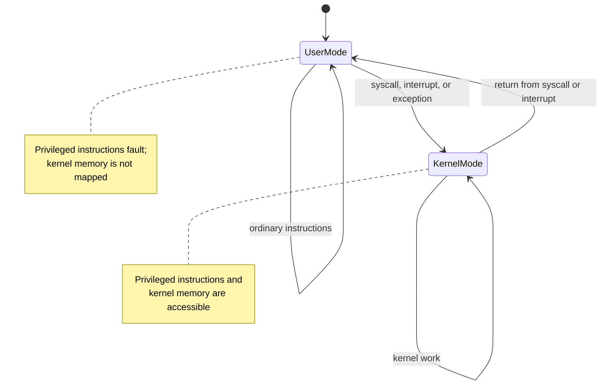
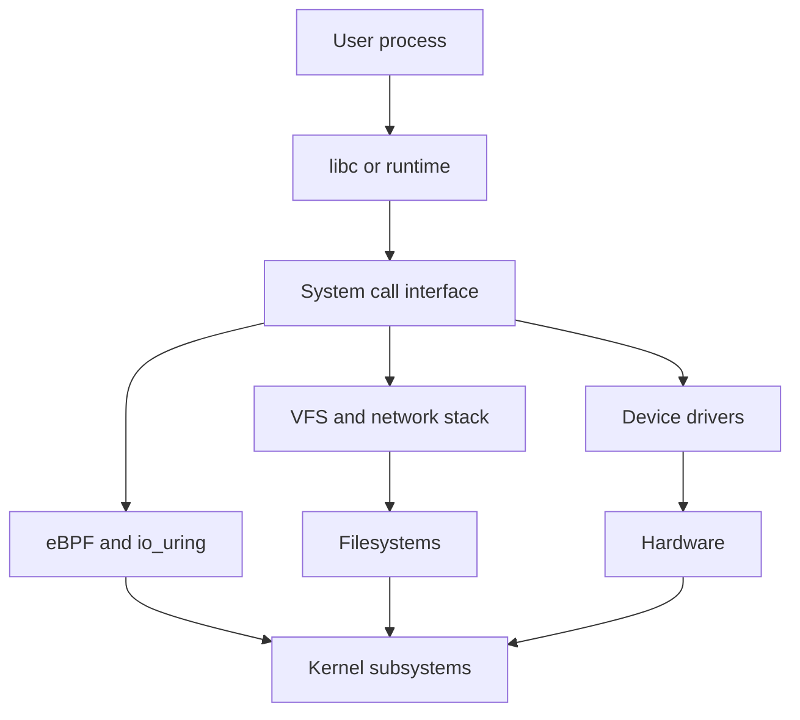

# SYS-02.1: Privilege Levels and the Kernel Boundary

> **Module:** SYS-02 · **Level:** L1 · **Prerequisites:** SYS-01 · **Estimated time:** 6 h (3 reading, 3 practice)
> **Outcome addressed:** SYS-02.O1

## Learning outcomes

By the end of this tutorial you can:

1. Explain x86 privilege rings and Arm exception levels, and why user mode cannot execute privileged instructions.
2. Trace a system call from a user-space function to the kernel entry point and back.
3. Explain credentials, capabilities, setuid, and Windows tokens/integrity levels as different implementations of privilege.
4. Identify the kernel attack surface and the controls that reduce it.

## Why this matters

The user/kernel boundary is the most important security boundary on a general-purpose computer. A bug that lets user code execute with kernel privilege is a local privilege escalation. A bug that lets a remote user cross the boundary is often a full system compromise.

Privilege is also frequently misunderstood. "Root" is not a single bit; Linux splits root's powers into capabilities, Windows uses tokens and integrity levels, and macOS adds entitlements and system integrity protection. Incident analysis requires knowing which credential was checked.

## First principles

### Two modes, many names

The CPU has at least two privilege levels: one for the kernel and one for user programs. The hardware enforces the distinction; software cannot opt out.

| Platform | Levels | Common use |
|---|---|---|
| x86-64 | Ring 0–3 | Ring 0 kernel, ring 3 user; rings 1–2 rarely used by mainstream OSes |
| Armv8-A | EL0–EL3 | EL0 user, EL1 kernel, EL2 hypervisor, EL3 secure monitor |
| RISC-V | U, S, M | User, supervisor, machine |



### What changes at the boundary

When the CPU enters kernel mode:

1. The current user context (registers, program counter, stack pointer) is saved.
2. The CPU switches to a kernel stack.
3. The kernel validates the request, including pointers and credentials.
4. The requested operation runs with kernel privilege.
5. The kernel restores the user context or delivers a signal.

The kernel must treat every user-supplied pointer, length, index, and flag as untrusted. A missing check is a vulnerability, because the operation now runs with privileges the caller did not have.

### System call mechanics

The exact instruction differs:

| Platform | Instruction or mechanism | Notes |
|---|---|---|
| x86-64 Linux | `syscall` | Number in `rax`; arguments in `rdi`, `rsi`, `rdx`, `r10`, `r8`, `r9` |
| x86-64 Windows | `syscall` through `ntdll` stubs | User code normally calls `Nt*`/`Zw*` functions, not the instruction directly |
| AArch64 Linux | `svc #0` | Number in `x8`; arguments in `x0`–`x5` |
| macOS | `syscall` or `svc` depending on architecture and trap type | BSD syscalls and Mach traps; details are platform-specific |

The **system call number** selects the kernel function [L01]. Numbers are architecture-specific and can change; they are not a stable ABI across architectures. The kernel returns a result; on Linux, negative return values encode errors, and libc translates them into `errno`.

### Credentials

On Linux, a process has a real UID, effective UID, saved set-user-ID, and filesystem UID, plus a group list [L07]. The **effective UID** is the one used for most permission checks. `setuid` binaries run with the file owner's effective UID, which is why they are security-sensitive.

Linux **capabilities** split the traditional root powers into named units such as `CAP_NET_BIND_SERVICE`, `CAP_SYS_ADMIN`, and `CAP_DAC_OVERRIDE` [L03]. A process can hold a subset. `CAP_SYS_ADMIN` is broad and is often described as "the new root"; treat it as highly privileged.

Windows uses an **access token** containing the user SID, group SIDs, privileges, integrity level, and restrictions. A process presents the token when accessing a securable object; the object's security descriptor decides access [L14]. **UAC** creates filtered tokens for administrative users. **Mandatory Integrity Control** adds an integrity level that can block writes from lower-integrity processes even when the discretionary ACL would allow them [L21].

macOS uses POSIX credentials plus **entitlements** embedded in code signatures, **sandbox profiles**, and **System Integrity Protection (SIP)**. The captured host reports SIP enabled:

```text
$ csrutil status
System Integrity Protection status: enabled.
```

> **Version note (2026-10-19).** SIP behavior and the set of protected paths change across macOS releases. Do not assume a path is writable, or protected, without checking the current system.

### The kernel attack surface

Every interface that accepts user input is attack surface:

- system calls and ioctls;
- device drivers;
- filesystems and network stacks;
- eBPF programs and `io_uring` (version- and configuration-dependent);
- hypervisor interfaces;
- firmware update paths.

Reducing the surface is a design goal: remove unused drivers, restrict syscalls with seccomp, drop capabilities, and use least privilege.



### Confused deputies

A **confused deputy** is a privileged program that is tricked into using its authority on behalf of an unprivileged caller. Setuid programs, privileged services, and container runtimes are common deputies. Defenses include:

- validating the caller's identity and intent;
- dropping privileges before handling untrusted data;
- using file descriptors instead of paths to avoid TOCTOU races;
- applying `no_new_privs` where appropriate;
- sandboxing the privileged component.

## Worked example: identity and privilege on the capture host

```text
$ id
uid=501(miroslav) gid=20(staff) groups=20(staff),12(everyone),61(localaccounts),79(_appserverusr),80(admin),81(_appserveradm),701(com.apple.sharepoint.group.1),33(_appstore),98(_lpadmin),100(_lpoperator),204(_developer),250(_analyticsusers),395(com.apple.access_ftp),398(com.apple.access_screensharing),399(com.apple.access_ssh),400(com.apple.access_remote_ae)
```

Reading it:

- The real UID is 501, the primary GID is 20, and the process belongs to many supplementary groups.
- Membership in `admin` is not the same as being root. It affects which operations the system permits through authorization mechanisms, but the effective UID is still 501.
- Group membership is part of the credential set. Adding a group can grant access to files and sockets without changing the UID.

```text
$ sysctl kern.securelevel
kern.securelevel: 0
```

`kern.securelevel` is a BSD-derived kernel security level. A value of 0 means the default level; higher levels restrict operations such as loading kernel modules or changing firewall rules. The exact effect is OS-specific; the point is that privilege is not only "root or not root."

## Security implications

1. **Validate at the boundary.** The kernel must copy user data into kernel memory, check lengths, and re-check credentials at the point of use.
2. **Least privilege is concrete.** Drop capabilities you do not need; use `no_new_privs`; run services as dedicated users; avoid `CAP_SYS_ADMIN` and `--privileged`.
3. **Setuid is a liability.** Every setuid binary is a potential privilege-escalation target. Prefer services with narrow, auditable interfaces.
4. **Kernel bugs are high impact.** Reduce the attack surface with seccomp, LSM policy, and minimal drivers; patch promptly.
5. **Privilege is multidimensional.** UID, capabilities, groups, tokens, integrity levels, entitlements, and sandbox profiles can each grant or deny access.

## Common misconceptions

| Misconception | Correction |
|---|---|
| "Root can do anything." | Capabilities, LSMs, immutable files, secure boot, and hardware restrictions can limit root. |
| "`sudo` is a security boundary." | It is a policy tool; the boundary is the kernel's credential check. A misconfigured `sudoers` rule can grant more than intended. |
| "User mode cannot affect the kernel." | User mode can invoke a large attack surface; a kernel bug can turn that into kernel execution. |
| "A container is a lightweight VM." | Containers share the host kernel; a kernel vulnerability may cross the boundary. |
| "The effective UID is the only credential that matters." | Groups, capabilities, tokens, integrity levels, and LSMs also decide access. |

## Exercises

### Foundation

1. What are rings 0 and 3 used for on x86-64?
2. What does the `svc` instruction do on AArch64?
3. Name three Linux capabilities and the powers they grant.

### Application

4. Run `id` on your system. Identify the real UID, effective UID if available, primary group, and supplementary groups.
5. Inspect a setuid binary on a Linux system with `ls -l` and `getcap`. Explain what privilege it gains and whether it drops it.
6. Read `/proc/self/status` on Linux and record `Uid`, `Gid`, `CapEff`, `NoNewPrivs`, and `Seccomp`. Explain each field.

### Analysis

7. A service runs as root and writes a log file in a directory owned by an unprivileged user. Describe a symlink attack and the kernel control that prevents it.
8. Explain why `CAP_SYS_ADMIN` is considered especially dangerous.
9. Compare Linux capabilities with Windows integrity levels. What problem does each solve, and what does each leave unsolved?

### Extension

10. Design a privilege-reduction plan for a network service that needs to bind to port 443, read a configuration file, and write logs. Specify the user, capabilities, filesystem permissions, and sandbox policy.

## Knowledge check

1. What happens to the user stack when the CPU enters kernel mode?
2. Why must the kernel copy user pointers rather than dereference them directly?
3. What is the difference between a real UID and an effective UID?
4. What does `no_new_privs` prevent?
5. Why is a container not equivalent to a virtual machine?

Answers: `assessments/sys-02/answer-key.md`.

## Key takeaways

- The hardware enforces user/kernel separation; the kernel is the reference monitor for privileged operations.
- System calls are the main controlled entry point, and they are a large attack surface.
- Privilege is multidimensional: UID, groups, capabilities, tokens, integrity levels, entitlements, and sandbox policy.
- Least privilege and attack-surface reduction are the durable defenses.

## Further reading

| Source | Supports | Verification |
|---|---|---|
| [L03] Linux capabilities(7) | Capability model and individual capabilities | V1 |
| [L07] Linux credentials(7) | UIDs, GIDs, and credential changes | V1 |
| [L13] POSIX.1-2024 | Process credentials and security interfaces | V1 |
| [L14] Windows access control | Tokens, security descriptors, and access checks | V1 |
| [L21] Windows mandatory integrity control | Integrity levels and UAC relationship | V1 |
| [L12] Intel SDM | Privilege levels and syscall transitions | V4 |

Links and verification status for every source ID are recorded in [`REFERENCES.md`](../../REFERENCES.md).

## Cross-links

- Next: [SYS-02.2 Processes, threads, and scheduling](02-processes-threads-and-scheduling.md)
- Lab: [SYS-02 lab](../../labs/sys-02-syscalls-and-isolation/lab.md)
- Assessment: [SYS-02 assessment](../../assessments/sys-02/assessment.md)

## Completion checklist

- [ ] I can explain the user/kernel transition without notes.
- [ ] I can name the syscall instruction and register conventions for at least two platforms.
- [ ] I can distinguish UID, capabilities, tokens, and integrity levels.
- [ ] I recorded my own credentials and one privilege-related kernel setting.
- [ ] I can explain a confused-deputy attack and two defenses.
- [ ] I answered the knowledge-check questions and checked the answer key.
