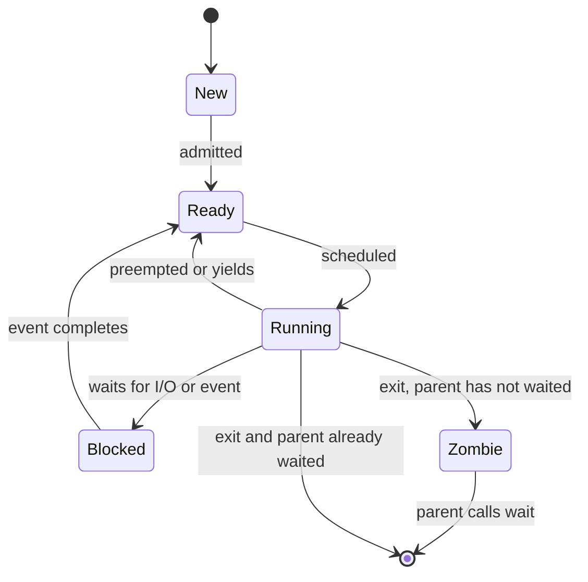
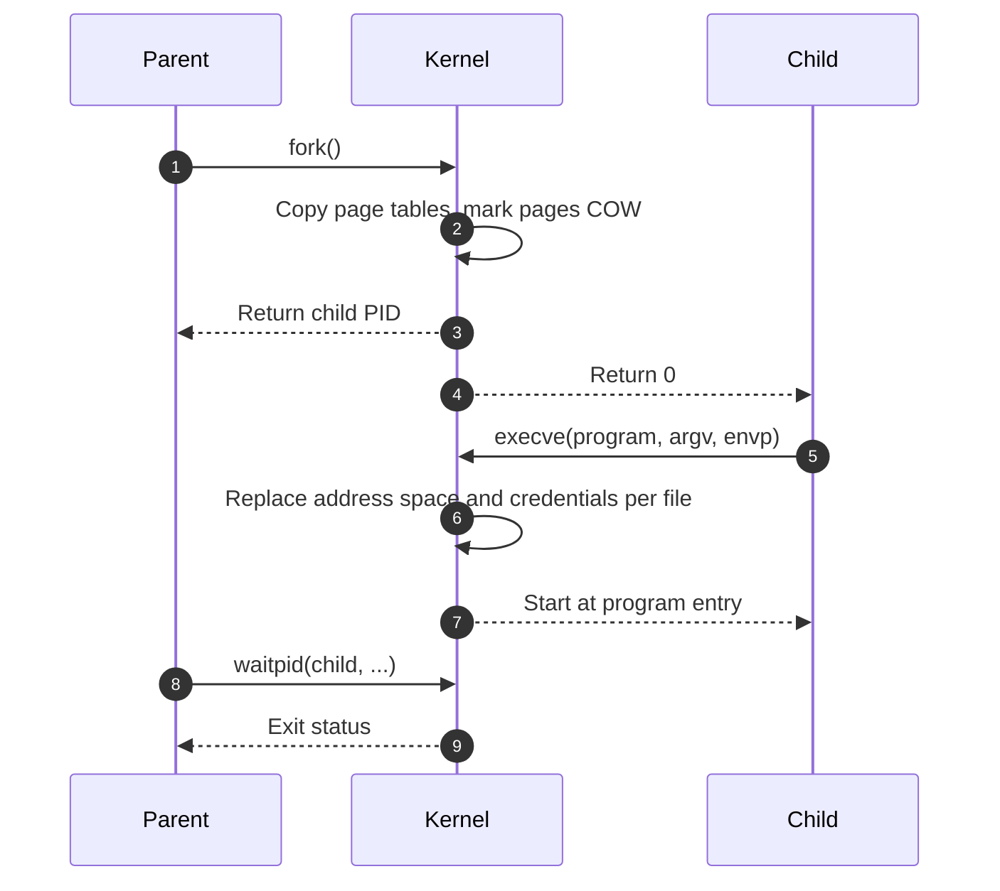

# SYS-02.2: Processes, Threads, and Scheduling

> **Module:** SYS-02 · **Level:** L1 · **Prerequisites:** SYS-02.1 · **Estimated time:** 7 h (3 reading, 4 practice)
> **Outcome addressed:** SYS-02.O1

## Learning outcomes

By the end of this tutorial you can:

1. Explain what a process contains beyond its code, and what a thread shares with its process.
2. Trace `fork`, `exec`, `wait`, exit, and signals through the process lifecycle.
3. Explain scheduling goals, priorities, and resource limits well enough to reason about starvation and exhaustion.
4. Analyze process-injection and credential-inheritance risks and the controls that reduce them.

## Why this matters

Many security decisions are process decisions. Does a service run as a dedicated user? Does a child inherit the parent's file descriptors and credentials? Can an attacker attach to a process and read its memory? Does a crash leave a core dump containing secrets?

Processes also explain detection. A parent-child relationship, a command line, an environment variable, or a signal can be the difference between a benign administrative action and an intrusion.

## First principles

### What a process is

A **process** is an executing instance of a program with:

| Component | Purpose |
|---|---|
| Address space | Code, data, heap, stack, and mappings (SYS-01.2) |
| One or more threads | Execution contexts |
| Credentials | UID/GID, groups, capabilities, token |
| File descriptor table | Open files, sockets, pipes, devices |
| Signal dispositions | Handlers, ignored signals, blocked signals |
| Resource limits | CPU, memory, files, processes, core dumps |
| Namespace membership | Isolation domains (SYS-02.5) |
| Kernel bookkeeping | State, parent, children, accounting |

The kernel stores this in a **process control block**. Linux calls it `task_struct`; Windows uses `EPROCESS` plus related structures [L15]; macOS uses `proc` and `task`. The names differ, the concept does not.

### Process versus thread

| Property | Process | Thread |
|---|---|---|
| Address space | Private (shared only by explicit mappings) | Shared with sibling threads |
| File descriptors | Private table | Shared |
| Credentials | Private | Shared |
| Signal handling | Dispositions are process-wide and shared | Dispositions shared; masks and pending signals are per-thread |
| Stack | Private | Private per thread |
| Registers and program counter | Private | Private per thread |
| Creation cost | Higher | Lower |
| Isolation | Stronger | Weaker |

A thread has its own **thread-local storage (TLS)**, stack, registers, and scheduling state. It shares global variables, heap objects, and file descriptors with its process. A bug in one thread can corrupt another thread's data, and a thread that changes credentials changes them for the whole process.

### Lifecycle



A **zombie** has exited but its parent has not collected its exit status. It consumes a process-table entry, not CPU. An **orphan** is a process whose parent exited; it is reparented (often to PID 1 or a subreaper).

### fork, exec, wait



**`fork`** creates a child with a copy of the parent's address space [L28]. Modern kernels use copy-on-write so pages are shared until one side writes. The child inherits file descriptors, credentials, signal dispositions, and environment unless flags or subsequent calls change them.

**`exec`** replaces the process image with a new program. The PID stays the same. Open file descriptors remain open unless marked close-on-exec (`FD_CLOEXEC`). This inheritance is a common source of leaked sockets and secrets.

**`wait`** collects the child's exit status. A parent that never waits leaves zombies.

### Signals

A **signal** is an asynchronous notification delivered to a process or thread. Examples: `SIGINT` (interrupt), `SIGTERM` (terminate), `SIGKILL` (force kill), `SIGSEGV` (segmentation fault), `SIGCHLD` (child state change).

- `SIGKILL` and `SIGSTOP` cannot be caught, blocked, or ignored.
- A handler runs asynchronously; only async-signal-safe functions are safe to call from it.
- Signal dispositions are inherited across `exec` for ignored signals; handlers are reset.
- A signal can be blocked per thread, which is why signal handling in multithreaded programs is subtle.

### Scheduling

The scheduler decides which runnable thread uses a CPU. Goals conflict: fairness, latency, throughput, and priority.

| Concept | Meaning |
|---|---|
| **Time slice** | How long a thread may run before preemption |
| **Priority / nice** | Relative share of CPU; on Linux, nice ranges from -20 (most favorable) to 19 |
| **Preemption** | Forcibly switching away from a running thread |
| **Affinity** | Which CPUs a thread may run on |
| **Real-time policy** | Priority-based policies such as `SCHED_FIFO` and `SCHED_RR`; can starve other work if misused |
| **Cgroup CPU controller** | Group-level CPU allocation and limits (SYS-02.5) |

> **Version note (2026-10-19).** Linux used the Completely Fair Scheduler (CFS) for many years and moved to EEVDF (Earliest Eligible Virtual Deadline First) in the 6.6 series. Scheduler behavior and tunables differ by kernel version. Do not present a specific scheduling algorithm as universal.

### Resource limits

Unix-like systems expose per-process limits (`RLIMIT_*`): CPU time, file size, open files, processes, stack size, core dump size, and more [L13]. The captured host shows:

```text
$ ulimit -a
core file size          (blocks, -c) 0
data seg size           (kbytes, -d) unlimited
file size               (blocks, -f) unlimited
max locked memory       (kbytes, -l) unlimited
max memory size         (kbytes, -m) unlimited
open files                      (-n) 1048575
pipe size            (512 bytes, -p) 1
stack size              (kbytes, -s) 8176
cpu time               (seconds, -t) unlimited
max user processes              (-u) 2666
virtual memory          (kbytes, -v) unlimited
```

Limits are inherited by children and can be lowered by unprivileged processes. They are a blunt but important containment control.

## Worked example: reading a process

Captured on **macOS 27.0.1, arm64**. The account name is redacted to `learner` before publication:

```text
$ ps -o pid,ppid,uid,user,stat,comm -p $$
  PID  PPID   UID USER     STAT COMM
15375  5145   501 learner Ss   /bin/bash
```

Reading the columns:

- `PID` is the process ID; `PPID` is the parent's PID.
- `UID` and `USER` show the credential under which the shell runs.
- `STAT` encodes state and flags. `S` means sleeping, and `s` indicates a session leader. Flags vary by `ps` implementation.
- `COMM` is the command name; `args` would show the full command line.

Threads on the same host:

```text
$ ps -M $$
USER       PID   TT   %CPU STAT PRI     STIME     UTIME COMMAND
learner 15375   ??    0.0 S    31T   0:00.00   0:00.00 /bin/bash ...
```

The exact columns are platform-specific. On Linux, `ps -eLf` or `ls /proc/<pid>/task` lists threads. The security-relevant question is the same: which threads belong to which process, and what do they share?

## Security implications

1. **Injection crosses a process boundary.** Linux `ptrace`, Windows `CreateRemoteThread`/APC injection, and macOS task ports can write into another process. Restrict `ptrace_scope`, protect debug privileges, and monitor for cross-process writes.
2. **Credentials and descriptors are inherited.** A privileged parent that spawns a child without dropping privileges or closing descriptors leaks authority.
3. **Core dumps can contain secrets.** Set `RLIMIT_CORE` to 0 for sensitive services, or route core dumps to protected storage.
4. **Resource exhaustion is denial of service.** Fork bombs, thread bombs, file-descriptor leaks, and memory growth can take down a host. Apply limits and monitor.
5. **`/proc` is an information source.** On Linux, `/proc/<pid>` exposes command lines, environment, maps, and file descriptors to authorized users. Restrict access and avoid secrets in environment variables.
6. **Signal handling can be abused.** A process that trusts `SIGUSR1` from any sender, or runs unsafe code in a handler, creates a vulnerability.

## Common misconceptions

| Misconception | Correction |
|---|---|
| "A thread is a lightweight process." | Threads share the address space, descriptors, and credentials; that sharing changes the security model. |
| "`fork` copies all memory immediately." | Pages are shared copy-on-write until modified. |
| "Zombies consume CPU." | They consume a process-table entry until reaped. |
| "`kill` always terminates a process." | It sends a signal; only `SIGKILL` is uncatchable, and even that can be delayed in uninterruptible sleep. |
| "Environment variables are private." | They are readable through `/proc` and inherited by children. |
| "A process running as a different user is fully isolated." | It shares the kernel, and may share files, sockets, and namespaces. |

## Exercises

### Foundation

1. Name four things a process has that a thread does not.
2. What does `fork` return in the parent and in the child?
3. Why can `SIGKILL` not be caught?

### Application

4. Run `ps -o pid,ppid,uid,user,stat,comm -p $$` on your system. Explain each column for your shell.
5. Write a C program that calls `fork`, prints the PID in both branches, and calls `waitpid` in the parent. Run it and record the output.
6. Open a file, then `exec` a program without `FD_CLOEXEC`. Demonstrate whether the descriptor survives. Explain the security implication.

### Analysis

7. A long-running service leaks one file descriptor per request. Predict the failure mode and the metric that would reveal it first.
8. Explain how a core dump could disclose a private key, and propose two controls.
9. A process accepts `SIGUSR1` and writes a log line from the handler using `printf`. Explain why that is unsafe and propose a safe design.

### Extension

10. Design an experiment to compare the startup cost of processes and threads on your platform. State the metric, sample size, and confounders. Do not claim a result without measurements.

## Knowledge check

1. What does `exec` preserve across the image replacement?
2. Why is `FD_CLOEXEC` a security control?
3. What is the difference between a zombie and an orphan?
4. Why is `SCHED_FIFO` dangerous if granted to untrusted code?
5. Why should sensitive services disable core dumps?

Answers: `assessments/sys-02/answer-key.md`.

## Key takeaways

- A process is an address space plus threads, credentials, descriptors, limits, and kernel state.
- Threads share authority; that is convenient and dangerous.
- `fork`/`exec`/`wait` and descriptor inheritance shape both functionality and leakage.
- Scheduling and resource limits are availability controls as much as performance controls.

## Further reading

| Source | Supports | Verification |
|---|---|---|
| [L28] Linux clone(2) | Process and thread creation, namespace flags | V1 |
| [L25] Linux proc(5) | Process information exposure | V1 |
| [L13] POSIX.1-2024 | Process creation, signals, and resource limits | V1 |
| [L15] Windows processes and threads | Windows process and thread model | V1 |
| [L22] Windows job objects | Group resource and isolation control | V1 |
| [B09] Windows Internals | `EPROCESS`, scheduling, and injection mechanisms | V1 |

Links and verification status for every source ID are recorded in [`REFERENCES.md`](../../REFERENCES.md).

## Cross-links

- Previous: [SYS-02.1 Privilege levels and the kernel boundary](01-privilege-levels-and-kernel-boundary.md)
- Next: [SYS-02.3 Files, permissions, and access control](03-files-permissions-and-access-control.md)
- Lab: [SYS-02 lab](../../labs/sys-02-syscalls-and-isolation/lab.md)

## Completion checklist

- [ ] I can list the components of a process and what threads share.
- [ ] I can trace `fork`, `exec`, `wait`, and exit.
- [ ] I can explain zombies, orphans, and descriptor inheritance.
- [ ] I recorded real process and limit output on my system.
- [ ] I can explain two process-injection paths and one control for each.
- [ ] I answered the knowledge-check questions and checked the answer key.
