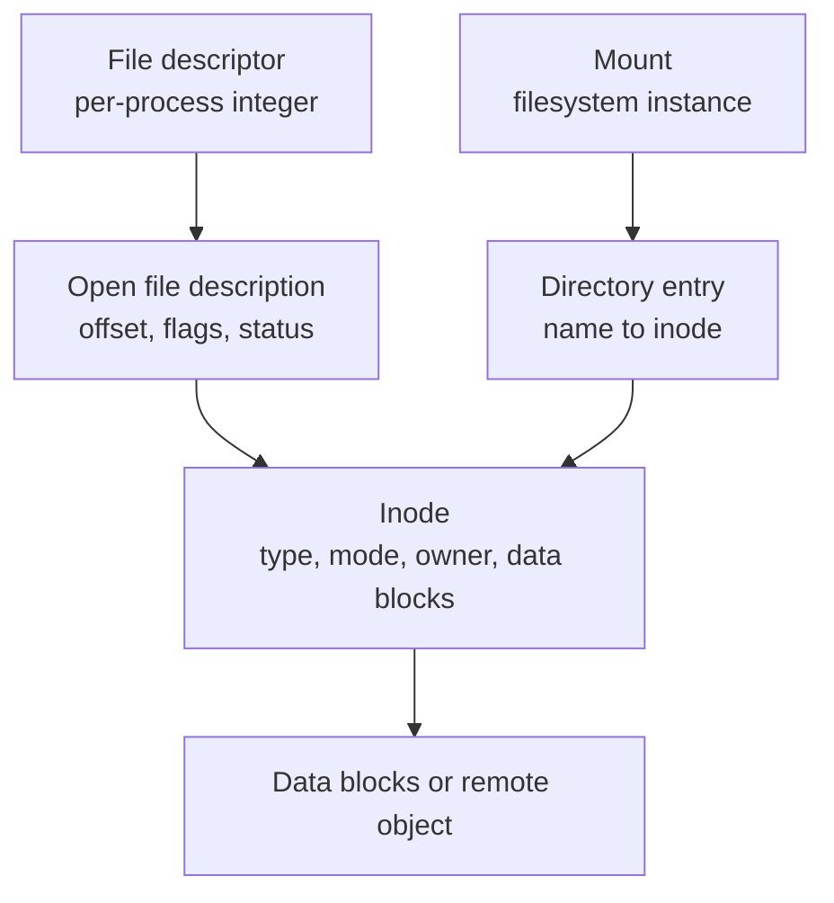
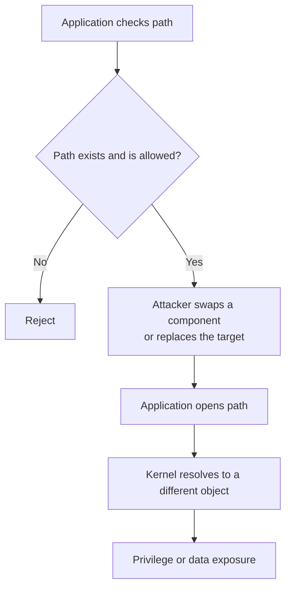
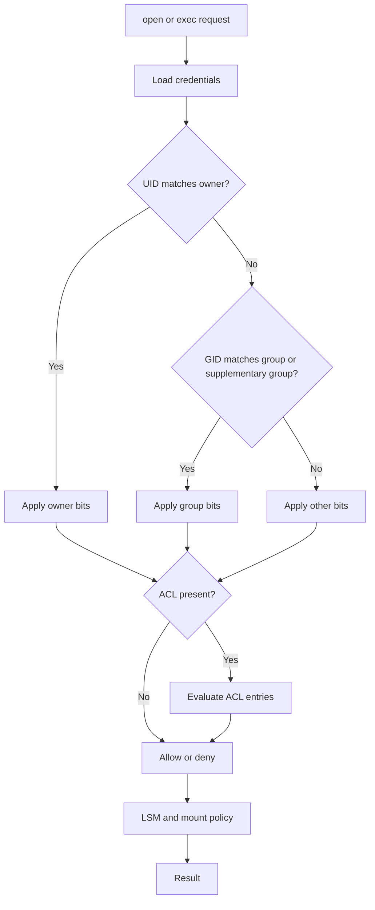

# SYS-02.3: Files, Permissions, and Access Control

> **Module:** SYS-02 · **Level:** L1 · **Prerequisites:** SYS-02.1, SYS-02.2 · **Estimated time:** 7 h (3 reading, 4 practice)
> **Outcome addressed:** SYS-02.O1, SYS-02.O3

## Learning outcomes

By the end of this tutorial you can:

1. Explain the difference between an inode, a directory entry, a file descriptor, and an open file description.
2. Interpret Unix mode bits, special bits, umasks, ACLs, and mount options, and predict the resulting access decision.
3. Explain Windows DACLs, integrity levels, and the interaction between share and filesystem permissions.
4. Identify TOCTOU, symlink, path-traversal, and world-writable-directory risks and the controls that prevent them.

## Why this matters

Files are where authority is stored: private keys, credentials, configuration, databases, audit logs, and the executables that run as root. A permission mistake can turn a read-only service into a privilege-escalation path, and a path-resolution race can defeat a check that looks correct in source code.

Most "the application checked permissions" bugs are not about the permission bits. They are about *which object* was checked versus *which object* was used.

## First principles

### The layers



| Object | Meaning | Key security property |
|---|---|---|
| **Inode** | Metadata for a file: type, mode, owner, group, size, timestamps, data pointers | Exists independently of any name |
| **Directory entry (dentry)** | A name mapped to an inode | Names can be added or removed without deleting the inode |
| **File descriptor (FD)** | A per-process integer referring to an open file description | Can be inherited across `exec` and passed between processes |
| **Open file description** | Shared state for an open: offset, flags, status | Multiple FDs can share one description |
| **Mount** | A filesystem attached at a path | Mount options add or remove permissions |

A **hard link** is another directory entry for the same inode [L06]. A **soft link** (symbolic link) is a separate object containing a path; resolving it can cross filesystems and can be changed independently of the target.

### Unix mode bits

A mode is nine permission bits plus three special bits:

```text
  owner   group   other
  r w x   r w x   r w x
  4 2 1   4 2 1   4 2 1
```

| Bit | On a regular file | On a directory |
|---|---|---|
| `r` | Read contents | List names |
| `w` | Modify contents | Create, delete, or rename entries |
| `x` | Execute | Traverse (enter) the directory |

A directory needs `x` to reach entries inside it. `r` without `x` lets you list names but not stat or open them. `w` without `x` is nearly useless.

Special bits:

| Bit | Numeric | Effect |
|---|---|---|
| Setuid | 4000 | Executable runs with the file owner's effective UID |
| Setgid | 2000 | Executable runs with the file group; on a directory, new files inherit the group |
| Sticky | 1000 | On a directory, only the owner (or privileged user) can delete or rename entries |

The **umask** clears permission bits when a file or directory is created. A umask of `0022` removes group and other write, producing `755` directories and `644` files under the usual creation modes.

### ACLs and extended attributes

POSIX ACLs add named users and groups with per-entry permissions. Tools include `getfacl` and `setfacl` on Linux; macOS supports ACLs through `chmod +a` and `ls -le`. An ACL can grant access that the mode bits deny, so mode bits alone are not a complete access picture.

Extended attributes (xattrs) store metadata such as SELinux labels, capabilities, and macOS quarantine flags. On macOS, `ls -l` marks files with extended attributes using `@`.

Linux **file capabilities** can grant a subset of root powers to an executable without full setuid. They are still privilege grants and require careful review.

### Mount options

Mount options change what a filesystem allows:

| Option | Effect |
|---|---|
| `ro` | Read-only |
| `nosuid` | Ignore setuid/setgid bits |
| `nodev` | Do not interpret device nodes |
| `noexec` | Do not execute binaries |
| `noatime` | Do not update access time (performance, not security) |

A common hardening pattern is to mount `/tmp`, `/var/tmp`, and user-writable filesystems with `nosuid,nodev,noexec`. This does not stop an attacker from storing data there, but it removes easy execution and privilege paths.

### Windows access control

Windows stores a **security descriptor** on a securable object [L14]. It contains:

- an owner SID;
- a **DACL** (discretionary ACL) with allow and deny ACEs;
- a **SACL** (system ACL) for auditing;
- control flags.

A process presents an **access token** with the user's SIDs, groups, privileges, integrity level, and restrictions. The kernel evaluates the DACL against the requested access mask [L14]. **Mandatory Integrity Control** adds a mandatory policy: a lower-integrity process generally cannot write to a higher-integrity object, even if the DACL allows it [L21].

For network shares, both **share permissions** and **NTFS permissions** apply. The effective network access is the more restrictive combination; local access is governed by NTFS permissions. This is a frequent source of confusion in audits.

### Path resolution and races

Opening a file is not a single atomic check. The kernel resolves each path component, checks traverse permission, follows symbolic links, and finally opens the inode. If an attacker can change a component between the check and the use, a **time-of-check-to-time-of-use (TOCTOU)** race occurs.



Defenses include:

- open with `O_NOFOLLOW` where appropriate;
- use `openat` with directory file descriptors and relative names;
- create files with `O_CREAT | O_EXCL` and restrictive modes;
- use `mkstemp`-style APIs instead of predictable temp names;
- drop privileges before touching user-controlled paths;
- avoid checking a path and then reopening it.

### The permission decision

For Unix, the kernel checks the effective UID and GIDs against the inode's owner and group, applies the matching class, and then consults ACLs if present. Root and capabilities such as `CAP_DAC_OVERRIDE` can bypass discretionary checks; LSMs can still deny.



## Worked example: real mode bits and a setuid copy

Captured on **macOS 27.0.1, arm64**:

```text
$ umask
0022
```

A file created under this umask:

```text
$ printf 'synthetic data\n' > notes.txt
$ ls -l
-rwsr-xr-x@ 1 miroslav  wheel  166480 Oct 19 15:34 copy-of-echo
-rw-r--r--@ 1 miroslav  wheel      15 Oct 19 15:34 notes.txt
drwxrwxrwx@ 2 miroslav  wheel      64 Oct 19 15:34 shared
```

```text
$ stat -f 'mode=%Sp owner=%Su group=%Sg size=%z name=%N' notes.txt
mode=-rw-r--r-- owner=miroslav group=wheel size=15 name=notes.txt

$ stat -f 'mode=%Sp owner=%Su group=%Sg size=%z name=%N' copy-of-echo
mode=-rwsr-xr-x owner=miroslav group=wheel size=166480 name=copy-of-echo
```

Reading the output:

- `notes.txt` is `-rw-r--r--`: owner read/write, group read, other read.
- `copy-of-echo` is `-rwsr-xr-x`: the `s` in the owner execute position is the **setuid** bit.
- `shared/` is `drwxrwxrwx`: world-writable, which is dangerous for a directory because any user can create, rename, or delete entries (absent the sticky bit).
- The `@` after the mode marks extended attributes on macOS. It does not mean the file is unsafe; it means metadata is present.

The setuid copy in this example is owned by the same user who created it, so it does not demonstrate a privilege change. The mode bit is visible; whether it grants additional authority depends on the file owner and the executing user. Setuid on scripts is commonly ignored for security reasons; the exact behavior is OS-specific.

## Security implications

1. **World-writable directories are dangerous.** Without the sticky bit, any user can delete or replace another user's files. Use `1777` for shared temporary directories, or better, per-user directories.
2. **Setuid binaries are high-value targets.** Audit them, keep them minimal, prefer capabilities or privileged services, and monitor changes.
3. **TOCTOU is a design bug.** Do not check a path and later reopen it. Bind the decision to the object with a file descriptor.
4. **Permissions on secrets matter.** Private keys should be `600` or stricter, owned by the service account, and excluded from backups and logs.
5. **Mount options are part of access control.** `nosuid,nodev,noexec` on writable filesystems removes easy escalation paths.
6. **Deleting a name does not erase data.** An open file description keeps the inode alive; forensic recovery and secure deletion are separate problems.
7. **Effective Windows access is the intersection.** Share and NTFS permissions both apply over SMB; do not audit only one.

## Common misconceptions

| Misconception | Correction |
|---|---|
| "`chmod 777` is the fix for permission denied." | It grants every user full control. Diagnose the missing permission instead. |
| "Root can read any file." | LSMs, encryption, immutable attributes, and secure boot can deny or restrict root. |
| "A hard link is the same as a copy." | It is another name for the same inode; deleting one name does not delete the data while another exists. |
| "Deleting a file wipes the data." | It removes a name; the inode and blocks may persist until reused. |
| "ACLs replace the need for least privilege." | ACLs express policy; a broad ACL is still over-privilege. |
| "File permissions are checked once at open." | They are checked at open; subsequent reads and writes use the open file description. |

## Exercises

### Foundation

1. What is the difference between an inode and a directory entry?
2. What does the `s` bit in `-rwsr-xr-x` mean?
3. What does a directory's `x` permission allow?

### Application

4. Create a file with `umask 0022` and another with `umask 0077`. Record the resulting modes with `stat`.
5. Create a setuid binary from a program you compile. Record `ls -l` and explain what would change if another user executed it.
6. On Linux, create a file with an ACL using `setfacl`, then verify it with `getfacl`. Explain why `ls -l` may not show the full picture.

### Analysis

7. A service running as root writes a file to `/tmp/app.log` using a predictable name. Describe a symlink attack and two defenses.
8. A directory is `drwxrwxrwx` without the sticky bit. Explain two attacks available to an unprivileged user.
9. A Windows share grants `Everyone: Change` and the NTFS ACL grants `Users: Read`. What access does a network user effectively have, and why?

### Extension

10. Design a filesystem layout for a service that needs to read a config file, write logs, and store uploaded files. Specify owners, modes, mount options, and the threat each choice addresses.

## Knowledge check

1. Why can two file descriptors share an offset?
2. What does the sticky bit prevent on a directory?
3. What is the difference between a soft link and a hard link?
4. What is TOCTOU, and which syscall pattern reduces it?
5. How do share and NTFS permissions combine over SMB?

Answers: `assessments/sys-02/answer-key.md`.

## Key takeaways

- Inodes, names, descriptors, and open file descriptions are different objects with different lifetimes.
- Mode bits are necessary but not sufficient; ACLs, capabilities, mount options, and LSMs also decide access.
- Path-based checks are vulnerable to races; object-based access with descriptors is safer.
- Setuid and world-writable paths are recurring privilege-escalation sources.

## Further reading

| Source | Supports | Verification |
|---|---|---|
| [L06] Linux inode(7) | Inode metadata and file types | V1 |
| [L07] Linux credentials(7) | UID/GID checks and credential changes | V1 |
| [L13] POSIX.1-2024 | File permissions, ACLs, and pathname resolution | V1 |
| [L14] Windows access control | DACLs, ACEs, and access checks | V1 |
| [L21] Windows mandatory integrity control | Integrity levels and write restrictions | V1 |
| [L26] Linux mount namespaces | Mount visibility and per-namespace options | V1 |

Links and verification status for every source ID are recorded in [`REFERENCES.md`](../../REFERENCES.md).

## Cross-links

- Previous: [SYS-02.2 Processes, threads, and scheduling](02-processes-threads-and-scheduling.md)
- Next: [SYS-02.4 System calls and tracing](04-system-calls-and-tracing.md)
- Lab: [SYS-02 lab](../../labs/sys-02-syscalls-and-isolation/lab.md)

## Completion checklist

- [ ] I can distinguish inode, dentry, FD, and open file description.
- [ ] I can decode mode bits and special bits from `ls -l`.
- [ ] I measured the effect of two different umasks.
- [ ] I can explain a TOCTOU attack and an object-based defense.
- [ ] I can compare Unix permissions with Windows DACLs and integrity levels.
- [ ] I answered the knowledge-check questions and checked the answer key.
