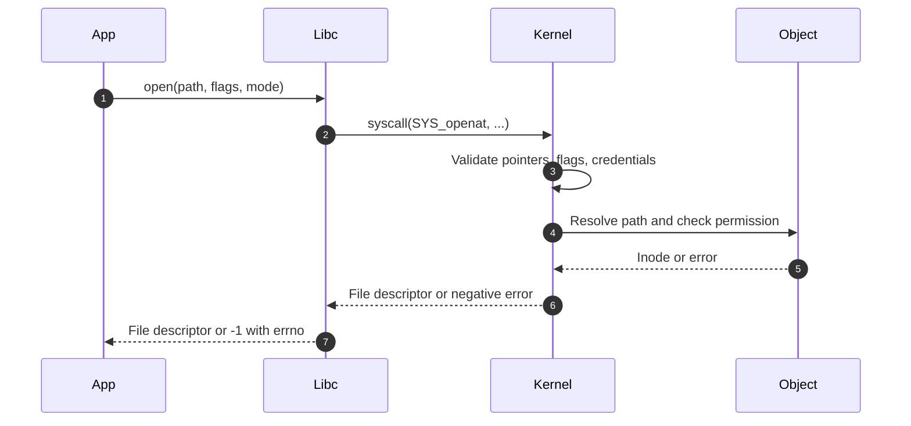
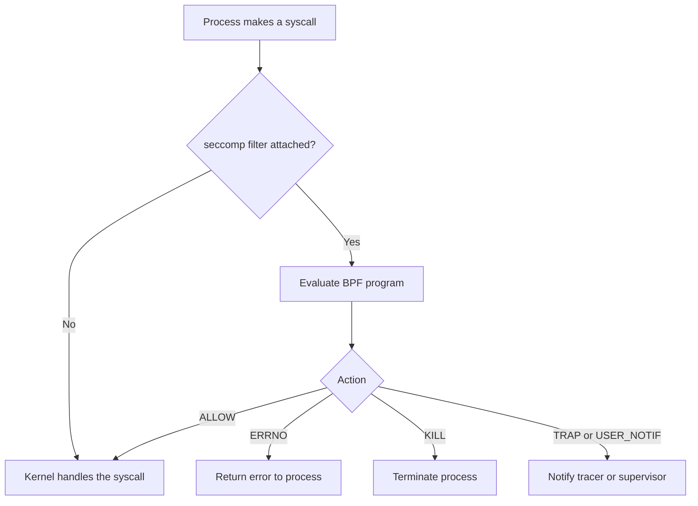

# SYS-02.4: System Calls and Tracing

> **Module:** SYS-02 · **Level:** L1 · **Prerequisites:** SYS-02.1–SYS-02.3 · **Estimated time:** 6 h (3 reading, 3 practice)
> **Outcome addressed:** SYS-02.O2

## Learning outcomes

By the end of this tutorial you can:

1. Explain the system call ABI: number, arguments, return value, and `errno`.
2. Trace a process and map observed syscalls to kernel abstractions such as file descriptors and credentials.
3. Explain `strace`, `ptrace`, seccomp, and audit as different observers or filters at the kernel boundary.
4. Produce trace evidence that another analyst can reproduce.

## Why this matters

System calls are where a program's intent becomes a kernel action. A trace answers questions that source code cannot:

- Which file did this process actually open?
- Did the permission check fail, and with which error?
- Did the process fork, exec, or connect to a network address?
- Which syscalls does a container allow?

Detection engineering, incident response, sandboxing, and container hardening all depend on this layer.

## First principles

### The system call ABI

A system call has:

| Element | Meaning |
|---|---|
| Number | Selects the kernel operation; architecture-specific |
| Arguments | Up to six machine-word values on common ABIs |
| Return value | Result, or a negative error code on Linux |
| `errno` | A thread-local error number set by libc when a syscall fails |

On Linux, libc wrappers translate the kernel's negative return into `-1` and set `errno`. A successful call may return 0 or a positive value, depending on the operation.



Not every libc function is a syscall. `printf` formats in user space and eventually calls `write`. `malloc` may use `brk` or `mmap`, or may serve the request entirely from its own free lists. `clock_gettime` may be served from the vDSO without entering the kernel on some architectures.

### The trace

A **tracer** attaches to a process, stops it at syscall entry and exit, and inspects registers and memory [L08]. `strace` on Linux uses `ptrace`. `dtruss` on macOS uses DTrace. Debuggers use the same mechanism.

A trace line has four parts:

| Part | Example shape | Meaning |
|---|---|---|
| Name | `openat` | Syscall name |
| Arguments | `(AT_FDCWD, "<path>", O_RDONLY)` | Decoded arguments |
| Return | `= <value>` | Return value |
| Error | `= -1 EACCES (Permission denied)` | Failed call and errno |

The following is a **format template, not captured output**:

```text
<syscall>(<arg1>, <arg2>, ...) = <return value>
<syscall>(<arg1>, <arg2>, ...) = -1 <ERRNO> (<message>)
```

Never present a template as evidence. Capture the real line from your own run and include the command and version.

Useful `strace` options (Linux):

| Option | Effect |
|---|---|
| `-f` | Follow forks and threads |
| `-e trace=file` | Trace file-related syscalls |
| `-e trace=desc` | Trace descriptor-related syscalls |
| `-e trace=network` | Trace network syscalls |
| `-o <file>` | Write the trace to a file |
| `-tt` | Timestamps with microseconds |
| `-s <n>` | Increase the maximum string length printed |
| `-y` | Print paths associated with file descriptors |
| `-k` | Print stack traces, if supported by the build |

> **Version note (2026-10-19).** `strace` output formatting, available filters, and `-k` support vary by version and build options. Record `strace --version` and the kernel version.

### Capturing a real interaction

The following Python session was run on **macOS 27.0.1, arm64, system Python 3.9**:

```text
$ python3 - <<'PY'
import os, errno
fd = os.open('/etc/hosts', os.O_RDONLY)
print('open returned fd:', fd)
data = os.read(fd, 16)
print('read returned bytes:', data)
os.close(fd)
print('close returned: None')
try:
    os.open('/etc/master.passwd', os.O_RDONLY)
except OSError as e:
    print('denied errno:', e.errno, errno.errorcode[e.errno])
PY
open returned fd: 3
read returned bytes: b'##\n# Host Databa'
close returned: None
denied errno: 13 EACCES
```

What this demonstrates:

- The first free descriptor is 3, because 0, 1, and 2 are already standard input, output, and error.
- `os.read(fd, 16)` returned exactly 16 bytes; a short read is allowed and must be handled.
- `os.close(fd)` returned `None` in Python; the underlying `close` returned success.
- Opening `/etc/master.passwd` failed with `EACCES` (13), a permission error, because the file is restricted to root on this host.

The Python calls are wrappers. A trace would show the underlying syscalls, typically `openat`, `read`, `close`, and `exit_group` on Linux. The exact names and numbers are platform-specific; do not assume the macOS calls map one-to-one to Linux names.

### seccomp

**seccomp** restricts which syscalls a process may make. A filter is a BPF program attached with `seccomp(2)` or `prctl(PR_SET_SECCOMP, ...)`. The filter inspects the syscall number and argument registers and returns an action: allow, kill, trap, return an error, or notify a supervisor [L02] [L18].

Important properties:

- seccomp filters are inherited across `fork` and `exec`.
- Installing a filter generally requires `no_new_privs` or `CAP_SYS_ADMIN`.
- A filter cannot dereference user pointers; it sees register values, not pointed-to memory.
- seccomp is a syscall filter, not a full sandbox. Combine it with namespaces, cgroups, LSMs, and least privilege.



### Other observers

| Mechanism | Platform | What it observes | Notes |
|---|---|---|---|
| `strace` | Linux | Syscall entry and exit via `ptrace` | High overhead; useful for debugging and labs |
| `perf trace` | Linux | Syscalls with lower overhead | Requires perf permissions |
| `auditd` | Linux | Syscalls selected by audit rules | Designed for security auditing and compliance |
| eBPF tracing | Linux | Kernel and user events | Requires privileges; powerful and complex |
| `dtruss` | macOS | Syscalls via DTrace | Requires root; SIP and DTrace restrictions apply |
| EndpointSecurity | macOS | Security-relevant events | For security products; entitlement required |
| ETW | Windows | Kernel and user telemetry | Broad event source for defenders |

## Security implications

1. **Syscall filtering reduces attack surface.** A service that only needs `read`, `write`, `openat`, `close`, and `exit_group` does not need `execve` or `mount`.
2. **Traces are evidence, but incomplete.** A tracer sees syscalls, not the contents of every buffer or the full call stack. Kernel-internal activity and static code are invisible.
3. **`ptrace` is powerful.** A process that can attach to another can read and modify its memory. Restrict `ptrace_scope` and protect debug privileges.
4. **seccomp is not a sandbox by itself.** It filters syscalls but does not confine filesystem paths, network destinations, or memory access.
5. **Audit rules must be chosen deliberately.** Logging every syscall is expensive and noisy; log privilege changes, execution, and access to sensitive paths.
6. **Trace data can contain secrets.** Command-line arguments, paths, and buffer previews may include credentials. Protect and minimize trace files.

## Common misconceptions

| Misconception | Correction |
|---|---|
| "`strace` shows everything the program does." | It shows syscalls the tracer observes, not kernel internals, library logic, or all memory contents. |
| "Syscall numbers are the same on every architecture." | They are architecture-specific and can change. |
| "Every libc function is a syscall." | Many are pure user-space; others are wrappers around one or more syscalls. |
| "seccomp blocks all attacks." | It restricts syscall use; it does not validate pointer contents or prevent logic bugs in allowed calls. |
| "A denied syscall always means an attack." | Benign programs probe optional features and handle errors routinely. |
| "`ptrace` is only used by debuggers." | It is also used by tracers, sandboxes, and injection tools. |

## Exercises

### Foundation

1. What are the four parts of a syscall trace line?
2. What does `errno` represent, and who sets it?
3. Why is the first returned file descriptor usually 3?

### Application

4. Run the Python example above on your system. Record the descriptor, the bytes read, and the error number for the denied path.
5. On Linux, write a small C program that opens a file, reads 16 bytes, writes them to standard output, and exits. Trace it with `strace -f -e trace=openat,read,write,close,exit_group`. Record the real trace.
6. Cause an `EACCES` failure by creating a file with mode `000` and opening it as an unprivileged user. Trace the failure and record the real line.

### Analysis

7. A trace shows `execve` immediately after a network connection. Explain two hypotheses and the additional evidence that would distinguish them.
8. A container's seccomp profile blocks `ptrace`. Explain what this prevents and what it does not prevent.
9. An analyst says "the process never opened the file because it is not in the trace." Give two reasons the trace could be incomplete.

### Extension

10. Design a minimal seccomp allowlist for a program that reads one file and writes to standard output. List the syscalls, justify each, and describe how you would test that the allowlist is sufficient.

## Knowledge check

1. What does the kernel return on a failed Linux syscall, and how does libc translate it?
2. Why does `strace` add overhead?
3. What is the difference between `seccomp` and a full sandbox?
4. Why is `ptrace` a security-sensitive capability?
5. Why must a trace report include the kernel and tool versions?

Answers: `assessments/sys-02/answer-key.md`.

## Key takeaways

- Syscalls are the controlled interface between user and kernel; their ABI is architecture-specific.
- A trace is evidence only with the command, environment, versions, and real output.
- seccomp filters syscalls; it does not confine paths, network destinations, or memory.
- `ptrace` enables debugging, tracing, and injection, so access to it is a privilege.

## Further reading

| Source | Supports | Verification |
|---|---|---|
| [L01] Linux syscalls(2) | Syscall interface, numbers, and conventions | V1 |
| [L02] Linux seccomp(2) | Filter installation and actions | V1 |
| [L18] Kernel seccomp filter documentation | Filter semantics and examples | V1 |
| [L08] Linux ptrace(2) | Tracer attachment and memory access | V1 |
| [L25] Linux proc(5) | Process and syscall-related status files | V1 |
| [L13] POSIX.1-2024 | Standard process and file interfaces | V1 |

Links and verification status for every source ID are recorded in [`REFERENCES.md`](../../REFERENCES.md).

## Cross-links

- Previous: [SYS-02.3 Files, permissions, and access control](03-files-permissions-and-access-control.md)
- Next: [SYS-02.5 Isolation and sandboxing](05-isolation-and-sandboxing.md)
- Lab: [SYS-02 lab](../../labs/sys-02-syscalls-and-isolation/lab.md)

## Completion checklist

- [ ] I can explain the syscall ABI and `errno` handling.
- [ ] I captured a real syscall-adjacent interaction and recorded the environment.
- [ ] I can explain what `strace`, `ptrace`, seccomp, and audit each observe or control.
- [ ] I can design a minimal syscall allowlist and justify it.
- [ ] I can explain why a trace may be incomplete.
- [ ] I answered the knowledge-check questions and checked the answer key.
