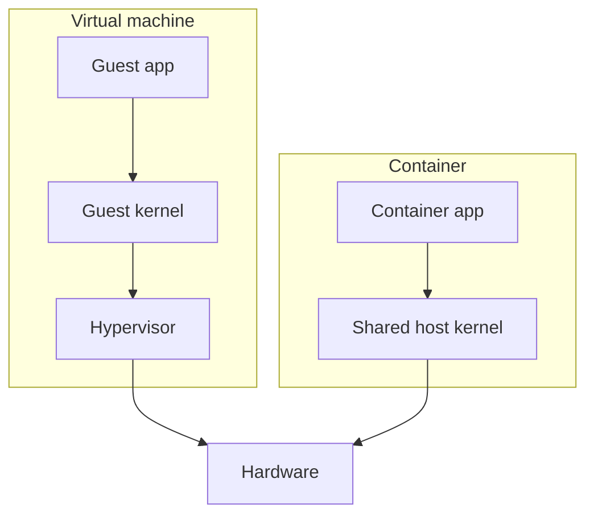
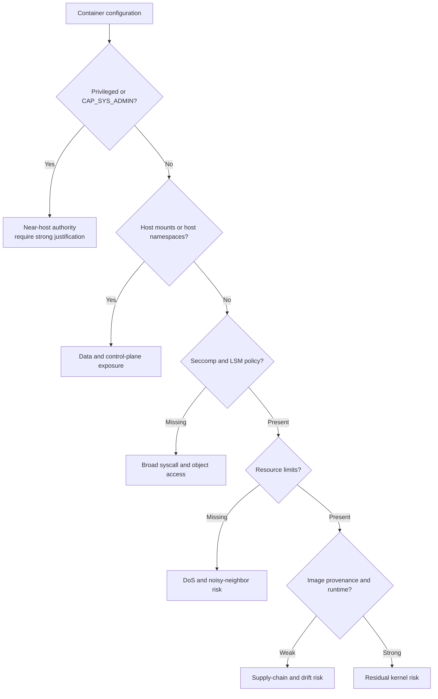

# SYS-02.5: Isolation and Sandboxing

> **Module:** SYS-02 · **Level:** L1 · **Prerequisites:** SYS-02.1–SYS-02.4 · **Estimated time:** 6 h (3 reading, 3 practice)
> **Outcome addressed:** SYS-02.O3

## Learning outcomes

By the end of this tutorial you can:

1. Distinguish fault, resource, and security isolation, and state which mechanism provides each.
2. Explain Linux namespaces, cgroups, `chroot`/`pivot_root`, capabilities, seccomp, and LSMs as separate layers.
3. Explain why a container is not a virtual machine and where the boundary actually is.
4. Evaluate a container or sandbox configuration and identify the controls that are missing.

## Why this matters

"Isolated" is not a binary property. A process can be isolated from another process's memory but still share its network, its kernel, its filesystem, and its credentials. Security incidents frequently involve a boundary that was assumed but never implemented: a privileged container, a host mount, a shared PID namespace, or a kernel vulnerability that crossed every namespace at once.

This tutorial teaches you to name the boundary, the mechanism, and the evidence that it works.

## First principles

### Three kinds of isolation

| Kind | Question | Example mechanisms |
|---|---|---|
| **Fault isolation** | If one component crashes, does it take down another? | Process address spaces, VMs, supervisors |
| **Resource isolation** | Can one component exhaust another's CPU, memory, PIDs, or disk? | cgroups, `RLIMIT_*`, job objects, quotas |
| **Security isolation** | Can one component read or affect another's data or authority? | Namespaces, LSMs, sandboxes, VMs, seccomp |

These are independent. A container may have strong resource isolation and weak security isolation, or the reverse. A design review must state which kind it needs.

### Linux namespaces

A **namespace** wraps a global kernel resource so that processes in the namespace see their own instance [L04]. Linux provides:

| Namespace | Isolates | Flag |
|---|---|---|
| Mount | Filesystem mount points | `CLONE_NEWNS` |
| PID | Process IDs and visibility | `CLONE_NEWPID` |
| Network | Interfaces, routes, firewall rules, ports | `CLONE_NEWNET` |
| IPC | System V IPC and POSIX message queues | `CLONE_NEWIPC` |
| UTS | Hostname and domain name | `CLONE_NEWUTS` |
| User | UID/GID mappings and capabilities | `CLONE_NEWUSER` |
| Cgroup | Visible cgroup hierarchy | `CLONE_NEWCGROUP` |
| Time | Boot time and monotonic clock offsets | `CLONE_NEWTIME` |

`clone(2)` creates a process in new namespaces; `unshare(2)` moves the caller; `setns(2)` joins an existing namespace [L04] [L28]. A process's namespace membership is visible in `/proc/<pid>/ns/`.

**User namespaces** map a range of UIDs inside the namespace to a different range outside. This lets an unprivileged user appear as root inside the namespace and create other namespaces. It is powerful and has been a recurring source of kernel vulnerabilities. It is not, by itself, a complete security boundary.

### cgroups

**Control groups (cgroups)** organize processes and apply resource limits. cgroup v2 uses a single hierarchy with controllers such as `cpu`, `memory`, `io`, `pids`, `cpuset`, and `hugetlb` [L05] [L19].

Important files in cgroup v2:

| File | Purpose |
|---|---|
| `memory.max` | Hard memory limit |
| `memory.current` | Current memory usage |
| `cpu.max` | CPU bandwidth limit |
| `pids.max` | Maximum number of processes/threads |
| `cgroup.controllers` | Controllers available to children |
| `cgroup.subtree_control` | Controllers enabled for children |

`pids.max` is a direct defense against fork bombs. `memory.max` bounds memory pressure. Neither isolates data; they bound consumption.

### chroot, pivot_root, and mounts

`chroot` changes the root directory used for path resolution. It is not a security boundary on its own:

- a process with an open descriptor to a directory outside the new root can escape;
- a process that can call `chroot` again or mount filesystems may escape;
- privileged processes can often break out.

`pivot_root` changes the root and mount namespace together and is the basis for container root filesystems [L26]. Container runtimes combine it with mount namespaces, `MS_NOSUID`, `MS_NODEV`, and `MS_NOEXEC` where appropriate.

### Capabilities, seccomp, and LSMs

These controls are complementary:

| Control | Restricts |
|---|---|
| Capabilities | Which privileged operations a process may perform |
| seccomp | Which syscalls a process may make |
| LSM (SELinux, AppArmor, Landlock) | Which objects a process may access under a policy |

Dropping capabilities does not restrict syscalls; a seccomp filter does not check file paths; an LSM does not reduce resource consumption. A hardened container uses all three plus namespaces and cgroups.

### Containers versus virtual machines

A **virtual machine** runs a guest kernel under a hypervisor [N12]. The hypervisor presents virtual hardware and enforces the boundary with hardware virtualization support. A **container** is a process (or group of processes) on the host kernel, confined by namespaces, cgroups, capabilities, seccomp, and LSMs.

The security consequence is direct: a container escape that exploits the shared kernel can affect the host and other containers. A VM escape must compromise the hypervisor or a device model, which is a different and usually smaller attack surface. Neither boundary is absolute.

**MicroVMs** (for example, lightweight VMs with minimal device models) and **user-space kernels** (for example, gVisor) try to reduce the shared-kernel risk while keeping fast startup. They change the threat model; they do not eliminate it.

### Windows and macOS equivalents

| Platform | Mechanism | Purpose |
|---|---|---|
| Windows | Job objects | Group resource limits and UI restrictions [L22] |
| Windows | AppContainer | Capability-based sandbox with low integrity [L14] |
| Windows | Hyper-V isolation | VM boundary for containers |
| macOS | App Sandbox | Entitlement-based sandbox for apps [L23] |
| macOS | System Integrity Protection | Restricts modification of system paths |
| macOS | Code signing and notarization | Integrity and origin, not a sandbox |

## Evaluating a container configuration

A useful review asks these questions in order:

The order matters because a privileged container makes other controls largely irrelevant. A container with `--privileged` or `CAP_SYS_ADMIN` should be treated as host-level authority, not as a sandbox.

## Security implications

1. **A shared kernel is a shared attack surface.** Kernel vulnerabilities can cross namespace boundaries. Patch the host and minimize the kernel surface.
2. **Privileged containers are not isolated.** `--privileged`, `CAP_SYS_ADMIN`, host PID/IPC/network, and host path mounts each weaken the boundary substantially.
3. **The Docker socket is root-equivalent.** Access to the container runtime control socket allows creating privileged containers and mounting the host filesystem.
4. **User namespaces need care.** They enable unprivileged container builds but have repeatedly exposed kernel bugs. Restrict them where they are not needed.
5. **Resource limits are availability controls.** Set `pids.max`, `memory.max`, and CPU limits; monitor OOM kills and throttling.
6. **Isolation is not backup.** A compromised container can encrypt or delete mounted data. Backups must be separate and tested.
7. **Detection still matters.** Runtime telemetry for unexpected `execve`, namespace changes, and privileged mounts complements preventive controls.

## Common misconceptions

| Misconception | Correction |
|---|---|
| "Containers are secure because they are isolated." | They share the host kernel; isolation depends on configuration and kernel correctness. |
| "A user namespace is a full security boundary." | It maps identities; it does not contain kernel vulnerabilities or all resource use. |
| "seccomp blocks all attacks." | It filters syscalls; allowed syscalls can still be misused. |
| "A VM has no shared attack surface." | Hypervisors, device models, and shared hardware still present risk. |
| "Resource limits are only about performance." | They are also denial-of-service and noisy-neighbor controls. |
| "If the container cannot see the host filesystem, it is safe." | Network access, credentials, kernel bugs, and mounted secrets may still be exposed. |

## Exercises

### Foundation

1. Name the three kinds of isolation and one mechanism for each.
2. Which namespace isolates process IDs?
3. What does `pids.max` limit?

### Application

4. On Linux, run a process in new user and network namespaces (`unshare -Urn`) and record `id`, `ip link`, and `/proc/self/ns/*`. Explain what changed.
5. Inspect a container's namespaces with `ls -l /proc/<pid>/ns` and its cgroup with `cat /proc/<pid>/cgroup`. Record the evidence.
6. Review a container configuration and list every control that is missing: capabilities, seccomp, LSM, resource limits, read-only root filesystem, user, and mounts.

### Analysis

7. A container runs with `--privileged` and mounts `/var/run/docker.sock`. Explain two distinct paths to host compromise.
8. A team uses namespaces and cgroups but no seccomp or LSM. Which risks remain, and which are reduced?
9. A kernel vulnerability allows escaping a user namespace. Explain why this affects containers but not a VM guest in the same way.

### Extension

10. Design an isolation profile for an untrusted file-conversion service. Specify the runtime, user, capabilities, seccomp policy, filesystem mounts, network policy, and resource limits. For each control, state the threat it addresses.

## Knowledge check

1. What is the difference between a namespace and a cgroup?
2. Why is `chroot` not a security boundary?
3. What does `CAP_SYS_ADMIN` imply for container isolation?
4. Why is a VM boundary different from a container boundary?
5. Which mechanism would you use to stop a fork bomb inside a container?

Answers: `assessments/sys-02/answer-key.md`.

## Key takeaways

- Isolation is multidimensional: fault, resource, and security isolation are different properties.
- Linux containers combine namespaces, cgroups, capabilities, seccomp, and LSMs; each addresses a different risk.
- Containers share the host kernel; VMs do not share the guest kernel with the host.
- Privileged containers and runtime socket access are host-level authority.

## Further reading

| Source | Supports | Verification |
|---|---|---|
| [L04] Linux namespaces(7) | Namespace types and semantics | V1 |
| [L05] Linux cgroups(7) | Control group concepts and controllers | V1 |
| [L19] Kernel cgroup v2 documentation | cgroup v2 interface and limits | V1 |
| [L26] Linux mount namespaces | Mount isolation and propagation | V1 |
| [L27] Linux PID namespaces | PID isolation and init behavior | V1 |
| [N12] NIST SP 800-190 | Application container security guidance | V1 |
| [T10] Kubernetes security documentation | Pod and cluster security controls | V1 |
| [B10] Container Security | Container threat model and controls | V4 |

Links and verification status for every source ID are recorded in [`REFERENCES.md`](../../REFERENCES.md).

## Cross-links

- Previous: [SYS-02.4 System calls and tracing](04-system-calls-and-tracing.md)
- Next: [SYS-03: Linux Administration and Hardening](../../COURSE_MAP.md#sys-03-linux-administration-and-hardening)
- Lab: [SYS-02 lab](../../labs/sys-02-syscalls-and-isolation/lab.md)
- Assessment: [SYS-02 assessment](../../assessments/sys-02/assessment.md)

## Completion checklist

- [ ] I can distinguish fault, resource, and security isolation.
- [ ] I can name the Linux namespace types and what each isolates.
- [ ] I can explain how cgroups bound resource use.
- [ ] I can explain why a container is not a VM.
- [ ] I reviewed a container configuration and named missing controls.
- [ ] I answered the knowledge-check questions and checked the answer key.
